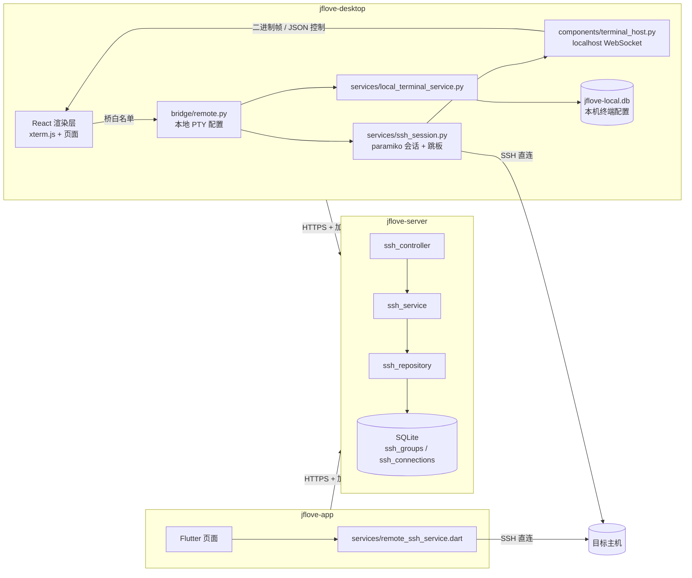

# JFLove v1.10.0 设计文档 —— 远程 SSH/SFTP 客户端与本机终端

> 版本：**1.10.0**｜阶段：Phase 2｜角色：designer
> 需求基线：`文档记录/需求文档/v1.10.0.md`（含 2 轮修订）
> 页面基线：`文档记录/需求文档/v1.10.0-页面原型.html`（桌面 3 页 + App 5 屏）
> 影响模块：`jflove-server`、`jflove-desktop`、`jflove-app`；**`jflove-web` 不参与**。
> 数据库：新增 2 张表（`ssh_groups`、`ssh_connections`），交付 `jflove-db/migrate-1.10.0.sql` + `rollback-1.10.0.sql`。
> 桌面端新增本地库 `jflove-local.db`（仅本机终端配置，**不参与服务端同步**）。

---

## 0. 设计摘要

| 项 | 结论 |
|---|---|
| 服务端职责 | 仅存储连接配置与分组（明文列，按 `user_id` 隔离），提供 CRUD；**不建立任何 SSH 连接、不做 TCP 转发** |
| 桌面端职责 | Python 侧用 `paramiko` 建 SSH/SFTP 会话（含任意级跳板），用本地 PTY 跑本机终端；渲染层只负责展示与输入 |
| App 职责 | `dartssh2` 直连，跳板用「本地端口转发 + 目标连 127.0.0.1」；页面与桌面端同构 |
| 终端数据通道 | **本机 `127.0.0.1` WebSocket**（Python 外壳 ↔ QtWebEngine 渲染层），与 SSH/SFTP 直连链路无关 |
| 凭据流向 | 服务端 → Python（`paramiko`）→ 内存；**私钥/密码原文不进入桌面渲染层**（编辑态用 `has_*` 标记） |
| 逐跳状态 | 客户端按 `jump_connection_id` 自行展开链路，建立过程通过桥事件逐跳上报 |
| 启动命令 | 连接/打开成功后由客户端写入 shell 并回车，终端回显，结束仍保持交互 |

---

## 1. 架构与模块划分



**边界**：SSH/SFTP 流量只走客户端 ↔ 目标主机；服务端只承载配置 CRUD（HTTP 加密信封）。

### 1.1 数据流澄清

| 流 | 走哪里 | 是否经过服务端 |
|---|---|---|
| 连接配置 / 分组 / 凭据读写 | 客户端 → 服务端（HTTPS + 加密信封） | ✅ **是，且只有这一条** |
| SSH 终端 / SFTP | 客户端 → 目标主机（`paramiko` / `dartssh2` 直连） | ❌ 否 |
| 跳板链路 | 客户端 → 跳板 → 目标（客户端自建 transport 链） | ❌ 否 |
| 终端显示（桌面端内部） | Python 外壳 ↔ 本机渲染层（`127.0.0.1` WebSocket） | ❌ 否，不出机器 |
| 本机终端 | 本地 PTY ↔ 渲染层（`127.0.0.1` WebSocket） | ❌ 否 |

> 第 4 行容易被误解为“终端流经过服务端”，实际它只是桌面端**同一台机器内** Python 与 WebView 之间的管道：
> 渲染层是 JS，拿不到 SSH/PTY 句柄，必须由 Python 侧读取后再喂给 xterm.js。

---

## 2. 服务端设计

### 2.1 数据表（DDL）

```sql
CREATE TABLE IF NOT EXISTS ssh_groups (
    id          INTEGER PRIMARY KEY AUTOINCREMENT,
    user_id     INTEGER NOT NULL,
    name        TEXT    NOT NULL,
    sort_order  INTEGER NOT NULL DEFAULT 0,
    created_at  TEXT    NOT NULL,
    updated_at  TEXT    NOT NULL,
    deleted_at  TEXT
);

CREATE TABLE IF NOT EXISTS ssh_connections (
    id                  INTEGER PRIMARY KEY AUTOINCREMENT,
    user_id             INTEGER NOT NULL,
    ssh_group_id        INTEGER NOT NULL DEFAULT 0,   -- 0 = 未分组
    name                TEXT    NOT NULL,
    host                TEXT    NOT NULL,
    port                INTEGER NOT NULL DEFAULT 22,
    username            TEXT    NOT NULL DEFAULT '',
    auth_type           TEXT    NOT NULL DEFAULT 'password',
    password            TEXT    NOT NULL DEFAULT '',
    private_key         TEXT    NOT NULL DEFAULT '',
    passphrase          TEXT    NOT NULL DEFAULT '',
    jump_connection_id  INTEGER NOT NULL DEFAULT 0,   -- 0 = 直连
    terminal_type       TEXT    NOT NULL DEFAULT 'xterm-256color',
    charset             TEXT    NOT NULL DEFAULT 'UTF-8',
    init_command        TEXT    NOT NULL DEFAULT '',
    host_key_fingerprint TEXT   NOT NULL DEFAULT '',
    last_connected_at   TEXT,
    created_at          TEXT    NOT NULL,
    updated_at          TEXT    NOT NULL,
    deleted_at          TEXT
);
```

索引（追加到 `database.py::_INDEXES`）：

```sql
CREATE INDEX IF NOT EXISTS ssh_groups_user_id_idx ON ssh_groups(user_id);
CREATE INDEX IF NOT EXISTS ssh_connections_user_id_idx ON ssh_connections(user_id);
CREATE INDEX IF NOT EXISTS ssh_connections_group_id_idx ON ssh_connections(ssh_group_id);
CREATE INDEX IF NOT EXISTS ssh_connections_jump_idx ON ssh_connections(jump_connection_id);
```

**约束口径**：
- 不做列级 `UNIQUE`（软删除会让已删名字永久占用，依据 `users` 的处理，见 `jflove-server/src/models/database.py:202-211`）。
- **分组重名**：服务层校验「同 `user_id` + `deleted_at IS NULL` 下不重名」，冲突返回 409；不建 DB 唯一索引。
- 连接名允许重复（同名不同主机是常见用法）。
- `auth_type` 枚举：`password` / `publickey` / `password_keyboard`。

### 2.2 仓储层 `ssh_repository.py`

| 方法 | 说明 |
|---|---|
| `list_groups(user_id)` | 活跃分组 + 每个分组的连接数 |
| `get_group(user_id, group_id)` | 归属校验由上层做 |
| `create_group / update_group / soft_delete_group` | 删除时把组内连接的 `ssh_group_id` 置 0 |
| `list_connections(user_id, keyword)` | 摘要字段，不含凭据 |
| `get_connection(user_id, id)` | 全量字段（含凭据），供客户端拉取 |
| `create_connection / update_connection / soft_delete_connection` | 更新时凭据字段为空串表示「不修改」 |
| `count_jump_references(user_id, id)` | 被引用数，用于删除拦截 |

### 2.3 服务层 `ssh_service.py`

- `validate_payload()`：端口 1–65535；`auth_type` 合法；`init_command` 不得含 `\n` / `\r`，长度 ≤ 1024；`name`/`host` 非空。
- `validate_jump_chain(user_id, connection_id, jump_id)`：向上走链，最多 16 跳；出现环 → `ValueError("跳板链路存在循环")`。
- `duplicate(user_id, id)`：复制除 `last_connected_at` 外的全字段，名称追加「副本」。
- 删除连接前 `count_jump_references > 0` → 409 `被 N 条连接引用为跳板`。

### 2.4 API 契约（全部 POST + 加密信封，`token` 在 body）

| # | 路径 | 请求字段 | 响应字段 | 错误 |
|---|---|---|---|---|
| 1 | `/api/v1/ssh/groups/list` | `token` | `groups: [{id, name, sort_order, connection_count}]` | 401 |
| 2 | `/api/v1/ssh/groups/create` | `token, name, sort_order?` | `id` | 400/409 |
| 3 | `/api/v1/ssh/groups/update` | `token, id, name?, sort_order?` | `ok` | 400/403/404/409 |
| 4 | `/api/v1/ssh/groups/delete` | `token, id` | `ok` | 403/404 |
| 5 | `/api/v1/ssh/connections/list` | `token, keyword?` | `connections: [摘要]` | 401 |
| 6 | `/api/v1/ssh/connections/get` | `token, id` | `connection: 全量` | 403/404 |
| 7 | `/api/v1/ssh/connections/create` | `token, 全量字段` | `id` | 400/409 |
| 8 | `/api/v1/ssh/connections/update` | `token, id, 字段…` | `ok` | 400/403/404 |
| 9 | `/api/v1/ssh/connections/delete` | `token, id` | `ok` | 403/404/409 |
| 10 | `/api/v1/ssh/connections/duplicate` | `token, id` | `id` | 403/404 |

**摘要字段**（列表）：`id, ssh_group_id, name, host, port, username, auth_type, jump_connection_id, has_password, has_private_key, last_connected_at, updated_at`。

**全量字段**（get / create / update）：摘要字段 + `password, private_key, passphrase, terminal_type, charset, init_command, host_key_fingerprint, created_at`。

**凭据更新语义**：`password` / `private_key` / `passphrase` 缺省或空串 = 不修改；显式 `clear_password: true` / `clear_private_key: true` 才清空。避免「编辑时看不到原文 → 保存把密码抹了」。

所有接口 `user_id` 来自 `token`，**禁止**从 body 取 `user_id`。

### 2.5 字段类型定义（响应/请求共用）

| 字段 | 类型 | 说明 |
|---|---|---|
| `id` | int | 自增主键 |
| `ssh_group_id` | int | 0 = 未分组 |
| `name` / `host` / `username` | string | 非空（username 允许空，部分机器允许匿名） |
| `port` | int | 1–65535 |
| `auth_type` | string | `password` / `publickey` / `password_keyboard` |
| `password` / `private_key` / `passphrase` | string | 仅 get/create/update 出现 |
| `has_password` / `has_private_key` | bool | 列表与 get 均返回 |
| `private_key_fingerprint` | string | SHA256，私钥存在时非空 |
| `jump_connection_id` | int | 0 = 直连 |
| `terminal_type` / `charset` | string | 默认 `xterm-256color` / `UTF-8` |
| `init_command` | string | 单行，≤1024，可空 |
| `host_key_fingerprint` | string | `SHA256:…`，空 = 未确认 |
| `last_connected_at` | string? | ISO8601，可空 |
| `created_at` / `updated_at` | string | ISO8601 |
| `ok` | bool | 写操作响应 |
| `groups` | array | `{id:int, name:string, sort_order:int, connection_count:int}` |
| `connections` | array | 摘要对象数组 |
| `connection` | object | 全量对象 |

---

## 3. 桌面端设计

### 3.1 Python 会话层 `services/ssh_session.py`

```
open_session(connection_row, callbacks) -> SshSession
  1. 解析跳板链：jump_connection_id 递归，最多 16 跳，环检测（客户端也要防）
  2. 逐跳建立 Transport：
       sock = socket.create_connection((host, port), timeout=15)
       transport = paramiko.Transport(sock)
       transport.start_client(timeout=15)
       verify_host_key(transport.get_remote_server_key(), row)  # 见 3.2
       authenticate(transport, row, interactive_handler)
  3. 最后一跳 open_session + get_pty(term, cols, rows) + invoke_shell()
  4. 后台线程读 chan.recv(4096) → 输出回调
```

- **认证**：
  - `password`：`transport.auth_password(username, password)`
  - `publickey`：`Ed25519Key/RSAKey/ECDSAKey.from_private_key(StringIO(pem), password=passphrase)`，依次尝试
  - `password_keyboard`：先 `auth_password`；若服务器要 challenge，`auth_interactive_dumb` + 回调弹窗（桌面端原生对话框或渲染层输入，走桥事件）
  - 认证顺序由 `auth_type` 决定，失败时抛出**可区分**的异常（`AuthFailedError` / `HostKeyMismatchError` / `JumpFailedError(index)`）
- **跳板**：`jump_transport.open_channel("direct-tcpip", (host, port), ("127.0.0.1", 0))`，把 channel 交给下一跳的 `Transport`。
- **断开**：`chan.close()` → `transport.close()` → 逆序关闭跳板。
- **超时**：连接 15s、认证 20s；超时转中文错误。
- **主线程约束**：所有阻塞操作在 bridge 工作线程执行；状态通过 `eventPushed` 推。

### 3.2 主机指纹

- 首次（`host_key_fingerprint` 为空）：取 `transport.get_remote_server_key()` 的 `SHA256:<base64>` 指纹，**暂停认证**，发事件 `remote.hostkey_ask {session_id, host, fingerprint}`，等渲染层确认（超时 30s 默认拒绝）。
- 已存在指纹：不匹配 → 拒绝连接，事件 `remote.hostkey_mismatch {expected, actual}`。
- 接受后由 Python 直接 `update_connection` 写回指纹（不经渲染层）。

### 3.3 本地终端 `services/local_terminal_service.py`

| 平台 | 实现 |
|---|---|
| Linux / macOS | `pty.openpty()` + `subprocess.Popen(shell, stdin=slave, stdout=slave, stderr=slave, preexec_fn=os.setsid)`；读 master fd 线程；`TIOCSWINSZ` 处理 resize |
| Windows | `pywinpty`（ConPTY）：`PTY(cols, rows)` + `spawn(cmdline, cwd, env)`；缺失依赖时本机终端入口禁用并提示，**不影响远程终端** |

Shell 探测：
- Windows：`pwsh.exe` > `powershell.exe` > `cmd.exe`；`wsl.exe -l -q` 有输出则追加 WSL 条目。
- Linux/macOS：读 `/etc/shells`，默认 `$SHELL`；`os.environ.get("SHELL")` 回退 `/bin/sh`。
- 探测结果通过 `local_term.detect_shells` 返回给渲染层。

启动命令：进程/通道就绪后 `write(init_command + "\n")`；Windows 下按 UTF-8 写入，PTY 编码统一 UTF-8（ConPTY 原生 UTF-8）。

### 3.4 终端数据通道 `components/terminal_host.py`

**协议：WebSocket**（`PySide6.QtWebSockets`，PySide6 自带）。

> 已实测：`jflove-desktop/venv-linux/bin/python -c "from PySide6.QtWebSockets import QWebSocketServer, QWebSocket; print('QtWebSockets OK')"`
> 输出 `QtWebSockets OK`（本机 Linux venv，2026-11-13）。Windows 端打包随 PySide6 一并进入，Phase 4 首日复验。

| 项 | 设计 |
|---|---|
| 监听 | `QWebSocketServer` 绑定 `127.0.0.1:0`（随机端口），只接受本机连接 |
| 路径 | `ws://127.0.0.1:{port}/term/{session_id}?token={32hex}` |
| 鉴权 | `newConnection` 时校验 token 与 session 绑定；不符立即 close |
| 下行 | **二进制帧**，内容即 PTY / SSH 输出的 UTF-8 原始字节；渲染层 `term.write(new Uint8Array(ev.data))` |
| 上行 | **文本帧 JSON**：`{"type":"input","data":"…"}` / `{"type":"resize","cols":120,"rows":32}` / `{"type":"close"}` |
| 保活 | 服务端每 20s ping；浏览器自动 pong；连续 2 次无 pong 判死并清理会话 |
| 背压 | `socket.bytesToWrite() > 512KB` 时暂停读通道（50ms 重试），防内存暴涨 |
| 编码 | UTF-8；Windows ConPTY 原生 UTF-8，无需转码 |

**为什么选 WebSocket**：终端流是「低延迟 + 双向 + 二进制 + 长连接」，业界标准做法就是 WebSocket（VS Code、ttyd、Gotty、code-server 同构），天然具备 ping/pong 保活、帧边界、二进制与背压。上一版设想的 `http.server` chunked + POST 输入属于自创写法（每键一次请求、无保活、无帧边界），**作废**。

**线程模型**：`QWebSocketServer` 在 GUI 线程；PTY / paramiko 读线程通过 `Signal(bytes)`（QueuedConnection）投递到 GUI 线程再 `sendBinaryMessage`；渲染层输入经 `textMessageReceived` 交给会话写线程。

### 3.5 桥接口（`src/bridge/remote.py`，登记进 `WHITELIST`）

| service.method | 参数 | 返回 |
|---|---|---|
| `remote.connections_list` | `{keyword?}` | `{connections: [...]}`（无凭据） |
| `remote.connections_get` | `{id}` | `{connection}`（无凭据原文，只有 `has_*` / 指纹） |
| `remote.connections_create` | 全量 | `{id}` |
| `remote.connections_update` | 全量 | `{ok}` |
| `remote.connections_delete` | `{id}` | `{ok}` |
| `remote.connections_duplicate` | `{id}` | `{id}` |
| `remote.groups_*` | 同服务端 | 同服务端 |
| `remote.session_open` | `{connection_id, cols, rows}` | `{session_id}`（异步建链） |
| `remote.session_close` | `{session_id}` | `{ok}` |
| `remote.hostkey_confirm` | `{session_id, accept}` | `{ok}` |
| `remote.sftp_list` | `{session_id, path}` | `{entries: [...]}` |
| `remote.sftp_mkdir/rename/delete` | `{session_id, ...}` | `{ok}` |
| `remote.sftp_download` | `{session_id, remote_path, local_path}` | `{transfer_id}` |
| `remote.sftp_upload` | `{session_id, local_path, remote_path}` | `{transfer_id}` |
| `remote.sftp_cancel` | `{transfer_id}` | `{ok}` |
| `local_term.detect_shells` | `{}` | `{shells: [...]}` |
| `local_term.profiles_list/create/update/delete` | … | … |
| `local_term.groups_list/create/update/delete` | … | … |
| `local_term.open` | `{profile_id?, cols, rows}` | `{session_id, port, token}` |

**事件（`eventPushed`）**：

| topic | payload |
|---|---|
| `remote.session_status` | `{session_id, phase: "jump_connecting"\|"jump_ready"\|"auth"\|"ready"\|"failed"\|"closed", jump_index, message}` |
| `remote.hostkey_ask` | `{session_id, host, fingerprint}` |
| `remote.sftp_progress` | `{transfer_id, bytes_done, bytes_total, speed_bps}` |
| `local_term.session_status` | `{session_id, phase, message}` |

**凭据红线**：`connections_get` 不返回 `password/private_key/passphrase` 原文，只返回 `has_password` / `has_private_key` / `private_key_fingerprint`（SHA256）；编辑保存时凭据字段为空表示不改。渲染层因此**永远拿不到私钥原文**。

### 3.6 渲染层

页面与组件：

```
ui/src/pages/remote/
  RemotePage.tsx          # D1：分组树 + 卡片 + 编辑抽屉
  SessionPage.tsx         # D2：会话树 + 标签栏 + 终端/SFTP 视图
  LocalTerminalPage.tsx   # D3：本机终端配置（本地库）
ui/src/components/remote/
  TerminalView.tsx        # xterm.js 封装（fit/search/复制粘贴/字号）
  SftpView.tsx            # 双栏 + 传输队列
  JumpChainBar.tsx        # 逐跳状态
ui/src/stores/remote-store.ts
ui/src/services/remote-service.ts   # 只走 callBridge
```

- 新增依赖：`@xterm/xterm`、`@xterm/addon-fit`、`@xterm/addon-search`。
- 路由：`/remote`、`/remote/session`、`/remote/local`（hash 路由，沿用现有）。
- 侧栏新增「远程连接」，图标加入 `IconName` 白名单。
- 终端标签状态机：`connecting → authenticating → ready → closed/failed`。
- 关闭标签：`session_close` → 后端断开 → 释放 HTTP 会话。
- 复制粘贴：`Ctrl+Shift+C/V`；粘贴多行弹确认（原生确认条，非 modal）。
- 启动命令：终端 ready 后 Python 自动写入；渲染层只显示。

### 3.7 本地库 `jflove-local.db`

路径：`LOCAL_STORAGE_DIR/jflove-local.db`（与 `mount_index.db` 同目录，见 `jflove-desktop/src/utils/mount_index.py:22`）。

```sql
CREATE TABLE IF NOT EXISTS local_terminal_groups (
    id INTEGER PRIMARY KEY AUTOINCREMENT,
    name TEXT NOT NULL,
    sort_order INTEGER NOT NULL DEFAULT 0,
    created_at TEXT NOT NULL,
    updated_at TEXT NOT NULL
);
CREATE TABLE IF NOT EXISTS local_terminal_profiles (
    id INTEGER PRIMARY KEY AUTOINCREMENT,
    group_id INTEGER NOT NULL DEFAULT 0,
    name TEXT NOT NULL,
    shell_kind TEXT NOT NULL,
    shell_path TEXT NOT NULL DEFAULT '',
    args TEXT NOT NULL DEFAULT '',
    cwd TEXT NOT NULL DEFAULT '',
    env_json TEXT NOT NULL DEFAULT '{}',
    init_command TEXT NOT NULL DEFAULT '',
    created_at TEXT NOT NULL,
    updated_at TEXT NOT NULL
);
```

本机终端不做软删除（无同步、无审计需求，直接物理删除）。

---

## 4. App 端设计

### 4.1 路由与导航

| 路由 | 页面 |
|---|---|
| `/remote` | 远程连接列表 |
| `/remote/edit` | 新建/编辑（`extra` 传 connection） |
| `/remote/terminal` | 终端（`extra` 传 connection + session 参数） |
| `/remote/sftp` | SFTP |

- 底部导航 6 项：`/files`、`/notes`、`/transfer`、`/remote`、`/album`、`/settings`。
- `/transfer` 页内三 Tab：传输中 / 离线下载 / 修复中心；`/offline` 保留为深链（从 Tab 内跳转），**不删除页面与能力**。
- 现有 `/repair` 深链继续保留（已并入传输页的既有做法）。

### 4.2 网络层 `services/remote_ssh_service.dart`

- 复用 `utils/http_service.dart`（`_buildPayload` 自动带 token、`_decryptEnvelope` 解密）。
- 新增 `lib/utils/ssh/`：
  - `ssh_session.dart`：`dartssh2` 客户端封装（密码 / 私钥 / keyboard-interactive）
  - `jump_chain.dart`：链路解析 + 环检测
  - `sftp_client.dart`：SFTP 操作 + 进度流
- 凭据展示：与桌面端一致（`has_*`），编辑时留空不改。

### 4.3 跳板实现（App）

`dartssh2` 无 `ProxyJump` 参数，采用**本地端口转发**：

1. 连跳板 A，`client.forward(remoteHost: "127.0.0.1", remotePort: 0?...)` —— 用框架提供的 `forward` 在本地起临时端口映射到目标；
2. 用 `SSHClient(host: "127.0.0.1", port: localPort)` 连目标；
3. 关闭时先关目标再关转发。

> **置信度：推断**。`dartssh2` 的 `forward` API 签名需在 Phase 4 做最小验证（命令：连本机 sshd 经跳板登录）。失败兜底方案：App 端 v1 只支持单级跳板，用 `SSHClient` 的自定义 `socket` 参数（若可用）替代。

### 4.4 终端渲染

- 新增依赖 `xterm`（Flutter 包，ANSI 解析 + 手势滚动）。
- 底部工具条补 `Ctrl/Alt/Tab/Esc/方向键/粘贴` 的转义序列。
- 启动命令、跳板链路在终端页顶部展示。

---

## 5. 逐接口安全标注（§9.7）

| 接口 | 明文白名单 | 鉴权 | 路径参数 | 归属校验 | 加密 | 备注 |
|---|---|---|---|---|---|---|
| `/ssh/groups/*` | 否 | body.token | 无 | `user_id` 过滤 | 信封 | 组名冲突 409 |
| `/ssh/connections/list` | 否 | body.token | 无 | `user_id` 过滤 | 信封 | 不返回凭据 |
| `/ssh/connections/get` | 否 | body.token | 无 | 记录 `user_id` 匹配否则 403 | 信封 | 返回凭据（客户端直连需要） |
| `/ssh/connections/create` | 否 | body.token | 无 | 强制写入 token 的 user_id | 信封 | 跳板环检测 |
| `/ssh/connections/update` | 否 | body.token | 无 | 同 get | 信封 | 空凭据=不改 |
| `/ssh/connections/delete` | 否 | body.token | 无 | 同 get | 信封 | 被引用 409 |
| `/ssh/connections/duplicate` | 否 | body.token | 无 | 同 get | 信封 | |

- 全部非文件流接口，无 `StreamingResponse`，符合 §9.5。
- 日志：`host`/`username` 可记，`password`/`private_key`/`passphrase` 一律不记；异常 message 不含凭据。
- 静态存储：按 D37 明文列（用户裁决），信任模型 = 服务端不可攻破。

---

## 6. 数据库迁移

### 6.1 `jflove-db/migrate-1.10.0.sql`

幂等；只建表与索引，不碰业务数据。

```sql
CREATE TABLE IF NOT EXISTS ssh_groups (
    id          INTEGER PRIMARY KEY AUTOINCREMENT,
    user_id     INTEGER NOT NULL,
    name        TEXT    NOT NULL,
    sort_order  INTEGER NOT NULL DEFAULT 0,
    created_at  TEXT    NOT NULL,
    updated_at  TEXT    NOT NULL,
    deleted_at  TEXT
);

CREATE TABLE IF NOT EXISTS ssh_connections (
    id                  INTEGER PRIMARY KEY AUTOINCREMENT,
    user_id             INTEGER NOT NULL,
    ssh_group_id        INTEGER NOT NULL DEFAULT 0,
    name                TEXT    NOT NULL,
    host                TEXT    NOT NULL,
    port                INTEGER NOT NULL DEFAULT 22,
    username            TEXT    NOT NULL DEFAULT '',
    auth_type           TEXT    NOT NULL DEFAULT 'password',
    password            TEXT    NOT NULL DEFAULT '',
    private_key         TEXT    NOT NULL DEFAULT '',
    passphrase          TEXT    NOT NULL DEFAULT '',
    jump_connection_id  INTEGER NOT NULL DEFAULT 0,
    terminal_type       TEXT    NOT NULL DEFAULT 'xterm-256color',
    charset             TEXT    NOT NULL DEFAULT 'UTF-8',
    init_command        TEXT    NOT NULL DEFAULT '',
    host_key_fingerprint TEXT   NOT NULL DEFAULT '',
    last_connected_at   TEXT,
    created_at          TEXT    NOT NULL,
    updated_at          TEXT    NOT NULL,
    deleted_at          TEXT
);

CREATE INDEX IF NOT EXISTS ssh_groups_user_id_idx ON ssh_groups(user_id);
CREATE INDEX IF NOT EXISTS ssh_connections_user_id_idx ON ssh_connections(user_id);
CREATE INDEX IF NOT EXISTS ssh_connections_group_id_idx ON ssh_connections(ssh_group_id);
CREATE INDEX IF NOT EXISTS ssh_connections_jump_idx ON ssh_connections(jump_connection_id);
```

### 6.2 `jflove-db/rollback-1.10.0.sql`

```sql
-- 回滚前检查：确认没有需要保留的数据（该表仅存连接配置）
-- SELECT COUNT(*) FROM ssh_connections;
DROP TABLE IF EXISTS ssh_connections;
DROP TABLE IF EXISTS ssh_groups;
```

### 6.3 代码侧

- `database.py`：新增 `_CREATE_SSH_GROUPS` / `_CREATE_SSH_CONNECTIONS`，加入 `expected_schema()`；索引加入 `_INDEXES`；`init_db()` 走既有建表循环。
- 发布前 `python scripts/check_db_schema.py` 必须退出码 0（`AGENTS.md §5.1.1`）。

---

## 7. 关键决策与最终裁决

| 决策点 | 最终方案 | 原因 | 影响 |
|---|---|---|---|
| 终端通道 | 本机 127.0.0.1 WebSocket（QtWebSockets） | 终端场景标准做法；PySide6 自带，零新依赖（已实测） | 需处理线程投递与背压 |
| 凭据进渲染层 | **不进**（`has_*` + 新值覆盖） | 宪法 §9.6「密钥不进渲染层」 | 编辑表单不显示原文 |
| 跳板链 | 客户端展开，服务端只校验环 | 服务端不建连 | 逐跳状态由客户端推 |
| 主机指纹 | 首连确认，指纹存服务端 | 防 MITM | 多一台设备首次也要确认 |
| App 底部导航 | 离线下载并入传输页 | 7 项挤压 | 需保留全部能力（AC-22） |
| App 跳板 | 本地端口转发 | dartssh2 无 ProxyJump | 需最小验证 |
| 本机终端 | 内嵌 PTY，配置存本地库 | 用户裁决 | Windows 需 pywinpty |

**禁止下游实现**：Web 端任何入口/代码；服务端 TCP 中继；客户端缓存远程凭据；明文静态加密方案（KEK/主口令）。

---

## 8. 测试设计（AC 映射）

| AC | 测试手段 |
|---|---|
| AC-1/2/3 | 服务端 pytest：CRUD、分组删除落 0、跨用户 403 |
| AC-4/5/6 | 桌面端集成：本机 sshd 双跳、三跳、环拒绝 |
| AC-7/8 | 终端：256 色截图、resize 后 `tput cols`、3 标签并发 |
| AC-9/10 | SFTP：100MB 上传进度、取消、终端/文件切换不重认证 |
| AC-11/12 | 本机终端：Win/Linux shell 探测、重启后配置仍在 |
| AC-13 | 停服后远程列表报错、本机终端可用 |
| AC-14 | 指纹变化拒绝（改 sshd host key 复现） |
| AC-15 | 伪造 ID 调 get/update/delete → 403 |
| AC-16 | 日志 grep `password`/`PRIVATE KEY` 无命中 |
| AC-19/20/21 | 启动命令回显、执行、换行拒绝 |
| AC-17 | App 底部导航 6 项且「远程」可进入列表 |
| AC-18 | Web 端无路由/入口/接口调用（grep `ssh` 无命中） |
| AC-22 | App 传输页内完成离线下载全流程 |
| AC-23 | 逐跳状态事件顺序断言 |

---

## 9. 与 v1.9.1 的设计差异

- 新增功能域「远程连接」，服务端 +2 表 +10 接口。
- 桌面端新增 3 个页面、桥新增 `remote` / `local_term` 两个 service。
- App 新增 4 路由、底部导航重排、传输页三 Tab。
- 新依赖：`paramiko`、`pywinpty`（win）、`@xterm/xterm`(+fit/search)、`dartssh2`、`xterm`。
- Web 端零改动。

---

## 10. 风险与遗留

| 风险 | 影响 | 处置 |
|---|---|---|
| `pywinpty` 在目标 Windows 安装失败 | 本机终端不可用 | 入口禁用并提示；远程终端不受影响（Phase 4 首日验证） |
| `dartssh2` 跳板 API 不符预期 | App 跳板不可用 | Phase 4 最小验证；失败降级单级/自定义 socket |
| `xterm` Flutter 包质量 | App 终端体验差 | Phase 4 对比自绘；必要时换 `xterm.dart` 分支 |
| SFTP 大目录一次性 readdir | 列表卡顿 | 前端虚拟滚动；>5000 项提示 |
| 终端输出洪峰 | 渲染层卡顿 / 内存 | WebSocket 背压：`bytesToWrite > 512KB` 暂停读；前端 16ms 批量 write |
| 跳板链超时叠加 | 连接慢 | 单跳 15s、总链路 45s 上限，失败指出具体跳 |
| 明文凭据存储 | 已被用户接受 | 仅保证不进日志、不进渲染层 |

---

## 11. 实施顺序（Phase 3~4）

1. 服务端：表 + 仓储 + 服务 + 控制器 + pytest。
2. 桌面端 Python：本地库 → 会话层 → 终端 HTTP 通道 → 桥。
3. 桌面端渲染层：页面 + xterm + SFTP。
4. App：网络层 → 列表/编辑 → 终端 → SFTP → 导航迁移。
