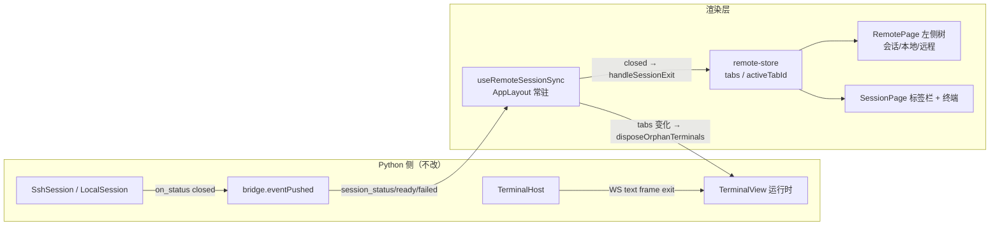

# JFLove v1.10.10 技术设计 —— 远程连接会话生命周期与左侧「会话」节点

> 版本：**1.10.10**｜阶段：Phase 2｜角色：designer
> 需求基线：`文档记录/需求文档/v1.10.10.md`
> 影响模块：**仅 `jflove-desktop/ui/`**（渲染层 + zustand store）；后端、数据库、Web 端、App 端**零改动**。

---

## 1. 方案总览

本版不新增接口、表结构或桥方法，只调整桌面端渲染层的三处**状态归属**：

1. **配置表单**：删除「分组」字段，提交载荷不再包含 `ssh_group_id`（更新时服务端按缺省保留原值）。
2. **会话生命周期**：把 `remote.session_*` / `local_term.session_*` 的订阅从 `SessionPage` 上移到
   **登录后常驻的同步层**，由 store 统一决定「自动关闭 / 保留失败标签」。
3. **导航入口**：`RemotePage` 左侧树新增置顶「会话」根节点，直接读写 store 的 `tabs` / `activeTabId`。



**单一真相**：会话是否已打开、状态如何，只由 `useRemoteStore.tabs` 决定；`SessionPage` 的标签栏与
`RemotePage` 的「会话」树都从同一个数组渲染，不各自维护副本。

## 2. Store 设计（`ui/src/stores/remote-store.ts`）

### 2.1 状态字段

| 字段 | 类型 | 变化 |
| --- | --- | --- |
| `tabs` | `SessionTab[]` | 保留；每项 `status: 'connecting' \| 'ready' \| 'failed' \| 'closed'` |
| `activeTabId` | `string \| null` | 保留 |
| `groups` | `RemoteGroup[]` | **删除**（不再拉取/展示分组） |

### 2.2 动作

| 动作 | 签名 | 语义 |
| --- | --- | --- |
| `handleSessionExit` | `(sessionId: string, message: string) => SessionTab \| null` | 标签存在且 `status === 'ready'` 时：从 `tabs` 移除、修正 `activeTabId`、异步 `remoteService.closeSession` 兜底回收，返回被关标签；否则返回 `null`（失败/连接中标签保留） |
| `markSessionReady` | `(sessionId: string) => void` | 仅当标签存在且 `status === 'connecting'` 时置 `ready`，用于终端首帧输出兜底 |
| `closeTab` | `(id: string) => Promise<void>` | 保留（手动关闭）；移除逻辑与 `handleSessionExit` 共用内部 helper |
| `openRemoteSession` / `openLocalSession` | 不变 | 建标签后仍处于 `connecting` |
| `setActiveTab` / `setTabView` / `patchTab` | 不变 | — |
| `groups` / `createGroup` / `deleteGroup` / `reopenTab` | **删除** | 分组入口已移除；自动关闭后不再需要「重开」入口 |

> 幂等性：同一 `closed` 事件重复到达时，第二次 `tabs.find` 为空 → 直接返回 `null`，不会重复 toast。

## 3. 常驻会话同步层（新增 `ui/src/utils/remote-session-sync.ts`）

### 3.1 挂载位置

`ui/src/layouts/AppLayout.tsx` 调用 `useRemoteSessionSync()`。`AppLayout` 在 `RequireAuth` 内、
由 react-router 常驻（路由切换不卸载），保证用户停留在文件/笔记/设置等页面时仍能收到会话结束事件。

### 3.2 订阅与处理

| 事件 | 处理 |
| --- | --- |
| `remote.session_status` | 更新 `jumpChain` / `message`；`phase === 'closed'` → `handleSessionExit(id, message)`，成功则 toast |
| `remote.session_ready` | `patchTab(id, { status: 'ready', message: '已连接' })` |
| `remote.session_failed` | `patchTab(id, { status: 'failed', message })`（**不关闭**） |
| `local_term.session_status` | `phase === 'ready'` → `markSessionReady`；`phase === 'closed'` → `handleSessionExit`，成功则 toast |
| `local_term.session_ready` | `patchTab(id, { status: 'ready', message: '已打开' })` |
| `local_term.session_failed` | `patchTab(id, { status: 'failed', message })`（**不关闭**） |

- 所有回调先按 `session_id` 查 `tabs`，查不到直接返回（会话可能已被手动关闭）。
- `useEffect` 返回统一退订；React 18 StrictMode 下重复挂载只保留一份有效订阅。
- toast 只在 `handleSessionExit` 返回非空时触发一次：标题「会话已结束：<标题>」，描述为结束原因。

### 3.3 终端运行时回收

```ts
useEffect(() => {
  let prev = useRemoteStore.getState().tabs;
  return useRemoteStore.subscribe((state) => {
    if (state.tabs === prev) return;
    prev = state.tabs;
    disposeOrphanTerminals(new Set(state.tabs.map((tab) => tab.id)));
  });
}, []);
```

- 用 `subscribe` 而非 selector，避免每次状态补丁引发 `AppLayout` 重渲染。
- `disposeOrphanTerminals` 幂等；`SessionPage` 内原来的回收 effect 删除，避免两处职责重叠。
- 用户从「会话」树关闭标签、自动关闭、或标签栏关闭，都走同一条回收路径。

## 4. 终端视图（`ui/src/components/remote/TerminalView.tsx`）

- 删除 `onExit` 回调链（`SessionPage` 不再需要维护 `exits` 状态与「已结束」横幅）。
- WS 文本帧 `{type:'exit'}` 仍更新本运行时 `ready = false` 并 `notifyStatus`，但**不负责**关标签；
  关标签只由常驻同步层的 `closed` 事件驱动（跨页面一致）。
- 首次收到二进制输出时调用 `useRemoteStore.getState().markSessionReady(sessionId)`：
  - 兜底 `remote.session_ready` 早于标签创建而丢失的竞态；
  - 只有真正有输出才算就绪，认证失败（无输出）不会被误标。
- `disposeTerminalSession` 仍由同步层调用，WS 关闭、看门狗、ResizeObserver 全部释放。

> 依赖方向：`TerminalView → remote-store`（单向），store 不 import 任何组件，无循环依赖。

## 5. 页面设计

### 5.1 `RemotePage` 左侧树

```text
┌ 会话  (2)                 ← 固定置顶，count = tabs.length
│  ● 家里 NAS        ×      ← 状态点 + 标题；悬停显示关闭
│  ○ 内网数据库      ×
├ 本地  (3)
│  PowerShell
│  ...
└ 远程  (5)
   家里 NAS
   ...
```

| 元素 | 规则 |
| --- | --- |
| 根节点 | 复用 `TreeRoot`，`count = tabs.length`，图标 `terminal`；顺序：会话 → 本地 → 远程 |
| 会话行 | 新组件 `TreeSession`：状态点（ready 绿 / connecting 黄 / failed 红）、标题、悬停「×」关闭 |
| 单击会话行 | `setActiveTab(tab.id)` + `navigate('/remote/session')` |
| 关闭按钮 | `void closeTab(tab.id)`；同步层随后回收运行时 |
| 空态 | 根节点下显示「暂无打开的会话」 |
| 本地/远程条目 | **不再过滤 `group_id`**，全部渲染；分组选择状态与相关过滤逻辑删除 |

### 5.2 表单

- `RemoteConnectionForm`：删除 `groups` prop、`groupId` state、「分组」`Field`、payload 的 `ssh_group_id`。
- `RemotePage.LocalForm`：删除 `groups` prop、`groupId` 字段、分组下拉。
- `LocalTerminalPage`（遗留页）：删除「本地分组」侧栏、`groups` 状态、分组下拉；路由保留。

### 5.3 `SessionPage`

- 删除 `exits` / `handleExit` / `handleReopen` / `reopenTab` / 「已结束」横幅。
- 删除会话事件的重复订阅（统一交给同步层），仅保留 `remote.hostkey_ask` / `remote.otp_ask` 的局部弹层。
- 标签状态点与工具条状态简化为：失败红 / 就绪绿 / 其余黄。
- 空态改为带「返回连接列表」按钮的 `EmptyState`。

## 6. 接口与数据

- **无新增/修改 REST 接口**，`api.request` 路径白名单不变。
- **无数据库变更**，无需 `migrate-1.10.10.sql` / `rollback-1.10.10.sql`。
- 已使用的桥方法（`remote.session_close`、`remote.connections_*`、`local_term.*`）均沿用现有白名单。

## 7. 安全标注（对照 `AGENTS.md §9.7`）

| 检查项 | 结论 |
| --- | --- |
| 新接口 / 路径参数 | 无；不扩大路径白名单 |
| 加密信封 | 无新请求，沿用 Python 侧既有加密通道 |
| 凭据边界 | 表单仍不读取密码/私钥原文；删除分组字段不涉及凭据 |
| session_key / JWT | 仍只在 Python；渲染层只拿会话 `session_id` 与本地 WS token |
| 日志 | 不新增含文件名/路径的日志；会话结束原因仅展示在 UI |
| 文件字节 | 不涉及 |

## 8. 失败模式与边界

| 场景 | 行为 |
| --- | --- |
| `closed` 事件重复到达 | 第二次查不到标签 → no-op，不重复 toast |
| 用户先手动关闭，`closed` 后到 | 同上，no-op |
| 认证失败 / 指纹拒绝 | `closed` 到达时 `status` 仍为 `connecting` → 保留；随后 `session_failed` 显示原因 |
| 会话就绪事件早于标签创建 | 终端首帧输出触发 `markSessionReady`，退出时仍能自动关闭 |
| 仅 SFTP 标签 | 无终端 WS；本次不新增 SFTP 心跳，掉线需手动关闭（已知边界） |
| 应用退出 | 会话与运行时随进程结束，无持久化 |

## 9. 验证设计（AC → 证据）

| AC | 验证手段 |
| --- | --- |
| AC-1/AC-2 | `grep` 三处表单源码无「分组」；vitest 源码约束用例 |
| AC-3 | 渲染 `RemotePage` 的树，构造 `group_id != 0` 条目仍出现（组件测试或实机） |
| AC-4/AC-5 | 实机 e2e：SSH 终端 `exit` → 标签数减 1、计数减 1、toast 出现；断链用例复用同一判据 |
| AC-6 | 实机：错误密码连接 → 标签保留且含失败文案 |
| AC-7/AC-8 | 实机：打开 2 个会话 → 回列表页 → 点「会话」行进入对应终端；悬停关闭计数减 1 |
| AC-9 | 无会话时树显示「暂无打开的会话」；会话页空态按钮可点 |
| AC-10 | 实机：会话就绪后切到文件页 → 在终端 `exit`（或杀远端）→ 回远程页确认标签已关 |
| AC-11 | `npm run lint/test/build` 退出码 0；desktop e2e 新增用例 PASS |

## 10. 设计差异（相对 v1.10.9）

| 项 | v1.10.9 | v1.10.10 |
| --- | --- | --- |
| 会话事件订阅 | `SessionPage` 局部 | `AppLayout` 常驻同步层 |
| 退出处理 | 保留标签 + 横幅 + 重开 | 就绪会话自动关闭 + toast；失败保留 |
| 左侧树 | 本地/远程（仅未分组） | 会话/本地/远程（全部条目） |
| 表单 | 含分组 | 无分组 |
| 终端运行时回收 | `SessionPage` effect | 常驻订阅（任意页面都回收） |
