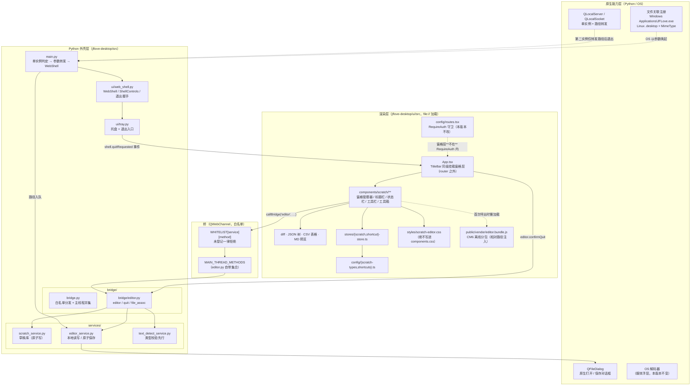
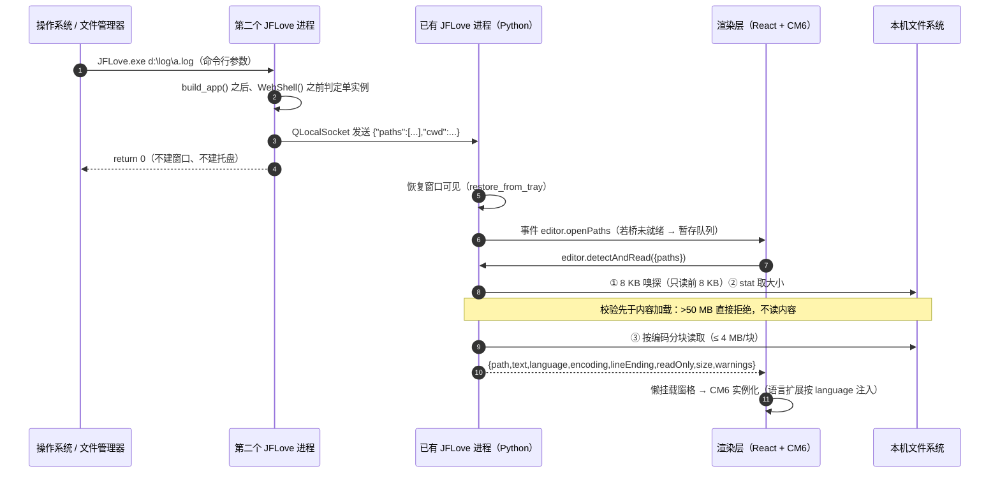
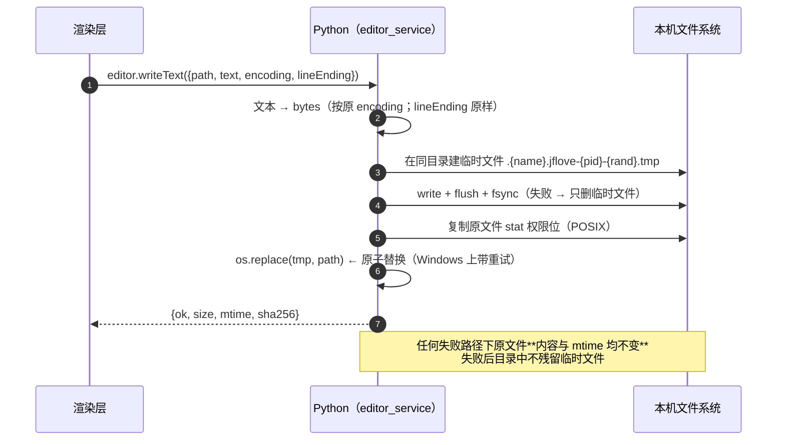
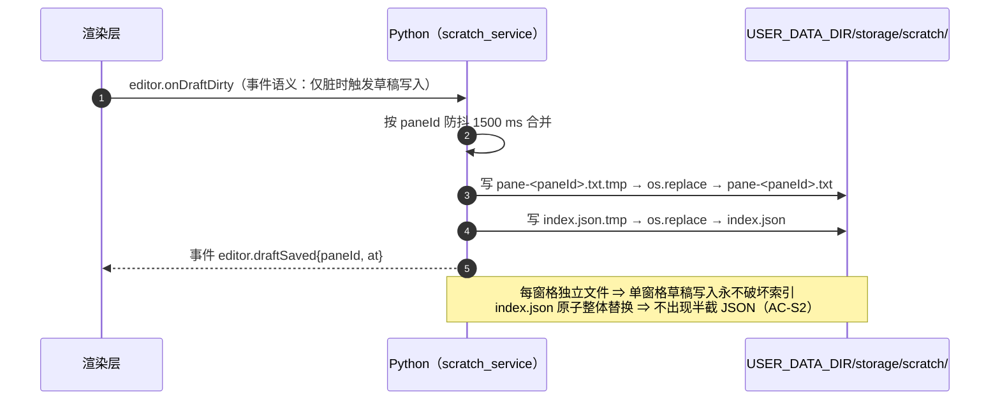
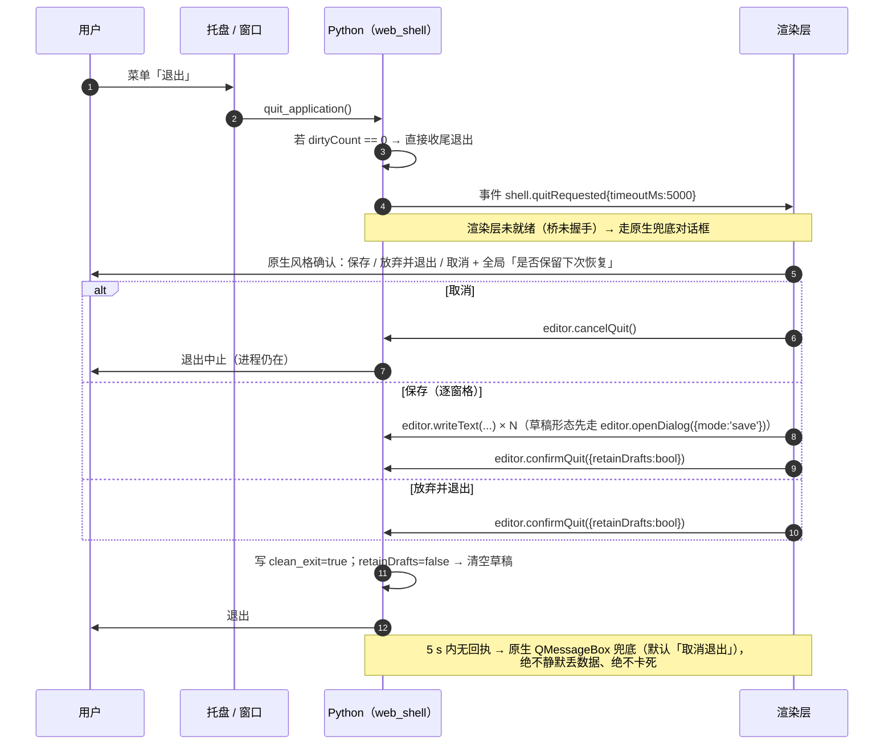
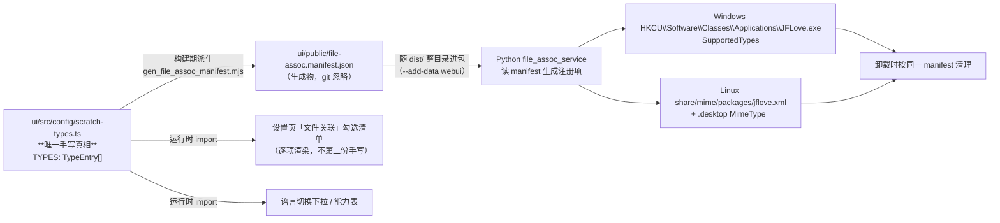
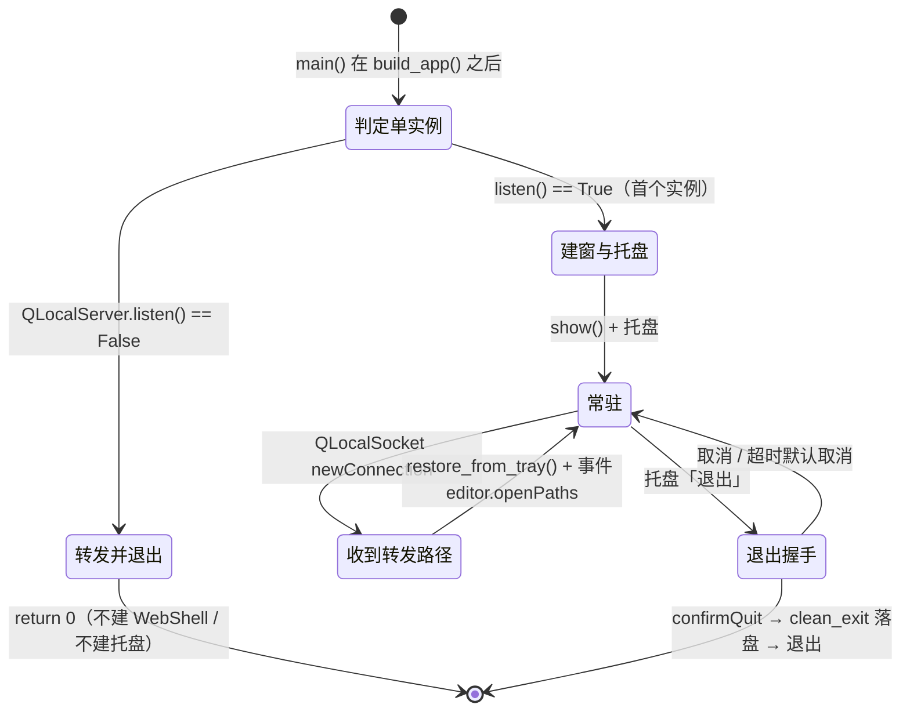

# JFLove v1.6.0 设计文档

> **基线**：`文档记录/需求文档/v1.6.0.md`（81 条 AC：主序列 AC-1 ~ AC-62、数据安全 AC-S1 ~ AC-S4、清债 AC-B1 ~ AC-B9、范围门禁 AC-R1 ~ AC-R6）。
> **上游计划**：`plans/desktop-scratch-editor-v1.6.0.md`（§5.1.1 前提纠正 P-1 ~ P-8、§6.4 新增落点、§12 BL-8、§14 取证清单）。
> **上一版设计**：`文档记录/设计文档/v1.5.1.md`（格式参考）。
> **编写角色**：designer（Phase 2，`AGENTS.md §7.3`）。
>
> **证据纪律**（`.agents/skills/designer/SKILL.md`）：本文档每条"现状结论"都标注**取证命令**、**原始输出片段**与**置信度**（`已实测（静态）` / `已实测（历史）` / `推断` / `待确认`）。下游角色使用前**必须自己复现一次**；复现结果与本文不符时**先改文档、再改代码**。

---

## 0. 版本对齐、范围与设计约束

### 0.1 范围与归属

| 模块 | 本版本动作 | 说明 |
|------|-----------|------|
| `jflove-desktop/` | **主范围**：文本编辑器（原生外壳 + `ui/` 前端工程 + 打包资产） | 功能新增 |
| `jflove-server/` | **仅清债**：`src/services/file_service.py`（BL-8）、`src/controllers/config_controller.py`（BL-2 描述文案）、**新建** `requirements-dev.txt`（BL-4） | 不新增路由、不新增路径参数 |
| `jflove-web/` | **仅清债**：`src/utils/http-client.ts`（BL-3）、`package.json`（BL-4 覆盖率工具） | 无功能改动 |
| `jflove-app/` | **零改动** | `git diff --name-only` 必须为空 |
| `.github/` | **零改动** | D16 未授权 |
| 数据库 | **无结构变更** | 见 §9 |

### 0.2 设计约束（不可违反，违反即门禁/宪法失败）

| 编号 | 约束 | 依据 |
|------|------|------|
| C-1 | `ui/src/styles/components.css` 与 `ui/src/pages/NoteEditPage.tsx` **逐字节不变**；编辑器样式一律进新建的 `ui/src/styles/scratch-editor.css` | `scripts/check_web_desktop_parity.py::PARITY_MANIFEST`（`:68-71`）；AC-R1 |
| C-2 | 渲染层（JS）**无网络出口**；一切后端通信只经白名单桥；`api.request` 白名单**不扩大**、会话密钥**不下发**渲染层 | `AGENTS.md §9.5/§9.6`；AC-R4 |
| C-3 | **编辑器与远端零交互**：不读写虚拟磁盘 / 文件管理 / 笔记数据 | 需求 D17 / R-4；AC-42 |
| C-4 | 不新增加密原语、不新增长期密钥 / 静态盐 / 写死对称密钥 | `AGENTS.md §9.5.17` |
| C-5 | 桥**未登记方法一律拒绝**；涉 `QFileDialog` 的方法必须登记进**所属子模块**的 `MAIN_THREAD_METHODS` | `bridge.py:338-343`；P-3；AC-36 |
| C-6 | 版本号唯一真相 = 仓库根 `version.json`；各模块常量**禁止手改** | `AGENTS.md §8`；AC-R3 |
| C-7 | 清债与编辑器**分主题提交**；BL-8 单独一个提交主题 | §4 边界纪律 1；AC-B6 |

### 0.3 需求 → 设计映射（速览）

| 需求节 | 承接设计节 |
|--------|-----------|
| F1 浮动窗格 | §4.1（窗格管理器）、§3.2（分层架构） |
| F2 快捷键体系 | §4.2（快捷键系统 + 默认键位表） |
| F3 块选择 | §6.1.2（CM6 集成：`rectangularSelection`） |
| F4 类型识别与差异化 | §5.3（类型表）、§5.2（类型校验器）、§6.1.1（CM6 语言包） |
| F5 工具箱 12 项 | §4.1.5（工具箱）、§6.1（CM6 / `sql-formatter` / `xml-formatter` / `MergeView`） |
| F6 保存与打开（纯本地） | §6.2（`editor_service`）、§6.3（草稿库）、§7.1（桥方法表） |
| F7 本地文件关联 | §4.3（设置页）、§5.1（清单单一真相）、§6.6（单实例）、§6.7（注册与打包） |
| F8 类型校验先行 | §5.2（`text_detect_service` 可执行判据） |
| F9 草稿与还原 | §6.3（草稿库）、§6.4（退出握手） |
| F10 状态栏 | §4.1.4 |
| BL-8 | §6.8（服务端覆盖写原子化） |
| 安全宪法 | §8（逐条标注） |

---

## 1. 现状取证（命令 + 原始输出 + 置信度）

> **取证环境**：本机仓库 `D:\github\jflove`，2026-10-12。除标注外全为**静态代码取证**。
> 本节的 **E1 ~ E9 直接采信自编排者已取证结论**（父代理指令「已取证的关键事实」），**E10 ~ E16 为本次设计自查补充**。

| # | 结论 | 取证方式 | 原始输出（片段） | 置信度 |
|---|------|---------|-----------------|--------|
| E1 | 桌面端**没有**任何单实例机制 | `grep QLocalServer\|QLocalSocket\|QSharedMemory\|QSystemSemaphore\|single_instance\|already_running` over `jflove-desktop/`；`git log -S "QLocalServer"` / `-S "QLocalSocket"` | **0 命中**；**0 个提交** | 已实测（静态 + 历史） |
| E2 | `main()` **无「检查已有实例」分支**，一路无条件 | 读 `src/main.py:78-135` | `build_app()`(:80) → `_migrate_legacy_data()`(:88) → `Bridge()`(:96) → `WebShell(...)`(:97) → `_shell.show()`(:133) → `app.exec()`(:135) | 已实测（静态） |
| E3 | **多开现状是真实缺陷** | 读 `tray.py` / `settings.py` / `logger.py` / `auth_service.py` | `tray.py:60` 每进程各建一个 `QSystemTrayIcon`（双托盘）；`settings.py:71` `LOG_DIR = USER_DATA_DIR/logs`、`logger.py:31-48` `RotatingFileHandler` 被两进程共同持有 ⇒ 互相截断 `app.log`；`auth_service.py:106-109` 临时文件名**固定**为 `_SESSION_FILE + ".tmp"` ⇒ 交错覆盖 | 已实测（静态） |
| E4 | **主窗口先于登录存在** ⇒ 窗格可无登录态显示，**Python 侧零改动** | 读 `main.py:97-101`、`main.py:133`、`web_shell.py`（全文无登录判定）、`ui/src/routes.tsx:41-49`、`ui/src/main.tsx:24-36` | `WebShell` 与 `_shell.show()` 无条件；登录守卫**纯在前端** `RequireAuth`（`routes.tsx:41-49`，`/` 包在其中 `:104-109`，未登录 → `Navigate to="/login"` `:46`）；`/login` 独立（`:96-102`）；`main.tsx:24-36` 先 `await bootstrap()` 再挂载 React，**桥不可用/未登录也照常渲染** | 已实测（静态） |
| E5 | `main.py` 共 139 行，**无 `argparse`** | 读全文 + grep | `sys.argv` 唯一消费点 = `web_shell.py:474` `QApplication(sys.argv)` | 已实测（静态） |
| E6 | 桥的 `MAIN_THREAD_METHODS` **分散在 3 个子模块**，`bridge.py` 求并集 | grep | `media.py:185`、`sync.py:184`、`transfer.py:151`；`bridge.py:359-363` `media \| sync \| transfer`；`files.py:17-21` 注释明确写「`bridge.MAIN_THREAD_METHODS` 这个名字**不存在**」 | 已实测（静态） |
| E7 | 桥白名单合并方式 = `**module.HANDLERS` | 读 `bridge.py:259-288` | `**files_bridge.HANDLERS`(:281)、`**media_bridge.HANDLERS`、`**sync_bridge.HANDLERS`、`**transfer_bridge.HANDLERS` | 已实测（静态） |
| E8 | 离线分包既有模式 = 「web 端点产出 → 桌面端复制 → 相对路径注入」 | 读 `build.py:303-332`、`:352`、`ui/src/utils/mermaid/loader.ts` | `ensure_mermaid_bundle()` 从 `jflove-web/public/vendor/` 复制到 `ui/public/vendor/`（缺失即 `fail()`）；`loader.ts:16` `const BUNDLE_URL = './vendor/mermaid.bundle.js'`（注释明写：绝对路径在 `file://` 下会解析到**文件系统根**）；`loader.ts:9` **构建期 import** `mermaid.version.json` | 已实测（静态） |
| E9 | 打包资产现状 | 读 `packaging/windows/jflove.iss`、`packaging/linux/*` | `.iss`：`AppId` :63、**`PrivilegesRequired=admin`** :87、`PrivilegesRequiredOverridesAllowed=dialog` :88、`CloseApplications=yes` :94、`[Tasks]` **仅** `desktopicon`(:109-111，`Flags: unchecked`)、`[Code]` :127-161 卸载问是否删用户数据；`.desktop`：`Exec=jflove` :10、`Icon=jflove` :11、`StartupWMClass=JFLove` :16、**无 `MimeType=`**；`.spec`：`%install` :69-97、`%files` :99-106、**`%post` :108-112 / `%postun` :114-116** 已有 `update-desktop-database` + `gtk-update-icon-cache` 钩子位；`jflove.wrapper:9` `exec /usr/lib/jflove/JFLove "$@"` ⇒ **参数天然透传**；`build_rpm.sh:200-209` 逐个 `cp` 资产进 `SOURCES` | 已实测（静态） |
| E10 | 桌面端 `ui/package.json` **无任何编辑器内核依赖**；Markdown 渲染栈已具备 | 读 `ui/package.json` | 依赖只有 `dompurify ^3.4.12` / `highlight.js ^11.11.0` / `lucide-react ^0.469.0` / `marked ^15.0.0` / `react` / `react-dom` / `react-router ^7.1.0` / `zustand ^5.0.0` | 已实测（静态） |
| E11 | 前端挂载点：`TitleBar` 与 `RouterProvider` **同级**，都在 `App.tsx` 内 | 读 `ui/src/App.tsx:65-74` | `<div className="flex h-screen flex-col …"><TitleBar />{/* 内容区 */}<div className="relative min-h-0 flex-1"><RouterProvider router={router} /></div><ToastHost /></div>` | 已实测（静态） |
| E12 | 设置页为多 `Section` 结构，可原地扩展 | 读 `ui/src/pages/SettingsPage.tsx` | `:29 export function SettingsPage()`；`:114 <PageHeader title="设置" />`；`:122/:166/:191/:236/:254` 各 `<Section title=…>`；`:387 function Section({icon,title,children})` | 已实测（静态） |
| E13 | `resolve_web_root()` 冻结态从解包目录的 `webui/` 取首页 ⇒ `dist/` 整目录（含 `vendor/`）已随包分发 | 读 `build.py:391,399` | `--add-data "{UI_DIST_DIR}{sep}webui"`；`build.py:74-75` 注释「打包时放进解包目录的 `webui/`，与 `web_shell.resolve_web_root()` 约定一致」 | 已实测（静态） |
| E14 | 桌面端 Python 运行时依赖只有 4 项，**无任何字符集探测库** | 读 `jflove-desktop/requirements.txt` | `PySide6==6.11.0` / `requests==2.33.1` / `cryptography==47.0.0` / `pyinstaller==6.20.0` | 已实测（静态） |
| E15 | 后端 `complete_upload` 确为「先截断再写 + 校验失败即删目标文件」 | 读 `jflove-server/src/services/file_service.py:247-296` | `:270 async with aiofiles.open(dest_file, "wb") as out:`（**目标文件原位置直接截断**）；`:280 os.remove(dest_file)`；`:285-290` `os.utime` 还原 mtime 在**校验之后** | 已实测（静态） |
| E16 | 跨端门禁清单**只有 2 个文件** | 读 `scripts/check_web_desktop_parity.py:68-71` | `PARITY_MANIFEST = ("src/pages/NoteEditPage.tsx", "src/styles/components.css")` ⇒ 新增 `scratch-editor.css` / `components/scratch/**` **不触发门禁**，但**也不受门禁保护** | 已实测（静态） |

### 1.1 本次取证新发现的**文档失实**（登记项，必须更正）

| # | 位置 | 失实内容 | 实测真相 | 处置 |
|---|------|---------|---------|------|
| **E17** | `文档记录/设计文档/v1.5.0.md:1464` | 声称「**单实例实测**（第二个实例退出并唤起第一个）」 | 与代码不符：全仓 `QLocalServer`/`QLocalSocket`/`QSharedMemory` **0 命中**、`git log -S` **0 提交**；`v1.1.1` 的「单实例」是**进程内** `LoginWindow`↔`MainWindow` 切换（`设计文档/v1.1.1.md:159-163`），**非跨进程** | 历史快照**保留原文 + 追加更正**（`LESSONS.md L21`）：跨进程单实例**直到 v1.6.0 才由本设计补齐**，实现落点见 §6.6 |
| **E18** | `plans/desktop-scratch-editor-v1.6.0.md`（P-6 结论） | 称 `build_mermaid_bundle.mjs` 输出到 `jflove-desktop/resources/mermaid/` 与 `jflove-app/assets/mermaid/` | 该 desktop 目标**已被本次清理删除**（该目录**历史上从未存在**，与 P-8 的「已删除 vs 从未存在」同一类措辞问题） | 设计据此确定 CM6 分包落点**只走**「`jflove-web/public/vendor/` → 桌面端复制」一条路（§6.1.1），**不再引用任何 `jflove-desktop/resources/**` 路径** |

---

## 2. 系统架构

### 2.1 分层架构



**关键分层判据（可 grep 验证）**

| 判据 | 命令 | 期望 |
|------|------|------|
| 渲染层无直连后端 | `grep -rn "api/v1" jflove-desktop/ui/src` | **0 命中**（AC-R4 ④） |
| 渲染层无编辑器远端调用 | `grep -rniE "notes\|upload\|preview\|disks" jflove-desktop/ui/src/components/scratch jflove-desktop/ui/src/stores/scratch-store.ts` | **0 命中**（AC-42 ①） |
| 无全局热键注册 | `grep -rniE "QHotkey\|RegisterHotKey\|globalShortcut" jflove-desktop` | **0 命中**（AC-8） |
| 窗格层不在守卫内 | 人工核对 `App.tsx`：`<ScratchPaneLayer />` 与 `<TitleBar />` 同级、在 `<RouterProvider>` **之外** | 成立（AC-47） |

### 2.2 关键数据流









### 2.3 边界声明（架构级）

1. **渲染层无网络出口**：`WebShell._harden_settings` 已设 `LocalContentCanAccessRemoteUrls=false`（`web_shell.py:350-352`），页面由 `file://` 加载，且 JS 内 `/api/v1/` **0 命中**。本版本**不放松**该设置。
2. **本次零远端**：编辑器不打任何 `/api/v1/*`；`api.request` 白名单**未扩大**（`api_gateway.py:56` 的 `SESSION_MANAGED_PATHS` 与路径前缀白名单均不动）。
3. **"文本进渲染层"是有意为之的边界例外**（R-5），论证见 §8.2。
4. **窗格层挂在 router 之外**：与 `TitleBar` 同级（`App.tsx:67`），因此**未登录时也能显示与操作**（AC-47），不受 `RequireAuth` 影响。

---

## 3. 模块划分总览

### 3.1 新增 / 改动文件清单（Phase 4a 的施工边界）

| # | 文件 | 动作 | 说明 |
|---|------|------|------|
| 1 | `jflove-desktop/src/utils/single_instance.py` | **新增** | `QLocalServer` 单实例服务端 + `QLocalSocket` 客户端转发 |
| 2 | `jflove-desktop/src/services/text_detect_service.py` | **新增** | 类型校验先行：扩展名白名单 → 8 KB 嗅探 → 大小阈值 → 编码判定 |
| 3 | `jflove-desktop/src/services/editor_service.py` | **新增** | 本地文件读写、原子保存、原生对话框编排 |
| 4 | `jflove-desktop/src/services/scratch_service.py` | **新增** | 草稿库（index.json + 每窗格独立内容文件，原子写）、干净退出标记、启动还原 |
| 5 | `jflove-desktop/src/bridge/editor.py` | **新增** | 桥命名空间 `editor` / `quit` / `file_assoc` + **自带 `MAIN_THREAD_METHODS`** |
| 6 | `jflove-desktop/src/bridge/bridge.py` | 改 | 合并 `**editor_bridge.HANDLERS` + 并集加入 `editor_bridge.MAIN_THREAD_METHODS` |
| 7 | `jflove-desktop/src/main.py` | 改 | `build_app()` 之后、`Bridge()` 之前插入单实例判定与参数解析；`editor_bridge.set_main_window(_shell)` |
| 8 | `jflove-desktop/src/ui/web_shell.py` | 改 | ① 退出握手（`request_quit()`）；② 禁用 WebEngine 默认动作（打印 / 另存为 / 打开 / 打印预览）；③ `notify_external_paths()` 推送入口 |
| 9 | `jflove-desktop/src/ui/tray.py` | 改 | 「退出」菜单改走 `request_quit()` 握手路径 |
| 10 | `jflove-desktop/src/config/settings.py` | 改 | 新增 `SCRATCH_DIR` / 编辑器常量（**不动 `APP_VERSION` 字段**） |
| 11 | `jflove-desktop/ui/src/components/scratch/**` | **新增目录** | §4.1 各组件 |
| 12 | `jflove-desktop/ui/src/stores/scratch-store.ts` | **新增** | 窗格列表 / 几何 / 层级 / 脏标记 / 目标路径 / 草稿还原 |
| 13 | `jflove-desktop/ui/src/stores/shortcut-store.ts` | **新增** | 键位映射 + 冲突检测 + 持久化 |
| 14 | `jflove-desktop/ui/src/config/scratch-types.ts` | **新增** | **类型表唯一真相**（§5.3），供 F4 / F7 清单 / 校验器展示共用 |
| 15 | `jflove-desktop/ui/src/config/shortcuts.ts` | **新增** | 默认键位表 + 中文说明（§4.2） |
| 16 | `jflove-desktop/ui/src/services/scratch-service.ts` | **新增** | 桥调用封装（唯一出口） |
| 17 | `jflove-desktop/ui/src/utils/scratch/open-paths-queue.ts` | **新增** | 启动期「打开文件」事件待处理队列（§7.5） |
| 18 | `jflove-desktop/ui/src/styles/scratch-editor.css` | **新增** | 全部编辑器样式（**绝不写进 `components.css`**） |
| 19 | `jflove-desktop/ui/src/App.tsx` | 改 | 挂载 `<ScratchPaneLayer />`（`TitleBar` 同级、router 之外）+ 退出确认 |
| 20 | `jflove-desktop/ui/src/pages/SettingsPage.tsx` | 改 | 新增 `<Section title="文本编辑器">`（快捷键入口 / 文件关联 / 草稿） |
| 21 | `jflove-desktop/ui/src/types/codemirror-bundle.d.ts` | **新增** | `window.__JFLOVE_CM__` 与 `window.cmModules` 的类型声明（**手写，不引 npm 依赖**） |
| 22 | `jflove-desktop/scripts/build-codemirror-bundle.mjs` | **新增（本地脚本）** | 产出 CM6 离线分包到 `ui/public/vendor/`（§6.1.1） |
| 23 | `jflove-desktop/scripts/gen_file_assoc_manifest.mjs` | **新增（本地脚本）** | 从 `scratch-types.ts` 派生 `file-assoc.manifest.json`（§5.1） |
| 24 | `jflove-desktop/build.py` | 改 | 新增 `ensure_editor_bundle()`（照 `ensure_mermaid_bundle()` 模式）+ 打包前派生关联清单 |
| 25 | `jflove-desktop/packaging/windows/jflove.iss` | 改 | 新增 `[Registry]` 段 + `[Code]` 卸载清理 |
| 26 | `jflove-desktop/packaging/linux/jflove.desktop` | 改 | 补 `MimeType=` 行 |
| 27 | `jflove-desktop/packaging/linux/jflove-desktop.spec` | 改 | `%install` 装 `.xml`、`%files` 登记、`%post`/`%postun` 加 `update-mime-database` |
| 28 | `jflove-desktop/packaging/linux/build_rpm.sh` | 改 | `:200-209` 处新增 `cp` 共享 MIME 包 |
| 29 | `jflove-server/src/services/file_service.py` | 改 | **BL-8**：`complete_upload` 临时文件 + `os.replace()` |
| 30 | `jflove-server/src/controllers/config_controller.py` | 改 | **BL-2**：OpenAPI description 改「键值对映射」（行为不变） |
| 31 | `jflove-server/requirements-dev.txt` | **新建** | **BL-4**：`pytest-cov`（**不入运行时 `requirements.txt`**） |
| 32 | `jflove-web/src/utils/http-client.ts` | 改 | **BL-3**：解密失败 → `ApiError(502)`，文案含「解密失败」、不含 `nonce`/`ciphertext` |
| 33 | `jflove-web/package.json` | 改 | **BL-4**：`@vitest/coverage-v8` + `test:coverage` 脚本 |
| 34 | 两份 `src/styles/tokens.css:4` + `文档记录/设计文档/v1.5.0.md` + `BACKLOG.md` | 改（注释 / 文档） | **BL-1**：只纠正文档指向，两端 `tokens.css` 保持逐字节一致 |
| 35 | `jflove-desktop/README.md` + `文档记录/桌面端开发记录/v1.6.0.md` | 改 / 新增 | **BL-5**：显式记录「文档要求 3.14+ / 本地实测 3.13.14 且用例全绿 / 不升级环境」 |

> **明确不改**：`ui/src/styles/components.css`、`ui/src/pages/NoteEditPage.tsx`（跨端门禁）、`ui/src/config/routes.tsx`（窗格层在 router 之外，无需改路由）、`jflove-app/**`、`.github/**`。

### 3.2 依赖方向（单向，无环）

```
components/scratch/**  →  stores/{scratch,shortcut}-store.ts  →  services/scratch-service.ts  →  utils/desktop-bridge.ts
                                              ↘  config/{scratch-types,shortcuts}.ts（纯数据，无副作用）
config/scratch-types.ts  ←（构建期派生）←  scripts/gen_file_assoc_manifest.mjs

bridge/editor.py  →  services/{editor,scratch,text_detect}_service.py  →  utils/{single_instance,logger}.py
bridge/editor.py  →  （只读）config/settings.py
ui/web_shell.py   →  bridge.publish_event（事件推送，单向）
```

**禁止**：`services/**` 反向 import `bridge/**`（`files.py:46-50` 的 `_publish` 用**惰性导入**规避循环依赖，本版本沿用同一手法）；渲染层直连 `http_client`。

<!-- §3 / §4 结束 -->

---

## 4. 模块设计

### 4.1 前端：`components/scratch/**`（窗格与视图）

#### 4.1.1 组件树

| 组件（建议路径） | 职责 | 关键 props / 依赖 |
|-----------------|------|------------------|
| `ScratchPaneLayer.tsx` | **浮动层根**：`position:absolute; inset:0; pointer-events:none`；内部按 zIndex 渲染所有窗格；提供「平铺 / 层叠」工具条 | 挂在 `App.tsx:67` `TitleBar` 同级（router 之外） |
| `ScratchPane.tsx` | 单个窗格外壳：拖动（标题栏 mouse 事件）/ 缩放（8 向 handle）/ 最小化 / 最大化还原 / 关闭（脏则询问） | `pane` 状态来自 `scratch-store`；**内容区懒挂载** |
| `ScratchPaneTitleBar.tsx` | 标题、脏标记、目标文件名、最小化 / 最大化 / 关闭按钮 | `pane.title`/`pane.dirty`/`pane.path` |
| `ScratchPaneStatusBar.tsx` | F10 全字段：`行:列` / 选中字符数 / 总字符数（含换行符）/ 编码 / 换行符 / 语言 / 只读标记 / 脏标记 | 由 CM6 的 `updateListener` + `EditorState.selection` 驱动 |
| `ScratchPaneToolbar.tsx` | 语言手动切换下拉、视图模式（编辑 / 预览 / 分屏 / 表格 / 树形）、保存 / 另存为 / 打开、字号 / 行号 / 自动换行开关 | `config/scratch-types.ts` 的 `CAPABILITIES` |
| `ScratchToolboxMenu.tsx` | F5 **12 项**工具箱 | 纯函数实现放在 `utils/scratch/transform/*.ts`，UI 只做派发 |
| `ScratchEditorHost.tsx` | **CM6 实例宿主**（懒挂载点）；`EditorView` 生命周期、keymap 桥接、`Prec.high` 顺序 | 首次可见时才 `loadEditorBundle()` |
| `views/DiffView.tsx` | 两段文本对比（`@codemirror/merge` 的 `MergeView`） | 第二段来源三选一：剪贴板 / 另一窗格 / 本地文件（`editor.readTextOnly`） |
| `views/JsonTreeView.tsx` | JSON 树（**只读**，可折叠） | 解析失败只提示，**不改原文** |
| `views/CsvTableView.tsx` | CSV / TSV 表格（**只读**，不回写） | 分隔符识别；`\t` / `,` |
| `views/MarkdownPreview.tsx` | Markdown 预览（复用既有 `marked` + `highlight.js` + `dompurify`） | 与 `NoteEditPage` 同栈，但**不 import 它**（避免触碰门禁文件） |

> **为什么视图组件不复用 `NoteEditPage.tsx` 内部实现**：该文件在 `PARITY_MANIFEST` 内（`check_web_desktop_parity.py:69`），**任何改动（含导出内部函数）都会破门禁**。因此 Markdown 预览**重新写一个薄封装**，只复用 npm 包（`marked` / `highlight.js` / `dompurify`），不 import 门禁文件。

#### 4.1.2 窗格状态模型（`scratch-store.ts`）

```ts
/** 单个编辑窗格的完整状态（草稿持久化的字段与之对齐） */
interface ScratchPane {
  id: string;                 // crypto.randomUUID()，同时是草稿文件名
  title: string;              // 显示名：文件名 或「未命名」
  path: string | null;        // 本地目标绝对路径；null = 草稿形态
  language: string;           // 语言 id（见 §5.3 TYPES 表），可手动切换
  detected: string;           // 识别出的语言（切换后仍保留原识别值，供「恢复自动」）
  viewMode: 'edit' | 'preview' | 'split' | 'table' | 'tree';
  encoding: TextEncoding;     // 'utf-8' | 'utf-8-bom' | 'gbk' | 'utf-16le' | 'utf-16be'
  lineEnding: 'lf' | 'crlf';
  readOnly: boolean;          // F8 阈值降级 / .diff 类只读
  dirty: boolean;
  geometry: { x: number; y: number; w: number; h: number; z: number; min: boolean; maxed: boolean };
  caret: { line: number; col: number };   // 1 基，用于还原
  scrollTop: number;
  fontSize: number;
  showLineNumbers: boolean;
  wordWrap: boolean;
  mounted: boolean;           // 懒挂载标记：false = 只登记不建 CM6 实例
}
```

**公开 action（供 UI 与快捷键调用）**

| action | 语义 |
|--------|------|
| `createPane(init?)` | 新建窗格（快捷键 / 打开文件 / 命令行路径入口统一走它） |
| `closePane(id)` | 关闭；`dirty` 时由调用方先弹询问 |
| `focusPane(id)` | 置顶：`z = ++zCounter`（层叠顺序可读） |
| `movePane(id, dx, dy)` / `resizePane(id, w, h)` | 几何更新（含最小尺寸钳制） |
| `toggleMinimize(id)` / `toggleMaximize(id)` | 最小化 / 最大化还原（记录还原前几何） |
| `tileAll()` / `cascadeAll()` | 平铺（互不重叠铺满可视区）/ 层叠（固定偏移 24 px 递增） |
| `setLanguage(id, lang)` | 手动切语言（F4.2） |
| `setViewMode(id, mode)` | 视图切换（能力表校验，不可用则不动） |
| `markDirty(id, dirty)` | 脏标记（同时驱动草稿防抖与 Python 侧 `dirtyCount`） |
| `hydrateFromDrafts(entries)` | 启动还原：**只登记状态，`mounted` 保持 false** |
| `setFontSize` / `toggleLineNumbers` / `toggleWordWrap` | F5.12 |

#### 4.1.3 懒挂载（化解「不限数量自动还原」的启动压力）

- `hydrateFromDrafts()` 阶段**不创建 CM6 实例**，只把 `ScratchPane` 放进 store，并渲染标题栏 + 状态栏骨架。
- `ScratchEditorHost` 的 `useEffect` 在**两种条件下**才 `await loadEditorBundle()` 并建实例：① 窗格矩形与视口相交（`IntersectionObserver`）；② 窗格被激活（获得焦点）。
- **不可见的窗格**（最小化 / 被完全遮挡 / 视口外）保持未挂载，内存占用为「一个 React 空壳」。
- **判据（AC-60 量化）**：10 个有内容窗格全部还原时，只有当前激活的 1 个建实例；切换窗格时才递增 → 首个还原窗格可见时间 ≤ 1.5 s（NFR 首次呼出目标）。

#### 4.1.4 状态栏口径（F10 / AC-62）

| 字段 | 计算方式（必须逐字实现） |
|------|------------------------|
| `行:列` | 1 基。列 = 光标所在字符位于该行的第几个**字符**（按码点，不按 UTF-16 code unit） |
| 选中字符数 | `[...selectedText].length`（无选中 = 0） |
| 总字符数 | `[...doc.toString()].length` —— **含换行符**（`"abc\nDE"` = **6**，U-14 定稿）；文案注明「含换行符」 |
| 编码 | `pane.encoding` |
| 换行符 | `pane.lineEnding`（LF / CRLF） |
| 语言 | `pane.language`（手动切换后随之变化） |
| 只读标记 | `pane.readOnly === true` 时显示 |
| 脏标记 | `pane.dirty` |

#### 4.1.5 快捷键系统 → §4.2（独立小节，含完整默认键位表）

#### 4.1.6 工具箱 12 项（F5）——名称与口径（**恰好 12 项**，AC-23）

| # | 名称 | 实现落点 | 关键口径 |
|---|------|---------|---------|
| 1 | 查找 / 替换 / 跳转行 | CM6 `@codemirror/search`（`search` / `openSearchPanel`）+ 自绘面板 | 支持正则匹配与正则替换；跳转行按 1 基行号 |
| 2 | 行操作（排序 / 去重 / 去空行 / 去首尾空格） | `utils/scratch/transform/lines.ts` | 以 `split('\n')` 的**行数组**为输入，`join('\n')` 输出，**不额外补末尾换行**；排序 = Unicode 码点升序、**大小写敏感、与 locale 无关**（`a < b` 逐码点比较）；去重 = 完全相等保留首次；去空行 = 仅删 `''`（**全空白行不算空行**）；去首尾空格 = 每行 `trim()`（含 `\t`） |
| 3 | 大小写转换（大写 / 小写 / 驼峰 / 下划线） | `transform/case.ts` | 分隔符集合 = 空白符 / `_` / `-` / `.`；驼峰 = 切分后首词全小写、其余词首字母大写拼接；下划线 = 切分后全小写 + `_` 连接 |
| 4 | 转义 / 反转义（JSON / HTML / URL） | `transform/escape.ts` | JSON：`"`→`\"`、`\`→`\\`、换行→`\n`（**不含外层引号**）；HTML：`& < > "`；URL：保留 `A-Za-z0-9-_.!~*'()`，其余按 UTF-8 百分号编码 |
| 5 | Base64 编解码 | `transform/base64.ts` | UTF-8 往返（`TextEncoder`/`TextDecoder`，**不用 `btoa` 直接吃字符串**） |
| 6 | JSON 树 + 格式化 + 压缩 | `views/JsonTreeView.tsx` + `transform/json.ts` | 格式化缩进 **2 空格**；压缩去结构外空白；**非法 JSON 只提示错误、原文逐字符不变** |
| 7 | Markdown 编辑 / 预览 / 分屏 | `views/MarkdownPreview.tsx` | 复用 `marked` + `highlight.js` + `dompurify` |
| 8 | CSV / TSV 表格视图切换 | `views/CsvTableView.tsx` | 识别 `,` 与 `\t`；列对齐；**只读、不回写** |
| 9 | SQL 美化（可配置） | `transform/sql.ts` + `sql-formatter` | 至少可配 **方言 / 关键字大小写 / 缩进宽度** 三项，改配置**即时生效**（重跑格式化） |
| 10 | XML 格式化 / 压缩 | `transform/xml.ts` + `xml-formatter`（**格式化**）+ **自研安全压缩** | ⚠ **R-6 已实测**：`xml-formatter` **保留注释与 CDATA ✅**，但**压缩不达标** —— ① 会吃掉"元素唯一内容为纯空白文本"（`<a> </a>` → `<a></a>`）；② `minify` + `collapseContent` 在**多行输入**下会**粘词**（`This is <b>some</b> content.` → `This is<b>some</b>content.`）。⇒ **压缩改为自研**（原型 `poc/editor-probes/xml-safe-minify.mjs`，9/9 用例正确）；格式化参数见下方「R-6 实测参数」 |
| 11 | 两段文本对比（diff） | `views/DiffView.tsx` + `@codemirror/merge` 的 `MergeView` | 行级；第二段来源三选一（剪贴板 / 另一窗格 / 本地文件） |
| 12 | 字号缩放 + 行号 / 自动换行开关 | `ScratchPaneToolbar.tsx` | `Ctrl` + 滚轮缩放字号；行号、自动换行可控 |

> **禁止项**：界面与文档中**不得出现**「时间戳 ↔ 日期互转」（D10 / AC-23 的 0 命中判据）。
>
> **✅ R-6 已实测（2026-10-12）**，参数定稿如下（证据：`jflove-desktop/poc/editor-probes/R6-结论.md` + `r6-out/` 172 份输入输出原文）：
> - **XML 格式化**：`{indentation:'  ', lineSeparator:'\n', attributeQuotes:'double', collapseContent:true, strictMode:true, throwOnFailure:true}` + **调用方补回 BOM**（该库会丢弃 BOM）。注意：**单引号属性会被改写为双引号**；**非法 XML 默认静默补全**（故必须 `strictMode:true` + `throwOnFailure:true`）。
> - **XML 压缩**：**不用该库** —— 改用自研 `xml-safe-minify`（`poc/editor-probes/xml-safe-minify.mjs`，复用已有 `xml-parser-xo` 传递依赖、零新增包；9/9 用例正确，含"纯空白文本节点"前置预检）。若坚持用库：**不传 `collapseContent`** 并加纯空白节点预检。
> - **SQL 美化**：`{language, keywordCase:'upper', tabWidth:2, useTabs:false, linesBetweenQueries:1}`；20 个方言取值见结论文件。
> - **已知不达标（须在 UI 侧规避，属本设计的实现约束）**：① MySQL `DELIMITER` 会被改坏 ⇒ 检测到 `DELIMITER` 时**禁用 SQL 美化并提示**；② `:name` 命名参数在默认方言下抛错 ⇒ 捕获后给明确提示；③ **非 SQL 文本会被静默改写**（实测 XML 输入被改成 `< root > < a > 1 < / a >`）⇒ 美化前做轻量 SQL 形态预检；④ **深层嵌套会长时间阻塞**（1000 层括号实测 **12.9 s**）⇒ 设输入规模上限或超时保护。

### 4.2 快捷键系统（F2 / AC-6 ~ AC-10）— **含完整默认键位表（U-13 待用户确认）**

#### 4.2.1 默认键位表（**本节的产出即 U-13 的待确认产物**）

> 设计原则（逐条给理由）：
> 1. **不注册任何全局热键**（F2.5 / AC-8）：只用 DOM `keydown`（捕获阶段）实现，**不调** `RegisterHotKey` / `globalShortcut`。
> 2. **避开浏览器 / WebEngine 已占用的组合**，把「宿主默认动作」降到最少；被接管的组合键**逐个登记**（§4.2.3）。
> 3. **窗体类操作走 `Ctrl+Shift+*`**（与 VSCode 的 Ctrl+W 关窗格不同 —— 本应用 Ctrl+W 在 file:// 下会关 WebEngine 视图，不接管）。
> 4. **块选择修饰键默认 `Alt`**（F3.1 用户已定稿，此表沿用）。
> 5. **只列 20 项**：F2 要求"每个快捷键都能改"，不等于"功能越多越好"；工具箱的 12 项各**不单独占键位**（它们在工具箱菜单里点选），避免与编辑器既有直觉冲突。

| # | 功能 id | 功能名（界面显示） | 中文功能说明（**必填，F2.4**） | **默认键** | 作用域 |
|---|---------|------------------|------------------------------|-----------|--------|
| 1 | `pane.new` | 新建编辑窗格 | 在当前位置打开一个新的浮动编辑窗格，内容为空 | `Ctrl+Alt+N` | 窗口激活 |
| 2 | `pane.close` | 关闭当前窗格 | 关闭当前聚焦的编辑窗格；内容未保存时会先询问 | `Ctrl+Alt+W` | 窗格聚焦 |
| 3 | `pane.next` | 切换到下一个窗格 | 把焦点移到层级中的下一个窗格，并把它置为最前 | `Ctrl+Alt+→` | 窗口激活 |
| 4 | `pane.prev` | 切换到上一个窗格 | 把焦点移到层级中的上一个窗格，并把它置为最前 | `Ctrl+Alt+←` | 窗口激活 |
| 5 | `pane.tile` | 平铺全部窗格 | 让所有窗格互不重叠地铺满可用区域 | `Ctrl+Alt+T` | 窗口激活 |
| 6 | `pane.cascade` | 层叠全部窗格 | 把所有窗格按固定偏移依次堆叠，层级顺序清晰可读 | `Ctrl+Alt+C` | 窗口激活 |
| 7 | `file.open` | 打开本地文件 | 弹出原生文件对话框选择本机文件，校验通过后在新窗格打开 | `Ctrl+Alt+O` | 窗口激活 |
| 8 | `file.save` | 保存 | 已有路径的文件直接写回；从未保存过的窗格弹出原生对话框指定位置与文件名 | `Ctrl+S` | 窗格聚焦 |
| 9 | `file.saveAs` | 另存为 | 重新指定路径与文件名保存，原文件保持不变 | `Ctrl+Shift+S` | 窗格聚焦 |
| 10 | `pane.togglePreview` | 切换预览 / 分屏 | 在编辑、预览、分屏三种视图之间循环切换（Markdown 类文档） | `Ctrl+Shift+V` | 窗格聚焦 |
| 11 | `edit.find` | 查找 / 替换 | 打开查找替换面板，支持正则匹配与正则替换 | `Ctrl+F` | 窗格聚焦 |
| 12 | `edit.gotoLine` | 跳转到行 | 输入行号后把光标移到该行行首 | `Ctrl+G` | 窗格聚焦 |
| 13 | `edit.commentToggle` | 切换行注释 | 对选中行加注释符；再执行一次恢复原文本（逐字符相同） | `Ctrl+/` | 窗格聚焦 |
| 14 | `edit.blockSelectModifier` | 块选择修饰键 | 按住它再用鼠标左键拖拽产生矩形块选择；不按则是普通流式选择 | `Alt` | 窗格聚焦 |
| 15 | `view.toolbox` | 打开工具箱 | 打开 12 项文字处理工具箱菜单 | `Ctrl+Alt+K` | 窗口激活 |
| 16 | `view.diff` | 两段文本对比 | 打开 diff 面板，第二段可来自剪贴板、另一个窗格或本地文件 | `Ctrl+Alt+D` | 窗口激活 |
| 17 | `view.zoomIn` | 增大字号 | 把当前窗格的字号调大一档 | `Ctrl+=` | 窗格聚焦 |
| 18 | `view.zoomOut` | 减小字号 | 把当前窗格的字号调小一档 | `Ctrl+-` | 窗格聚焦 |
| 19 | `view.zoomReset` | 重置字号 | 把当前窗格字号恢复到默认值 | `Ctrl+0` | 窗格聚焦 |
| 20 | `view.toggleWordWrap` | 切换自动换行 | 开启或关闭当前窗格的自动换行 | `Alt+Z` | 窗格聚焦 |

> **`Ctrl` + 滚轮缩放字号**（F5.12）不占键位表条目 —— 它是鼠标手势，单独在 `wheel` 处理器里实现（`ctrlKey && wheel` → 调 `view.zoomIn/Out`）。
>
> **保留但不接管**（明确写入设计，避免"配了没反应"的争议）：`Ctrl+C/X/V/A/Z/Y`、`Ctrl+Home/End`、`Shift+方向键` 由 **CM6 默认 keymap** 处理（编辑器内一律生效）；`F5/F11/F12`、`Ctrl+W`、`Ctrl+N`、`Ctrl+P`、`Ctrl+Tab` **不提供**为可配置项（应用级不接管，见 §4.2.3）。

#### 4.2.2 作用域与生效规则

| 规则 | 设计 |
|------|------|
| 窗口激活才生效 | 应用级监听挂在 `window` 上，**且**校验 `document.hasFocus() && !document.hidden`；窗口失焦时 `keydown` 不再产生任何编辑器行为（AC-8） |
| 窗格聚焦类 | 仅当 `event.target` 位于某个窗格 DOM 内（`closest('[data-scratch-pane]')`）才响应 |
| 窗口激活类 | 任意路由页都响应（F1.1：任意页面按快捷键出窗格） |
| 页面既有交互 | `edit.commentToggle` / `view.toggleWordWrap` / `pane.*` / `view.*` 的键位与既有页面**零重叠**（`Ctrl+/`、`Alt+Z`、`Ctrl+Alt+*`、`Ctrl+Shift+V` 在既有桌面端页面中未被使用） |
| ~~**唯一须显式接管的既有组合**~~（⚠ **R-5 已推翻**） | 原文称 `Ctrl+S` / `Ctrl+Shift+S` 被 WebEngine 默认映射为「保存网页」—— **Qt 6.11 实测不成立**：48 个 WebEngine 动作**全部 `shortcuts()` 为空、0 个注册进 view**，枚举里也**没有** Print / Open / 缩放条目（那些是 Qt5 遗留注释）。⇒ **实测无任何键位冲突**（37 个候选键逐一实测：无触发、无对话框、无缩放/重载/关窗变化）。**仍保留**窗格内的 `preventDefault()`（防宿主版本变化 + 防浏览器默认行为），但它**不再是「必须接管」的理由** |
| 冲突检测 | 保存时对全表做键位归一化后比对（归一化规则：`Ctrl`/`Control` 统一、修饰键顺序固定为 `Ctrl+Alt+Shift+Meta+Key`、键名大小写归一），**发现重复即拒绝保存并在该行标红 + 提示**，**绝不静默覆盖**（AC-9） |

#### 4.2.3 与 CM6 keymap 的协调（**技术关键点**）

- CM6 的 keymap 通过 `Prec.high(keymap.of([...]))` 参与其**内部**优先级竞争，**看不见** CM6 之外的 `window` 监听。
- 因此应用级监听必须挂在 `window` 的**捕获阶段**（`addEventListener('keydown', h, true)`），它会在 CM6 的 DOM 处理器之前拿到事件。
- **协作规则**（写进实现注释，避免"配了没反应"）：
  1. 应用级监听**先**判定自己是否接管（键位命中 + 作用域命中）；**不接管就立刻返回**，事件继续流向 CM6 → 保证 CM6 的 `Ctrl+C/V/Z/...` 全部照常。
  2. 应用级监听**接管时**调 `event.preventDefault()` + `event.stopPropagation()`，**不再**让 CM6 处理（否则会双触发）。
  3. 反向：被 CM6 独占的组合（如 `Mod-Enter`、`Ctrl-Space` 补全）**不**出现在默认键位表里（用户若强行配成同一个键，由应用级优先，并在冲突提示中说明「该键同时被编辑器内核使用」）。
- **⚠ AC-10 的落地判据已被 R-5 实测改写（2026-10-12）** —— 原伪代码**不可执行**（`QWebEnginePage.actions()` 在 Qt 6.11 **不存在**）：

> **R-5 实测结论**（证据：`jflove-desktop/poc/editor-probes/R5-结论.md` + `out/` 下 26 份原始日志，windows 与 offscreen 双平台）
> 1. **`page.actions()` 不存在**（`AttributeError`）；`QWebEngineView.actions()` 存在但返回控件自身动作表，实测**长度 0**。页面级只能用 `page.action(WebAction)` / `triggerAction()`。**正确做法**：
>
> ```python
> # web_shell.py 新增（R-5 实测后的做法，签名级伪代码）
> _HOST_ACTIONS_TO_DISABLE = (
>     QWebEnginePage.WebAction.SavePage, ViewSource, RequestClose, InspectElement,
>     ExitFullScreen, Reload, ReloadAndBypassCache, Back, Forward, Stop,
> )
>
> def _disable_host_actions(self) -> None:
>     """幂等清理宿主默认动作（Qt 6.11 实测默认无快捷键；本操作是版本变化兜底）"""
>     for wa in _HOST_ACTIONS_TO_DISABLE:
>         act = self.view.pageAction(wa)      # ← 不是 page.actions()
>         if act is not None:
>             act.setShortcuts([])            # 实测有效（读回为空、触发归零）
>             act.setEnabled(False)           # 实测有效
> ```
>
> 2. **枚举 49 项 = 48 个真实动作 + 1 个计数哨兵 `WebActionCount`** —— ⚠ **对它调 `page.action()` 会崩溃（Windows `0xC0000005`）**，实现必须跳过。
> 3. **`setShortcuts([])` / `setEnabled(False)` / `view.removeAction()` 三者实测均有效**（读回为空、触发计数归零）；三者都是"清了才生效"。
> 4. ⚠ **原退路「渲染层 `preventDefault` 可兜住宿主抢键」经实测不成立** —— 宿主 `QAction` 抢键发生在渲染层**之前**；键位归属的**最终决定权在渲染层的 window 捕获阶段**。好在实测**无冲突**，当前不构成问题。
> 5. **AC-10 的观测点必须改**：**不能看"弹不弹保存对话框"** —— `SavePage` 走 `downloadRequested`，**不弹框**（本项目未连接该信号）。**改为**：① 渲染层收到该键（打点）；② `triggered` 计数为 **0**；③ **无 `downloadRequested`**。
> 6. **未测出（登记为 Phase 4a 人工验收项）**：本机 QtWebEngine **渲染层收不到任何注入键盘事件**（`QTest` 与 OS 级 send 皆然；鼠标与 `runJavaScript` 正常、窗口已激活、Qt 侧快捷键能派发）⇒「JS 能否拿到 `Ctrl+S` 并 `preventDefault`」**未验证**，须人工 GUI 复核。

#### 4.2.4 持久化与重置

- 存储位置：`USER_DATA_DIR/storage/shortcuts.json`（**不进** `settings.json`，理由：快捷键是纯渲染层偏好、Python 无消费方，独立文件便于「一键恢复全部默认」）。
- 结构：`{"version": 1, "bindings": {"file.save": "Ctrl+S", ...}, "blockSelectModifier": "Alt"}` —— **只存与默认值不同的项**（`overrides` 语义）；`version` 不匹配或键名不存在时**忽略该项并回默认**（不阻塞启动）。
- 重置：单项重置 = `delete overrides[id]`；一键恢复默认 = 写 `{"version":1,"bindings":{}}`。
- 落盘时机：用户点「保存」后写一次（**不做防抖自动写**，避免误配被静默持久化）；写失败给明确提示、内存态回滚。

### 4.3 文件关联设置页（F7.2 / AC-44）

- 落点：`ui/src/pages/SettingsPage.tsx` 新增 `<Section icon="file" title="文本编辑器">`（**该文件不在门禁清单**，可改）。
- 三个子块：
  1. **快捷键**：「打开快捷键配置」入口 + 当前键位摘要（跳到设置页内的快捷键面板）；
  2. **文件关联**：勾选清单（**由 `config/scratch-types.ts` 派生**，见 §5.1）+ 每项显示扩展名与可读名称 + 「在系统默认程序中的当前状态」只读展示；
  3. **草稿**：草稿目录路径（只读展示）+ 「清空草稿」按钮（二次确认，AC-61）。
- **默认全不勾选**（D22）：`file_assoc.get` 返回 `selected: []` 时 UI 全不勾。
- 勾选状态落盘：`USER_DATA_DIR/storage/file_assoc.json`（`{"version":1,"selected":["log","json"]}`），**由 Python 侧读写**（渲染层不碰文件系统）。
- **不修改、不抢占任何扩展名的默认程序**（D18 / AC-43 ②④）：Windows 只写 `HKCU\Software\Classes\Applications\JFLove.exe`（**加 `OpenWithProgids`/`SupportedTypes`，不写 `HKCU\Software\Classes\.ext` 的默认值**）；Linux 只装 `.desktop` + MIME 包并跑 `update-mime-database`，**不调** `xdg-mime default`。

<!-- §4.3 结束 -->

---

## 5. 类型表单一真相与类型校验

### 5.1 单一真相机制（**AC-48a 锁定**）



**机制定义（可执行判据）**

| 项 | 规定 |
|----|------|
| 唯一手写清单 | **只有** `ui/src/config/scratch-types.ts` 里的 `TYPES` 数组（导出 `EXTENSIONS` / `LANGUAGES` / `CAPABILITIES` 派生量） |
| 派生命令 | `node jflove-desktop/scripts/gen_file_assoc_manifest.mjs`（构建期由 `build.py` 调用，等价于 `ensure_*_bundle` 的位置） |
| 生成物 | `ui/public/file-assoc.manifest.json`：`{"version":1,"generatedFrom":"config/scratch-types.ts","types":[{"ext":"json","label":"JSON","language":"json","mime":["application/json"]},…]}` |
| 消费方 | ① 设置页（`import { TYPES } from '../../config/scratch-types'`）；② Python `file_assoc_service`（读 manifest 生成 / 清理注册项）；③ 打包资产（`.iss` 的 `[Registry]` 由 Python 侧安装后写入 —— **不手写进 `.iss`**，见 §6.7.2） |
| 一致性判据 | `python jflove-desktop/scripts/check_file_assoc_manifest.py --check`：重跑派生并比对文件内容，**退出码 0** 表示一致；不等 → 退出码 1 并打印 diff。**反向验证**：手工往 manifest 里加一项 `.zzz` → 必须返回 1 |
| 反例禁止 | **不得**在 `.iss` / `jflove.desktop` / 任一 Python 文件里手打扩展名清单（新增格式时必须只改 `scratch-types.ts` 一处，其余全部自动跟随） |

### 5.2 类型校验器 `text_detect_service.py`（F8 / AC-49 ~ AC-53、AC-S3、AC-S4）

#### 5.2.1 校验顺序（**强制，先于内容加载**）

```
probe(path) -> ProbeResult      # 只做判定，不返回内容
  ① 扩展名白名单（TYPES 命中）→ language = 对应值，skip 嗅探
  ② stat → size
       size > 50 MB  ⇒ 拒绝（reason='too_large'）           ← 在读任何内容之前
       size >  5 MB  ⇒ 降级只读（readonly=True）
  ③ 单次有界读取 sample = fp.read(64 * 1024)   # 只读一次，句柄与缓冲复用
       ├─ sniff 用 sample[:8192]（**严格按 F8 的「前 8 KB」**）→ 二进制嗅探
       └─ encoding 用整个 sample（64 KB）→ 编码判定
       判为二进制 ⇒ 拒绝（reason='binary'）
  ④ 编码判定（判据见 §5.2.3）
       不可判定 ⇒ 拒绝（reason='unknown_encoding'）

read_text(path, probe) -> ReadResult   # 只有 probe 通过才被调用
  ⑤ 先 yield ③ 已读到的 sample 前缀，再分块读取剩余部分（≤ 4 MB/块）
       → 按 probe.encoding 严格解码 → 拼接
```

> **为什么读一次 64 KB 而不是分两次读**：需求给的判据是"嗅探读前 8 KB"，而编码判定需要更大样本才有区分度（`gb18030` 的合法性在小样本上有假阴性）。**一次有界读 64 KB**（< 5 MB 阈值，内存可忽略），前 8 KB 满足 F8 的判据措辞、整个 64 KB 满足编码判定的准确度，且**不引入第二次 I/O**。文件小于 64 KB 时 `sample` 即全文，⑤ 无剩余可读。
> 实现上 `probe()` 与 `read_text()` 是**两个独立函数**，桥只暴露 `editor.detectAndRead`（内部顺序调用）；**`read_text` 无法单独从渲染层触达**（不进白名单）⇒ 结构上保证"不可能先读后判"（AC-S3 ③）。

#### 5.2.2 二进制嗅探**可执行判据**（前 8 KB）

设 `sample = fp.read(64 * 1024)`（见 §5.2.1 ③），**嗅探只看 `sample[:8192]`**，下表的 `sample` 均指**前 8 KB 切片**；`n = len(sniff)`。按顺序判定：

| 序号 | 条件（精确表达式） | 判定 | 理由 |
|------|------------------|------|------|
| B1 | `n == 0` | `empty` → 按 `txt` 打开空窗格 | 空文件不是二进制 |
| B2 | `n >= 2` 且（`sniff[0:2]` ∈ {`FF FE`, `FE FF`}）**或**（`n >= 4` 且 `sniff[0:4]` ∈ {`FF FE 00 00`, `00 00 FE FF`}） | **文本**（UTF-16/32 BOM），**跳过 B3/B4** | BOM 明确声明是文本 |
| B3 | `b"\x00" in sniff` 且 `n >= 16` 且 `sniff[0::2]` 与 `sniff[1::2]` 中**恰有一侧**的 NUL 占比 ≥ 90% | **文本**（无 BOM 的 UTF-16） | ⚠ **R-9 实测：该门槛对中文 UTF-16 从不触发**（实测 0.1257 / 0.0420 ≪ 0.90；只有 ASCII 占 ≥90% 的 UTF-16 才可能满足）⇒ 本行实际覆盖面**远小于**原文声称 |
| B4 | `b"\x00" in sniff` | **二进制** | NUL 字节是需求给定的判据（F8.1.2）。⚠ **R-9 补充**：无 BOM 的 **UTF-16 中文**会落到本行被判二进制（B3 救不回）——**已裁决接受 + 提示**，见下方 R-9 结论段 |
| **B5**（⚠ **R-9 已推翻，改为解码优先**） | ~~`non_text_ratio > 0.30`~~ ⇒ **改为**：`sniff.decode('utf-8', strict)` 成功 ⇒ **文本**；否则 `sniff.decode('gb18030', strict)` 成功**且含多字节序列**（任一字节 ∈ `0x81..0xFE`）⇒ **文本（gbk）** | 原「非文本字节比例 > 0.30」**不可用**：实测 GBK 中文正文 **0.5443 / 0.5830 ≫ 0.30** ⇒ **误杀**；且"无 NUL 随机二进制" **0.5438** 与 GBK **区间几乎重合** ⇒ **不存在能分开两者的比例阈值**。解码优先实测修掉 3 个 GBK 误杀（证据：`jflove-desktop/poc/editor-probes/R9-结论.md`） |
| B6 | 其它 | **文本**（交 ④ 编码判定） | — |

> **⚠ R-9 实测结论（2026-10-12，已推翻原判据，本节据此改写）**：`0.30` **不成立**，且**不是调参问题** ——
> GBK 中文正文实测 **0.5443 ~ 0.5830**，而"无 NUL 随机二进制"实测 **0.5438**，**两类区间几乎完全重合** ⇒ **比例阈值这条路本身没有区分度**（证据：`jflove-desktop/poc/editor-probes/R9-结论.md` §2，探针 `r9-sniff-threshold.py`）。
> **采纳替代判据**：删除 `0.30` 魔数，B5 改为**严格解码优先**（utf-8 strict ⇒ 文本；gb18030 strict + 含多字节 ⇒ gbk），与 §5.2.3 编码判定**同源**；**不新增依赖、不新增 I/O**（8 KB 解码为微秒级）。实测效果：**修复 3 个 GBK 误杀**（样本 03/10/11），无 NUL 随机二进制误放 **0/2000**。置信度：**已实测**。
>
> **残留项（未闭环，标为待补测）**：**样本 14（UTF-16 无 BOM 中文）仍被判二进制** —— B3 的 0.9 门槛对中文 UTF-16 不触发（实测 0.1257）。
> **设计裁决：接受"判二进制 + 提示"**。理由：① 该格式罕见；② 提示文案明确给出"可能是 UTF-16 编码，可用支持该编码的编辑器打开"；③ 若把 B3 门槛下调到 0.10 级以救它，会**未经标定**地削弱 B3 的判别力。**B3 门槛的重新标定登记为待补测项**（探针建议改为"一侧 ≥ 0.40 且另一侧 ≤ 0.02"，但该值**只测过 1 个样本**，未标定）。

> **残余风险（需求已认可，F8.5）**：白名单命中的文件**跳过嗅探** ⇒ 小型二进制改名成 `.log` 会以文本方式打开（≤ 5 MB 时最多显示乱码；> 5 MB 仍降级只读）。这是顺序规则的**有意取舍**，不在本版本扩大范围。

#### 5.2.3 编码判定（在 64 KB 采样窗口内，纯标准库）

| 优先级 | 判据 | 结论 |
|--------|------|------|
| 1 | `sample` 以 `EF BB BF` 开头 | `utf-8-bom` |
| 2 | 以 `FF FE`（且非 `FF FE 00 00`）开头 | `utf-16le` |
| 3 | 以 `FE FF` 开头 | `utf-16be` |
| 4 | `sample.decode('utf-8')` 成功（`strict`）且不含 `U+FFFD` | `utf-8` |
| 5 | `sample.decode('gb18030')` 成功 **且** 采样中含 ≥ 1 个多字节序列（任一字节 ∈ `0x81..0xFE`） | `gbk`（**读写都用 `gb18030`**，它是 GBK 的超集，可解 GBK 全部字节） |
| 6 | 其它 | **无法判定** ⇒ 拒绝并提示（`reason='unknown_encoding'`），**禁止**静默替换（AC-S4 ④） |

**实现硬约束**

1. **不引入第三方字符集库**（`chardet` / `charset-normalizer`）：`requirements.txt` 只有 4 项（E14），新增依赖会扩大打包体积与供应链面 ⇒ 用上表的标准库判据；推理链「严格解码成功即接受」对 UTF-8 是**可靠**的（UTF-8 校验和极强），对 GB18030 用「含多字节序列」排除纯 Latin-1 误判。
2. **解码禁止 `errors="replace"`**：`read_text` 用 `errors="strict"`；一旦抛 `UnicodeDecodeError` ⇒ 返回错误（**不得**降级替换后仍允许保存）。
3. **UTF-16 无 BOM**（⚠ **R-9 已修正**）：原文说"由 B3 判为文本"——**实测在中文 UTF-16 上不成立**（B3 门槛 0.90 从不触发，样本 14 落到"含 NUL ⇒ 二进制"）。**本设计的实际行为**：无 BOM 的 UTF-16 **中文**被判为**二进制**并给出提示（文案含"可能是 UTF-16 编码"）；仅当 UTF-16 内容**以 ASCII 为主**（一侧 NUL ≥ 90%）时才由 B3 判为文本，并进入"编码不可安全推断 ⇒ 提示用户选 `utf-16le` / `utf-16be`"的分支。**"不静默猜编码"这一原则不变。**
4. `lineEnding` 判定：在采样中统计 `\r\n` 与裸 `\n`；`\r\n` 更多 ⇒ `crlf`，否则 `lf`（**保存时按原样回写**，AC-20）。
5. **编码原样回写**：`editor.writeText` 的 `encoding` 参数必填（来自窗格状态）；`utf-8-bom` 写回时必须**补回** `EF BB BF`；`gbk` 用 `gb18030` 编码；`crlf` 写回时把 `\n` 统一换为 `\r\n`（**只对原本是 crlf 的文档**）。

#### 5.2.4 阈值与行为汇总（与需求 §3.8 表格逐条对齐）

| 判据 | 阈值 / 规则 | 超限行为 | AC |
|------|------------|---------|-----|
| 扩展名白名单 | 命中即采用对应语言 | **跳过**二进制嗅探 | AC-49 |
| 二进制嗅探 | 读前 **8 KB**；BOM / NUL 检查 + **严格解码优先**（utf-8 strict → gb18030 strict 含多字节）⚠ *R-9 已删除原「非文本比例 > 0.30」* | **不加载、不产生窗格** + 明确提示 | AC-50 |
| 大文件（提示） | `> 5 MB` 且 `≤ 50 MB` | 提示 + **默认只读**（编辑禁用、保存不可用） | AC-52 |
| 大文件（拒绝） | `> 50 MB` | **直接拒绝** + 说明原因 | AC-53 |
| 编码 | 非 UTF-8 / UTF-8-BOM / GBK / UTF-16 | **明确提示**，**不得静默替换** | AC-S4 |
| 未知扩展名 + 文本 | 按 `txt` 处理 | 纯文本打开，可手动切语言 | AC-22 / AC-51 |
| 未知扩展名 + 二进制 | — | 不加载、不产生窗格 | AC-50 |

### 5.3 类型表（`scratch-types.ts`）**建议内容**（= F4.3 表格的机器可读形式）

| `ext` | `language`（CM6 扩展） | 高亮 | 差异化能力（`capabilities`） | MIME（供文件关联派生） |
|-------|----------------------|------|---------------------------|---------------------|
| `json` / `jsonc` | `json` | ✅ | `format` `minify` `tree`(只读) `fold` | `application/json` |
| `md` / `markdown` | `markdown` | ✅ | `preview` `split` | `text/markdown` |
| `csv` / `tsv` | `text` | 表格高亮 | `table`(只读) `delimiter-detect` `align` | `text/csv` |
| `sql` | `sql` | ✅ | `sqlFormat`(方言/大小写/缩进) | `application/sql` |
| `xml` / `html` / `svg` | `xml` / `html` | ✅ | `format` `minify` `fold` `indent` | `application/xml` / `text/html` / `image/svg+xml` |
| `yaml` / `yml` / `toml` / `ini` / `conf` / `properties` / `css` | `yaml` / `css` / `text` | ✅（`conf`/`properties` 用 `text`+高亮） | `fold` `indent` | `application/yaml` / `text/css` / `text/plain` |
| `py` `js` `ts` `tsx` `jsx` `sh` `bat` `ps1` `java` `go` `rs` `c` `cpp` | 各自语言包 | ✅ | `bracketMatch` `autoIndent` `commentToggle` | `text/x-python` / `text/javascript` / … |
| `log` / `txt` / **无扩展名** | `text` | 纯文本 | `monospace` `wordWrap` `largeFileGuard` | `text/plain` |
| `diff` / `patch` | `diff` | ✅ | **只读预览**（`readOnly=true` 强制） | `text/x-diff` |
| **未知扩展名（文本内容）** | `text` | 纯文本 | 按 `txt` 处理 + 可手动切语言 | —（**不进关联清单**） |
| **未知扩展名（二进制内容）** | — | — | **不加载、不产生窗格** | — |

> **D23 的落地**：关联清单 = 上表**前 9 行**（有明确 `ext` 的条目）派生；「未知扩展名」两行**不进清单**（它们不是"支持的格式"，而是兜底策略）。用户仍可从**操作系统层面**手动把任意扩展名绑定到 JFLove —— 该路径下扩展名可能不在清单内，**仍先过 §5.2 校验**（F7.3）。

<!-- §5.3 结束 -->

---

## 6. 模块设计（续）：CM6 集成 / 保存 / 草稿 / 退出握手 / 文件关联 / 单实例 / BL-8

### 6.1 CM6 集成（离线分包 + 语言包 + 块选择 + diff）

#### 6.1.1 依赖清单与分包（**不写进 `ui/package.json`**）

| 组 | 包 | 说明 |
|----|----|------|
| 核心 | `@codemirror/state` `@codemirror/view` `@codemirror/commands` `@codemirror/search` `@codemirror/language` `@codemirror/autocomplete` | 已确认可装 |
| diff | `@codemirror/merge` | 官方 `MergeView`（行级 diff） |
| 语言 | `@codemirror/lang-json` `-markdown` `-sql` `-xml` `-yaml` `-python` `-javascript` `-css` `-html` `-java` `-cpp` `-php` `-rust` `-go` | 逐语言按需注入 |
| 遗留模式 | `@codemirror/legacy-modes` | 补齐 `toml` / `ini` / `properties` / `diff` / `shell` / `bat` 等 |
| 格式化 | `sql-formatter@15` `xml-formatter@3` | 工具箱 9 / 10 项 |
| **矩形选择** | **`@codemirror/view` 内置 `rectangularSelection`** | ⚠ **不使用**已废弃的 `@codemirror/rectangular-selection@0.19.2` |

**分包产物（落点照 mermaid 模式，E8 / E13）**

| 项 | 规定 |
|----|------|
| 产出脚本 | `jflove-desktop/scripts/build-codemirror-bundle.mjs`（**本地脚本**，不写根 `scripts/`：产物**只有桌面端消费**，与 mermaid 三端共用不同 —— 这是与 E18 的 `resources/` 失效路径的**明确区隔**） |
| 产出文件 | ① `jflove-desktop/ui/public/vendor/editor.bundle.js`；② `jflove-desktop/ui/public/vendor/editor.version.json`（`{codemirror:"6.x.y",merge:"6.x.y",sqlFormatter:"15.x.y",xmlFormatter:"3.x.y",sha256:"…"}`） |
| 打包形态 | **单个 IIFE / ESM 文件**，副作用把整包挂到 `window.__JFLOVE_CM__`（含 `EditorView` / `EditorState` / `languages` / `merge` / 格式化器）。**必须单文件**：`file://` 下的动态 `import()` 路径解析在 QtWebEngine 中不可靠 |
| 版本锁 | 脚本内**显式钉死版本**；`editor.version.json` 里记录实际装到的版本 |
| 消费方式 | ① 构建期 `import versionJson from '../../../public/vendor/editor.version.json'`（照 `loader.ts:9`）—— **因此缺文件时 `vite build` 直接失败**；② 运行期注入 `<script src="./vendor/editor.bundle.js">`（**相对路径是硬约束**，照 `loader.ts:11-16` 的理由） |
| 进包 | `build.py:399` 的 `--add-data "{UI_DIST_DIR}{sep}webui"` **已整目录带上 `vendor/`** ⇒ 无需改 `--add-data`；但必须新增 `ensure_editor_bundle()`（照 `build.py:303-332` 模式：缺失即 `fail()` 并提示跑本地脚本） |
| `.gitignore` | `ui/public/vendor/` 已被忽略（`.gitignore:86`）⇒ 不新增忽略规则 |

**为什么不在 `ui/package.json` 里加依赖**：编辑器内核**只在运行期从 `public/vendor/` 加载**，源码里没有任何 `import '@codemirror/...'`（`ui/src/types/codemirror-bundle.d.ts` 提供手写类型）。这带来两个好处：① `npm ci` 不拉 20+ 个包；② 与 mermaid 完全同构（`mermaid` 也不在 `package.json` 里，E10 已实测）。**代价**：类型不会随版本自动更新 ⇒ 由 `editor.version.json` + 手写 `.d.ts` 承担，且 `build-codemirror-bundle.mjs` **必须**在版本变化时同步更新 `.d.ts` 的（少量）签名。

**懒加载**：`App.tsx` 启动**不加载** editor.bundle（首屏 < 300 ms 无影响）；首次呼出窗格时 `await loadEditorBundle()` ⇒ 对应 NFR「首次呼出 ≤ 1.5 s（含内核首次加载）」。

#### 6.1.2 块选择（F3 / AC-11 ~ AC-13）

| 项 | 设计 |
|----|------|
| 实现 | `@codemirror/view` 的 `rectangularSelection({ eventFilter })` 扩展（**内置**） |
| 修饰键可配 | `eventFilter = (e) => e.altKey` 由 `shortcut-store.blockSelectModifier` 派生（默认 `Alt`；改 `Ctrl` 后 `Alt` 自动退化为普通选择 —— 同一 `eventFilter` 只认一个修饰键，天然满足 AC-12） |
| **复制口径（IDE 行为）** | 矩形选择由 CM6 的 `EditorSelection` 多 range 表示；**复制时必须逐行提取**：对 `[列区间] × [行区间]` 的每一行，取该列区间字符、**短行右侧补空格到块宽**、行间以 `\n` 连接。CM6 默认的 `copy` 对多 range 是**各段直接拼接**，**不等于** IDE 口径 ⇒ 必须**自实现 `copy` 处理器**（`EditorView.domEventHandlers({ copy })`），并把拼接口径抽成纯函数 `blockSelectCopy(doc, ranges): string` 以便单测 |
| 键盘方式 | `rectangularSelection` 自带 `Shift+方向键` 扩展（上下按列扩行、左右按列移列区间）；修饰键按 `Alt`/`Ctrl` 传参 |
| 共存 | 矩形选择与多光标 / 语法高亮 / 折叠 / 搜索**不互斥**（同一 `EditorState` 上的多个扩展） |

> **AC-11 的手算校验**（实现必须逐字符匹配）：
> 文档 `abcdef\ngh\nijklmn`（无末尾换行），选第 2~4 列 ⇒ 块宽 3 ⇒ 剪贴板 = `bcd\nh  \nijk`（第二行 `h` + 2 个空格）。

#### 6.1.3 diff / 预览 / 树 / 表格

| 视图 | 实现 | 只读性 |
|------|------|--------|
| diff | `@codemirror/merge` 的 `MergeView`（左右两个 `EditorView`，`original`/`modified`） | 只读（两侧 `EditorState.readOnly.of(true)`） |
| JSON 树 | 自绘递归组件（`details/summary`）+ `JSON.parse` | 只读；解析失败**只提示**，原文不动 |
| CSV 表格 | `text.split(/\r?\n/)` + 首行分隔符投票（`,` vs `\t`） | 只读；**不回写** |
| MD 预览 | `marked` → `dompurify.sanitize` → `dangerouslySetInnerHTML`；代码块 `highlight.js` | 只读渲染 |

### 6.2 保存与打开（`editor_service.py`，F6 / D17 / AC-36 ~ AC-41）

#### 6.2.1 原子写算法（**AC-S1 的核心**）

```
def atomic_write(path: str, data: bytes, *, preserve_mode=True) -> None:
    d = os.path.dirname(os.path.abspath(path))          # ← 临时文件必须与目标**同目录**
    fd, tmp = tempfile.mkstemp(prefix=f".{basename}.jflove-", suffix=".tmp", dir=d)
    try:
        with os.fdopen(fd, "wb") as f:
            f.write(data); f.flush(); os.fsync(f.fileno())
        if preserve_mode and os.path.exists(path):
            shutil.copymode(path, tmp)                  # POSIX 权限位；Windows 上 no-op
        _replace_with_retry(tmp, path)                  # os.replace + Windows 短重试
    except BaseException:
        _silent_unlink(tmp)                             # 失败只删临时文件，**绝不触碰原文件**
        raise
```

**逐条理由与取舍**

| 决策 | 理由 / 取舍 |
|------|-----------|
| 临时文件放在**目标目录内** | `os.replace` 跨文件系统会退化为**非原子**的 copy+delete（`EXDEV`）。同目录是最小代价的保证。副作用：目录中出现隐藏临时文件（`.{name}.jflove-*.tmp`）—— 用户可见但明确可识别，且失败路径删除（AC-41 ④） |
| 用 `mkstemp` 而非固定名 | 固定 tmp 名正是**本版本要修的既有缺陷之一**（`auth_service.py:106-109` 的交错覆盖风险）。`mkstemp` 的随机后缀天然支持并发（多窗格同时保存同一目录） |
| 不用 `os.rename` | Windows 上 `rename` 对已存在目标**失败**；`os.replace` 是跨平台的"原子替换已存在文件"唯一正确选择 |
| `_replace_with_retry`（3 次 × 50 ms） | Windows 上 `os.replace` 可能因目标被其它进程短暂持有（杀毒 / 索引）而抛 `PermissionError`。重试是有界的；**耗尽后抛错**（不静默） |
| `fsync` | 断电场景下保证数据先落盘再替换（AC-S1 ① 的"进程在替换前被强杀"要求 tmp 要么完整要么不存在；`fsync` 让"文件内容"与"目录项"的顺序可控） |
| `shutil.copymode` | 保存不应把可执行位（如 `.sh` 脚本）抹掉 |
| **不保留原文件 inode 之外的元数据**（ACL/ADS/属主） | 明确取舍：`os.replace` 会换 inode，Windows 的 ACL 继承自目录（替换后仍正确），但**显式设置的 ACL / 备用数据流会丢**。本版本接受，写入设计文档并**不**做额外处理（避免过度设计） |

#### 6.2.2 保存语义决策表（对齐 D17 / D21）

| 场景 | 行为 | 判据 |
|------|------|------|
| 草稿形态（`path == null`）+ 保存 | **必须**弹 `QFileDialog.getSaveFileName`（GUI 线程） | 取消 → 返回 `{cancelled:true}`，**磁盘零文件**、`dirty` 保持 |
| 已有路径 + `Ctrl+S` | **直接** `atomic_write(pane.path, …)`，**无任何对话框** | 目录文件数量与文件名集合不变（无副本、无新文件） |
| 已有路径 + 自动保存 | 防抖 **1500 ms** 后直接写回；**无对话框** | `AUTO_SAVE_DEBOUNCE_MS = 1500` 为**唯一常量**（Python 与前端**都以它为准**：前端防抖、Python 只做写入） |
| 草稿形态 + 自动保存 | **永不落盘到用户文件系统**；只写草稿库 | 判据：`USER_DATA_DIR/storage/scratch/` 之外的目录文件集合不变 |
| 另存为 | 弹对话框 → 写新路径；**原文件内容与 mtime 均不变** | `os.stat(p).st_mtime_ns` 与 sha256 前后相同 |
| 保存失败 | 抛错 → 渲染层显示明确提示；**内容、脏标记、草稿均不变** | 目录中不残留临时文件 |
| 只读窗格（>`5 MB` 降级 / `.diff` 只读） | `editor.writeText` **直接拒绝**（`{"ok":false,"error":"只读"}`），工具栏保存项禁用 | AC-19 / AC-52 |

#### 6.2.3 打开（三条入口统一）

| 入口 | 路径 |
|------|------|
| 应用内原生对话框 | `editor.openDialog`（GUI 线程）→ 返回 paths → `editor.detectAndRead` |
| 系统「打开方式」/ 命令行 | `main.py` 解析 `sys.argv[1:]` → 单实例转发或本地入队 → `notify_external_paths()` → 事件 `editor.openPaths` → 渲染层调 `editor.detectAndRead` |
| 工具箱 diff 的第二段「本地文件」 | `editor.openDialog({purpose:'pick'})` → **只读** + `detectAndRead` |

**多路径**：`detectAndRead({paths:[…]})` 逐条独立处理，返回 `items: [{path, ok, …} | {path, ok:false, reason, message}]`；**不存在的路径**返回 `{ok:false, reason:'not_found'}` 且**不影响**其它路径（AC-48）。**不打印完整路径**（§9.4）⇒ 错误文案用文件名 + 原因，日志用哈希。

### 6.3 草稿库（`scratch_service.py`，F9 / AC-54 ~ AC-61）

#### 6.3.1 目录与文件结构

```
USER_DATA_DIR/storage/scratch/                 # = SCRATCH_DIR
├── index.json                                 # 窗格元数据索引（原子整体替换）
├── pane-<paneId>.txt                          # 窗格正文（UTF-8 明文，原子写）
└── .tmp/                                      # 临时文件落点（与目标同卷）
    ├── pane-<paneId>.txt.<rand>.tmp
    └── index.json.<rand>.tmp
```

**`index.json` 结构（v1）**

```jsonc
{
  "version": 1,
  "clean_exit": false,              // 干净退出标记；启动时 false ⇒ 异常退出 ⇒ 触发还原
  "updated_at": 1760000000.123,
  "panes": [
    {
      "id": "6f1c…",                // 与 pane-<id>.txt 对应
      "title": "a.log",
      "path": "D:\\log\\a.log",     // null = 草稿形态；**明文存本机**（U-8 当前口径）
      "language": "text",
      "encoding": "utf-8",
      "line_end": "lf",
      "read_only": false,
      "dirty": true,
      "geometry": {"x": 120, "y": 80, "w": 720, "h": 480, "z": 3, "min": false, "maxed": false},
      "caret": {"line": 12, "col": 4},
      "scroll_top": 0,
      "font_size": 14,
      "show_line_numbers": true,
      "word_wrap": false,
      "updated_at": 1760000000.100
    }
  ]
}
```

#### 6.3.2 原子写与崩溃检测（AC-S2）

| 机制 | 设计 | 理由 |
|------|------|------|
| **每窗格独立内容文件** | 正文写 `pane-<id>.txt`，**不写进 index.json** | 单个窗格写入永不破坏索引；索引始终是小 JSON |
| **两者都原子写** | 都走 §6.2.1 的 `atomic_write`（同目录临时文件 + `os.replace`） | "旧草稿要么完整、要么不存在"（AC-S2 ③） |
| **写序** | 先写内容文件，**再**写 index.json | 崩溃在两步之间 → index 里该窗格的 `updated_at` 偏旧但**内容完整**；绝不出现"索引指向不存在的文件"之外的第三种状态；加载时对缺失内容文件的条目**跳过并记警告**（不阻塞） |
| **崩溃检测** | 启动读 `index.json`：`clean_exit == false` ⇒ 走"异常退出"分支 → **自动全部还原**（D9 / AC-55 / AC-60） | 干净退出时写 `clean_exit=true`（§6.4 退出握手） |
| **半截 JSON 容错** | `index.json` 解析失败 ⇒ 尝试 `.tmp/` 下最新的 `index.json.*.tmp`；再失败 ⇒ 视为空索引并**只记警告、不弹阻塞对话框** | AC-S2 ① 的"不出现草稿损坏阻塞弹窗" |
| **防抖** | 渲染层 `scratch-store` 侧 1500 ms 防抖（与自动保存共用 `AUTO_SAVE_DEBOUNCE_MS`），**只在脏时**调 `editor.draftSave` | AC-54 的"内容不变再等一个周期 → 草稿 mtime 不变" |
| **不在渲染层做防抖的重复写** | Python 侧对同一 `paneId` 的写入做**串行化**（队列 + 单飞），避免并发 replace 交错 | 与既有 `auth_service` 固定 tmp 缺陷同型风险的**根治** |

#### 6.3.3 进程内既有 tmp 名缺陷的登记（**本次是否顺手修？答：不修**）

E3 已实测三处同型风险：`auth_service.py:106-109`、`server_history_service.py:71-75`、`sync_service.py:81-84`（**固定** `.tmp` 名）。**设计裁决：本版本不改**，理由：① 需求 §4「只改点名文件」；② 表外同类问题**只登记**（`AGENTS.md §8` / AC-B7）。**登记进 `BACKLOG.md`**（由 PMO 落账），建议做法与判据同 §6.2.1 的 `mkstemp` 模式。

### 6.4 退出握手（F9.4 / F9.6 / AC-56 ~ AC-59）

| 环节 | 设计 |
|------|------|
| 触发 | 托盘「退出」→ `TrayController` 改为调 `WebShell.request_quit()`（**不再**直接 `quit_application()`）；`closeEvent`（✕）仍为最小化到托盘（不算退出，AC-58） |
| dirtyCount 真相 | 渲染层在脏状态变化时调 `editor.reportDirty({count})`（**轻量、无内容**），Python 记在 `_dirty_count` |
| 零脏直接退 | `_dirty_count == 0` ⇒ 写 `clean_exit=true` + 清草稿（若用户历史上选择"不保留"）→ 退。**不弹**确认框 |
| 有脏 | Python 推事件 `shell.quitRequested {timeoutMs: 5000}` → 渲染层弹确认（保存 / 放弃并退出 / 取消 + **全局一次性**「是否保留下次恢复」） |
| 渲染层回执 | `editor.confirmQuit({retain: bool})` → Python：`clean_exit=true`，`retain==false` ⇒ 清草稿；然后 `quit_application()` |
| 取消 | `editor.cancelQuit()` → Python 清 `_quitting_pending`，**进程不退出**（AC-56：PID 仍在、内容不变） |
| 超时兜底 | 5 s 内无回执（或桥未握手 / 页面未加载）⇒ GUI 线程弹**原生** `QMessageBox`：「有未保存的编辑内容，是否退出？未保存内容将保留为草稿，下次启动自动还原。」按钮 `退出 / 取消`，**默认「取消」**。选「退出」⇒ `clean_exit=false`（保留草稿）+ 退出 |
| 全局一次性的判据 | 「是否保留下次恢复」**只出现在这一处**（不出现逐窗格询问）；实现上它是确认对话框的一个 checkbox（不逐窗格渲染即天然满足 AC-57 ③） |
| 单窗格关闭 | `ScratchPane` 组件内询问（保存 / 放弃 / 取消）；取消 = 窗格不关、内容不变；放弃 = `editor.draftDiscard(paneId)`（该草稿被清理，重启不还原） |
| **绝不清空内容** | 任何失败路径下：编辑器内容保持、草稿保持、错误提示明确（F6 红线 5 / AC-41） |

### 6.5 窗口退出与单实例的交互（顺序）



### 6.6 单实例（`utils/single_instance.py`，F7.4 / AC-46）

#### 6.6.1 选型与协议

| 项 | 设计 | 理由 / 取舍 |
|----|------|-----------|
| 机制 | **`QLocalServer` / `QLocalSocket`**（Qt 自带，Windows 命名管道 / Unix domain socket） | 零新增依赖；`QSharedMemory` 只能"探测"不能传路径；`QSystemSemaphore` 语义不足。**已在 Q-1 取证**：桌面端当前**完全没有**任何单实例机制（E1）⇒ **从零做** |
| 服务名 | `jflove-{APP_ORG}-{APP_NAME}`（实测值 `APP_NAME`/`APP_ORG` 来自 `config/settings.py`，由 `main.py:81-82` 写入 `QApplication`） | 同一用户、同一机器唯一；不同版本共用同一实例（升级后老实例仍在 → 新实例转发给老实例，符合"进程数=1"判据） |
| **判定时机** | **必须在 `build_app()`（`main.py:80`）之后、`WebShell()`（`main.py:97`）与 `Bridge()`（`:96`）之前** | ⚠ **这是最关键的时序约束**：若在 `WebShell()` 之后判，第二实例会先**闪一个窗口**（`_shell.show()` 是 `:133`，但 `WebShell.__init__` 已建 `QWebEngineView` 并注册桥，`setup_tray` 还会**建出第二个托盘图标**）。放在 `build_app()` 之后是因为 `QLocalServer` 需要 `QCoreApplication` 实例 |
| 协议 | 客户端连上后写 **一行 UTF-8 JSON** 后关闭：`{"v":1,"action":"open","paths":[...],"cwd":"…","pid":1234}\n` | 行分隔 JSON 足够；**不用** Qt 的 `QDataStream`（跨版本格式脆弱） |
| 服务端处理 | `newConnection` → `waitForReadyRead(1000)` → 读全部 → `json.loads` → 校验 `paths` 为字符串数组且长度 ≤ 64 → `shell.restore_from_tray()` + `notify_external_paths(paths)` | 恢复可见**优先于**打开（AC-46 ②），保证用户能看到结果 |
| 陈旧 socket 兜底 | Linux：`listen()` 失败且 `serverError() == AddressInUseError` ⇒ `QLocalServer.removeServer(name)` 后**重试一次**；仍失败 ⇒ 记日志并**继续作为唯一实例启动**（不因单实例机制而无法启动） | Unix domain socket 文件在进程被强杀后会残留 |
| **首次启动竞态** | 两个进程同时启动 → 只有一个 `listen()` 返回 `True`；另一个 `False` ⇒ 转为客户端，连接（最多重试 3 次 × 200 ms，覆盖"服务端刚 listen 但尚未 ready"的窗口）后转发 | 用 `listen()` 的返回值做**唯一仲裁**，不做锁文件（避免又引入 stale lock） |
| 客户端超时与兜底 | 连接 / 写入失败（含 3 次重试耗尽）⇒ ① 写 `stderr` + `app.log` 一行警告（**不含完整路径**，只含文件数）；② **降级为本地启动**（自己建窗口并把路径入队），**绝不静默丢弃用户的打开请求**（F7.4 / F7.5）。⚠ 代价：此时进程数可能为 2 —— 这是**明确的降级行为**而非静默失败 |
| 路径数量上限 | 单次 ≤ 64 条；超出部分**截断并提示**（防止超大命令行把协议撑爆） | 与 AC-48 的"多路径"不冲突（3 个是典型值） |

#### 6.6.2 QtWebEngine profile 锁（**✅ R-1 已实测（2026-10-12）：设计防线成立**）

> **R-1 实测结论**（证据：`jflove-desktop/poc/editor-probes/R1-结论.md` + `r1-profile-lock.py` + `out/` 原始日志）

- **实测结果（推翻原"待确认"的推测方向）**：
  1. **默认 profile 是 off-the-record**：`storageName=''`、`isOffTheRecord=True`、`persistent=…\QtWebEngine\OffTheRecord`、HTTP 缓存**在内存**。从 `import` → `QApplication` → `QtWebEngineQuick.initialize()` → `defaultProfile()` → `QWebEnginePage()` → `QWebEngineView()` → `show` + `loadFinished` → 写 `localStorage`，**全程 user-data 目录新增文件数 = 0**，`OffTheRecord` 目录从未创建。
  2. **无任何锁**：全部进程输出搜 `Singleton` / `ProcessSingleton` / `already running` / `profile appears` **0 命中**；无 `SingletonLock` / `SingletonCookie` / `SingletonSocket`。
  3. **三进程实测**：A（持 view，40 s）exit 0；B（只 `QApplication`）exit 0、2.23 s、**0 新增文件**、无锁相关 stderr；C（A 运行期间建 view 并加载）exit 0、9.17 s、0 新增、**A 完全不受影响**（心跳 tick 2→7，正常退出）。
  4. **只有「持久化 profile」才有目录争用**：对照 P1/P2（同一**具名** profile）P2 exit 0，但 stderr 有 3× `Unable to move the cache: 拒绝访问 (0x5)`（`disk_cache_util_win`）并新建 `blob_storage`，P1 存活 ⇒ **争用存在但非致命**。本项目当前**不用**持久化 profile，故不受影响。
- **裁决：设计防线成立，且比假设更安全** —— §6.6.1 的「判定时机在 `build_app()` 之后、`WebShell()` 之前」**足以**避免 profile 锁；**不需要**启用原退路（"在 `QApplication` 之前先探活"）。
- **判据修订（写进 Phase 4a 任务）**：
  1. 双击两次 `JFLove.exe`（间隔 200 ms）→ 断言进程数 **等于 1**（此项**需单实例实现后才能测**，本轮未测）；
  2. 在第二实例路径上断言**未创建** `QWebEngineView`／未加载 profile（日志打点）；
  3. ~~检查 `%LOCALAPPDATA%\JFLove\QtWebEngine\Default\` 下不出现新增 `Singleton*` 残留~~ ⇒ ⚠ **修订**：**该路径当前根本不存在**（默认 profile 是 OTR，不落盘）；改为断言 **`…\QtWebEngine\OffTheRecord\` 与 user-data 目录均无新增文件**；
  4. 反向对照：把判定时机**挪到** `WebShell()` 之后 → 断言 ① 失败（进程数 2 且出现第二个托盘）。
- **未测出**：判据 1/4（需先实现 `SingleInstanceGuard`）；`--user-data-dir` 的精确值（浏览器侧在宿主进程内，子进程命令行只有 renderer）；非 Windows 平台；持久化 profile 争用是否**损坏数据**（只证"非致命"）。

#### 6.6.3 `main.py` 的最小改动落点（Q-3）

```python
def main() -> int:
    app = build_app()                                    # :80 保持不变
    app.setApplicationName(APP_NAME)                     # :81
    ...
    # ── 新增：命令行参数 + 单实例判定（必须在 WebShell 之前）──
    from src.utils.single_instance import SingleInstanceGuard
    guard = SingleInstanceGuard(server_name=f"jflove-{APP_ORG}-{APP_NAME}")
    if not guard.try_become_primary():
        guard.forward(paths=sys.argv[1:])                # 转发后
        return 0                                         # ← 第二实例到此结束（无窗口、无托盘）
    # ── 之后原样：bridge = Bridge() … _shell.show() … ──
```

- **无 `argparse`**（E5）：只用 `sys.argv[1:]`，把**非选项**参数当路径；**不接受任何命令行开关**（避免引入"看起来支持但没实现"的选项）。
- 路径规范化：`os.path.abspath` + 去重 + 过滤空串；**不校验存在性**（存在性由 `detectAndRead` 判定，给出可观测提示，AC-48）。
- 首个实例：把 `paths` 暂存在 `guard` 上，等 `_shell.load_ui()` 成功（`:129`）后再 `notify_external_paths()`。**若 `load_ui()` 失败**（`:130 return 2`）：路径**丢弃但记日志**（无渲染层可交付；这是唯一允许"不打开"的情形）。

### 6.7 打包与文件关联注册（F7.1 / AC-43）

#### 6.7.1 清单源（**派生自 §5.1，禁止第二份手写**）

- Python 侧新增 `jflove-desktop/src/services/file_assoc_service.py`：读 `ui/public/file-assoc.manifest.json`（打包后在 `webui/file-assoc.manifest.json`）。
- **打包形态**：`file-assoc.manifest.json` 位于 `ui/public/` ⇒ 被 Vite 复制到 `dist/` ⇒ 被 `--add-data "{UI_DIST_DIR}{sep}webui"` 一起进包（E13）。Python 在**冻结态**从 `resolve_web_root()/file-assoc.manifest.json` 读，**开发态**从 `ui/public/…` 读。

#### 6.7.2 Windows（Inno Setup）

| 决策点 | 裁决 | 理由 / 取舍 |
|--------|------|-----------|
| **注册表 hive 选择** | **`HKCU`**（`PrivilegesRequired=admin` 下依然写 `HKCU`） | ① "打开方式"候选列表**每用户生效即可**，无需机器级；② 卸载清理不依赖管理员权限、也不会污染其它用户；③ **不抢占默认程序**的前提是**绝不写** `HKLM\Software\Classes\.ext`；④ 若写 `HKLM` 而用户选了「仅为当前用户安装」（`PrivilegesRequiredOverridesAllowed=dialog`，`.iss:88`），会**无权限或权限错位**。**取舍**：机器级多用户安装时其它用户看不到该项 —— 本版本接受（D18 的目标是"当前用户能用打开方式"，不是"全机器可见"） |
| 写什么 | `HKCU\Software\Classes\Applications\JFLove.exe`：默认值 = `JFLove 文本编辑器`；子键 `SupportedTypes`（每个扩展名一个**空值**）；`shell\open\command` = `"{app}\JFLove.exe" "%1"`；`DefaultIcon` = `"{app}\JFLove.exe",0` | 这是「打开方式 → 选择其他应用」列表识别应用的标准位置（AC-43 ① 的判据就是该键存在） |
| **不写什么** | ❌ 不写 `HKCU\Software\Classes\.<ext>`；❌ 不写 `HKCU\Software\Microsoft\Windows\CurrentVersion\Explorer\FileExts\.<ext>\UserChoice`；❌ 不设 `ChangesAssociations=yes`；❌ 不调 `SHChangeNotify` 之外任何"设为默认"的 API | 任何一条都会**抢占默认程序**，直接违反 D18 / AC-43 ② |
| `.iss` 的 `[Registry]` 段写法 | **静态段 + 逐扩展名行由 `build.py` 在编译前生成**（`#include` 一个生成文件 `/D` 传入或 `#include` 生成 `.iss` 片段） | 避免手写清单漂移；`build.py` 从同一 manifest 渲染。**若 Inno 的 `#include` 路线成本高**，退路是**运行时注册**（首启动或设置页保存时由 Python 写 `HKCU`）—— 此时 `.iss` 无需 `[Registry]`，但 AC-43 ① 的判据（**安装后**键存在）要求"首次启动后键存在"，与 AC 的"安装后"表述有偏差 ⇒ **优先选构建期生成静态段**，把偏差消灭在源头 |
| 卸载清理 | `[UninstallDelete]` **不适用**（它是文件）⇒ 在 `[Code]` 的 `CurUninstallStepChanged(usUninstall)` 里遍历**同一 manifest** 的扩展名逐项 `RegDeleteKeyIncludingSubkeys`，最后删 `Applications\JFLove.exe` 整键 | AC-43 ③ 的判据；用 `usUninstall`（而非 `usPostUninstall`）是因为注册表清理应在删除文件之前，且**不得**用 `SuppressibleMsgBox` 之外的交互（保持静默卸载可完成） |
| 升级安装 | `AppId` **不变**（`.iss:63`）⇒ 原地升级；`[Registry]` 段重写同值（幂等） | 已有注释明确"改这个值会导致装出两份" |

#### 6.7.3 Linux（RPM）

| 项 | 设计 |
|----|------|
| 共享 MIME 包 | **新增** `packaging/linux/jflove.xml`（`shared-mime-info` 格式），**按 manifest 派生**扩展名 → `<glob pattern="*.json"/>` 等；`<mime-type type="application/x-jflove-text">` 作为 JFLove 自有类型（不修改系统既有 MIME 定义） |
| `.desktop` 改动 | 补 `MimeType=text/plain;application/json;text/markdown;application/xml;text/csv;application/sql;application/x-yaml;application/x-jflove-text;` （**由 manifest 派生，多行续行 `;` 结尾**）；`Exec=jflove`、`Icon=jflove`、`StartupWMClass=JFLove` **不动** |
| `.spec` 三处登记（**缺一即 `%files` 校验失败**） | ① `%install` 新增 `install -m 0644 %{_sourcedir}/jflove.xml %{buildroot}%{_datadir}/mime/packages/jflove.xml`；② `%files` 新增 `%{_datadir}/mime/packages/jflove.xml`；③ `%post` / `%postun` 各新增 `update-mime-database %{_datadir}/mime &> /dev/null \|\| :`（**沿用既有 `\|\| :` 约定**，`.spec:109-110` 的理由不适用于本次新增但同源） |
| `build_rpm.sh` | `:200-209` 处新增 `cp "$SCRIPT_DIR/jflove.xml" "$RPMBUILD_ROOT/SOURCES/"`（**必须在 SOURCES 组装段**，否则 spec 找不到源） |
| **不做** | ❌ 不调 `xdg-mime default`（会改默认程序）；❌ 不写 `~/.config/mimeapps.list`；❌ 不注册 `~/.local/share/applications` 优先级 | 同 D18 |
| 参数透传 | `jflove.wrapper:9` `exec /usr/lib/jflove/JFLove "$@"` **已透传** ⇒ **无需改**（E9） |

#### 6.7.4 应用内细粒度设置

- 设置页勾选 → `file_assoc.set({selected:[…]})` → Python 写 `file_assoc.json`。
- **语义边界（必须写清，避免误期望）**：应用内勾选**不修改系统默认程序**，它只决定 **JFLove 自己**对哪些扩展名**声明支持**（对应 Windows 的 `SupportedTypes`、Linux 的 MimeType 行）。因为安装包的注册是**静态的**（构建期生成），**运行时的勾选不重写系统注册表**（否则又成了"安装后改系统"）。
  - 于是勾选状态的**可观测效果** = ① 跨重启保留（AC-44 的判据）；② 在应用内「用 JFLove 打开」的候选过滤 / 提示文案；③ `file_assoc.get` 的返回值。
  - **✅ 已由用户裁决为 C 方案（2026-10-12 第三轮，见 §12 U-13b）。以下为裁决前的分析，保留留痕**：需求 F7.2 说"勾选哪些扩展名用 JFLove 打开"，字面读像是"勾了就改系统关联"。**本设计的解释**是"声明支持范围 + 应用内偏好"，因为 D18/D22 同时要求"不抢占默认程序"。**若用户要的是"勾选即写入系统注册表设为默认"，那与 D18 直接冲突**，须由用户裁决（该冲突已登记 §12）。
- 被系统唤起时**无论是否勾选都打开**（F7.3）：`detectAndRead` 不查 `file_assoc.json`。

### 6.8 BL-8：服务端覆盖写原子化（`jflove-server/src/services/file_service.py::complete_upload`）

#### 6.8.1 现状（E15）与缺陷链

| 步 | 现状（`:247-296`） | 危险 |
|----|------------------|------|
| ① | `:270 async with aiofiles.open(dest_file, "wb") as out:` | **目标文件原位置先被截断** ⇒ 中途失败即"原文件变成部分内容" |
| ② | 循环合并分片 | 任一 `aiofiles.open(chunk)` 抛错（缺分片 / 权限 / IO）⇒ 留下半截目标文件 |
| ③ | `:279-281 if sha256.hexdigest() != session["file_hash"]: os.remove(dest_file)` | **校验失败 = 删除目标文件** ⇒ 原文件丢失 |
| ④ | `:285-290 os.utime(dest_file, …)` | mtime 还原在校验**之后**，逻辑本身正确，但作用在**已被破坏**的文件上 |

#### 6.8.2 设计（临时文件 + `os.replace`）

```python
# complete_upload 内的关键改造（签名不变，返回值不变）
dest_dir = _safe_join(session["base"], session["rel_path"])
os.makedirs(dest_dir, exist_ok=True)
dest_file = os.path.join(dest_dir, session["filename"])

# ① 临时文件**放在目标目录内**（与 dest_file 同文件系统 ⇒ os.replace 才是原子的）
tmp_file = os.path.join(dest_dir, f".{session['filename']}.jflove-upload-{upload_id}.part")
try:
    sha256 = hashlib.sha256()
    async with aiofiles.open(tmp_file, "wb") as out:      # ← 只动临时文件
        for i in range(total):
            async with aiofiles.open(chunk_path, "rb") as f:
                data = await f.read()
            sha256.update(data)
            await out.write(data)
    # ② 校验：失败只删临时文件，**绝不触碰 dest_file**
    if sha256.hexdigest() != session["file_hash"]:
        raise ValueError("文件校验失败，hash 不匹配")
    # ③ mtime 还原作用在**临时文件**上，然后一次性原子替换
    src_mtime = session.get("mtime")
    if src_mtime:
        try:
            os.utime(tmp_file, (src_mtime, src_mtime))
        except OSError as e:
            logger.warning("无法还原 mtime（不影响上传结果）: %s", type(e).__name__)
    await asyncio.to_thread(_replace_with_retry, tmp_file, dest_file)   # os.replace + 重试
finally:
    _cleanup_temp(tmp_file)          # 失败 / 异常路径下只删临时文件
shutil.rmtree(session["tmp_dir"], ignore_errors=True)
del _upload_sessions[upload_id]
return dest_file
```

| 决策 | 理由 / 取舍 |
|------|-----------|
| **临时文件必须在目标目录内** | **跨文件系统**问题：若用系统临时目录（`tempfile.gettempdir()`，常挂载在 `/tmp` 或另一个盘），`os.replace` 会抛 `OSError: [Errno 18] Invalid cross-device link`（Linux）或退化为非原子 copy（Windows）。**放在 `dest_dir` 是最小且唯一正确的落点** |
| 临时文件名可识别 | `.{filename}.jflove-upload-{upload_id}.part` —— 让"失败后不残留无法识别的半截文件"（AC-B9 ③）**可被清理与审计**；`_cleanup_temp` 用 `ignore_errors=True` |
| **失败不删 `dest_file`** | 删除原文件是本缺陷的**最严重之处**（`:280`）。修改后 `os.remove` 从代码中消失 |
| `os.replace` 而非 `shutil.move` | 同目录下 `os.replace` 是原子的；`shutil.move` 在跨设备时会退化 |
| **保留 `mtime` 还原逻辑** | 需求明确要求"保留"。语义**更正确**了：先把 `mtime` 设到临时文件，再整体替换 ⇒ **目标文件的"最终状态"一次成型**（内容与 mtime 同时可见，无中间态） |
| **不引入回滚备份** | 需求 §4 明确"无远端保存 ⇒ 编辑器侧备份作废"；此处只需"原文件不被破坏"，`os.replace` 已充分。**多留一份备份反而引入"备份文件何时清理"的新问题**（过度设计，SKILL 明令避免） |
| 会话清理不变 | `shutil.rmtree(session["tmp_dir"])` + `del _upload_sessions[upload_id]` 保持在成功路径；失败路径由调用方 `cancel_upload` 清理（既有行为） |
| 并发 | 两个 `upload_id` 覆盖同一目标：各自写各自的 `.part`，`os.replace` 是最后一次写者胜 —— 与改造前语义一致（只是不再有中间半截状态） |
| 范围 | **只改 `complete_upload`**；`init_upload` / `upload_chunk` / `cancel_upload` / 路由 / 加密信封**一律不动**（AC-B7 / 纪律 2） |

#### 6.8.3 明确"这不是新接口"

**BL-8 是既有接口 `POST /api/v1/files/upload/complete` 的**行为修正**：路径、方法、请求字段、响应字段、鉴权方式、加密信封策略**全部不变**。`AGENTS.md §9.7` 的新接口自查清单**不适用**（无新增路径参数、无新增响应头、无新增错误类型；逐条勾选见 §8.4）。对应的 AC 是 **AC-B9**，判据是**注入式用例**（不改接口契约即可验证）。

### 6.9 进程内既有调试能力（明确不做）

需求 §4 中 **BL-6** 是信息项：13 项真机像素 / 几何项在无头环境无法验证。本版本**不做代码工作**，只在 Phase 6 的真机验收中观察。**不得**为它们伪造 AC 或伪造通过记录（`LESSONS.md` L27/L40）。

---

## 7. 接口设计

### 7.1 桥方法表（新增命名空间 `editor` / `quit` / `file_assoc`）

**通用约定**

| 项 | 约定 |
|----|------|
| 调用形态 | `bridge.request(requestId, service, method, JSON.stringify(params))` → 异步 `responseReady(requestId, {ok, result \| error})`（`bridge.py:325-379`） |
| 错误语义 | 处理函数抛 `Exception` → 桥转 `{ok:false, error:str(exc)}`（`bridge.py:367-369` / `:377-380`）；**未登记方法 → `{ok:false, error:"未登记的方法：…"}`**（`bridge.py:340-343`） |
| 参数名校验 | 只记参数**键名**，不记值（`bridge.py:354`，`AGENTS.md §9.14`） |
| 主线程判定 | `(service, method) ∈ editor_bridge.MAIN_THREAD_METHODS` ⇒ 在 GUI 线程内联执行；否则进 `Worker` 工作线程（`bridge.py:359-373`） |
| **注册方式** | `bridge.py` 的 `WHITELIST` 加一行 `**editor_bridge.HANDLERS`（照 `:281` 的 `**files_bridge.HANDLERS`）；主线程并集加 `\| editor_bridge.MAIN_THREAD_METHODS`（照 `:360-362`）** |
| 依赖注入 | `editor_bridge.set_main_window(_shell)`（在 `main.py:112` 的 `files_bridge.set_main_window(_shell)` 旁），供 `QFileDialog` 作 parent |
| 编辑器远端调用 | **0 个** —— 下表**没有任何**方法触碰 `/api/v1/*`（C-3 / AC-42） |

| # | `service.method` | 参数（字段名 / 类型） | 返回（字段名 / 类型） | **主线程** | 错误语义 | 承接 AC |
|---|------------------|---------------------|---------------------|-----------|---------|--------|
| 1 | `editor.openDialog` | `mode:"open"\|"save"`（str，默认 open）、`purpose?:"pick"`、`defaultName?:string`、`filters?:{name:string,patterns:string[]}[]` | `{cancelled:boolean, paths:string[]}`（open）/ `{cancelled:boolean, path:string\|null}`（save） | ✅ **是** | 对话框取消 = 正常返回（`cancelled:true`），**不是**错误 | AC-36 / AC-42 |
| 2 | `editor.detectAndRead` | `paths:string[]`（≤ 64 条） | `{items:ReadItem[]}`，`ReadItem = {path, ok:true, name, text, size, language, encoding, lineEnding, readOnly, warnings:string[]}` 或 `{path, ok:false, reason:"binary"\|"too_large"\|"unknown_encoding"\|"not_found"\|"io_error", message, size?}` | ✅ **是**（含 `QFileDialog` 的入口 + 首次对话可能弹"编码选择"；纯统计与 I/O 虽可移出，但为一致性**整条留在主线程**并保证有界耗时） | 单条失败**不抛**，进 `items[].ok:false`；参数非法（非数组 / 超长）→ 抛错 | AC-22 / AC-45 / AC-48 ~ AC-53 / AC-S3 / AC-S4 |
| 3 | `editor.writeText` | `path:string`、`text:string`、`encoding:TextEncoding`、`lineEnding:"lf"\|"crlf"`、`expectedSha256?:string` | `{ok:true, size:number, mtime:number, sha256:string}` | ❌ 否（工作线程；磁盘 I/O，不碰 GUI） | 任何失败抛错（错误文案**不含完整路径与内容**，见 §7.4）；只读窗格在渲染层就被禁用，此处再兜一层（`reason:"read_only"`） | AC-37 / AC-38 / AC-41 / AC-S1 |
| 4 | `editor.readTextOnly` | `path:string`（用于 diff 第二段） | 同 `ReadItem`（单条） | ❌ 否 | 同 #2 的单条语义 | AC-34 |
| 5 | `editor.statPath` | `path:string` | `{exists:boolean, size:number, mtime:number, isDir:boolean}` | ❌ 否 | 不存在的路径返回 `{exists:false}`（**不抛**） | AC-39 / AC-48 |
| 6 | `editor.draftSave` | `pane:{id,title,path,language,encoding,lineEnd,read_only,dirty,geometry,caret,scroll_top,font_size,show_line_numbers,word_wrap}`、`content:string` | `{ok:true, at:number}` | ❌ 否 | 写失败抛错（渲染层保留内存内容 + 提示，**不得清空**） | AC-54 / AC-S2 |
| 7 | `editor.draftDiscard` | `paneId:string` | `{ok:true}` | ❌ 否 | 幂等（不存在也返回 ok） | AC-59 |
| 8 | `editor.draftList` | 无 | `{cleanExit:boolean, entries:PaneMeta[]}`（`PaneMeta` = `draftSave` 的 `pane` 字段） | ❌ 否 | 索引损坏 → 返回可用条目 + `warnings`，**不抛** | AC-55 / AC-57 / AC-60 |
| 9 | `editor.clearAllDrafts` | 无 | `{ok:true, removed:number}` | ❌ 否 | 失败抛错（**不得**影响用户已保存文件） | AC-61 |
| 10 | `editor.reportDirty` | `count:number` | `{ok:true}` | ❌ 否 | 无 | AC-56（退出握手前置） |
| 11 | `editor.confirmQuit` | `retain:boolean` | `{ok:true}` | ✅ **是**（要立刻触发 `QApplication.quit()`，必须在 GUI 线程） | 无 | AC-56 / AC-57 |
| 12 | `editor.cancelQuit` | 无 | `{ok:true}` | ✅ **是**（清 `_quitting` 状态） | 无 | AC-56 |
| 13 | `quit.pending` | 无 | `{pending:boolean, dirtyCount:number}` | ❌ 否 | 无 | AC-56 |
| 14 | `file_assoc.get` | 无 | `{selected:string[], supported:string[], platform:"win32"\|"linux"\|"other", osRegistered:boolean, note:string}` | ❌ 否 | manifest 缺失 → `supported:[]` + `note` 说明（**不抛**） | AC-44 |
| 15 | `file_assoc.set` | `selected:string[]` | `{ok:true, selected:string[]}` | ❌ 否 | 含不支持的扩展名 → 抛错（**不静默过滤**） | AC-44 |
| 16 | `file_assoc.openSystemDefaults` | 无 | `{ok:boolean, hint:string}` | ✅ **是**（可能 `QDesktopServices.openUrl` / 系统链接，需 GUI 线程） | 平台不支持 → `{ok:false, hint}` | AC-44（辅助） |

**Python → 渲染层事件表**（`bridge.publish_event`，`bridge.py:317-321`）

| # | topic | payload | 触发 | 渲染层行为 |
|---|-------|---------|------|-----------|
| 1 | `editor.openPaths` | `{paths:string[], source:"cli"\|"single_instance"}` | 首个实例拿到命令行路径 / 收到单实例转发 | 调 `editor.detectAndRead` 并建窗格；**桥未就绪时进待处理队列**（§7.5） |
| 2 | `shell.quitRequested` | `{timeoutMs:number}` | 托盘 / 退出路径 | 弹确认（保存 / 放弃 / 取消 + 全局保留选择）→ 回 `editor.confirmQuit` / `editor.cancelQuit` |
| 3 | `editor.draftSaved` | `{paneId:string, at:number}` | 草稿写成功 | 仅更新 UI 提示（不改变内容） |
| 4 | `editor.notice` | `{level:"info"\|"warn"\|"error", code:string, message:string}` | 类型校验拒绝 / 编码不可判定 / 打开失败 | **Toast 提示**（文案不含完整路径与内容） |

**`ShellControls` 上新增 / 改动的方法**（`shell` 对象**不走**白名单，见 `web_shell.py:76`）——本版本**不新增** `shell.*` 方法；退出握手走 `bridge` 的 `editor.confirmQuit`，避免两套通道。

### 7.2 前端 store 公开 action 汇总

| store | action | 说明 |
|-------|--------|------|
| `scratch-store` | `createPane` / `closePane` / `focusPane` / `movePane` / `resizePane` / `toggleMinimize` / `toggleMaximize` / `tileAll` / `cascadeAll` / `setLanguage` / `setViewMode` / `markDirty` / `setFontSize` / `toggleLineNumbers` / `toggleWordWrap` / `hydrateFromDrafts` / `applyReadResult`（把 `editor.detectAndRead` 的 `ReadItem` 变成窗格） | §4.1.2 的 `ScratchPane` 模型 |
| `shortcut-store` | `getBinding` / `setBinding` / `resetBinding` / `resetAll` / `detectConflicts` / `load` / `save` | §4.2 |
| （工具） `scratch/open-paths-queue.ts` | `enqueueOpenPaths` / `flushOpenPaths` / `onOpenPaths` | §7.5 |

### 7.3 无新增 HTTP 接口（**零远端**）

| 项 | 结论 |
|----|------|
| 编辑器 | **0 个**新接口、**0 个**改动接口 —— 不与 `/api/v1/*` 发生任何关系 |
| 服务端改动 | **BL-2**：既有 `GET /api/v1/config` 的 **OpenAPI description 文案**（行为零变化）；**BL-8**：既有 `POST /api/v1/files/upload/complete` 的**行为修正**（见 §6.8.3） |
| 路由清单 | 与 v1.5.1 **逐条一致**（AC-R4 ①）—— 判据：导出 OpenAPI 后 diff 路径集合为空 |
| 明文白名单 | **未扩大**（仍只有 `/health`、`/api/v1/auth/key-exchange`、`/api/v1/auth/admin-exists`）（AC-R4 ②） |
| 路径参数 | **无新增**（AC-R4 ①） |
| 加密信封 | 普通 JSON 走既有 `decrypt_request_body` + `encrypt_response`；文件流走既有 `encrypt_stream_chunk` + `StreamingResponse`（`X-Encrypted-Stream: v1`）——**全部不变** |

### 7.4 日志与错误文案（§9.4 / §9.13 / §9.14 / AC-R5）

| 位置 | 规定 | 具体做法 |
|------|------|---------|
| Python 日志 | **不打印**文件路径与内容明文 | 路径一律走 `_safe_ref(path)`：`f"{basename[:12]}#{sha256(path)[:8]}"`（**截断 + 哈希**）；内容**永不入日志**（连长度之外摘要都不记） |
| 桥的 debug 日志 | 只记 `service.method` 与**参数键名**（`bridge.py:354` 既有约定） | 沿用，新增方法不得例外 |
| 渲染层 `console.*` | 不打印内容片段、不打印完整路径 | 开发期调试用 `console.debug('[scratch]', {paneId, size})`（**只用 id 与数字**） |
| 用户可见错误文案 | 原因 + 文件名（**不含目录**） | 例：`"a.log 不是可识别的文本文件（含二进制内容）"`、`"b.txt 文件过大（> 50 MB），已拒绝打开"`、`"c.json 已按只读打开（> 5 MB）"` |
| 响应头 | 无新增加（本版本零新增接口） | — |

### 7.5 启动期事件丢失的解决方案（**Q-2 的遗留问题，必须解决**）

**问题**：`main.tsx:24-36` 在 `await bootstrap()` **之后**才 `createRoot().render()`；因此从进程启动到 `onBridgeEvent('editor.openPaths')` 被订阅之间存在一个窗口（实测 `bootstrap()` 含桥调用，量级 10² ms）。此窗口内推送的事件**会被丢弃**（`desktop-bridge.ts:127-137` 只投递给**已注册**的 handler；无 handler 时直接 return）。

**设计：双保险（前端待处理队列 + Python 侧延迟推送）**

| 层 | 机制 | 细节 |
|----|------|------|
| ① 渲染层队列 | `utils/scratch/open-paths-queue.ts` 维护**模块级** `pending: string[]`；**在 `main.tsx` 的 `bootstrap()` 之前**就调用 `onBridgeEvent('editor.openPaths', …)` 把事件写进 `pending`（模块顶层副作用，在 `bootstrap()` 的 await 之前执行） | 关键：`onBridgeEvent` 只要求 `window` 存在，**不要求桥握手完成**；`eventPushed` 的 handler 在桥握手时才被接线（`desktop-bridge.ts:127`），但**注册表是模块级的**，握手后事件照常到达 |
| ② 队列消费 | `ScratchPaneLayer` 挂载后调 `flushOpenPaths()`；若此时队列非空 → 逐条 `detectAndRead` | 保证"事件可能早于 UI"这一情形不丢 |
| ③ Python 侧延迟 | 首个实例**不立即推送**：把路径存进 `guard`，在 `_shell.load_ui()` 成功（`main.py:129`）之后**再** `notify_external_paths()`；且 `notify_external_paths` 内部做 **1 次重试**（首次推送后 `QTimer.singleShot(1500, ...)` 检查是否被消费；未消费则**再推一次**，渲染层按 `paths` 去重） | 覆盖"`load_ui()` 返回后页面还在加载"的长尾；去重键 = `(path, size, mtime)` |
| ④ 单实例转发的时序 | 转发路径**也走 ③**：`restore_from_tray()` 先执行（窗口可见），再入队 → 推送 | 因此不存在"窗口还没加载完就收到路径"的额外窗口 |

> **判据（Phase 4a 必须实测）**：在 `bootstrap()` 里人为注入 800 ms 延迟后，从命令行传入 3 个文件 → 断言**仍打开 3 个窗格**（AC-48 的加强版）；并做**反向对照**：去掉队列（直接 `onBridgeEvent`）→ 断言丢失 ≥ 1 个。

---

## 8. 安全标注（对照 `AGENTS.md §9` 逐条）

### 8.1 逐条对照表

| §9 条款 | 本版本适用性 | 设计处置 |
|---------|-------------|---------|
| §9.1.1 加密通道为默认值 | **不适用**（零新增接口、零接口改动） | 编辑器**不打任何** `/api/v1/*`；明文白名单**未扩大** |
| §9.1.2 文件传输端到端加密 | **不适用**（编辑器不传文件） | BL-8 只改服务端**本地落盘**顺序，仍走既有上传分片链路与既有加密信封 ⇒ 加密策略**零变化** |
| §9.1.3 错误响应加密（4 类全局 handler） | **不适用**（无新增异常类型 / 无新增路由） | BL-8 抛的是既有 `ValueError`（由既有 controller 转 `HTTPException`）⇒ 既有 handler 覆盖 |
| §9.1.4 URL 不携带业务参数 | **合规** | 无新增 URL；编辑器连 URL 都不构造 |
| §9.2 密钥交换 / PFS / 不引入长期密钥 | **不适用及原因**：本版本**不新增任何密钥材料**，不触碰 ECDH / HKDF / session_key —— 编辑器的本机读写**不需要密码学**（数据不出本机、不经网络） | `session_key` 仍在 Python 内存；**不下发**渲染层（AC-R4 ⑥） |
| §9.3.9 JWT 只走加密 body | **不适用**（无新增接口） | — |
| §9.3.10 / §9.3.11 路径参数鉴权 | **不适用**（无新增路径参数路由） | 判据：路由清单与 v1.5.1 一致（AC-R4 ①） |
| §9.4.12 响应头不暴露文件名 / 路径 | **不适用**（无新增响应） | — |
| §9.4.13 错误 detail 不 echo 完整路径 | **适用（渲染层与桥的文案）** | §7.4：文案 = 文件名 + 原因，**不含目录**；Python 侧异常 message 同理 |
| §9.4.14 日志不记录用户内容明文 | **适用（本版本重点）** | §7.4：路径 `截断 + sha256`；**内容永不入日志**；桥只记参数键名；AC-R5 抽查控制台与错误提示 |
| §9.5.15 / §9.5.16 中间件与 `http_client` 唯一出口 | **不适用及原因**：编辑器**不产生任何 HTTP 调用**，因此既不新增 `decrypt_request_body`/`encrypt_response` 的调用点，也不新增 `http_client` 的调用点；BL-8 只改服务端**本地文件**操作 | 反过来说：**若实现里出现任何 `requests` / `http_client` import 到编辑器链路，即为违宪**（`grep` 判据见 AC-42） |
| §9.5.17 不新增加密原语 | **合规** | 编辑器与 BL-8 **都不引入**新算法 / 新模式 / 新 KDF / 新盐 |
| §9.6 `cross-platform-desktop` 行 | **合规且是本次核心** | 渲染层无网络出口 ✔；文件字节**不进**渲染层 ✔（`QFileDialog` 与 `open()/read()/write()` 全在 Python）；密钥不下发 ✔；`api.request` 白名单未扩大、`SESSION_MANAGED_PATHS` 未动 ✔ |
| §9.7 新接口自查清单 | **逐条勾选见 §8.4** | 结论：**本版本无新增接口**，清单仅在"行为修正"维度核对 |

### 8.2 「文本进渲染层」是有意的边界（R-5 / C-4 论证）

**主张**：编辑器把**本机文件解码后的文本**交给渲染层，**不违反** §9.6 的"文件字节与密钥严禁进入渲染层"。论证：

| # | 论据 | 证据 |
|---|------|------|
| 1 | **既有先例已把远端文本交给渲染层**：`files.preview_text`（`bridge/files.py:136-148`）经**加密流**从远端取回字节、在 **Python 侧解密**、再以 `text` 返回渲染层；`FilePreviewPage.tsx` 正在消费它 | `files.py:150-154`：`raw = file_service.get_preview_bytes(...)` → `raw[:limit].decode("utf-8", errors="replace")` → `return {"text": text, …}` |
| 2 | 本版本只是把「**只读文本**」变成「**可编辑文本**」，**对象与通道完全相同**（同一 `bridge` 白名单机制、同一 `eventPushed`/`responseReady` 通道） | — |
| 3 | **不新增网络出口**：编辑器**不调用** `file_service.get_preview_bytes` 或任何 `http_client` 方法 | AC-42 的 0 命中判据 |
| 4 | **不下发 session_key**：`session_manager` 仍在 Python；渲染层拿不到、也不需要 | AC-R4 ⑥ |
| 5 | **字节流不进渲染层**：读取、编码判定、解码、编码回写、`os.replace` **全在 Python**；渲染层只拿 `string` | §6.2 / §6.3；`editor.writeText` 参数是 `text:string`，**没有** `bytes`/`base64` 字段 |
| 6 | **数据来源是用户本机**：内容来自用户键入选区或用户在本机通过原生对话框显式选择的文件（`QFileDialog` 的返回值），**不经网络** | 与"把远端内容复制到本机草稿（用户不知情）"**性质相反** —— 后者正是 D3/D4 被推翻的原因 |
| 7 | **边界被显式登记**：需求 R-5 已把该例外写成硬性需求（"编辑器内容进入渲染层是有意为之的边界例外：不得因此新增网络出口、不得因此把文件字节交给渲染层"） | 需求 §7.4 |

**边界的具体红线（实现期 grep 判据）**

| 红线 | 命令 | 期望 |
|------|------|------|
| 编辑器链路无 HTTP | `grep -rn "http_client\|requests" jflove-desktop/src/services/editor_service.py jflove-desktop/src/services/scratch_service.py jflove-desktop/src/services/text_detect_service.py jflove-desktop/src/bridge/editor.py` | **0 命中** |
| 渲染层无字节 | `grep -rniE "arraybuffer\|base64\|Uint8Array\|blob" jflove-desktop/ui/src/components/scratch jflove-desktop/ui/src/services/scratch-service.ts` | **0 命中**（**例外**：文件关联 manifest 的 JSON 读取不涉及字节） |
| 渲染层无密钥 | `grep -rniE "session_key\|sessionKey\|jwt\|token" jflove-desktop/ui/src/components/scratch jflove-desktop/ui/src/stores/scratch-store.ts` | **0 命中** |

### 8.3 草稿库的本地数据安全（U-8 当前口径）

| 项 | 结论 |
|----|------|
| 存储形态 | **明文**（U-8 按推荐值定稿：明文 + 设置页「清空草稿」入口） |
| 加密 | **本版本不加密**；若用户要求加密，须**追加 AC 与设计改动**（草稿读写链路）—— 且**不得**为此引入新加密原语（§9.5.17）：只能用既有 ChaCha20-Poly1305，密钥来源需要一个**用户口令或 OS 密钥库**，这是**新的密钥管理问题**，必须用户明确同意（§9.2.8） |
| 敏感内容风险 | 草稿可能含用户粘贴的敏感文本 ⇒ 设计上：① **提供一键清空**（AC-61）；② 干净退出且用户选"不保留"时**立即清理**；③ 草稿目录随用户数据目录，卸载时由既有 `CurUninstallStepChanged`（`.iss:137-161`）询问是否删除 |
| 权限 | 草稿目录随 `settings.py:93-94` 的既有 `mkdir(parents=True)` 模式创建，**不额外收紧权限**（与 `session.json` 同目录、同级别） |

### 8.4 §9.7 新接口自查清单（逐条勾选）

- [x] 路径上是否有可被枚举的 ID？→ **不适用**：本版本**无新增接口**、无新增路径参数。
- [x] 请求 body 是否走 `decrypt_request_body`？→ **不适用**（无新增接口）。BL-8 改动的接口 `upload/complete` **仍走**既有解密中间件，零变化。
- [x] 成功响应是否走 `encrypt_response`？→ **不适用**（同上，零变化）。
- [x] 错误是否通过 `HTTPException` 抛出？→ BL-8 的 `ValueError` 由**既有** controller 转 `HTTPException`，**不新增**异常类型。
- [x] 是否需要返回文件流？→ **否**（BL-8 是服务端**本地落盘**，不涉及响应流）。
- [x] 响应头是否含敏感元数据？→ **无新增响应头**。
- [x] 是否在日志中明文记录用户内容？→ **否**：§7.4（路径截断 + 哈希；内容永不入日志）。
- [x] 是否新增长期密钥 / 静态盐 / 写死对称密钥？→ **否**（§8.1 §9.5.17 行）。

> **结论**：本版本在安全宪法维度上是"**零新增面**"版本 —— 所有风险集中在**本机数据安全**（原子写、编码原样回写、类型校验先行），而这正是 AC-S1 ~ AC-S4 四条的验收对象。

---

## 9. 数据库设计

**本版本无任何表结构变更。**

| 项 | 结论 | 依据 |
|----|------|------|
| 新增表 | **无** | 编辑器**纯本地**，数据落 `USER_DATA_DIR/storage/scratch/`（文件系统，**不是**数据库） |
| 新增列 / 索引 / 约束 | **无** | — |
| BL-8（`complete_upload`） | **不涉及 DDL** —— 只改服务端**文件系统**的写入顺序（临时文件 + `os.replace`） | E15 / §6.8 |
| BL-2（`config_controller` description） | **不涉及 DDL** —— 只改 OpenAPI 描述文案 | — |
| 迁移脚本 | **不需要** ⇒ **无 `jflove-db/migrate-1.6.0.sql` / `rollback-1.6.0.sql` 交付物**（`AGENTS.md §5.1.2` 的触发条件未满足） | — |
| 发布前结构核对 | **仍需执行**（`python scripts/check_db_schema.py` 退出码 0）—— 它是**发布流程的固定步骤**，不因本版本无变更而豁免；本次预期结果为"无差异" | `AGENTS.md §5.1.1` |
| 历史遗留表 | 本版本**不新增**任何历史遗留对象；既有 `notes_permissions` 等状态不变 | `SKILL.md` 纪律 8 |

---

## 10. AC → 设计映射（81 条全覆盖，供 Phase 5/6 逐条核查）

> **用法**：Phase 5（代码审查）与 Phase 6（测试）**逐行**核对；"承接模块 / 机制"列是核查的入口，"设计落点"是可在代码中定位的位置。
> **总数核对**：主序列 62 + 数据安全 4 + 清债 9 + 范围门禁 6 = **81**。

### 10.1 主序列 AC-1 ~ AC-62

| AC | 承接模块 / 机制 | 设计落点 |
|----|----------------|---------|
| AC-1 | 快捷键 `pane.new`（`Ctrl+Alt+N`，窗口激活作用域）+ `scratch-store.createPane` + CM6 `focus()` | §4.2.1 / §6.1.1 |
| AC-2 | 每窗格独立 `EditorState`（内容 / 语言 / 视图都在 `ScratchPane` 上） | §4.1.2 / §6.1.1 |
| AC-3 | `ScratchPane` 的拖动 / 缩放 / 最小化 / 最大化 / 关闭 | §4.1.1 |
| AC-4 | `tileAll()`（行列网格铺满）/ `cascadeAll()`（偏移 24 px 递增 + z 递增） | §4.1.2 |
| AC-5 | 窗格层挂在 `App.tsx:67` 与 `TitleBar` 同级（**router 之外**）⇒ 路由切换不重挂载 | §2.3 / §3.1 #19 |
| AC-6 | `config/shortcuts.ts` 每项含 `id`/`label`/`description`(中文)/`defaultKey`；UI 逐项渲染「功能名 + 说明 + 默认键 + 当前键 + 修改 + 重置」 | §4.2.1 |
| AC-7 | `shortcut-store.load/save` → `USER_DATA_DIR/storage/shortcuts.json`；重置写空 overrides | §4.2.4 |
| AC-8 | **无全局热键**：只用 `window` 捕获阶段 `keydown` + `document.hasFocus()`；0 命中 `QHotkey`/`RegisterHotKey`/`globalShortcut` | §4.2.2 |
| AC-9 | `detectConflicts()`（归一化后比对）→ 重复即拒绝保存 + 标红 | §4.2.2 |
| AC-10 | `WebShell._disable_host_actions()`（**按白名单 `view.pageAction(wa)` 清 shortcuts** —— ⚠ *R-5：`page.actions()` 在 Qt 6.11 不存在*）+ 应用级捕获阶段 `preventDefault`；**观测点改为**「渲染层收到键 + `triggered` 计数 0 + 无 `downloadRequested`」（**不得**看是否弹保存框） | §4.2.3 |
| AC-11 | `rectangularSelection` + **自实现 copy 处理器**（短行右补空格到块宽） | §6.1.2 |
| AC-12 | `eventFilter` 由 `blockSelectModifier` 派生（只认一个修饰键） | §6.1.2 |
| AC-13 | `rectangularSelection` 自带的 `Shift+方向键` 扩展 + 同一 copy 口径 | §6.1.2 |
| AC-14 | `config/scratch-types.ts` 的 `language` → CM6 语言扩展按需注入 | §5.3 / §6.1.1 |
| AC-15 | `setLanguage(id, lang)` 重建语言扩展 + 刷新能力表 | §4.1.2 / §4.1.2 |
| AC-16 | `setViewMode('edit'\|'preview'\|'split')` + `MarkdownPreview` | §4.1.5 #7 |
| AC-17 | `CsvTableView` + 分隔符投票（`,` vs `\t`） | §4.1.5 #8 |
| AC-18 | `@codemirror/commands` 的 `toggleComment` + `bracketMatching` | §4.1.5 #3 / §5.3 |
| AC-19 | `.diff`/`.patch` 在类型表标 `readOnly=true`；`ScratchEditorHost` 设 `EditorState.readOnly`；保存项禁用 | §5.3 / §6.2.2 |
| AC-20 | 编码判定（BOM 保留）+ `lineEnding` 判定 + **原样回写**（`utf-8-bom` 补 BOM、`crlf` 换回 `\r\n`） | §5.2.3 硬约束 5 |
| AC-21 | `foldGutter` + `codeFolding()`（json/yaml/xml/代码类） | §6.1.1（语言清单） |
| AC-22 | 白名单未命中 → 嗅探判文本 → `language='text'` 按 `txt` 处理 + 可切语言 | §5.2.1 / §5.3 |
| AC-23 | `ScratchToolboxMenu` **恰好 12 项**；0 命中「时间戳」 | §4.1.5（12 行表） |
| AC-24 | `@codemirror/search` 的 `search` + 自绘面板（正则选项）+ `gotoLine` | §4.1.5 #1 / §4.2.1 #12 |
| AC-25 | `transform/lines.ts` 四个纯函数（口径见 §4.1.5 #2） | §4.1.5 #2 |
| AC-26 | `transform/case.ts`（分隔符集合 + 驼峰 / 下划线规则） | §4.1.5 #3 |
| AC-27 | `transform/escape.ts` 三组可逆 | §4.1.5 #4 |
| AC-28 | `transform/base64.ts`（`TextEncoder`/`TextDecoder` UTF-8 往返） | §4.1.5 #5 |
| AC-29 | `JsonTreeView`（递归 `details`）+ `JSON.stringify(v, null, 2)` / 无缩进；解析失败只提示 | §4.1.5 #6 / §4.1.3 |
| AC-30 | `MarkdownPreview`（`marked` → `dompurify` → `innerHTML`） | §4.1.5 #7 |
| AC-31 | `CsvTableView`（行列解析 + 只读） | §4.1.5 #8 |
| AC-32 | `transform/sql.ts` + `sql-formatter`（方言 / 关键字大小写 / 缩进宽度）即时生效 | §4.1.5 #9 |
| AC-33 | `transform/xml.ts` + `xml-formatter`（保注释 / CDATA ✅）+ **自研 `xml-safe-minify`**（⚠ *R-6 实测：库压缩不达标，已改自研*） | §4.1.5 #10 |
| AC-34 | `DiffView`（`MergeView`）+ 第二段三来源（剪贴板 / 另一窗格 / `editor.readTextOnly`） | §4.1.3 / §7.1 #4 |
| AC-35 | `Ctrl+滚轮` → `setFontSize`；`toggleLineNumbers` / `toggleWordWrap` | §4.1.5 #12 / §4.2.1 #17-20 |
| AC-36 | `editor.openDialog({mode:'save'})`（**GUI 线程**）+ `atomic_write`；取消 → `cancelled:true`、零文件 | §7.1 #1 / §6.2.1-6.2.2 |
| AC-37 | 已有路径 → `atomic_write` 直接写回，**无对话框**；同目录 `mkstemp` ⇒ 无副本无新文件 | §6.2.2 |
| AC-38 | 读取 → 编辑 → 原样保存 ⇒ sha256 相同（编码 + 换行符原样回写） | §5.2.3 / §6.2.1 |
| AC-39 | 另存为写新路径 ⇒ `os.stat` 的 `st_mtime_ns` + sha256 对原文件前后相同 | §6.2.2 |
| AC-40 | 自动保存 `AUTO_SAVE_DEBOUNCE_MS=1500`；**仅 `path != null`** 触发；草稿形态只写草稿库 | §6.2.2 |
| AC-41 | `atomic_write` 的异常路径只删临时文件；窗格状态与草稿不变；失败抛错 → 明确提示 | §6.2.1 |
| AC-42 | ① 编辑器模块 0 命中远端调用（grep 判据 §2.1）；② 编辑器**无任何**网络依赖（断网 / 服务端未启均可）；③ **不移除既有入口**（本版本未新增任何入口，故"不再出现"自动成立 —— ⚠ 见 §11.3 C-1） | §2.3 / §7.3 / §8.2 |
| AC-43 | `.iss` `[Registry]` 写 `HKCU\Software\Classes\Applications\JFLove.exe` + `SupportedTypes`；**不写 `.ext` 默认值**；`[Code]` 卸载清理；Linux `jflove.xml` + `MimeType=` + `update-mime-database`，**不调 `xdg-mime default`** | §6.7.2 / §6.7.3 |
| AC-44 | 设置页 `<Section title="文本编辑器">` 的文件关联子块（清单**由 `scratch-types.ts` 派生**）+ `file_assoc.get/set` → `file_assoc.json` | §4.3 / §5.1 / §7.1 #14-15 |
| AC-45 | `sys.argv[1:]` → `editor.openPaths` → `detectAndRead` → 建窗格（**默认开编辑器，不是首页**）；**不查勾选清单** | §6.6.3 / §6.2.3 / §6.7.4 |
| AC-46 | `SingleInstanceGuard`（`listen()` 仲裁 + 转发 + `restore_from_tray()`） | §6.6 |
| AC-47 | 窗格层在 `RequireAuth` **之外**（`App.tsx:67`）⇒ 未登录可显示；编辑器链路 0 网络调用 | §2.3 / §3.1 #19 |
| AC-48 | `detectAndRead({paths:[…]})` 逐条独立；`not_found` 单项失败不影响其它 | §6.2.3 / §7.1 #2 |
| AC-49 | 白名单命中 → 直接用对应语言，**跳过嗅探**（判据：含可疑字节也不因此拒绝） | §5.2.1 ① / §5.2.2 |
| AC-50 | 8 KB 嗅探（BOM / NUL / **严格解码优先**）→ 拒绝且**不读完整内容**（⚠ *R-9 已删除原「非文本比例 > 0.30」*） | §5.2.2 |
| AC-51 | 嗅探判文本 → `language='text'`，内容逐字符等于原文件 | §5.2.1 / §5.3 |
| AC-52 | `size > 5 MB && ≤ 50 MB` → `readOnly:true` + 提示；内容**完整**（分块读 + 严格解码） | §5.2.1 / §5.2.4 |
| AC-53 | `size > 50 MB` → 在读内容之**前**返回 `too_large`；0 命中编辑器窗格 | §5.2.1 ② / §5.2.4 |
| AC-54 | 渲染层 1500 ms 防抖 → `editor.draftSave`；不脏不写（mtime 不变） | §6.3.2 |
| AC-55 | `index.json` 的 `clean_exit == false` ⇒ `draftList` 返回全部条目 → `hydrateFromDrafts` | §6.3.2 / §4.1.3 |
| AC-56 | `shell.quitRequested` → 渲染层确认 → `editor.cancelQuit`（进程不退出） | §6.4 |
| AC-57 | 「是否保留下次恢复」= 确认框内**唯一** checkbox（不逐窗格渲染）；`retain:false` ⇒ 清草稿 + `clean_exit=true` | §6.4 |
| AC-58 | `closeEvent` 仍为最小化到托盘（`web_shell.py:447-458` 不变）；`hide_to_tray()` **不清理草稿** | §6.4 |
| AC-59 | `ScratchPane` 关闭询问 → 取消不关；放弃 → `editor.draftDiscard(paneId)` | §6.4 / §7.1 #7 |
| AC-60 | 10 个窗格全部还原：`hydrateFromDrafts` 只登记 + 懒挂载（只为激活窗格建 CM6） | §4.1.3 / §6.3.2 |
| AC-61 | 设置页「清空草稿」（二次确认）→ `editor.clearAllDrafts`；不影响用户已保存文件 | §4.3 / §7.1 #9 |
| AC-62 | `ScratchPaneStatusBar` 8 字段（总字符数 `[...doc].length` 含换行符） | §4.1.4 |

### 10.2 数据安全专项 AC-S1 ~ AC-S4

| AC | 承接模块 / 机制 | 设计落点 |
|----|----------------|---------|
| AC-S1 | `atomic_write`（同目录 `mkstemp` → `fsync` → `os.replace` 重试）；失败只删临时文件 | §6.2.1 |
| AC-S2 | 草稿「每窗格独立内容文件 + index.json 整体原子替换」；解析失败退回 `.tmp/` 最新；缺失内容文件跳过 | §6.3.2 |
| AC-S3 | `probe()` 与 `read_text()` **结构分离**（`read_text` 不进白名单）⇒ 无法先读后判；> 50 MB 在 `stat` 后即返回 | §5.2.1 / §7.1 #2 |
| AC-S4 | 编码判定优先级表（BOM → strict UTF-8 → GB18030 含多字节 → **无法判定即拒绝**）；**禁止 `errors="replace"`**；原样回写 | §5.2.3 |

### 10.3 清债 AC-B1 ~ AC-B9

| AC | 承接模块 / 机制 | 设计落点 |
|----|----------------|---------|
| AC-B1 | BL-1：只改**注释与文档**（两份 `tokens.css:4` 同句、`设计文档/v1.5.0.md` 追加更正、`BACKLOG.md` 标已闭环）；**不改徽标样式代码** | §3.1 #34；需求 §4 BL-1 |
| AC-B2 | BL-2：`config_controller.py` 的 OpenAPI `description` 改「键值对映射」；**响应结构 / 行为零变化** | §7.3 |
| AC-B3 | BL-3：`jflove-web/src/utils/http-client.ts` 单独 `try/catch` 解密 → `ApiError(502, '响应解密失败')`（文案不含 `nonce`/`ciphertext`）；明文白名单不误伤；**桌面端对应实现零改动** | §3.1 #32 |
| AC-B4 | BL-4（Web）：`@vitest/coverage-v8` + `test:coverage` 脚本；`.github` 零改动 | §3.1 #33 |
| AC-B5 | BL-5：`jflove-desktop/README.md`（`README.md:58` 「Python 3.14+」处）显式记录「文档 3.14+ / 本地实测 3.13.14 且用例全绿 / **不升级环境**」；`python -V` 不变 | §3.1 #35 |
| AC-B6 | 提交主题分离：编辑器 / BL-1~BL-5 / **BL-8 单独**三组主题（Phase 8 用 `git log --oneline` 与各提交 `--stat` 核对） | §0.2 C-7 |
| AC-B7 | 改动文件全部落在 §3.1 的 35 项清单内；`jflove-app/` 与 `.github/` 的 `git diff --name-only` 为空 | §3.1 |
| AC-B8 | BL-4（服务端）：**新建** `jflove-server/requirements-dev.txt` 放 `pytest-cov`；运行时 `requirements.txt` **0 命中** | §3.1 #31 |
| AC-B9 | BL-8：`complete_upload` 临时文件 + `os.replace`（临时文件**在目标目录内**）；失败只删临时文件；**保留 mtime 还原**；成功路径不回归；三端回归 | §6.8 |

### 10.4 范围、门禁与回归 AC-R1 ~ AC-R6

| AC | 承接模块 / 机制 | 设计落点 |
|----|----------------|---------|
| AC-R1 | `python scripts/check_web_desktop_parity.py`（+ `--self-test`）退出码 0；`components.css` / `NoteEditPage.tsx` sha256 与 v1.5.1 基线相同 | §0.2 C-1（`PARITY_MANIFEST` = 这 2 个文件，E16） |
| AC-R2 | 自测门槛：`flake8 src/ tests/ --max-line-length=99` 0 警告；`pytest tests/ -v` 全通过；`ui` 的 `npm run lint` + `npm run build` 通过；服务端同 | 计划 §8 命令块 |
| AC-R3 | `version.json = 1.6.0`；`sync_version.py --check` 退出码 0；各模块常量无手改 | §0.2 C-6 |
| AC-R4 | ① 路由清单与 v1.5.1 一致（导出 OpenAPI diff 为空）；② `_PLAIN_PATHS` 未扩大；③ 无新密钥/盐；④ `ui/src` 0 命中 `/api/v1/`；⑤ 编辑器 0 命中远端调用；⑥ 会话密钥不下发 | §7.3 / §8.1 / §8.2 红线表 |
| AC-R5 | 渲染层日志与错误文案不含内容 / 完整路径（抽查控制台与提示） | §7.4 |
| AC-R6 | `jflove-app/` 与 `.github/` 零改动；桌面端既有页面除点名文件外零功能改动；Web / 移动端 0 命中编辑器入口 | §3.1 的"明确不改"清单 |

---

## 11. 已发现的矛盾与前提纠正

> 分三类：**A. 计划 §5.1.1 的 P-1 ~ P-8**（含本次范围变更后的有效性重标）；**B. 本次取证新发现的文档失实**；**C. 需求文档内部的表述张力**（必须回用户确认或由本设计显式澄清）。

### 11.1 A 类：计划 §5.1.1 的 P-1 ~ P-8（对**本版本**的效力）

| # | 原写法 | 实测真相 | 对本版本的效力 | 设计落点 |
|---|--------|---------|---------------|---------|
| P-1 | 文件项入口在 `FileListPage.tsx` | **错**：文件项入口在 `DiskBrowserPage.tsx` | **对本版本作废**（原 F7 文件管理页对接已整节删除）；落点知识保留备查 | — |
| P-2 | 流帧解密原语在 `http_client.py` | **错**：在 `src/utils/crypto.py:145`（`parse_stream_frame`），`http_client.py` 只是 import 复用 | **对本版本作废**（编辑器不走流解密链路）；本文档引用时指向 `crypto.py` | §8.1 §9.5.15 行 |
| P-3 | `bridge/files.py` 有 `MAIN_THREAD_METHODS` | **错**：集合只定义在 `media.py:185` / `sync.py:184` / `transfer.py:151`，`bridge.py:359-363` 求并集；**`bridge.MAIN_THREAD_METHODS` 这个名字不存在** | ✅ **仍然有效且更关键** | §7.1（`bridge/editor.py` **自带** `MAIN_THREAD_METHODS`，并在 `bridge.py` 的并集里追加） |
| P-4 | 可复用 `files.preview_text` 作编辑入口 | **危险**：默认**截断 2 MB**（`files.py:151` `limit=2*1024*1024`）、固定 `utf-8` + `errors="replace"`（`:153`） | **对本版本作废**（编辑器无远端读取入口）。「绝不静默截断」由 §5.2 阈值规则承接；「编码不得静默替换」由 §5.2.3 承接 | §5.2 |
| P-5 | 远端保存"可覆盖"即安全 | **危险**：`complete_upload` **先截断再写**（`file_service.py:270`），hash 不匹配即 `os.remove(dest_file)`（`:280`） | **对编辑器作废**，但缺陷真实存在 ⇒ **BL-8** | §6.8 |
| P-6 | 离线 vendor 产物输出到 `ui/public/vendor/` | **部分错**：`build_mermaid_bundle.mjs` 的输出路径与桌面端目录不一致；且 desktop 目标**已被清理删除**（该目录历史上从未存在） | ✅ **有效**：CM6 分包落点已在设计阶段确定为**本地脚本 → `ui/public/vendor/`**，**不照抄**任何失效路径 | §6.1.1 / §1.1 E18 |
| P-7 | 渲染层直调远端文件接口可作候选 | **技术可行但违宪**（需把 session_key 下发渲染层逐帧解密） | ✅ **结论加强**：本版本编辑器**根本不与远端交互** | §2.3 / §8.1 |
| P-8 | 已删除的原生 UI 文件"从未进仓库" | **不准确**：`src/ui/pages/*`、`login_window.py`、`components/markdown_view.py` 在 `d951f67` 入库、`962062f` 删除；真正**从未入库**的是 `src/ui/theme/*`、`src/ui/kit/*`、`设计预览/`、`plans/bridge_contract.md` | ✅ **有效**：本文档所有历史表述均区分「**已删除**」与「**从未存在**」 | §1.1 E18 |

### 11.2 B 类：本次取证**新发现**的文档失实

| # | 位置 | 失实内容 | 实测真相 | 处置 |
|---|------|---------|---------|------|
| **B-1** | `文档记录/设计文档/v1.5.0.md:1464` | 声称「**单实例实测**（第二个实例退出并唤起第一个）」 | 与代码不符：全仓 `QLocalServer`/`QLocalSocket`/`QSharedMemory`/`QSystemSemaphore` **0 命中**、`git log -S` **0 提交**；`v1.1.1` 的「单实例」是**进程内** `LoginWindow`↔`MainWindow` 切换（`设计文档/v1.1.1.md:159-163`），**非跨进程** | ① 历史快照按 `LESSONS.md` L21 **保留原文 + 追加更正**；② 更正措辞明确写「**跨进程单实例直到 v1.6.0 才由本次设计补齐**」；③ **同一句更正必须写进 `BACKLOG.md` 的对应条目**（与 S-7 同源） |
| **B-2** | `plans/desktop-scratch-editor-v1.6.0.md`（P-6 节与 §5.1 表） | 称 `build_mermaid_bundle.mjs` 存在 `jflove-desktop/resources/mermaid/` 输出目标 | 该目标**已被本次清理删除**，且该目录**历史上从未存在** | 设计**不引用**该路径；CM6 走本地脚本（§6.1.1）。计划文件的更正由 PMO 在收尾时落账 |
| **B-3** | 需求文档缺号 **AC-48a** | 需求 §9.6 表只有 AC-43 ~ AC-48，但 F7.2 与 D23 两次**点名**「**AC-48a** 锁定」 | **需求文档本身缺该条目**（编号被引用但未定义） | 本设计在 §5.1 **显式承担 AC-48a 的落地**（清单单一真相机制 + 可执行一致性判据），并在 §12 登记为「需求文档需补 AC-48a 的正式判据」 |

### 11.3 C 类：需求文档内部的**表述张力**（本设计的澄清 + 需回用户确认）

| # | 张力点 | 需求原文（节选） | 本设计的澄清 | 处置 |
|---|--------|----------------|-------------|------|
| **C-1** | **AC-42 ③ 的"远端文件管理页中不再出现『用文本编辑器打开』入口"** | §9.5 AC-42 ③ | 该入口**在 v1.5.1 中从未存在**（本版本才新增编辑器；原 F7「文件管理页对接」整节已在第二轮被删除，见需求 §7.2）。因此该判据的实现方式是**"不新增该入口"**，而不是"移除一个既有入口" | 判据可跑（`grep` 桌面端文件管理页 0 命中编辑器入口）；**若用户本意是"移除某个既有入口"，则需求需指出该入口的文件位置** —— 请用户确认 |
| **C-2** | **F7.2「勾选哪些扩展名用 JFLove 打开」 vs D18/D22「不抢占默认程序」** | §3.7 F7.2 / D18 / D22 | 字面读「勾选 = 改系统关联」；但 D18 明确"**不修改、不抢占任何扩展名的默认程序**"、D22"默认全不勾"。本设计取**"声明支持范围 + 应用内偏好 + 跨重启保留"**口径，**运行时不重写系统注册表**（注册项由安装包静态写入） | ✅ **已裁决（2026-10-12 第三轮）：取 C 方案** —— 勾选 = 声明支持 + 应用内偏好，另提供「**设为默认**」按钮（跳系统「默认应用」设置页；因 Windows 10/11 的 `UserChoice` 哈希保护不允许程序静默改默认）。系统层面绑定**始终独立可用**。原裁决请求如下（已作废）：⚠ ~~必须回用户确认（登记为 U-13b，§12）~~。若要"勾选即设为默认"，则与 D18 冲突，需重开裁决 |
| **C-3** | **AC-44 的可观测效果** | §9.6 AC-44 判据是"勾选 → 重启后仍选中" | 该判据**与 C-2 的口径一致**（纯持久化），因此即使按本设计解释，AC-44 仍可跑出 | 不阻塞；但 UI 文案必须**写明"不会修改系统默认程序"**，避免用户误期望 |
| **C-4** | **AC-54「设计文档规定的自动暂存间隔」** | §9.8 AC-54 判据依赖"设计文档规定的间隔" | 本设计**明确定值为 1500 ms**（与自动保存共用 `AUTO_SAVE_DEBOUNCE_MS = 1500`），并作为**唯一常量**由前端防抖使用 | ✅ 已闭环（AC-54 现在可判定） |
| **C-5** | **AC-24「跳转行」是否算工具箱第 1 项的一部分** | §3.5 F5.1「查找 / 替换（含正则）**+ 跳转行**」 | 本设计把「跳转行」做成**快捷键 `Ctrl+G` + 查换面板的一个输入框**，**不额外占工具箱条目**（工具箱仍恰好 12 项，AC-23 成立） | ✅ 已澄清 |
| **C-6** | **"分屏"视图与"预览"视图的能力归属** | §3.4 F4.3 的 md 行把 `编辑 / 预览 / 分屏` 列为差异化能力，§3.5 F5.7 重复一次 | 二者是**同一实现**（`viewMode` 三态），不是两个功能；工具箱条目数与键位数都不因此增加 | ✅ 已澄清 |
| **C-7** | **`> 5 MB` 只读窗格的"完整可见"与内存占用** | §3.8 F8.1.3 + §9.10 AC-S3 ④（20 MB 文件内存增量 ≤ 50 MB） | 只读**不等于**截断：Python 侧**分块读取再拼接**，渲染层拿到完整文本（20 MB 文本 + CM6 内部结构必然 > 50 MB，因此 AC-S3 ④ 的内存判据**只能**对"被拒绝"的两种情形（> 50 MB / 二进制）成立） | ⚠ **需在 AC-S3 的表述上明确边界**（登记 §12 U-13c）：④ 的判据应对 `> 50 MB` 与二进制两类成立，对 `> 5 MB` 只读**不适用** |

---

## 12. 关键决策与最终裁决

> `SKILL.md` 纪律 7 的强制章节：决策点 / 最终方案 / 原因 / 影响文件。

| # | 决策点 | 最终方案 | 原因 | 影响文件 |
|---|--------|---------|------|---------|
| **DS-1** | 单实例机制 | **`QLocalServer` + `QLocalSocket`**（行分隔 JSON 协议）；判定时机 = `build_app()` 之后、`WebShell()` 之前；**陈旧 socket 兜底**（`removeServer` 重试一次）；连接失败**降级为本地启动**而非静默丢弃 | 零新增依赖；`QSharedMemory` 无法传路径；时机若晚则第二实例会闪窗 + 建出第二个托盘（`tray.py:60`） | `utils/single_instance.py`（新）、`main.py`、`bridge/editor.py` |
| **DS-2** | 类型校验与内容加载的**结构隔离** | `probe()` / `read_text()` **两个函数**；桥只暴露 `editor.detectAndRead`，**`read_text` 不进白名单** | 用**结构**保证"不可能先读后判"（需求 R-1 是"不可绕过"约束，靠纪律会退化） | `services/text_detect_service.py`、`bridge/editor.py` |
| **DS-3** | 编码判定 | **纯标准库**优先级表（BOM → strict UTF-8 → GB18030+多字节 → 拒绝）；**不引入** `chardet`/`charset-normalizer` | `requirements.txt` 只有 4 项；新增依赖扩大打包与供应链面。取舍：Latin-1 会被判"无法判定"⇒ 提示用户（**符合需求**：宁可提示不静默替换） | `text_detect_service.py` |
| **DS-4** | 原子写的临时文件位置 | **必须在目标文件同目录**（`mkstemp(dir=目标目录)`） | 跨文件系统会退化为非原子（`EXDEV`）；同目录是唯一正确的原子保证。取舍：目标目录会出现可识别的隐藏临时文件 | `editor_service.atomic_write`、`scratch_service` |
| **DS-5** | 草稿库结构 | **每窗格独立内容文件 + `index.json` 整体原子替换**；先内容后索引；解析失败退回 `.tmp/` 最新 | 单窗格写入永不破坏索引；索引恒小；满足 AC-S2 的三条判据 | `services/scratch_service.py` |
| **DS-6** | 退出握手 | 事件 `shell.quitRequested` → 渲染层确认 → `editor.confirmQuit`；**5 s 超时** → 原生 `QMessageBox` 兜底（**默认「取消」**）；`dirtyCount==0` 时**不弹**确认 | 需求 §6.4 第 5 条要求"任何一方无响应都不得丢数据或卡死"；默认取消 = 不丢数据 | `web_shell.py`、`tray.py`、`App.tsx`、`bridge/editor.py` |
| **DS-7** | CM6 依赖是否进 `ui/package.json` | **不进** —— 只在运行期从 `public/vendor/` 加载（`<script src="./vendor/editor.bundle.js">`），类型由手写 `.d.ts` 承担 | 与 mermaid 完全同构（`mermaid` 也不在 `package.json`，E10）；但 `vite build` 会因**构建期 import `editor.version.json`** 而在缺包时失败 ⇒ 强制"必须先产出离线包" | `ui/public/vendor/*`、`types/codemirror-bundle.d.ts`、`scripts/build-codemirror-bundle.mjs`、`build.py` |
| **DS-8** | 清单单一真相的派生方向 | **TS 常量（`config/scratch-types.ts`）→ 构建期派生 `file-assoc.manifest.json` → Python 读 manifest 生成/清理注册项** | 类型表**天然属于前端**（语言扩展、能力表都由它驱动）；反向（Python 派生 TS）会让前端每加一个语言包都要改 Python | `config/scratch-types.ts`、`scripts/gen_file_assoc_manifest.mjs`、`file_assoc_service.py`、`.iss`、`jflove.xml`、`.desktop` |
| **DS-9** | 安装包注册表的 hive | **一律 `HKCU`**（即便 `PrivilegesRequired=admin`） | 打开方式候选**每用户即足够**；避免与"仅为当前用户安装"（`.iss:88`）产生权限错位；**绝不写 `HKLM\Software\Classes\.ext`**（那才是抢占默认）。取舍：其它本地用户看不到该项 | `packaging/windows/jflove.iss` |
| **DS-10** | `.iss` 的 `[Registry]` 段生成方式 | **构建期由 `build.py` 从同一 manifest 渲染出静态段**（而非运行期注册） | AC-43 ① 的判据是"**安装后**键存在"；运行期注册会与判据措辞错位。取舍：`build.py` 需多一步渲染逻辑 | `build.py`、`packaging/windows/jflove.iss` |
| **DS-11** | BL-8 的落盘方式 | 临时文件**放目标目录内**（`.*.jflove-upload-<upload_id>.part`）→ 校验 → `os.utime` 到临时文件 → `os.replace`；**删除** `os.remove(dest_file)`；**保留** mtime 还原 | 跨文件系统问题（同 DS-4）；把 mtime 设在临时文件上让"最终状态一次成型"；**不引入备份**（需求已明确编辑器侧备份作废，多一份备份会引出新问题） | `jflove-server/src/services/file_service.py` |
| **DS-12** | 快捷键默认键位 | 见 **§4.2.1 的 20 项表**（`Ctrl+S` / `Ctrl+Shift+S` / `Ctrl+F` / `Ctrl+G` / `Ctrl+/` / `Alt+Z` / `Ctrl+Alt+*` / `Alt` 块选择） | 避开宿主占用 + 保留 CM6 直觉 + 不抢全局；**`Ctrl+C/X/V/A` 等一律不接管** | `ui/src/config/shortcuts.ts`、`ui/src/stores/shortcut-store.ts` |
| **DS-13** | 启动期"打开文件"事件丢失 | **双保险**：渲染层模块级待处理队列（在 `bootstrap()` 之前注册 handler）+ Python 侧 `load_ui()` 后再推、1.5 s 后重推一次（按 `(path,size,mtime)` 去重） | `bootstrap()` 是 await 的桥调用，量级 10² ms；`eventPushed` 无 handler 时直接丢弃（`desktop-bridge.ts:127-137`） | `ui/src/utils/scratch/open-paths-queue.ts`、`main.tsx`、`web_shell.py` |
| **DS-14** | 进程内既有固定 `.tmp` 名缺陷 | **本版本不改**，只登记 `BACKLOG.md` | 需求 §4「只改点名文件」；表外同类问题只登记（AC-B7） | `BACKLOG.md`（PMO 落账） |
| **DS-15** | 窗口退出与关闭的语义边界 | **✕ / 系统关闭 = 最小化到托盘**（不变，`web_shell.py:447-458`）；**只有托盘「退出」** 走退出握手 | AC-58 明确"最小化到托盘不算退出、一律不清理草稿"；把 ✕ 改成退出会破坏既有行为 | `web_shell.py`、`tray.py` |

---

## 13. 风险与未决项

### 13.1 风险登记（含预案与判据）

| # | 风险 | 影响 | 置信度 | 预案 / 判据 |
|---|------|------|--------|-----------|
| R-1 | **QtWebEngine profile 锁**在第二实例路径上被触发 | 第二实例启动异常或 profile 损坏 | ✅ **已实测（2026-10-12）：不触发** | **已闭环** —— 默认 profile 是 **off-the-record**（user-data 目录 **0 新增文件**、无任何 `Singleton*`）；三进程 A/B/C 全 exit 0 且互不影响；仅**持久化** profile 有非致命争用（本项目不用）。⇒ 判定时机早于 `WebShell()` **足够**，**退路不需要启用**。证据 `poc/editor-probes/R1-结论.md` |
| R-2 | `PrivilegesRequired=admin` 下注册表 hive 选择 | 注册项位置错误 / 抢占默认程序 / 卸载残留 | **已裁决为 `HKCU`**（DS-9），但**未在真机验证** | 判据 = AC-43 四条；真机核对 `reg query HKCU\Software\Classes\Applications\JFLove.exe` 与 `assoc .txt` 前后一致 |
| R-3 | **单实例从零做的工程量**（含协议、兜底、实测） | 可能拖长 Phase 4a 关键路径 | 已实测（无既有机制） | **建议拆分**：把「单实例（DS-1 + §6.6）」作为**独立子任务/独立提交**交付，先落"能转发 + 进程数为 1"，再叠加超时兜底与降级（§14.2 任务拆解建议） |
| R-4 | **快捷键默认键位待用户确认（U-13）** | 实现后用户改口 ⇒ 默认值返工 | 待确认 | 默认值**集中在 `config/shortcuts.ts` 一处**，改默认只改这一个文件；AC-1 以"配置界面列出的默认键"为判据 ⇒ **不阻塞开发** |
| R-5 | ~~`QWebEnginePage.actions()` 的实际条目~~ → **该方法不存在** | AC-10「配了但按了没反应」 | ✅ **已实测（2026-10-12）：无冲突** | **已闭环** —— `page.actions()` 在 Qt 6.11 **不存在**；48 个动作**零快捷键、零注册**（枚举里无 Print / Open / 缩放）；`setShortcuts([])` / `setEnabled(False)` / `removeAction` **均有效**；⚠ 计数哨兵 `WebActionCount` **对它取 action 会崩溃，必须跳过**。做法改白名单 `view.pageAction()`（§4.2.3）。**残留**：「JS 能否收到并 `preventDefault`」需**人工 GUI 复核**。证据 `poc/editor-probes/R5-结论.md` |
| R-6 | `xml-formatter` / `sql-formatter` 的行为与需求口径不一致（CDATA / 注释 / 方言取值 / `tabWidth`） | 静默损坏用户文件（**最严重**） | ✅ **已实测（2026-10-12）** | **已闭环**：注释 / CDATA **保留** ✅；**压缩改自研**（库不达标，见 §4.1.5）；格式化参数已定稿（§4.1.5）。**残留 4 项须在 UI 侧规避**：MySQL `DELIMITER`、`:name`、非 SQL 文本被改写、深层嵌套 12.9 s 阻塞。证据 `poc/editor-probes/R6-结论.md` |
| R-7 | CM6 离线分包体积与首开耗时 | 违背"要快"的核心诉求 | 推断 | 关闭 sourcemap、单文件分包、懒加载（首屏不加载）；AC 化的实测值写进开发记录（NFR 要求） |
| R-8 | 20 MB 只读文件的渲染层内存 | 内存膨胀（AC-S3 ④ 对只读场景不适用） | 推断 | §11.3 C-7 已显式划界；如需进一步降低，另开裁决（不在本版本） |
| R-9 | 二进制嗅探阈值 0.30 的标定 | 误杀 GBK 文本 / 漏放小二进制 | ✅ **已实测（2026-10-12）：0.30 被推翻** | **已闭环**：改为「BOM/NUL 检查 + 严格解码优先」（§5.2.2）；证据 `jflove-desktop/poc/editor-probes/R9-结论.md`。**残留**：UTF-16 无 BOM 中文仍判二进制（已裁决接受 + 提示），B3 门槛重标定登记为**待补测** |
| R-10 | 退出握手在渲染层卡死（死循环 JS） | 退出卡死 | 推断 | 5 s 超时 + 原生兜底（DS-6）；**超时默认取消**（不丢数据优先于"一定要退出"） |
| R-11 | 清债横跨 3 个模块（desktop / web / server） | 回归面被拉宽 | 已识别 | 分主题提交（AC-B6）+ 各模块独立自测（AC-R2）+ 三端上传回归（AC-B9 ⑤） |

### 13.2 未决项清单（**必须由用户确认或后续实测闭环**）

| # | 未决项 | 类型 | 当前处置 | 影响 |
|---|--------|------|---------|------|
| **U-13** | **快捷键默认键位**（§4.2.1 的 20 项表） | ✅ **已确认（2026-10-12 第三轮）：20 项全部采纳** | 已给出完整默认表；`Ctrl+S` 保存、`Alt` 块选择、`Ctrl+F/Ctrl+G/Ctrl+/` 沿用直觉 | **已闭环** |
| **U-13b** | **F7.2 勾选清单的语义** | ✅ **已裁决（2026-10-12 第三轮）：取 C 方案** —— 勾选 = 声明支持 + 应用内偏好；**另提供「设为默认」按钮**，跳转系统「默认应用」设置页（因 Windows 10/11 的 `UserChoice` 哈希保护不允许程序静默改默认） | 与 D18/D22 一致；**系统层面绑定始终独立可用** | **已闭环**；§6.7.4 需补该按钮的交互说明（Phase 4a 实施） |
| **U-13c** | **AC-S3 ④ 的内存判据适用范围** | ✅ **已在需求文档侧修正** | 需求 AC-S3 ④ 已注明「**第三种 20 MB 只读打开不适用内存判据**」；该判据只对 `> 50 MB` 与二进制两类成立 | **已闭环** |
| **U-13d** | **AC-48a 在需求文档中缺条目** | ✅ **已在需求文档侧补齐** | 需求 §9.6 已新增 **AC-48a**（关联清单与类型表单一真相，含「新增格式自动同步」判据） | **已闭环** |
| ~~**R-1 / R-5 / R-6 / R-9**~~ | 4 项**待实测**技术前提 | ✅ **已全部实测闭环（2026-10-12）** | **R-9 推翻**（`0.30` 不可用 ⇒ 严格解码优先）· **R-6 部分推翻**（XML 压缩改自研）· **R-5 推翻伪代码**（`page.actions()` 不存在）· **R-1 确认防线成立** | 全部结论已回填本文 §5.2.2 / §5.2.3 / §4.1.5 / §4.2.3 / §6.6.2 与需求文档（含新增 **AC-50a**）。**唯一残留**：「JS 能否收到 `Ctrl+S`」需**人工 GUI 复核** |

### 13.3 发布前**必须**跑的可执行判据（把约束绑到命令 + 退出码）

| # | 命令 | 判据 |
|---|------|------|
| 1 | `python scripts/check_web_desktop_parity.py` | **退出码 0**；再跑 `--self-test` 也 **0**（AC-R1） |
| 2 | `python scripts/check_db_schema.py` | **退出码 0**（无结构差异；本版本无 DDL，但流程不豁免） |
| 3 | `python scripts/sync_version.py --check` | **退出码 0**（AC-R3） |
| 4 | `python jflove-desktop/scripts/check_file_assoc_manifest.py --check` | **退出码 0**（清单单一真相；**反向验证**：手改 manifest 后必须为 1） |
| 5 | `jflove-desktop/venv-win/Scripts/python.exe -m flake8 src/ tests/ --max-line-length=99` | **0 警告**（AC-R2） |
| 6 | `jflove-desktop/venv-win/Scripts/python.exe -m pytest tests/ -v` | **全通过**（AC-R2；含 §10 映射表要求的用例） |
| 7 | `cd jflove-desktop/ui && npm run lint && npm run build` | 0 警告 + **退出码 0**（AC-R2） |
| 8 | `cd jflove-server && python -m flake8 src/ tests/ --max-line-length=99 && python -m pytest tests/ -v` | 0 警告 + 全通过（含 BL-8 注入式用例，AC-B9） |
| 9 | `cd jflove-web && npm run test:coverage` | **退出码 0** 且产出报告（AC-B4） |
| 10 | `git diff --name-only -- jflove-app .github` | **为空**（AC-R6） |
| 11 | `python -m pytest jflove-server/tests -k "upload or sync"` | 全通过（三端回归，AC-B9 ⑤） |

---

## 14. 设计差异（相对 v1.5.1）与施工建议

### 14.1 与上一版设计的关系

| 维度 | v1.5.1 设计 | v1.6.0 设计 |
|------|------------|------------|
| 桌面端界面 | 既有业务页面（文件 / 笔记 / 同步 / 传输 / 设置） | **叠加一层浮动编辑窗格**，既有页面行为不变 |
| 桌面端 Python 外壳 | 无命令行参数、无单实例、无退出握手 | **新增** `sys.argv` 解析、`QLocalServer` 单实例、退出握手、禁用宿主默认动作 |
| 桥 | `api` / `meta` / `auth` / `files` / `media` / `sync` / `transfer` | **新增 `editor` / `quit` / `file_assoc`**（16 个方法，`bridge/editor.py` 自带主线程集合） |
| 打包 | Inno Setup 无 `[Registry]`；RPM 无 MIME 包 | **新增** `[Registry]`（`HKCU`）+ 卸载清理；Linux 新增 `jflove.xml` + `MimeType=` + `%post`/`%postun` 钩子 |
| 后端 | — | **仅** BL-2（描述文案）与 BL-8（覆盖写原子性）；路由 / 加密 / 表结构零变化 |
| Web 端 | — | **仅** BL-3 / BL-4 清债 |
| 数据库 | — | **无变更**（无迁移/回滚交付物） |

### 14.2 施工顺序建议（Phase 4a，按依赖排序）

1. ~~**前置实测（阻塞后续）**~~ ✅ **已于 2026-10-12 全部完成并回填**（**R-9 推翻 `0.30`** / **R-6 压缩改自研** / **R-5 推翻伪代码** / **R-1 确认防线**）；证据目录 `jflove-desktop/poc/editor-probes/`；**唯一残留**：「JS 能否收到 `Ctrl+S` 并 `preventDefault`」需**人工 GUI 复核**（已登记为 Phase 4a 验收项）；
2. **基础常量与类型表**：`config/settings.py`（`SCRATCH_DIR` / `AUTO_SAVE_DEBOUNCE_MS`）+ `config/scratch-types.ts` + `config/shortcuts.ts`；
3. **Python 服务层（可先单测）**：`text_detect_service.py` → `editor_service.py` → `scratch_service.py`（三者都不依赖桥，最有价值先落）；
4. **单实例 + 入口**：`utils/single_instance.py` + `main.py`（**建议独立提交**，见 R-3）；
5. **桥**：`bridge/editor.py` + `bridge/bridge.py` 两行改动；
6. **离线分包**：`scripts/build-codemirror-bundle.mjs` + `build.py::ensure_editor_bundle()` + `ui/src/types/codemirror-bundle.d.ts`；
7. **前端窗格层**：`scratch-store` → `ScratchPaneLayer` / `ScratchPane` / `StatusBar` → `ScratchEditorHost`（懒挂载 + 加载离线包）；
8. **工具箱 12 项 + 四类视图**；
9. **快捷键系统 + 冲突检测 + 设置页 Section**；
10. **草稿 / 还原 / 退出握手**（端到端联调）；
11. **文件关联**：manifest 派生脚本 → Python 服务 → 设置页 → 打包资产（`.iss` / `.xml` / `.desktop` / `.spec` / `build_rpm.sh`）；
12. **清债（独立提交主题）**：BL-1（文档/注释）→ BL-2/BL-3/BL-4/BL-5 → **BL-8 单独**。

### 14.3 Phase 6 必须补的**负向对照**用例（需求已点名）

`AC-8`（全局热键）、`AC-10`（宿主默认动作）、`AC-11`/`AC-12`/`AC-13`（块选择）、`AC-18`（注释切换可逆）、`AC-20`（BOM/CRLF 往返）、`AC-25`/`AC-26`/`AC-27`/`AC-28`/`AC-29`/`AC-31`/`AC-32`/`AC-33`/`AC-34`/`AC-35`（工具箱口径）、`AC-36`/`AC-37`/`AC-40`/`AC-41`/`AC-42`（保存与零远端）、`AC-43`/`AC-44`/`AC-46`/`AC-47`（关联与单实例）、`AC-50`/`AC-52`/`AC-53`（类型校验）、`AC-54`/`AC-58`/`AC-61`（草稿）、`AC-S1`/`AC-S2`/`AC-S3`/`AC-S4`（数据安全）、`AC-B3`/`AC-B4`/`AC-B8`/`AC-B9`（清债）。

---

**文档结束**。下一步（`AGENTS.md §7.3`）：**用户确认本设计文档**后，方可进入 Phase 3（后端开发，BL-2 / BL-8）与 Phase 4a（桌面端开发）。

> **§12 四项待决的最终状态（2026-10-12 第三轮问答后）**：**U-13 键位表 ✅ 已确认（20 项全部采纳）**；**U-13b ✅ 已裁决为 C 方案**（勾选 = 声明支持 + 应用内偏好，另提供「设为默认」按钮跳系统设置页）；**U-13c ✅ 已在需求侧修正**（AC-S3 ④ 的内存判据不适用于只读场景）；**U-13d ✅ 已在需求侧补齐**（新增 AC-48a）。
>
> **§13.1 的 4 项前置实测 ✅ 已于 2026-10-12 全部完成并回填**：**R-9 推翻**（嗅探 `0.30` 不可用 → 严格解码优先；需求侧新增 **AC-50a** 锁 GBK）· **R-6 部分推翻**（XML 压缩改自研；格式化参数已定稿）· **R-5 推翻**（`page.actions()` 不存在 → 改白名单 `view.pageAction()`）· **R-1 确认**（默认 profile 是 off-the-record，无锁，防线成立）。
> ⇒ **本设计文档现已无「待实测」项**。唯一残留：「**JS 能否收到 `Ctrl+S` 并 `preventDefault`**」（本机渲染层收不到注入键盘事件）需**人工 GUI 复核**，已登记为 Phase 4a 验收项。


