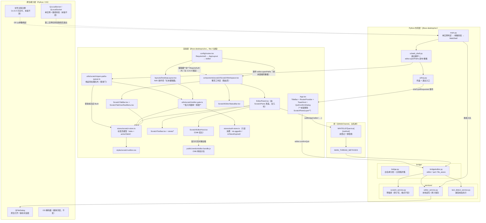
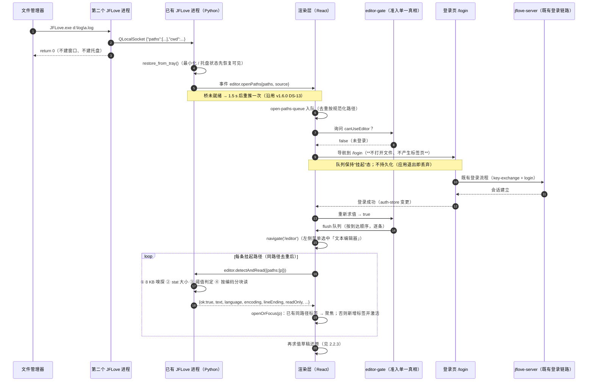
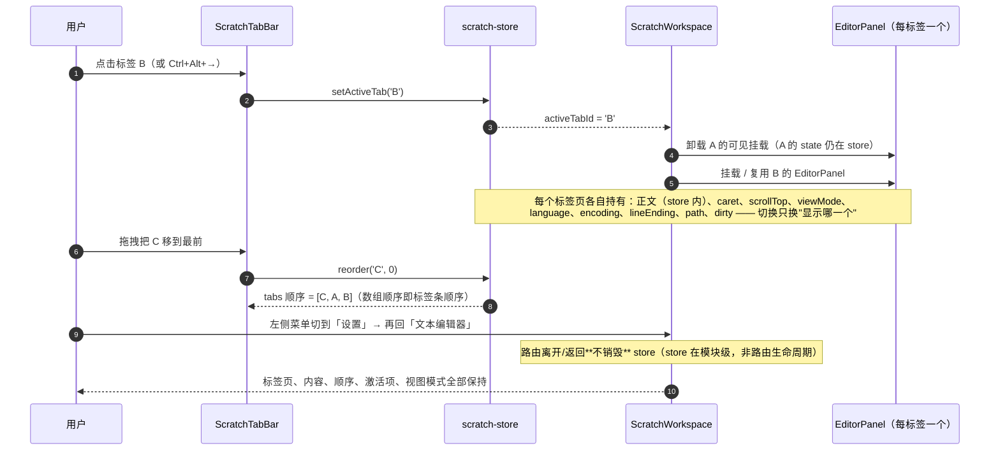
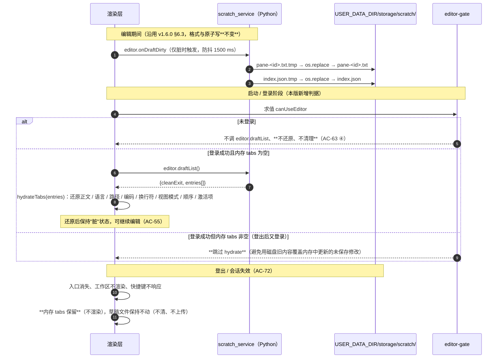
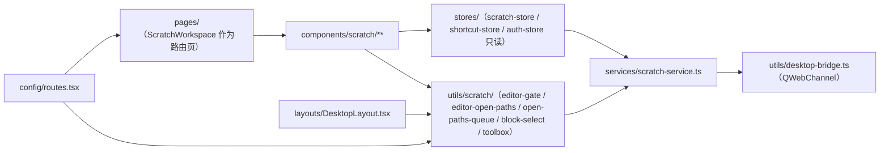
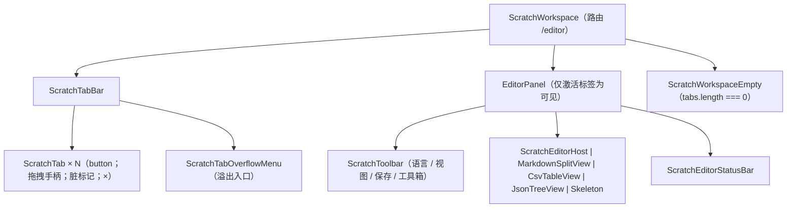
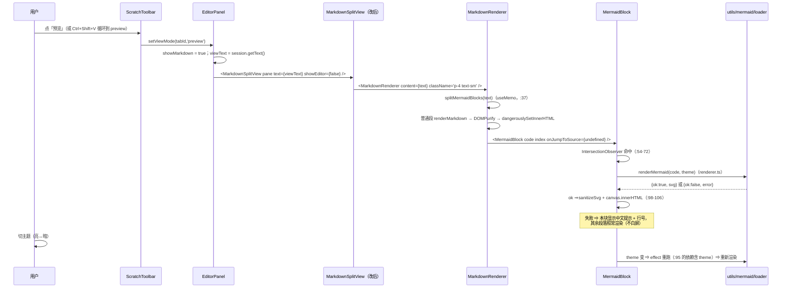
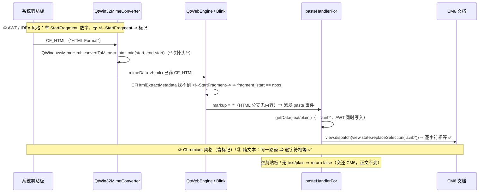
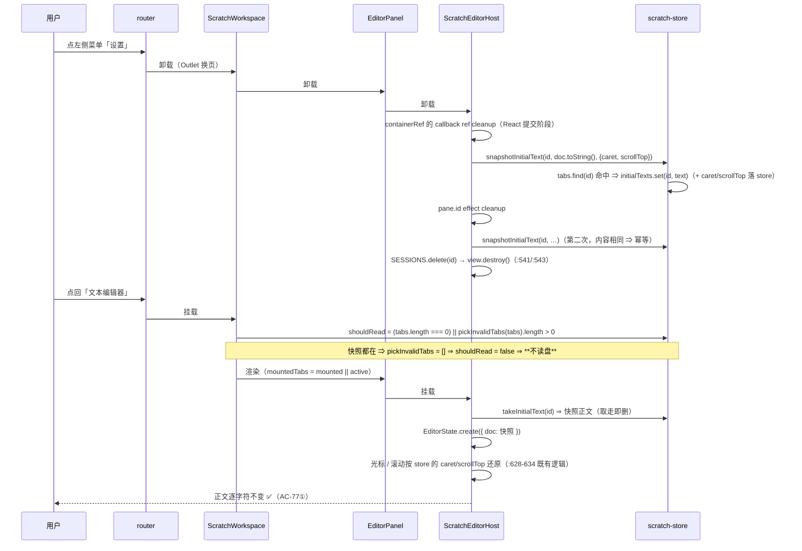

# JFLove v1.6.1 设计文档

> 角色：**designer**（`.agents/skills/designer/SKILL.md`）。
> 基线：`文档记录/需求文档/v1.6.1.md`（Phase 1 产出，用户已放行进入 Phase 2，2026-10-14）。
> 上一版设计：`文档记录/设计文档/v1.6.0.md`（1445 行）——**本文件的编号不动**，凡是与 v1.6.0 同名同名节（如 §6.2 保存语义）一律沿用其口径，本文件只写**差异与新增**。
> 本版范围：**仅 `jflove-desktop/`**（需求 D32）；无 Phase 3（后端）/ 4b（移动端）/ 4c（Web 端）；无数据库变更。

---

## 0. 版本对齐、范围与设计约束

### 0.1 范围与归属

| 项 | 内容 |
|----|------|
| 版本号 | **v1.6.1**（`version.json` 唯一真相，Phase 4a 末尾由 `python scripts/sync_version.py` 同步 9 处） |
| 阶段 | Phase 1 ✅ → **Phase 2（本文）** → Phase 4a（桌面端） → Phase 5 / 6 → Phase 7 / 8（**含 v1.6.0 未完成的 Phase 7/8 合并收尾**） |
| 模块 | 仅 `jflove-desktop/`（渲染层 `ui/` 为主 + Python 外壳零改动或极小改动，见 §3.1） |
| 独立交付 | 无数据库迁移 / 回滚脚本（§5.1.2 不触发）；无新桥方法（§7.1）；无新 HTTP 接口（§7.3） |

### 0.2 设计约束（不可违反，违反即门禁/宪法失败）

| # | 约束 | 出处 |
|---|------|------|
| C-1 | **未登录零存在**：入口不可见、快捷键不响应、工作区不渲染、草稿不还原 | 需求 R-1 / F1-A 1、7 |
| C-2 | **唤起请求在登录后必须兑现**：排队 + 同路径去重 + 登录成功后自动切菜单并打开 | 需求 R-2 / I-7 |
| C-3 | **编辑器与远端零交互**：登录门只是准入，不得新增任何远端读写、接口、密钥下发 | 需求 I-1 / I-3 / AC-42 / AC-R4 |
| C-4 | **渲染层无网络出口**：`/api/v1/` 在 `ui/src` 内 **0 命中** | 安全宪法 §9.6 + v1.6.0 AC-R4 ④ |
| C-5 | **文件字节与密钥不进渲染层**（只进文本），保存与草稿均走 Python 侧原子写 | 需求 I-2 / I-5 |
| C-6 | **类型校验先行**：任何入口（含登录后自动打开）都不得"先读进来再判断" | 需求 I-4 / R-8 |
| C-7 | **不抢默认程序 + 单实例复用**（进程数 1），本版**不改**打包与注册 | 需求 I-6 |
| C-8 | **跨端门禁文件不可改**：`ui/src/styles/components.css`、`ui/src/pages/NoteEditPage.tsx`（`PARITY_MANIFEST`） | v1.6.0 §4.1.1 注 + AC-R1 |
| C-9 | **真实生效**：被接管的 `Ctrl+W` 必须在**真机**验证（判据见 §13.3 第 11 条） | 需求 R-5 / AC-70 |

### 0.3 需求 → 设计映射（速览）

| 需求条目 | 设计落点 |
|---------|---------|
| F1-A（准入） | §4.1（`editor-gate.ts` 单一真相）、§4.3（唤起队列）、§4.4（草稿时机）、§6.1 |
| F1-B（工作区 + 标签页） | §4.2（组件树）、§4.3（标签页状态模型与 action）、§4.5（标签条交互：排序 / 溢出 / 空态） |
| F2（18 项快捷键） | §4.6（含 `Ctrl+W` 接管与真机判据） |
| F7 第 3/5 条（唤起 + 登录） | §4.3.3（队列与登录衔接）、§6.2（数据流） |
| F9 第 3 条（还原时机） | §4.4（还原时机与登出语义） |
| AC-63 ~ AC-72 | §10.5（本版新增 AC → 设计映射） |
| AC-R6（零改动范围） | §3.1（文件清单的"明确不改"栏）、§13.3 第 9 条 |

---

## 1. 现状取证（改造前）

> 取证方式：**只读清点**（一个 `cross-platform-desktop` 角色子 agent，prompt 含"只读、禁止写盘"，13 个文件）+ 父 agent 逐条核对 `文件:行` 与自行复读关键文件。核对结论：**回执的事实项全部成立**，其中两处类型细节被父 agent 纠正（见 §11 P-1）。
> 交付前已跑 `git status --porcelain`：无越界写盘（§6.1 第 4 条义务）。

### 1.1 关键事实（改造前）

| # | 事实 | 证据（文件:行） |
|---|------|----------------|
| 1 | **编辑器不是路由页**：`/` 的 children 里没有 `editor` / `scratch` 路由 | `ui/src/config/routes.tsx:103-148`（children 清单，`:146` 为占位路由） |
| 2 | 浮窗层挂在 **router 之外**（`TitleBar` 的兄弟），切换路由不销毁 | `ui/src/App.tsx:9`（import）、`:170`（`<ScratchPaneLayer />`）、`:172-174`（`RouterProvider`）；`:7-14` 头注释自述此点即 v1.6.0 AC-47 |
| 3 | 布局链 = `RequireAuth → AppLayout → DesktopLayout → <Outlet/>` | `ui/src/config/routes.tsx:41-49`（`RequireAuth`）、`:106-108`；`ui/src/layouts/AppLayout.tsx:10-12`；`ui/src/layouts/DesktopLayout.tsx:169-171` |
| 4 | 导航项**数据驱动**（4 主项 + 2 底项 + 4 admin），选中态按 `prefix` 决定 `startsWith` / `===` | `DesktopLayout.tsx:19-25`、`:28-36`、`:39-42`、`:45-50`、`:53-57`、`:121-135` |
| 5 | 窗格模型含**几何 / z 序 / 挂载标记** | `ui/src/types/scratch.ts:59-85`（`ScratchPane`）、`:32-42`（`PaneGeometry`） |
| 6 | 几何与排列 action 齐全（`movePane` / `resizePane` / `toggleMinimize` / `toggleMaximize` / `tileAll` / `cascadeAll` / `setViewport`，另有 `zCounter` / `viewport` 状态） | `ui/src/stores/scratch-store.ts:196-253`（`:202` `zCounter`、`:204` `viewport`、`:215-220` 几何与排列） |
| 7 | 拖动 / 缩放 / 最小化 / 最大化**都在窗格外壳内**实现 | `components/scratch/ScratchPane.tsx:172-217`（拖动 → `:196` `movePane`）、`:220-292`（缩放 → `:273/276`）、`:295-309`、`:317-325`（几何→CSS）、`:398-409`（八把手） |
| 8 | 平铺 / 层叠只在浮窗层 | `ScratchPaneLayer.tsx:283`（`store.tileAll()`）、`:286`（`store.cascadeAll()`） |
| 9 | **应用级快捷键监听宿主 = 浮窗层**（`window` 捕获阶段，仅 9 项） | `ScratchPaneLayer.tsx:57-67`（`APP_SCOPE_SHORTCUTS` 9 项）、`:70`（`PANE_SCOPE_SHORTCUTS` 3 项）、`:73-82`（`paneIdOf` / `isInsidePane`）、`:309-331`（监听体，`:329` `addEventListener(..., true)`） |
| 10 | 快捷键条目 **20 项**（`ShortcutId` 联合 + `SHORTCUT_DEFS` 表） | `ui/src/config/shortcuts.ts:27-47`、`:104-266`（`:106` `pane.new` … `:259` `view.toggleWordWrap`） |
| 11 | 草稿索引把**几何整体**落盘（还有 `caret` / `scroll_top` / 字体 / 换行） | `ui/src/services/scratch-service.ts:74`（`geometry: { ...pane.geometry }`）、`ui/src/types/scratch.ts:177-192`（`DraftPaneMeta`） |
| 12 | **启动即还原草稿**，与登录状态无关 | `ui/src/App.tsx:48-66`（`:50` `draftList()` → `:54` `hydrateFromDrafts`） |
| 13 | 外部唤起的**消费者**也在浮窗层 | `ui/src/utils/scratch/open-paths-queue.ts:172-174`（模块顶层订阅）→ `ScratchPaneLayer.tsx:174-181`（`onOpenPaths` + `flushOpenPaths`）→ `:154-171`（`openPaths`） |
| 14 | 唤起 payload = `{paths, source}`，来源常量两侧各有一份定义 | `ui/src/types/scratch.ts:277-280`；`jflove-desktop/src/ui/web_shell.py:217-225`（`SOURCE_CLI` / `SOURCE_SINGLE_INSTANCE` / 队列上限 64 / 重试 1500 ms）、`:1208-1214`（真正推送） |
| 15 | **登录态是既有能力**，判据 = `isLoggedIn` + `isTokenExpired()` | `ui/src/config/routes.tsx:41-49`；`ui/src/stores/auth-store.ts:26`（`isLoggedIn`）、`:138`（`isTokenExpired`） |
| 16 | "编辑器不依赖登录"是 v1.6.0 的**硬约束 + AC**（AC-47 与补充裁决 A） | v1.6.0 需求 §9 / 设计 v1.6.0 §1.1；本版 §14.1 反向 |
| 17 | 草稿索引的**写入侧白名单**：未知字段被丢弃，`geometry` 缺失时填中性默认值 | `jflove-desktop/src/services/scratch_service.py:254-285`（`:258` 注释"未知字段丢弃"、`:278` + `:234-245`） |
| 18 | 草稿索引的**读取侧**原样透传存储条目并补 `lineEnd` | `scratch_service.py:288-297`（`_to_public_meta`）；另见 `:404` `_normalize_stored_meta`（Phase 4a 需核对是否也走白名单，见 §13.2） |
| 19 | `ui/` **无 `npm test` 脚本**，21 个 `.test` 文件当前未接入底座门禁（以 `npx vitest run` 直跑） | `jflove-desktop/ui/package.json`；`glob jflove-desktop/ui/src/**/*test*` = 21 个文件 |
| 20 | 路由守卫**无任何 UI 测试** | 全库 `grep RequireAuth|RequireAdmin` 仅命中 `config/routes.tsx` 7 处与 `pages/admin/AdminSystemPage.tsx:14`（注释） |

### 1.2 可复用面（本版**不改**的既有机制）

| 面 | 现状落点 | 本版用法 |
|----|---------|---------|
| 桥方法 / 事件（16 + 4） | v1.6.0 设计 §7.1；`src/bridge/bridge.py`、`src/bridge/editor.py` | **0 新增、0 改名、0 改签名**（DS-19：仅在渲染层做 `pane → tab` 字段映射） |
| 草稿库（原子写 + index.json + `pane-<id>.txt`） | `src/services/scratch_service.py`（`:145` 重试替换、`:167` 原子写、`:197-204` 索引骨架） | 沿用；**唯一改动** = 索引白名单扩展（§5.3，DS-30） |
| 类型校验先行（8 KB 嗅探 / 阈值） | `src/services/text_detect_service.py`；需求 §3.3.1 阈值表 | 沿用，**阈值一字不改** |
| 退出握手（`quit.pending` / `confirmQuit` / `cancelQuit`） | `App.tsx:76-110`、`:177-187` | 沿用；`QuitConfirmDialog` **留在** `App.tsx`（DS-17） |
| 单实例 / 文件关联 / 托盘 | `src/utils/single_instance.py`、`ui/web_shell.py`、`ui/tray.py` | 沿用，**零改动** |
| CM6 宿主与 keymap 归属 | `components/scratch/ScratchEditorHost.tsx:321`（注释）、`:356`（`Prec.highest`）、`:380`、`:621`（内容访问器） | 沿用（宿主级用例已存在，见 `__tests__/scratch-block-select-keymap.test.ts`） |
| 启动期事件队列（FIFO + 双集合去重 + 上限 64） | `utils/scratch/open-paths-queue.ts:39-166` | **扩展为带登录门**（§4.4） |
| 懒挂载语义（`setMounted` + `initialTexts` 暂存区） | `ScratchPane.tsx:166-169`；`scratch-store.ts:229-235` | 沿用为**标签页懒挂载**（DS-29） |

### 1.3 取证边界（**未验证项**，不得在后续文档里写成"已验证"）

1. **`Ctrl+W` 的真机投递未测**：v1.6.0 已实测宿主 48 个动作**零快捷键**（`poc/editor-probes/` 的既有结论），但"渲染层能否收到 `Ctrl+W`"当时登记为**人工验收项**、未执行 ⇒ 本版必须由 `r13-ctrlw-takeover.py` 补（§13.3 第 11 条）。
2. **Pointer Events 在 QtWebEngine 的行为未实测**：DS-23 选 Pointer Events 而非 HTML5 DnD 的理由是**风险规避**（不是实测结论）；Phase 4a 必须在真机上确认拖拽排序可用，否则按 DS-23 的备选路径处理。
3. **未逐行读**：`ScratchEditorHost.tsx` 全文、`scratch-store.ts:256-892` 全文、`scratch-service.ts:131-333`。§5 的字段以 `ui/src/types/scratch.ts` 原文为准（已读全文 298 行）。
4. `_normalize_stored_meta`（`scratch_service.py:404`）是否也做白名单 —— **未核对**，列入 §13.2 待验证。

---

## 2. 系统架构

### 2.1 分层架构（改造后）



**与 v1.6.0 架构的三处结构性反转**

| # | v1.6.0 | v1.6.1 | 原因 |
|---|--------|--------|------|
| 1 | `<ScratchPaneLayer />` 挂在 `App.tsx` 的 `TitleBar` 同级、**router 之外**（AC-47） | **删除该挂载**；编辑器成为 `RequireAuth → AppLayout` 下的普通路由页 `/editor` | 需求 P-1/P-2：整页工作区由左侧菜单控制切换；"未登录零存在"由既有 `RequireAuth` 天然承接 |
| 2 | 窗格是**浮层**，几何 / z 序由 store 维护 | 工作区**随内容区自动铺满**；store 只维护 `tabs` 顺序与 `activeTabId` | 需求 D27 / F1-B 7 |
| 3 | 编辑器**与账号无关**（未登录也能开窗格） | 编辑器**依赖登录**；未登录时导航项 / 快捷键 / 工作区三者同时不存在 | 需求 D26 / AC-47 反转 |

### 2.2 关键数据流

#### 2.2.1 未登录经「打开方式」唤起 → 登录 → 自动打开（本版核心流程，AC-64）



**判据（AC-64）**：登录面板出现时标签页数 = 0；登录完成后标签页数 = 1、内容逐字符等于原文件、状态栏编码/换行符/语言一致。

#### 2.2.2 标签页切换与状态保持（AC-66 / AC-68）



#### 2.2.3 未保存内容的落盘与还原时机（AC-55 / AC-72）



### 2.3 边界声明（架构级）

1. **准入是渲染层概念**：`editor-gate` 只读 `auth-store` 的内存会话快照，**不发起任何网络请求**；会话过期判定沿用既有 `isTokenExpired()`（`ui/src/stores/auth-store.ts:138`）——**不逐次校验服务端**（需求 D31）。
2. **本版零远端新增**：编辑器仍不打任何 `/api/v1/*`；`api.request` 白名单（`api_gateway.py` 的 `SESSION_MANAGED_PATHS` 与路径前缀白名单）**不动**。
3. **渲染层无网络出口**：`WebShell._harden_settings` 的 `LocalContentCanAccessRemoteUrls=false` **不放松**。
4. **"文本进渲染层"是既有边界例外**（v1.6.0 §8.2 论证），本版**不扩大**：文件字节与密钥仍不进渲染层。
5. **Python 外壳基本不动**：`editor.openPaths` 的发布 / 重推 / 单实例 / 文件关联 / 退出握手全部沿用 v1.6.0；登录门完全在渲染层实现（**这是有意的**：登录门不得成为新增桥方法或远端调用的理由，C-3）。

**关键分层判据（可 grep 验证）**

> **口径更正（Phase 5 审查 M-4，2026-10-15）**：下表原先把几处判据写成"**裸 grep = 0 命中**"，
> 但**裸 grep 会把注释与测试说明一起算进去**（实测：`ScratchPaneLayer` 13 处、`data-scratch-pane` 4 处**全在注释/测试说明**里；
> `api/v1` 有 36 处非注释命中但**全是交白名单桥的路径字符串**，不是网络出口）⇒ 判据字面不成立、会误导下游。
> 现改为**可执行且真实成立**的口径（注释剥离 = 把 `/* */` 与 `//` 内容替换为空白后匹配；实测数字为 2026-10-15 本机复跑值）。

| # | 判据 | 命令（**都要先剥注释**） | 实测期望 |
|---|------|------|------|
| 1 | 渲染层无**网络 API 调用** | `grep -rnE "\b(fetch\|XMLHttpRequest\|axios)\s*\(" jflove-desktop/ui/src` | 剥注释后 **0**（唯一 1 处在 `utils/http-client.ts` 注释里）。`api/v1` 字符串**不作为判据**：实测 36 处非注释命中全在 `services/**` / `utils/http-client.ts` 的**路径常量**，经白名单桥交 Python，不构成网络出口 |
| 2 | 浮窗层已退役 | `grep -rn "ScratchPaneLayer\|data-scratch-pane\|ScratchPaneTitleBar" jflove-desktop/ui/src` | **非注释 0**（实测 13 + 4 处全在注释/测试说明） |
| 3 | 几何 / 排列能力已退役 | **限定 scratch 作用域**：`grep -rniE "tileAll\|cascadeAll\|movePane\|resizePane\|toggleMinimize\|zCounter\|setViewport" jflove-desktop/ui/src/stores/scratch-store.ts jflove-desktop/ui/src/components/scratch` | **非注释 0**（实测 raw=3 全在 `scratch-store.ts` 的注释里）。**注意**：`toggleMaximize` **不列入**该判据 —— 它是 `components/desktop/TitleBar.tsx` 调 `ShellControls.toggleMaximize()` 的**原生窗口最大化**（v1.5.0 起既有），与退役的窗格能力同名不同物 |
| 4 | 准入判据单一真相 | `grep -rn "canUseEditor" jflove-desktop/ui/src` | 定义 1 处（`utils/scratch/editor-gate.ts`）+ 消费处若干（实测非注释 9 处）；**不得**在消费处重复写 `isLoggedIn &&` 判定 |
| 5 | 编辑器在守卫内 | 人工核对 `ui/src/config/routes.tsx`：`/editor` 位于 `RequireAuth → AppLayout` 的 children 内 | 成立（与 v1.6.0 的 AC-47 判据相反） |
| 6 | 未登录零存在 | `cd jflove-desktop/ui && npx vitest run src/layouts/__tests__/desktop-layout-gate.test.tsx`（§10.5 点名的新用例） | ⚠ **该用例文件实测不存在（Phase 5 M-3/M-5）** ⇒ 判据**暂无载体**，必须在 Phase 6 补齐（否则 AC-63 ① 无可执行守门） |
| 7 | 编辑器样式未进门禁文件 | `grep -rn "scratch-" jflove-desktop/ui/src/styles/components.css` | **0 命中**（实测 0；该文件在跨端门禁清单内） |
| 8 | 零改动范围 | `git diff --name-only -- jflove-app jflove-server jflove-web .github` | **为空**（AC-R6）。⚠ 实测当前工作树有 7 个文件 +7/−7，**内容全部是用户自有的注释路径修正**（`.claude/skills/…` → `.agents/skills/…`），**提交时必须剔除** |

---

## 3. 模块划分

### 3.1 文件清单

**新增**

| 文件 | 职责 |
|------|------|
| `ui/src/utils/scratch/editor-gate.ts` | **准入判据单一真相**：纯函数 `canUseEditor()` + hook `useEditorGate()`（DS-16） |
| `ui/src/utils/scratch/editor-open-paths.ts` | 唤起队列的**登录门接线 + 消费者 + 自动切菜单**（DS-20 / §4.4） |
| `ui/src/components/scratch/ScratchWorkspace.tsx` | 整页工作区（路由页 `/editor`）；草稿还原时机（DS-21） |
| `ui/src/components/scratch/ScratchTabBar.tsx` | 标签条：单行、溢出滚动、拖拽排序、脏标记、关闭 |
| `ui/src/components/scratch/ScratchTabOverflowMenu.tsx` | 溢出下拉列表（定位并选中任一标签页） |
| `ui/src/components/scratch/ScratchWorkspaceEmpty.tsx` | 空态（「新建」「打开」入口） |
| `ui/src/components/scratch/__tests__/scratch-workspace-gate.test.tsx` | AC-63（含负向对照） |
| `ui/src/components/scratch/__tests__/scratch-tab-bar.test.tsx` | AC-67 / AC-69 |
| `ui/src/components/scratch/__tests__/scratch-tab-reorder.test.tsx` | AC-68 |
| `ui/src/components/scratch/__tests__/scratch-tab-switch-state.test.tsx` | AC-66 |
| `ui/src/utils/scratch/__tests__/editor-gate.test.ts` | DS-16 四种会话组合 |
| `ui/src/utils/scratch/__tests__/editor-open-paths-gate.test.ts` | AC-64 / AC-65（含负向对照） |
| `ui/src/layouts/__tests__/desktop-layout-gate.test.tsx` | AC-63 ①（导航项零命中） |
| `jflove-desktop/poc/editor-probes/r13-ctrlw-takeover.py` | AC-70 真机判据（阻塞项） |
| `jflove-desktop/tests/test_scratch_index_v161.py` | 索引白名单扩展 + 旧草稿兼容（DS-30） |

**改造**

| 文件 | 改动 |
|------|------|
| `ui/src/App.tsx` | 移除 `<ScratchPaneLayer />` 与 import（`:9` / `:170`）；`TitleBar` / `RouterProvider` / `ToastHost` / 退出握手 / 草稿还原 effect（`:48-66`）全部保留（还原 effect **移入**工作区，见 §4.5） |
| `ui/src/config/routes.tsx` | `/` 的 children 新增 `{ path: 'editor', element: <ScratchWorkspace /> }`（在 `RequireAuth → AppLayout` 之内） |
| `ui/src/layouts/DesktopLayout.tsx` | `NAV_ITEMS` 插入条件项「文本编辑器」（`icon: 'code'`，`:123` 已存在） |
| `ui/src/stores/scratch-store.ts` | 模型迁移（§4.3）：删几何 / 排列 / `zCounter` / `viewport`；`panes → tabs`、`activePaneId → activeTabId`；新增 `reorderTab` / `nextTab` / `prevTab` / `openOrFocus` |
| `ui/src/services/scratch-service.ts` | 边界字段映射（`tab → pane` 桥参数）；`toDraftPaneMeta` 去 `geometry`、加 `view_mode` / `order` / `active`（§5.3） |
| `ui/src/types/scratch.ts` | 新增 `ScratchTab` / `TabCaret`；`DraftPaneMeta` 加 3 个可选字段；`PaneGeometry` **删除** |
| `ui/src/components/scratch/ScratchPane.tsx` → **`EditorPanel.tsx`** | 去几何 / 拖动 / 缩放 / 最小化 / 最大化 / z 序；保留工具栏、视图分派、懒挂载、状态栏 |
| `ui/src/components/scratch/ScratchPaneStatusBar.tsx` → **`ScratchEditorStatusBar.tsx`** | 只改名（F10 字段与算法逐字不变） |
| `ui/src/components/scratch/ScratchPaneTitleBar.tsx` | **删除**（拖动 / 三按钮是浮层专属） |
| `ui/src/components/scratch/ScratchPaneLayer.tsx` | **删除**（职责拆给 `ScratchWorkspace`（渲染 + 视口无关）、`editor-open-paths.ts`（唤起）、快捷键运行时（§4.7）、`App.tsx`（退出握手，已在）） |
| `ui/src/components/scratch/index.ts` | barrel 同步（去 2 个、加 4 个） |
| `ui/src/utils/scratch/open-paths-queue.ts` | 加 `setOpenPathsGate()`；`flushOpenPaths` 首行判门（§4.4） |
| `ui/src/config/shortcuts.ts` | 条目 20 → 18（§4.7）；`PANE_SCOPE` 语义随 DOM 契约改写 |
| `ui/src/stores/shortcut-store.ts` | 条目集变化后的默认值 / 冲突检测用例同步 |
| `ui/src/pages/SettingsPage.tsx` | 快捷键区文案（去"平铺 / 层叠 / 窗格"）；**该文件不在门禁清单，可改** |
| `ui/src/components/scratch/ShortcutsSettingsDialog.tsx` | 同上（`:15` 注释里的"窗格层"改为"快捷键运行时"） |
| `ui/src/styles/scratch-editor.css` | 删几何 / 把手 / 平铺类；加标签条 / 溢出下拉 / 空态类；**不含**门禁文件 `components.css` |
| `jflove-desktop/src/services/scratch_service.py` | 索引白名单扩展（`:254-285`）—— **唯一的 Python 改动**（DS-30） |

**明确不改（负向清单，`git diff` 判据）**

| 范围 | 依据 |
|------|------|
| `ui/src/styles/components.css`、`ui/src/pages/NoteEditPage.tsx` | `PARITY_MANIFEST` 跨端门禁（v1.6.0 AC-R1）；判据：`grep -rn "scratch-" ui/src/styles/components.css` = 0 |
| `jflove-server/`、`jflove-web/`、`jflove-app/`、`.github/` | D32 + 需求 §3.4；判据：`git diff --name-only` 为空（AC-R6） |
| 除 `scratch_service.py` 白名单外的全部 `jflove-desktop/src/**`（桥 / 单实例 / 托盘 / 退出握手 / 媒体浮层） | C-3 / C-7 |
| `ui/src/components/scratch/views/*`、`ui/src/utils/scratch/toolbox*`、`blocks select` 纯函数 | F3 / F5 口径不变 |

### 3.2 依赖方向



规则（可 grep 判据）：

1. `utils/scratch/editor-gate.ts` **只**依赖 `stores/auth-store`（只读订阅），不得 import 任何 `components/**`（判据：`grep -n "components/" ui/src/utils/scratch/editor-gate.ts` = 0）。
2. `stores/**` 不得 import `components/**`（沿用 v1.6.0 §3.2）。
3. 渲染层到后端的路径**唯一**：`services/* → utils/desktop-bridge.ts`（C-4 判据）。

---

## 4. 模块设计

### 4.1 准入：单一真相（DS-16）

```ts
// ui/src/utils/scratch/editor-gate.ts（新增）
export interface EditorGateSnapshot { isLoggedIn: boolean; tokenExpired: boolean }

/** 纯函数：编辑器可用 ⇔ 有会话 且 会话未过期（不发起任何网络请求） */
export function canUseEditor(s: EditorGateSnapshot): boolean {
  return s.isLoggedIn && !s.tokenExpired;
}

/** 会话快照（供非 React 上下文使用：快捷键运行时、队列接线） */
export function currentEditorGate(): boolean { /* useAuthStore.getState() → canUseEditor */ }

/** React 订阅：四处消费共用 */
export function useEditorGate(): boolean { /* useAuthStore(selector) → canUseEditor */ }
```

**四处消费**（缺一即 AC-63 失败）：① `DesktopLayout` 的导航项渲染；② 快捷键运行时首行判定；③ `/editor` 路由守卫（`RequireAuth` 已有 + 工作区内部再判一次，防"会话中途失效"）；④ 草稿还原的触发条件。

**会话过期的判定口径**：沿用 `useAuthStore` 的 `isTokenExpired()`（`stores/auth-store.ts:138`），**不**新增定时器、**不**新增服务端校验（C-3）。

### 4.2 工作区组件树与 DOM 契约



**DOM 契约**（测试与快捷键判定的锚点，替换 v1.6.0 的 `[data-scratch-pane]`）：

| 属性 | 位置 | 用途 |
|------|------|------|
| `data-scratch-workspace="true"` | 工作区根 | 判"工作区是否渲染"（AC-63 ③） |
| `data-scratch-tab="<tabId>"` | 每个标签按钮 | 标签条顺序 / 拖拽 / 测试定位（AC-68） |
| `data-scratch-tab-active="true"` | 激活标签 | 激活项判定 |
| `data-editor-panel="<tabId>"` | 每个编辑面板外壳 | 快捷键"编辑面板聚焦类"的判定锚点（替代 `closest('[data-scratch-pane]')`） |
| `data-editor-panel-active="true"` | 可见面板 | AC-66 的观测点 |

### 4.3 标签页状态模型与 action 迁移

**模型（`stores/scratch-store.ts`）**

```ts
interface ScratchState {
  tabs: ScratchTab[];          // 数组顺序 = 标签条顺序（DS-18）
  activeTabId: string | null;
  lastError: string | null;
  // 已删除：zCounter、viewport、每个 tab 的 geometry
  // …actions 见下表
}
```

**action 迁移表**

| v1.6.0（现状，`scratch-store.ts:196-253`） | 处置 | v1.6.1 |
|---|---|---|
| `createPane(init?) → string` | 改名 | `createTab(init?) → string`（新标签**追加到末尾并激活**） |
| `closePane(id)` | 改名 | `closeTab(id)`（关闭后激活项 = 原位置的右邻，无右邻则左邻，全空则 `null`） |
| `focusPane(id)` | 改名 | `setActiveTab(id)` |
| `applyReadResult(item) → string \| null` | 语义并入 | `openOrFocus(item) → string \| null`：**同路径（`path` 非空且相等）→ 聚焦已有标签，不新建、不覆盖内容**（AC-65） |
| `movePane` / `resizePane` / `toggleMinimize` / `toggleMaximize` / `tileAll` / `cascadeAll` | **删除** | —（判据：`grep -rniE "tileAll\|cascadeAll\|movePane\|resizePane\|toggleMinimize\|toggleMaximize" ui/src` = 0） |
| `setViewport(w, h)` | **删除** | — |
| `setMounted(id, mounted)` | 保留 | 同签名（懒挂载，§4.8） |
| `setLanguage` / `setViewMode` / `markDirty` / `setFontSize` / `toggleLineNumbers` / `toggleWordWrap` | 保留 | 同签名（`id` 语义 = tabId） |
| `hydrateFromDrafts(entries)` | 扩展 | 额外还原 `view_mode` / 顺序 / 激活项 |
| `serializeDrafts()` | 扩展 | 不再产出 `geometry`；产出 `view_mode` / `order` / `active` |
| `savePane(id, {forceDialog?}) → Promise<boolean>` | 保留 | 同签名（v1.6.0 快速修复后的实现原样保留） |
| `flushPendingSaves()` | 保留 | 同签名 |
| `registerScratchContentAccessor` / `takeInitialText` | 保留 | 同签名 |
| `selectDirtyCount` / `selectBindings` / `selectBlockSelectModifier` | 保留 | 同签名 |
| — | **新增** | `reorderTab(from: number, to: number)`、`nextTab()`、`prevTab()`、`closeActiveTab()` |

**不变量**（Phase 6 用例判据）：① `tabs` 中 `path` 非空者两两不相等（AC-65）；② `activeTabId` 要么为 `null`（`tabs` 为空）要么命中某个 `tab.id`；③ 删除不是激活项的标签**不改变** `activeTabId`；④ `tabs` 顺序即 `order`，不存在第二处顺序来源。

### 4.4 唤起队列与登录衔接（DS-20，AC-64 / AC-65）

**队列侧扩展（`utils/scratch/open-paths-queue.ts`）**

```ts
let gate: () => boolean = () => true;                       // 默认开放（既有测试不受影响）
export function setOpenPathsGate(next: () => boolean): void { gate = next; }

export function flushOpenPaths(source = 'cli'): string[] {
  if (!gate()) return [];                                   // ← 登录门：不改队列、不记 delivered
  if (handlers.size === 0 || pending.length === 0) return [];
  /* …原实现逐字不变… */
}
```

> **为什么判门必须放在 `flushOpenPaths` 而不是消费者里**：`flushOpenPaths` 会把交付的路径记入 `delivered`（`:124` `rememberDelivered`），而 `enqueueOpenPaths` 对 `delivered` 命中**拒绝入队**（`:98`）。所以"先投递、消费者发现没登录再退回"会让路径**永久丢失**。判门放在投递之前，队列与去重表都不动，才能"挂起到登录成功"。

**接线（`utils/scratch/editor-open-paths.ts`，新增；由 `App.tsx` 静态 import 保证早于首帧）**

```ts
setOpenPathsGate(currentEditorGate);                        // ① 门 = 准入单一真相
onOpenPaths((paths) => { void openPathsAndReveal(paths); }); // ② 消费者在模块顶层注册（早于登录）
useAuthStore.subscribe((s) => {                             // ③ 登录态翻转 → 兑现挂起请求
  if (!canUseEditor(s)) return;
  if (pendingOpenPaths() === 0) return;
  router.navigate('/editor');                               //   「左侧菜单切到文本编辑器」
  flushOpenPaths();
});

async function openPathsAndReveal(paths: readonly string[]): Promise<void> {
  router.navigate('/editor');                               // 已登录路径：切菜单 + 打开
  for (const batch of chunk(paths, DETECT_AND_READ_MAX_PATHS)) {
    const { items } = await scratchService.detectAndRead(batch);   // Python 侧类型校验先行（C-6）
    items.forEach((item) => useScratchStore.getState().openOrFocus(item));
  }
}
```

**判据**（AC-64 / AC-65）：

| 步骤 | 期望 |
|------|------|
| 未登录时收到 `editor.openPaths` | `enqueueOpenPaths` 入队（`pendingOpenPaths() === 1`）；`useScratchStore.tabs.length === 0`；**无** `detectAndRead` 调用 |
| 登录成功（gate 翻转） | `router` 当前位置 = `/editor`；`detectAndRead` 恰好 1 次；`tabs.length === 1`；`activeTabId` = 该标签 |
| 再次收到**同一路径** | `tabs.length` 不变；激活项 = 已有标签；**内容未被覆盖**（AC-65 ③④） |
| 放弃登录后应用退出 | 无任何持久化产物（`pendingOpenPaths()` 仅内存；AC-64 ⑤ / U-2） |

### 4.5 草稿还原时机与登出语义（DS-21）

**还原条件（`ScratchWorkspace` 内，三条同时满足）**：① `useEditorGate() === true`；② `tabs.length === 0`（内存为空）；③ 本会话尚未还原过（`useRef(false)`）。

**次序**：先 `hydrateTabs(entries)`（还原草稿为标签），**再** `flushOpenPaths()`（把挂起的唤起请求打开并激活）。理由：AC-64 ③ 要求被唤起的文件**成为激活项**，而 hydrate 会把激活项设成草稿里的那一条 —— 先 hydrate 后 flush 才能让唤起项最后夺激活。

**登出 / 会话失效（AC-72）**：入口消失（`editor-gate` 翻转 → 导航项不渲染、快捷键首行返回、路由守卫重定向）、工作区不渲染；**内存 `tabs` 保留**（不渲染、不清空）、**草稿文件不清理**；再次登录：`tabs` 非空 ⇒ **跳过 hydrate**（绝不用磁盘旧内容覆盖内存里更新的未保存改动）。

### 4.6 标签条交互（DS-23，AC-67 / AC-68）

| 能力 | 设计 | 判据 |
|------|------|------|
| 单行固定 | 标签条**不随内容滚动**（固定在工作区顶部，`flex-shrink: 0`） | 需求 F1-B 1；AC-68 ②（切菜单返回后顺序不变） |
| 溢出滚动 | `overflow-x: auto`；鼠标滚轮 / 触控板横向滚动；激活标签 `scrollIntoView({ inline: 'nearest' })` | AC-67 ③「激活了但看不见」必须不出现 |
| 溢出下拉 | 标签条右侧常驻「标签列表」按钮 → `ScratchTabOverflowMenu`（全量标签，顺序同标签条，点击 = `setActiveTab`） | AC-67 ①「出现可滚动或下拉列表入口」、②「能定位并选中第 12 个」 |
| 拖拽排序 | **Pointer Events 自绘**：`pointerdown`（记录 `startX` / `tabId`）→ 位移 > 4 px 进入拖拽态（`setPointerCapture`）→ `pointermove` 用各标签 `getBoundingClientRect()` 的中点判定目标索引 → `reorderTab(from, to)` → `pointerup` 提交；`Escape` 取消（恢复原序） | AC-68 ①（可观测顺序变为 C / A / B） |
| 点击激活 | `pointerdown` → `pointerup` 位移 ≤ 4 px 视为点击（避免拖拽后误触发激活） | AC-66 |
| 关闭按钮 | 标签右侧 `×`（hover 可见）；脏标签先走 AC-59 询问 | AC-59 / AC-70 |
| 脏标记 | `dirty === true` ⇒ 标题旁圆点；保存成功消失 | F1-B 5 / AC-62 |
| 键盘可达 | 标签本体是原生 `<button>`（`Tab` 聚焦、`Enter` / `Space` 激活） | 需求 §5（体验要求）；AC-63 ②（未登录时无响应且不报错） |
| 空态 | `tabs.length === 0` ⇒ `ScratchWorkspaceEmpty`（「新建」「打开」），**不自动离开工作区** | AC-69 ①②③ |

### 4.7 快捷键（DS-24 / DS-25，AC-70）

**条目集（20 → 18）**

| # | id | 中文名 | 默认键 | 作用域 |
|---|----|--------|--------|--------|
| 1 | `pane.new` | 新建标签页 | `Ctrl+Alt+N` | 应用（window） |
| 2 | `pane.close` | **关闭当前标签页** | **`Ctrl+W`**（原 `Ctrl+Alt+W`） | 编辑面板聚焦 |
| 3 | `pane.next` | **下一个标签页** | `Ctrl+Alt+→` | 应用 |
| 4 | `pane.prev` | **上一个标签页** | `Ctrl+Alt+←` | 应用 |
| 5 | `file.open` | 打开本地文件 | `Ctrl+Alt+O` | 应用 |
| 6 | `file.save` | 保存 | `Ctrl+S` | 编辑面板聚焦 |
| 7 | `file.saveAs` | 另存为 | `Ctrl+Shift+S` | 编辑面板聚焦 |
| 8 | `pane.togglePreview` | 切换预览 / 分屏 | `Ctrl+Shift+V` | 编辑面板聚焦 |
| 9 | `edit.find` | 查找 / 替换 | `Ctrl+F` | 编辑面板聚焦 |
| 10 | `edit.gotoLine` | 跳转到行 | `Ctrl+G` | 编辑面板聚焦 |
| 11 | `edit.commentToggle` | 切换行注释 | `Ctrl+/` | 编辑面板聚焦 |
| 12 | `edit.blockSelectModifier` | 块选择修饰键 | `Alt`（可选 `Ctrl`） | 编辑面板聚焦 |
| 13 | `view.toolbox` | 打开工具箱 | `Ctrl+Alt+K` | 应用 |
| 14 | `view.diff` | 两段文本对比 | `Ctrl+Alt+D` | 应用 |
| 15 | `view.zoomIn` | 增大字号 | `Ctrl+=` | 编辑面板聚焦 |
| 16 | `view.zoomOut` | 减小字号 | `Ctrl+-` | 编辑面板聚焦 |
| 17 | `view.zoomReset` | 重置字号 | `Ctrl+0` | 编辑面板聚焦 |
| 18 | `view.toggleWordWrap` | 切换自动换行 | `Alt+Z` | 编辑面板聚焦 |

> **「中文名」列的真相 = `ui/src/config/shortcuts.ts::SHORTCUT_DEFS[].label`**（上文 18 行已按代码原文逐字对齐，2026-10-14 核对，`Select-String` 逐条比对）。
> 需求文档 §3.2（`文档记录/需求文档/v1.6.1.md:370` / `:510`）只强制**2 项作废 + 3 项改名 + 1 项改默认键**；
> 其余条目的中文名属**描述性措辞**，本表曾用简写（「打开文件」「查找」…），已统一为代码口径 —— 改文档而非改代码，
> 因为 label 无爆炸半径（全 `ui/src` 无第二处从 `SHORTCUT_DEFS` 读 label），而代码口径已是 v1.6.0 起的既有用户可见文案。

**已作废**：`pane.tile`（平铺 `Ctrl+Alt+T`）、`pane.cascade`（层叠 `Ctrl+Alt+C`）—— 配置界面**不得**出现（需求 §3.2）。

**承办方划分**（沿用 v1.6.0 §4.2.2 的分工，只换宿主）

| 作用域 | 承办方 | 本版宿主 |
|--------|--------|---------|
| 应用级 `window` 捕获（**7 项**：`pane.new` / `pane.close`(`Ctrl+W`) / `pane.next` / `pane.prev` / `file.open` / `file.save` / `file.saveAs`） | 渲染层 `window` **捕获阶段**监听 | `ScratchPaneLayer` 的接线**原样搬到** `ScratchWorkspace`（`ui/src/components/scratch/ScratchWorkspace.tsx`），只加两个前置：① 准入（未登录直接 `return`，**不** `preventDefault`）；② 面板作用域项要求事件目标在 `[data-editor-panel]` 内 |
| 编辑面板聚焦（其余 **11** 项） | CM6 keymap（`Prec.highest`）+ 面板内 DOM 判定 | 判定锚点由 `closest('[data-scratch-pane]')` 改为 `closest('[data-editor-panel]')` |

> **口径纠正（取证，2026-10-14）**：v1.6.0 的 `APP_SCOPE_SHORTCUTS` 原为 **9 项**（`git show HEAD:jflove-desktop/ui/src/components/scratch/ScratchPaneLayer.tsx` = `pane.new` / `pane.close` / `pane.next` / `pane.prev` / `pane.tile` / `pane.cascade` / `file.open` / `file.save` / `file.saveAs`）。作废 2 项后**恰好等于本版的 7 项** ⇒ 应用级覆盖面**零增减**。
> 由此还有一条**既有缺口**（非本版引入）：`view.toolbox`（`Ctrl+Alt+K`）与 `view.diff`（`Ctrl+Alt+D`）在 v1.6.0 与 v1.6.1 **都没有任何接管方**（既不在应用级监听里，也不在 CM6 keymap / 工具栏按钮之外），即用户改了键位也不会生效 —— 本版**不扩大改动面**，登记为 BACKLOG 候选 **BL-51**。

> **作用域限定与键盘可达（2026-10-15 用户裁决 V-1，Phase 6 收尾轮落地）**
>
> 1. **`pane.close`（`Ctrl+W`）的作用域 = 编辑面板内**（事件目标在 `[data-editor-panel]` 内；实现 `ui/src/utils/scratch/shortcut-runtime.ts:155-158`）。焦点停在**标签条**上时该键**放行给宿主** —— 这是**刻意**的边界：把 `Ctrl+W` 放大到 `[data-scratch-workspace]` 会让工作区内任意位置（含标签条）的关闭意图都被吞掉，与宿主窗口关闭语义冲突，收益与风险不成比例。需求 AC-70 ② 已就地补上该限定。
> 2. **补一条纯键盘可达路径**：标签条的标签本体（`div[role="tab"]`，`tabIndex=0`，`ScratchTabBar.tsx:278-280`）在 **`Delete`** 上关闭该标签 —— 经 store 的 `requestCloseTab`，**脏标签照样先弹关闭询问**（与 `Ctrl+W`、与 `×` 按钮同一入口）。**它不是第 19 项全局快捷键**：不进 `SHORTCUT_DEFS`、不进设置页、不可改键（组件内 `onKeyDown`，与既有的 `Enter`/`Space` 激活同层）。
> 3. 为什么不用"让 `×` 按钮可聚焦"：那会给每个标签增加一个 Tab 停靠点（Tab 序变长且语义重复）；`Delete` 与"标签已聚焦"这一情形一一对应。
> 4. **失败退路**：若真机发现 `Delete` 被 CM6 / 宿主占用或产生误关，**不改 `Ctrl+W` 语义**，回用户裁决（需求 V-1）。
>
> **`Ctrl+W` 的接管（DS-24）**

1. 注册：与既有应用级监听同一处（`window` 捕获阶段），命中即 `preventDefault()` + `stopPropagation()`；
2. **真机判据（阻塞项）**：`r13-ctrlw-takeover.py` 必须同时证明 —— ① 渲染层收到该键（探针内埋点：关闭流程真的启动，脏标签弹出询问）；② 宿主未执行默认动作（宿主 `actions` 触发计数 = 0、无 `downloadRequested`、主窗口 PID 不变、无宿主级对话框）；③ 干净标签被关闭。
3. **失败退路**：不改默认键、不静默降级 —— 登记阻塞项并回用户裁决（需求 R-5 与 `F2 第 7 条`的字面要求）。

### 4.8 懒挂载与内存（DS-29，沿用 v1.6.0 §4.1.3）

- 标签在**首次成为激活项**时 `setMounted(id, true)`（沿用 `ScratchPane.tsx:166-169` 的判据），此后**保持挂载**；
- 非激活标签用 `hidden` 属性隐藏（沿用 `ScratchPane.tsx:358` 的既有手法），**不卸载** CM6 实例 ⇒ AC-66 的"内容 / 光标 / 滚动位置保持不变"零成本成立、标签切换零延迟；
- 从隐藏恢复可见时调用既有 `nudgeEditorLayout()`（`ScratchPane.tsx:89-92`：`requestAnimationFrame` 派发 `resize`），让 CM6 重新测量；
- **未挂载标签的正文**仍在 `scratch-store` 的 `initialTexts` 暂存区（沿用 AC-60 的内存口径）；
- **退路（R-13）**：若真机发现 10 标签内存超预算，则改为"超过 N 个非激活标签按 LRU 卸载 + 快照到 `initialTexts`"，N 由真机数据定；本版**先按保持挂载实现**。

---

## 5. 类型与数据契约

### 5.1 渲染层类型（`ui/src/types/scratch.ts`）

```ts
export type TextEncoding = 'utf-8' | 'utf-8-bom' | 'gbk' | 'utf-16le' | 'utf-16be';   // 不变
export type LineEnding = 'lf' | 'crlf';                                              // 不变
export type ScratchViewMode = 'edit' | 'preview' | 'split' | 'table' | 'tree';        // 不变

/** 光标位置（1 基；由 PaneCaret 更名） */
export interface TabCaret { line: number; col: number }

/** 单个标签页状态（由 ScratchPane 改造：删除 geometry；保留懒挂载标记） */
export interface ScratchTab {
  id: string;               // crypto.randomUUID()，同时是草稿文件名 pane-<id>.txt
  title: string;            // 显示名：文件名 或「未命名」
  path: string | null;      // null = 草稿形态（永不写用户文件系统）
  language: string;         // 语言 id（见 config/scratch-types.ts 的 TYPES）
  detected: string;         // 自动识别值（手动切换后保留，供「恢复自动」）
  viewMode: ScratchViewMode;
  encoding: TextEncoding;
  lineEnding: LineEnding;
  readOnly: boolean;
  dirty: boolean;
  caret: TabCaret;
  scrollTop: number;
  fontSize: number;
  showLineNumbers: boolean;
  wordWrap: boolean;
  mounted: boolean;         // 懒挂载：false = 只登记不建 CM6
}
// 删除：PaneGeometry、ScratchPane（几何相关字段整体退役）
```

**桥 DTO**（`ReadItem` / `WriteTextParams` / `DraftPaneMeta` / `OpenPathsPayload` / `DetectAndReadResult` …）**除 §5.3 的 3 个新增可选字段外逐字不变**（命名混合口径见该文件 `:6-12` 的既有注释，**不要"顺手归一"**）。

### 5.2 store 状态形状

见 §4.3。要点：`tabs: ScratchTab[]`（顺序即标签条顺序）、`activeTabId: string | null`、`lastError: string | null`；**删除** `zCounter` / `viewport` / 任何 `geometry`。

### 5.3 草稿索引演进（DS-30）——本版唯一的存储格式改动

**宿主的现实**：`jflove-desktop/src/services/scratch_service.py` 的 `_normalize_pane_meta`（`:254-285`）是**白名单**归一（`:258` 注释"未知字段丢弃"），而 `_to_public_meta`（`:288-297`）是**原样透传存储条目**。⇒ 渲染层多发的新字段会被**静默丢弃**，仅靠渲染层改不动存储格式。

**写入侧（渲染层）**：`toDraftPaneMeta`（`scratch-service.ts:61-81`）改为

| 字段 | 本版处置 |
|------|---------|
| `geometry` | **不再发送**（Python 侧缺失时填中性默认值，见 `:278` + `:234-245`，安全） |
| `view_mode` | **新增**：`'edit' \| 'preview' \| 'split' \| 'table' \| 'tree'` |
| `order` | **新增**：标签条顺序（0 基整数） |
| `active` | **新增**：是否为激活项（布尔；一批条目里至多一个 `true`） |
| 其余（`title` / `path` / `language` / `encoding` / `lineEnd` / `read_only` / `dirty` / `caret` / `scroll_top` / `font_size` / `show_line_numbers` / `word_wrap`） | **逐字不变** |

**Python 侧（`scratch_service.py:269-285` 的返回字典追加 3 行）**

```python
"view_mode": _as_view_mode(pane.get("view_mode")),   # 白名单 5 值，非法/缺失 → "edit"
"order": _as_int(pane.get("order"), 0),
"active": _as_bool(pane.get("active"), False),
```

`geometry` 分支**保留**（`:278` 不动）：v1.6.0 旧索引里已有该字段，删掉会破坏"读取侧原样透传"的既有行为。

**兼容判据（Phase 6 必测）**

| 场景 | 期望 |
|------|------|
| v1.6.0 旧 `index.json`（**有** `geometry`、**无**新字段） | 还原成功；`view_mode = 'edit'`；顺序 = 索引数组顺序；激活项 = 第一条 |
| v1.6.1 新索引 | 三个新字段往返一致（`draftSave` → `draftList` 逐字段相等） |
| 渲染层发送非法 `view_mode`（如 `"bogus"`） | 存为 `'edit'`，不抛错（与 `line_end` 的既有宽松口径一致） |
| 回退到 v1.6.0 渲染层读 v1.6.1 索引 | **不做保证**（`geometry` 缺省为中性值 ⇒ 浮窗几何全 0）；版本回退不在服务范围，登记 R-15 |

---

## 6. 复用既有机制（逐项对照）

| 能力 | 现状落点 | 本版差异 |
|------|---------|---------|
| 类型校验先行（F8） | v1.6.0 设计 §6.1；`text_detect_service` | **零差异**：所有入口（含登录后自动打开）都先 `detectAndRead`，不得"先读进来再判断" |
| 打开 / 保存 / 另存为（F6） | v1.6.0 设计 §6.2（含 `savePane` 的只读拒绝、冲突检测、`rescheduleFlush` 自动暂存回归） | **零差异**；`savePane` 的 `id` 语义变为 tabId |
| 草稿（F9） | v1.6.0 设计 §6.3（原子写 / `.tmp` → `os.replace` / 索引修复 / 清理入口） | **差异**：① 落盘时机不变；② **还原时机**改为登录后（§4.5）；③ 索引字段 +3（§5.3） |
| 退出握手（F9 正常退出） | v1.6.0 设计 §6.4；`App.tsx:76-110`、`:177-187` | **零差异**（`QuitConfirmDialog` 仍在 `App.tsx`，任意路由都能弹） |
| 单实例 / 文件关联 | v1.6.0 设计 §6.5 / §6.6 | **零差异**；唤起链路只多一道渲染层登录门（C-7：进程数仍为 1） |
| 打包 | v1.6.0 设计 §6.6 | **零差异**（本版不改 Inno Setup / 便携 zip / 依赖清单） |
| CM6 分包与懒加载 | v1.6.0 设计 §6.1；`public/vendor/editor.bundle.js` | **零差异**（`loadCmBundle()` 首次需要时才加载） |
| 状态栏算法（F10） | v1.6.0 设计 §4.1.4（行:列 1 基按码点、选中字符数按码点、总字符数含换行符：`"abc\nDE"` = 6） | **零差异**，仅宿主位置从"窗格底部"换成"编辑面板底部" |
| 块选择（F3） | v1.6.0 设计 §6.1.2 + 快速修复的 M1/M2/L8 回修（`clampBlockCursor` / `extendBlockCursor` / `blockCursorRanges`） | **零差异** |
| 工具箱 12 项（F5） | v1.6.0 设计 §4.1.6 | **零差异**，仍恰好 12 项 |

---

## 7. 接口设计

### 7.1 桥接口（Python ↔ 渲染层）：**0 新增 / 0 改名 / 0 改签名**

沿用 v1.6.0 设计 §7.1 的 16 个方法 + 4 个事件（`editor.openDialog` / `detectAndRead` / `writeText` / `statPath` / `draftSave` / `draftList` / `draftDiscard` / `clearAllDrafts` / `reportDirty` / `confirmQuit` / `cancelQuit` / `quit.pending` / `file_assoc.get` / `file_assoc.set` / `file_assoc.openSystemDefaults` / 快捷键读写；事件 `editor.openPaths` / `shell.quitRequested` / `editor.draftSaved` / `editor.notice`）。

**DS-19 的字段映射（唯一改动面）**：渲染层内部用 tab 语义，**跨桥与跨磁盘仍是 `pane` 命名**：

| 渲染层 | 桥 / 磁盘 | 映射位置 |
|--------|----------|---------|
| `ScratchTab.id` / `TabCaret` | `pane.id` / `caret` | `services/scratch-service.ts` |
| `tabs` / `activeTabId` | `panes` / 条目 `active` | 同上 |
| `tab.id` | 文件名 `pane-<id>.txt` | Python 侧（不改） |

判据：`grep -rn "pane-\|'pane'" jflove-desktop/src` 的动态行为不变（`pane-` 前缀仍是草稿文件名，`tests/test_scratch_service_v1_6_0.py` 必须继续全绿）。

### 7.2 渲染层模块 API（新增/改动的对外面）

| 模块 | 导出 | 说明 |
|------|------|------|
| `utils/scratch/editor-gate.ts` | `canUseEditor` / `currentEditorGate` / `useEditorGate` | §4.1 |
| `utils/scratch/open-paths-queue.ts` | 既有导出 + `setOpenPathsGate(gate)` | §4.4 |
| `utils/scratch/editor-open-paths.ts` | （副作用模块）`installEditorOpenPaths()`，返回 dispose（测试用） | §4.4 |
| `stores/scratch-store.ts` | §4.3 的 action 表 | — |
| `components/scratch/index.ts` | 新增 `ScratchWorkspace` / `ScratchTabBar` / `ScratchTabOverflowMenu` / `ScratchWorkspaceEmpty` / `EditorPanel` / `ScratchEditorStatusBar`；移除 `ScratchPaneLayer` / `ScratchPane` / `ScratchPaneTitleBar` / `ScratchPaneStatusBar` | barrel 判据：`grep -c "ScratchPaneLayer" ui/src/components/scratch/index.ts` = 0 |

### 7.3 零远端（C-3 / AC-R4）

本版**不新增**任何 HTTP 接口、不新增请求路径、不新增密钥下发。判据：`grep -rn "api/v1" jflove-desktop/ui/src` = **0 命中**；`git diff` 不含 `jflove-server/src/**`。

**登录门不引入远端调用**：`canUseEditor` 只读内存会话快照；登录动作本身走既有 `/login` 页面与既有链路（不属本版新增）。

### 7.4 日志与文案（安全宪法 §9.13 / §9.14）

- 渲染层**零新增日志**（既有"零日志"口径不变）；新模块不得打印 `path` / 内容；
- 队列诊断只暴露**数字**（`pendingOpenPaths()` / `droppedOpenPaths()`，沿用 `open-paths-queue.ts:144-152`）；
- 用户可见文案不含完整路径：空态、溢出下拉、关闭询问、登录门相关提示一律只出现文件名或泛化描述；
- Python 侧沿用 `web_shell.py:1208-1214` 的"只记条数与来源，不记路径"。

### 7.5 事件与节流

| 事件 | 本版变化 |
|------|---------|
| `editor.openPaths` | 消费方从浮窗层迁到 `editor-open-paths.ts`；**投递语义**增加"登录门挂起"（§4.4） |
| `shell.quitRequested` | 不变（`App.tsx:76-78`） |
| `editor.draftSaved` | 不变（索引字段 +3） |
| `editor.notice` | 不变（`ScratchPaneLayer.tsx:138-146` 的 Toast 订阅迁到工作区） |

---

## 8. 安全标注（逐接口对照 §9 安全宪法）

| 面 | 是否明文白名单 | 鉴权 | 加密策略 | 结论 |
|----|--------------|------|---------|------|
| 本版新增 HTTP 接口 | — | — | — | **无新增**（§7.3） |
| 路径参数路由 | — | — | — | **无新增**（§3.4/§10） |
| 本机文件读写 | 不经网络 | 无（本机用户） | 不经加密层（本机 IPC） | 沿用 v1.6.0 §8；本版**不扩大**渲染层可见数据（仍只进文本，C-5） |
| 草稿库 | 本机磁盘明文 | 无 | 无（维持 v1.6.0 U-8 推荐值） | 沿用；本版**不新增**加密（需求 §10） |
| 渲染层网络出口 | — | — | — | **禁止**（C-4；判据 §7.3） |
| 桥白名单 | — | — | — | **不扩大**（`bridge.py` 的 `WHITELIST` 与 `SESSION_MANAGED_PATHS` 不动） |
| 会话令牌 | — | 既有 JWT | 既有加密信封 | **本版不读令牌内容**：`editor-gate` 只读布尔快照，不接触 token |

**AC-S1 ~ AC-S4 全部继续适用**（v1.6.0 数据安全专项，任一失败 = 版本阻塞项）。

---

## 9. 数据库

**无 DDL、无迁移、无回滚脚本**（不触发 `AGENTS.md §5.1.2`）：

- 本版不动 `jflove-dev.db` / `jflove-prod.db` 的任何表 / 列 / 索引；
- 唯一的"持久化格式"改动是**桌面端本机草稿索引** `USER_DATA_DIR/storage/scratch/index.json`（§5.3），它不是项目数据库，不受 §5.1 管辖，但**必须**满足"旧数据可读"（§5.3 兼容判据）。

---

## 10. 验收标准 → 设计映射

### 10.1 新增 AC（AC-63 ~ AC-72）

| AC | 设计落点 | 可执行判据 |
|----|---------|-----------|
| AC-63 未登录零存在 | §4.1（gate 四处消费）、§4.5（不还原） | `ui/src/layouts/__tests__/desktop-layout-gate.test.tsx` + `scratch-workspace-gate.test.tsx`（含负向注入） |
| AC-64 唤起 → 登录 → 自动打开 | §4.4、§6.2.1 时序图 | `editor-open-paths-gate.test.ts`（mock `onBridgeEvent` + gate 翻转） |
| AC-65 同路径去重聚焦 | §4.3 `openOrFocus` + 不变量 ① | `scratch-store-save.test.ts` 增用例（脏标签 + 同路径再打开） |
| AC-66 切换保留状态 | §4.8（保持挂载）+ §4.3 | `scratch-tab-switch-state.test.tsx` |
| AC-67 溢出可及 | §4.6（滚动 + 下拉） | `scratch-tab-bar.test.tsx`（12 标签 + 窄容器 → 下拉选中第 12 个） |
| AC-68 拖拽排序 + 顺序保持 | §4.6 + §4.3 `reorderTab` | `scratch-tab-reorder.test.tsx` |
| AC-69 关闭最后一个 → 空态 | §4.6 空态行 | `scratch-tab-bar.test.tsx` |
| AC-70 `Ctrl+W` 真实生效 | §4.7 + §13.3 第 11 条 | 单测：`ui/src/config/__tests__/shortcut-normalize.test.ts` 增条目；**真机**：`poc/editor-probes/r13-ctrlw-takeover.py` |
| AC-71 登录后离线可用 | §4.1（门不查服务端）、§7.3 | 集成用例（gate 为真 + 桥方法 mock 全部成功）+ 真机（断网） |
| AC-72 登出不丢内容 | §4.5 | `editor-gate.test.ts` + `scratch-store-save.test.ts`（登出 → 草稿文件仍在） |

### 10.2 就地改写的 AC（编号不变）

| AC | 设计落点 |
|----|---------|
| AC-1 / AC-2 / AC-3 | §4.3（`createTab` / `closeTab` / `reorderTab` / 溢出） |
| AC-5 | §4.3 不变量 ④（顺序 = 数组顺序）+ §2.2.2 时序图（store 在模块级，路由离开不销毁） |
| AC-45 | §4.4（已登录 / 未登录两条路径） |
| AC-47（反转） | §4.1 + §7.3（登录后不依赖服务端） |
| AC-55 / AC-57 / AC-58 / AC-60 / AC-61 | §4.5（还原时机）+ §5.3（顺序与激活项落盘） |
| AC-56 / AC-59 / AC-62 | 术语替换（§7.4 + §4.2 DOM 契约），语义不变 |
| AC-R3 | 版本号单一来源（Phase 4a 末尾 `sync_version.py`） |
| AC-R6 | §3.1 负向清单 |

### 10.3 作废 AC

| AC | 处置 |
|----|------|
| AC-4（平铺 / 层叠矩形判定） | **删除**该用例；"标签条顺序可读"由 AC-68 覆盖（§14.1） |

### 10.4 沿用 AC 的宿主变化（不重复列 AC 全文）

`AC-6 ~ AC-13`（快捷键 / 块选择）、`AC-14 ~ AC-35`（类型识别 / 工具箱 12 项）、`AC-36 ~ AC-48a`（保存与打开，`AC-42` 的离线部分以 AC-71 为判据）、`AC-49 ~ AC-54`（类型校验）、`AC-S1 ~ AC-S4`、`AC-R1 / AC-R2 / AC-R4 / AC-R5` —— **判据不变**，仅"窗格"读作"标签页/编辑面板"（§7.4 术语替换）。

---

## 11. 矛盾与纠正（设计期发现）

| # | 事项 | 处置 |
|---|------|------|
| **P-1** | 只读清点回执里的两处类型描述与源码不符：① 称 `ScratchPane` 有 `stats` 字段 —— 实际**没有**（`types/scratch.ts:59-85`），状态栏数据来自 `useScratchEditorStats(pane.id)` 钩子（`ScratchPane.tsx:125`）；② 称 `PaneCaret` 是 `{line, column}` —— 实际是 `{line, col}`（`:45-48`） | 以源码为准；本文件 §5.1 用 `col`。**教训**：回执里的类型细节必须回源核对（§6.1 第 5 条） |
| **P-2** | v1.6.0 设计文档 §4.1.2 的 `ScratchPane` 字段表**无** `detected` 字段，而实现有（`types/scratch.ts:69`） | 本版 §5.1 补齐 `detected`；v1.6.0 文档**不改**（历史版本作用域，DS-28） |
| **P-3** | v1.6.0 设计 §12 DS-12 定的"默认键位 20 项"与本版需求 §3.2 的 18 项冲突 | 由 **DS-24** 明确取代（§12 的效力复查表已列）；实现以 §4.7 的表为准 |
| **P-4** | 需求 §7.4 要求术语全部替换为"标签页"，但**磁盘与桥仍是 `pane` 命名**（否则丢用户草稿） | 由 **DS-19** 定口径：界面 / 文档 / 测试名 / TS 类型用 tab；桥参数与文件名保持 pane，映射在 `scratch-service.ts` 边界，并在 §5.3 / §7.1 显式登记 |
| **P-5** | 需求 §3.3.3 要求草稿暂存"视图模式 + 标签顺序与激活项"，但 Python 侧索引是**白名单**（`scratch_service.py:258`），渲染层单方面加字段会被丢弃 | 由 **DS-30** 定口径：Python 白名单做**向后兼容的可选扩展**（+3 字段），旧索引必须仍可读（§5.3） |

---

## 12. 关键决策与最终裁决

> 本版新增决策编号从 **DS-16** 起（DS-1 ~ DS-15 见 v1.6.0 §12，全部继续有效，除被下表点名的反转项）。

| # | 决策点 | 最终方案 | 原因 | 影响文件 |
|---|--------|---------|------|---------|
| **DS-16** | 准入判据放在哪里 | **单一真相函数 + hook**：`ui/src/utils/scratch/editor-gate.ts` 导出纯函数 `canUseEditor(snapshot: {isLoggedIn:boolean; tokenExpired:boolean}): boolean` 与 hook `useEditorGate()`（内部 `useAuthStore` 订阅）。导航项渲染、快捷键注册、工作区路由守卫、草稿还原**四处**都调它 | 判据散落 4 处必然漂移（"导航没了但快捷键还能开"正是需求 AC-63 的负向对照）；抽成纯函数可被单测直接喂四种组合 | `utils/scratch/editor-gate.ts`（新）、`layouts/DesktopLayout.tsx`、`components/scratch/ScratchWorkspace.tsx`、`config/routes.tsx`、快捷键运行时 |
| **DS-17** | 工作区的挂载点与路由 | 新增路由 **`/editor`**，位于既有 `RequireAuth → AppLayout` 之内；**删除** `App.tsx` 的 `<ScratchPaneLayer />`；`QuitConfirmDialog` **留在** `App.tsx`（退出握手与路由无关，AC-56~AC-59 不受影响） | 需求 P-1/P-2：由左侧菜单控制切换；"未登录零存在"直接复用既有守卫，不新增第二套鉴权；退出握手挂在 App 层才能在任意页面响应 | `App.tsx`、`config/routes.tsx`、`layouts/DesktopLayout.tsx`、`components/scratch/ScratchWorkspace.tsx`（新） |
| **DS-18** | 容器状态模型怎么迁移 | `scratch-store` **保留不新建**；模型改为 `tabs: ScratchTab[]`（**数组顺序 = 标签条顺序**）+ `activeTabId: string \| null`；**删除** `geometry` 字段与 `movePane` / `resizePane` / `toggleMinimize` / `toggleMaximize` / `tileAll` / `cascadeAll` / `focusPane`；**新增** `setActiveTab` / `reorderTab(from,to)` / `openOrFocus(readItem)` / `closeTab(id)` / `nextTab` / `prevTab` | 几何与 z 序是浮层专属概念，留一个都会让"是否还有浮层"变得不可判（判据见 §2.3 第 3 条）；"数组顺序即顺序"省掉独立 order 字段，不会出现两处顺序不一致 | `stores/scratch-store.ts`、`components/scratch/**`、`config/shortcuts.ts` |
| **DS-19** | 桥与磁盘上的 `pane*` 命名要不要一起改 | **渲染层 TS 改名为 tab 语义**（`ScratchTab` / `tabs` / `activeTabId`）；**桥参数名与磁盘格式保持 `pane` / `paneId` / `pane-<id>.txt` / `index.json`**，映射集中在 `services/scratch-service.ts` 边界 | ① 磁盘上已有 v1.6.0 用户草稿，改文件名/字段等于丢弃未保存内容（违反"不丢内容"内核）；② Python 侧 `scratch_service.py` 的字段是**存储格式**，改它要写迁移且无法回滚；③ 需求 §7.4 明确"内部字段名属实现细节，由设计文档决定"。**代价**：边界处需一次字段映射，已在 §7.2 给出类型 | `stores/scratch-store.ts`、`services/scratch-service.ts`、`types/scratch.ts`（Python 侧**零改动** —— 唯一例外见 **DS-30**：索引白名单的向后兼容扩展） |
| **DS-20** | 唤起请求在登录门后怎么排队 | 扩展既有 `utils/scratch/open-paths-queue.ts`：模块级队列 + `'pending' \| 'gated'` 一个**登录门谓词**（`setOpenPathsGate`）；**入队即去重**（按规范化路径，`path.resolve` 语义）；登录态变为可用时 `flushOpenPaths()` **按到达顺序**逐条走 `detectAndRead`；**不持久化**（应用退出即丢弃，需求 F1-A 5 / U-2） | 既有队列已解决"桥未就绪丢事件"（v1.6.0 DS-13），登录门只是把它**挂起更久**；不新增第二套队列，避免两条路径互相吃事件；去重放在入队侧才能同时覆盖"登录前重复唤起"与"登录后又唤起同一文件" | `utils/scratch/open-paths-queue.ts`、`components/scratch/ScratchWorkspace.tsx` |
| **DS-21** | 草稿还原时机 | **只在"登录成功 且 内存 tabs 为空"时还原一次**：`useEffect` 监听 `useEditorGate()`，条件满足时调 `editor.draftList()` → `hydrateTabs(entries)`；**登出时保留内存 tabs**（不渲染、不清草稿）；重新登录若内存 tabs 非空则**跳过 hydrate** | 直接"登录就还原"会在"登出→重新登录"时用磁盘旧内容**覆盖**内存里更新的未保存修改（数据损失）；"内存优先"是唯一安全的次序 | `components/scratch/ScratchWorkspace.tsx`、`stores/scratch-store.ts` |
| **DS-22** | 浮窗类组件的去留 | **删除**：`ScratchPaneLayer.tsx`、`ScratchPaneTitleBar.tsx`（拖动 / 最小化 / 最大化 / 关闭按钮是浮层专属）；**改造**：`ScratchPane.tsx` → `EditorPanel.tsx`（去几何与拖动，内容区 / 工具栏 / 视图不变）；**改名保留**：`ScratchPaneStatusBar.tsx` → `ScratchEditorStatusBar.tsx`（F10 字段与算法逐字不变）；**新增**：`ScratchWorkspace.tsx`、`ScratchTabBar.tsx`、`ScratchTabOverflowMenu.tsx`；`index.ts` barrel 同步 | 需求 D27 要求"完全移除"；状态栏与工具栏是**内容区**能力（F5 / F10），与容器无关，必须保留；保留 `ScratchPaneTitleBar` 会留下"还能拖动"的死代码 | `components/scratch/**`、`components/scratch/index.ts`、`styles/scratch-editor.css` |
| **DS-23** | 标签条交互的技术选型 | **拖拽排序用 Pointer Events 自绘**（`pointerdown/move/up` + `setPointerCapture`），**不用** HTML5 `draggable` / `DataTransfer`；**溢出**用 `overflow-x:auto` + 右侧固定「标签列表」下拉（`Icon('more')`），激活标签 `scrollIntoView({inline:'nearest'})` | ① QtWebEngine 对 HTML5 DnD 的兼容风险未实测（`LESSONS.md` L27 纪律：库/框架行为结论必须先做最小对照实验）；② Pointer Events 在既有快捷键 `preventDefault` 体系内可用、且能被 vitest（jsdom 触发 pointer 事件）与真机探针**双重**验证；③ 下拉列表同时满足 AC-67 的"能定位第 12 个" | `components/scratch/ScratchTabBar.tsx`、`ScratchTabOverflowMenu.tsx`、`styles/scratch-editor.css` |
| **DS-24** | `Ctrl+W` 的接管方式与失败退路 | window **捕获阶段**注册（沿用 v1.6.0 §4.2.3 的既有机制），命中时 `preventDefault() + stopPropagation()`；**Phase 4a 必须跑真机探针 `r13-ctrlw-takeover.py`**（扩展现有 `poc/editor-probes/r11-real-gui-drive.py` 的驱动方式）验证三条判据（§13.3 第 11 条）；**若真机验证失败**，不改默认键、不静默降级 —— 登记为阻塞项并回用户裁决 | 需求 R-5 要求"真实生效"；v1.6.0 R-5 已实测宿主 48 个动作**零快捷键**，但"渲染层能否收到 `Ctrl+W`"当时**未测**（登记为人工验收项），本版把它变成**可执行判据** | `config/shortcuts.ts`、快捷键运行时、`poc/editor-probes/r13-ctrlw-takeover.py`（新） |
| **DS-25** | 快捷键作用域语义怎么改写 | 原 **`window` 作用域** = "已登录且在工作区页面内"；原 **`pane` 作用域** = "编辑面板获得焦点"（判据由 `event.target.closest('[data-editor-panel]')` 承接，替换原 `[data-scratch-pane]`）；未登录时监听器**仍常驻、不解绑**，首行判定 `useEditorGate()` 为假即返回（不响应、不报错、不 `preventDefault`） | 需求 P-3 明确作用域语义必须随容器改写；"未登录不响应且不报错"是 AC-63 ② 与 AC-47 ③ 的判据 | `config/shortcuts.ts`、快捷键运行时、`components/scratch/**` |
| **DS-26** | 编辑器导航项的位置与形态 | `layouts/DesktopLayout.tsx` 的 `NAV` 数组在**「笔记管理」之后**插入 `{ path: '/editor', label: '文本编辑器', icon: 'code' }`（`IconName` 白名单里 `code` 已存在，`ui/src/components/ui/Icon.tsx:123`）；**选中态**沿用既有 `NavLink` 逻辑（`/editor` 前缀匹配） | 记事类相邻便于发现；用既有图标与既有选中态逻辑 ⇒ 零新增设计令牌（需求 §5「UI 与设计系统一致」） | `layouts/DesktopLayout.tsx` |
| **DS-27** | 工作区页面要不要 `PageHeader` | **不要**。标签条本身充当页头（含「新建」按钮与溢出入口），编辑面板紧贴其下 | 需求 F1-B 1 要求标签条固定、下方为编辑面板；再叠一个页头会吃掉垂直空间且与本版"整页工作区"的形态不一致 | `components/scratch/ScratchWorkspace.tsx` |
| **DS-28** | 被取代条目怎么落文档 | v1.6.0 设计文档**原文保留不改**（历史版本作用域）；本文件 §14.1 用差异表逐条列出反转项；实现与后续引用一律以 `文档记录/需求文档/v1.6.1.md` + 本文件为准 | `designer/SKILL.md` 纪律 7（改写而非追加）+ v1.6.0 已交付的文档不可回溯篡改 | 本文 §14.1、`文档记录/需求文档/v1.6.1.md` §7.3 |
| **DS-29** | 懒挂载在标签页形态下的去留 | **保留懒挂载、首次激活后保持挂载**：标签首次成为激活项时 `setMounted(id, true)`（沿用 `ScratchPane.tsx:166-169` 的判据），此后**不卸载**，非激活标签用 `hidden` 隐藏；从隐藏恢复可见时调既有 `nudgeEditorLayout()` | ① 卸载会让"切换保留内容 / 光标 / 滚动"（AC-66）必须额外做正文快照往返，成本与风险都高；② 保持挂载则 AC-66 零成本成立、切换零延迟（需求 F1-B 3 与 §5 体验要求）；③ 内存上限由 v1.6.0 已验收的懒挂载语义兜底，超预算的退路见 **R-13** | `components/scratch/EditorPanel.tsx`、`stores/scratch-store.ts`、`styles/scratch-editor.css` |
| **DS-30** | 草稿索引要不要承载"视图模式 + 标签顺序 + 激活项" | Python 侧 `scratch_service.py::_normalize_pane_meta`（`:254-285`）的白名单**向后兼容扩展 3 个可选字段**（`view_mode` / `order` / `active`），`geometry` 分支**保留不动**；渲染层不再发送 `geometry` | 该函数是白名单（`:258` 注释"未知字段丢弃"，读源确认），渲染层单方面加字段会被**静默丢弃**；不扩展则需求 §3.3.3 的"暂存视图模式 + 标签顺序与激活项"无法实现；旧索引必须仍可读（§5.3 兼容判据） | `jflove-desktop/src/services/scratch_service.py`、`services/scratch-service.ts`、`types/scratch.ts` |
| **DS-31** | 快捷键运行时**落在哪一层**（13.2 U-8 的裁决） | **模块级常驻** `ui/src/utils/scratch/shortcut-runtime.ts`：`installEditorShortcutRuntime()` 在**模块顶层**调用一次，由 `App.tsx` 静态 `import` 装上；**不**挂在工作区组件内。`pane.new` / `pane.next` / `pane.prev` 若当前不在 `/editor` 则先 `router.navigate('/editor')` 再动作 | **AC-1 原文要求"在任意路由页按「新建标签页」快捷键 → 界面切到编辑器工作区"** —— 监听器若随 `/editor` 页面挂载/卸载，则用户在「文件管理」页按键时它根本不存在，AC-1 直接失败（v1.6.0 之所以能过旧 AC-1，正是因为它挂在路由之外）。U-8 已把"必须常驻"写成硬约束 | `utils/scratch/shortcut-runtime.ts`、`App.tsx` |
| **DS-32** | 关闭脏标签时点「保存」走哪条语义（**BL-44 结案**） | 走 **`savePane`**（AC-36 / AC-37 的显式保存语义）：已有路径 ⇒ **不弹框**直接写回；从未落盘（`path === null`）⇒ 弹原生保存对话框；取消 / 只读 / 写失败 ⇒ **标签保持打开**、内容不丢 | v1.6.0 的关窗「保存」走的是 `flushPendingSaves()`（只写草稿库），与「保存」二字给用户的承诺不一致（BL-44 登记的就是这个歧义）。AC-36 已把"显式保存"定义清楚，关窗分支没有理由另立一套 | `components/scratch/ScratchWorkspace.tsx`、`stores/scratch-store.ts` |
| **DS-33** | 快捷键「中文名」以谁为准 | 以**代码** `ui/src/config/shortcuts.ts::SHORTCUT_DEFS[].label` 为准；设计 §4.7 表的中文名列按代码逐字回填（2026-10-14 核对 18 项） | 需求只强制"2 项作废 + 3 项改名 + 1 项改默认键"，其余名字是描述性措辞；而代码里的 label 自 v1.6.0 起就是**用户可见文案**（设置页逐项展示），改代码会改变用户看到的名字、改文档不会（label 零爆炸半径，实测全 `ui/src` 无第二处读它） | `文档记录/设计文档/v1.6.1.md` §4.7 |
| **DS-34** | 「本会话是否已还原草稿」的标记放哪 | **模块级变量**（`ScratchWorkspace.tsx::hydratedThisSession`），**不用** `useRef` | 工作区会随路由卸载再挂载（去设置页再回来）；`useRef` 会随组件重建复位 ⇒ "关掉全部标签 → 去设置页 → 回编辑器"会把刚放弃的脏草稿又还原回来。§4.5 写的是"本会话"这一语义，`useRef` 只是措辞，按语义实现 | `components/scratch/ScratchWorkspace.tsx` |
| **DS-35** | 关闭询问的**请求**怎么从常驻运行时传到工作区 | 经 store：`pendingCloseId` + `requestCloseTab(id)` / `clearCloseRequest()`；`closeTab` 关闭该标签时自动清位 | 运行时是模块级的、**没有组件上下文**，拿不到工作区的 `useState`；而询问框必须由工作区渲染（要读标签标题、要 Modal 与 store 的 `savePane`）。走 store 还顺带解决"快捷键与关闭按钮同帧各触发一次"的幂等问题 | `stores/scratch-store.ts`、`components/scratch/ScratchWorkspace.tsx`、`utils/scratch/shortcut-runtime.ts` |
| **DS-36** | 标签条「固定单行 + 可横向滚动」的**滚动容器**放在哪一层（对 §4.6 措辞的一处偏差） | `flex-shrink: 0` 留在根 `.scratch-tab-bar`；`overflow-x: auto` 落到内层 `.scratch-tab-strip`，溢出下拉与两个常驻按钮在滚动容器**之外** | 滚动容器会**裁剪**其内绝对定位后代（CSS 2.1 §11.1.1）⇒ 下拉菜单若在滚动容器内必被裁掉，且 `overflow-y` 会被计算成 `auto` 多出一条竖向滚动条。验收判据（AC-67 ①）只要求「放不下时可横向滚动到」+「溢出下拉可及」，落到内层同样满足，且不牺牲任何可及性。子代理实现前提出并经父 agent 采纳 | `components/scratch/ScratchTabBar.tsx`、`styles/scratch-editor.css` |

**DS-1 ~ DS-15 的效力复查**

| v1.6.0 决策 | 本版效力 |
|-------------|---------|
| DS-1（单实例）、DS-9/DS-10（注册表 hive / `[Registry]` 生成） | **继续有效，零改动** |
| DS-2（校验与加载结构隔离）、DS-3（编码判定）、DS-4（原子写临时文件位置）、DS-5（草稿库结构）、DS-11（BL-8 已闭环） | **继续有效** |
| DS-6（退出握手）、DS-15（✕ = 最小化到托盘） | **继续有效**；本版仅把"窗格"读作"标签页"（AC-56~AC-59） |
| DS-7（CM6 不进 `package.json`）、DS-8（清单派生方向）、DS-13（事件丢失双保险） | **继续有效**（DS-13 由本版 DS-20 扩展） |
| **DS-12（默认键位 20 项）** | ⚠ **被 DS-24 与需求 §3.2 部分取代**：20 → **18 项**（作废「平铺」「层叠」；3 项改名；「关闭」改 `Ctrl+W`），其余键位不变 |
| **DS-14（进程内固定 `.tmp` 名缺陷不改）** | **继续有效**（仍挂账） |

---

## 13. 风险、未决项与发布前判据

### 13.1 风险

| 编号 | 风险 | 影响 | 对策 / 退路 |
|------|------|------|------------|
| **R-12** | `Ctrl+W` 是否真能被渲染层收到 —— **未实测**（v1.6.0 遗留的人工验收项） | 直接决定 AC-70 | 阻塞项：`poc/editor-probes/r13-ctrlw-takeover.py` 三项证据（§4.7）。**失败不改默认键、不静默降级**，回用户裁决 |
| **R-13** | 保持挂载（DS-29）让 N 个激活过的标签各持一个 CM6 实例，内存随标签数增长 | 10 标签可用性 | 真机测内存；退路 = 非激活标签按 LRU 卸载 + 正文快照进 `initialTexts`（§4.8），阈值由实测数据定 |
| **R-14** | Pointer Events 拖拽排序在 QtWebEngine 的行为未实测（DS-23 是**风险规避**选择，不是实测结论） | AC-68 ① | 真机确认；退路 = 保留拖拽并**另加**标签右键菜单「向左 / 向右移动」（不改变"无几何"的设计内核） |
| **R-15** | v1.6.1 写出的 `index.json` 被 v1.6.0 渲染层读（版本回退）时 `geometry` 缺失 ⇒ 浮窗几何全 0 | 仅影响降级安装 | **不做保证**，显式登记（§5.3 兼容判据第 4 行） |
| **R-16** | 删除 `ScratchPaneLayer` / `ScratchPaneTitleBar` 会让 6 个既有测试文件失效（`scratch-pane-render` / `scratch-pane-font-view` / `shortcut-intercept-ac10` / `scratch-shortcut-capture-yield` / `scratch-store-save` / `scratch-save-decision`） | 门禁红 | 随本次**重写**（不是删除）：断言对象换成 `[data-scratch-tab]` / `[data-editor-panel]` / 新 store action；§14.2 第 9 步 |
| **R-17** | `isTokenExpired()` 是**被动判定**（无定时器、无服务端校验） ⇒ "会话在用户操作过程中过期"不会即时踢出 | 与 AC-63 的字面"无有效会话"有解释空间 | 明确口径：**在被求值时判定**（渲染导航项、按键、路由进入、hydrate 条件求值四处）；过期后首次交互即被拦下。**不新增定时器**（C-3 零远端） |
| **R-18** | **路由卸载会销毁 CM6 实例**：`ScratchWorkspace` 随 `/editor` 路由卸载 ⇒ `ScratchEditorHost` 的 cleanup 走到 `view.destroy()`，正文 / undo / 选区随之消亡；而正文唯一载体是该实例、`initialTexts` 又"取走即删" ⇒ **重挂后正文为空**（2026-10-15 用户实测缺陷 F5） | 切菜单往返后正文丢失（AC-5 / AC-77） | **已处置（v1.6.1）**：卸载前用 callback ref + cleanup 顺序把**正文 + caret + scrollTop 快照进 `initialTexts`**（`snapshotInitialText`，重挂优先取），并把 hydrate 门放宽为"内存有标签**但正文已失效**"；DS-29 补"路由卸载等价于实例销毁"；真机判据 = `r15` 的 **AC68-2**（含负向对照）；退路 = 工作区跨路由常驻 |

### 13.2 未决项（施工第一步必须澄清/验证）

| 编号 | 事项 | 验证方式 / 判据 |
|------|------|----------------|
| **U-6** | **U-6 已闭环（2026-10-14）**：`_normalize_stored_meta`（`scratch_service.py:434-443`）**与写入侧同一个白名单函数** —— `return _normalize_pane_meta(raw, pane_id, _as_number(raw.get("updated_at"), 0.0))`；`_normalize_index`（`:446`）只做外层容器归一，`_to_public_meta`（`:317`）是 `dict(meta)` 原样透传 ⇒ 只在 `_normalize_pane_meta` **一处**追加三字段，写入与读取（含 v1.6.0 旧索引、目录重建路径）两侧同时生效 | 已按此实现 + 38 个用例（`jflove-desktop/tests/test_scratch_index_v161.py`）：不经 `save_draft` 手工造带三字段的 `index.json` 直接读 ⇒ 三字段带出；驼峰 `viewMode` 等白名单外键被丢弃；`pytest tests/ -q` = `543 passed, 1 xfailed`、`flake8` = 0 |
| **U-7** | **U-7 已闭环（2026-10-14）**：`ui/src/styles/components.css` 内 **0 处** `scratch` 选择器（`Select-String -Pattern scratch` 计数 0）；编辑器样式全部在 `ui/src/styles/scratch-editor.css`（原本 538 行，本版追加 `.scratch-tab*` 252 行），该文件**不在** `PARITY_MANIFEST`（清单只有 `NoteEditPage.tsx` / `components.css` / `tokens.css` 三项）⇒ 本版样式改动**不受跨端门禁约束** | `grep -n "scratch" jflove-desktop/ui/src/styles/components.css`；有则相关规则必须留在 `scratch-editor.css` 并由本文件登记 |
| **U-8** | **U-8 已裁决（DS-31，2026-10-14）**：落点 = **模块级常驻** `ui/src/utils/scratch/shortcut-runtime.ts`，由 `App.tsx` 静态 import 装上、**不随工作区挂载**；**不得**用「组件没挂载」来替代门禁 | 设计约束（硬）：运行时**必须常驻**（挂在模块级、不随工作区挂载），否则"已登录但在别的路由按新建键"（AC-1）无法满足；"未登录不响应"由 `editor-gate` 保证（AC-63 ②），**不得**用"组件没挂载"来替代门禁 |
| **U-9** | **U-9 已裁决（2026-10-15，Phase 6 收尾轮）**：需求 §11 U-1 ~ U-5 **全部按"当前处置"列的默认口径确认收尾**（登录页复用 / 放弃登录不补开不持久化 / BL-44~BL-50 不纳入本版 / 不做"关闭全部" / 登出不强制提示）⇒ **不追加 AC、不改本节条目**；同时新增需求 **§11.1 / V-1**（`Ctrl+W` 作用域限定 + 标签条 `Delete` 键）并已就地写入需求 AC-70 与本文 §4.7 | 需求 §11 + §11.1；本文件 §4.7 与 §14.1 末行 |
| **U-10** | **U-10 已闭环（2026-10-15）**：真机 `r15` 权威轮（`out/r15-20261015-221514`）实测 —— 12 标签 + 窗口缩到 920×620 时 `strip.scrollWidth 2422 > clientWidth 600`（横向滚动**真的**出现且可滚），同时溢出下拉入口**常驻**于滚动容器之外、可列出全量 12 项并可点选（`AC67-1/2/3` 全 PASS）⇒ **"两者都有、下拉为可定位入口"的设计口径成立**，无需改判 | 见 `文档记录/测试报告/v1.6.1.md` §9.2 |

### 13.3 发布前可执行判据（Phase 6 / Phase 8 逐条留痕）

> 每条给出**命令 + 期望退出码**；真机项给出证据文件名。基线条目沿用 v1.6.0 的门禁脚本（`jf-bugfix-gates2.ps1` 的 19 道）。

| # | 判据 | 期望 |
|---|------|------|
| 1 | `python scripts/sync_version.py --check`；`version.json` = `1.6.1` | 退出码 0 |
| 2 | `npx vitest run`（`jflove-desktop/ui/`） | 全绿；文件 / 用例数在 Phase 6 报告登记（v1.6.0 末基线：22 files / 223 tests，含 38 `it.fails`） |
| 3 | `npm run lint`、`npx tsc --noEmit`、`npx vite build`（`jflove-desktop/ui/`） | 均退出码 0 |
| 4 | `venv-win/Scripts/python.exe -m flake8 src/ tests/ --max-line-length=99`（`jflove-desktop/`） | 退出码 0 |
| 5 | `venv-win/Scripts/python.exe -m pytest tests/ -v`（`jflove-desktop/`） | 全绿（含 `tests/test_scratch_index_v161.py` 与既有 `test_scratch_service_v1_6_0.py`） |
| 6 | `grep -rn "ScratchPaneLayer\|ScratchPaneTitleBar\|data-scratch-pane" jflove-desktop/ui/src`（**剥注释后**） | **非注释 0 命中**（裸 grep 有 13+4 处，全在注释与测试说明里 —— 口径更正见 §2.3） |
| 7 | `grep -rniE "tileAll\|cascadeAll\|movePane\|resizePane\|toggleMinimize\|zCounter\|setViewport" jflove-desktop/ui/src/stores/scratch-store.ts jflove-desktop/ui/src/components/scratch`（**剥注释后**） | **非注释 0 命中**（`toggleMaximize` 同名的原生窗口按钮**不在此列**，见 §2.3 判据 3） |
| 8 | `grep -rn "api/v1" jflove-desktop/ui/src` | **本版改判**（Phase 5 审查 M-4）：该命令字面**不成立**（实测非注释 36 处在 `services/**` 的**桥路径常量**里，属正常）。改为：`grep -rnE "\b(fetch\|XMLHttpRequest\|axios)\s*\(" jflove-desktop/ui/src`（剥注释）**0 命中**（AC-R4 零网络出口；详见 §2.3 判据表的更正说明） |
| 9 | `git diff --name-only` 不含 `jflove-server/`、`jflove-web/`、`jflove-app/`、`.github/` | 空（AC-R6 负向清单） |
| 10 | `python scripts/check_web_desktop_parity.py`、`scripts/check_logo_sync.py`、`jflove-desktop/scripts/gen_file_assoc_assets.py --check`、`python scripts/check_db_schema.py` | 均退出码 0 |
| 11 | **真机**：`poc/editor-probes/r13-ctrlw-takeover.py` | ✅ **已取得（2026-10-15，Phase 4a 第 ⑧ 步）**：正常轮 / `--negative-ac70` 负向对照轮均**退出码 0**，三项证据齐备（渲染层收到 / 宿主 47 项动作零触发 / 干净标签被关闭 + 脏标签弹询问且取消后正文不变）；证据目录与逐条字段见 `文档记录/桌面端开发记录/v1.6.1.md` §4.2。⚠ Phase 5 复核指出：判据②「宿主无默认动作」**区分度不足**（未登录轮与负向轮同为 0，无论实现好坏都会通过）⇒ 该条降为"无副作用观察项"，主证据是判据①③（本行即更正） |
| 12 | **真机**：AC-64 全链路（未登录 → 「打开方式」→ 登录 → 自动切菜单 + 打开为激活标签） | 逐条截图 / 日志（不含路径明文） |
| 13 | **真机**：AC-71 离线（已登录 + 断网 + 服务端未启动） | 新建 / 打开 / 保存 / 切换 / 另存为全部成功 |
| 14 | **负向对照注入**：需求 §14.3 的 9 条必须"注入后用例失败" | 9/9 失败（否则对应 AC 视为不可信） |
| 15 | **真机**：拖拽排序 + 12 标签溢出可及（R-14 / AC-67 / AC-68） | 通过或按退路改判 |

---

## 14. 设计差异（相对 v1.6.0）

### 14.1 与上一版设计的关系

| 维度 | v1.6.0 设计 | v1.6.1 设计 |
|------|------------|------------|
| 编辑器准入 | 与账号无关（挂载点在 router 之外，未登录可用） | **依赖登录**：导航项条件渲染、快捷键未登录不响应、工作区在 `RequireAuth` 内、草稿还原推迟到登录后 |
| 编辑器形态 | 应用内**浮动窗格**（拖动 / 缩放 / 最小化 / 最大化 / 平铺 / 层叠 / z 序，跨路由常驻） | **整页工作区 + 顶部固定标签条**（随内容区铺满；切换左侧菜单不销毁） |
| 容器状态模型 | `ScratchPane`（含 `geometry`、z 序、`mounted`）+ 平铺/层叠 action | `ScratchTab` + `tabs[]`（数组即顺序）+ `activeTabId`；几何与排列 action **删除** |
| 外部唤起 | 任意状态直接开窗格 | **先过登录门**；请求排队 + 同路径去重 + 登录成功后自动切菜单并打开 |
| 快捷键条目 | 20 项 | **18 项**（作废 2 / 改名 3 / 改默认键 1：`pane.close` → `Ctrl+W`） |
| 草稿还原 | 启动即还原全部窗格 | **登录成功后**还原为标签页；登出不清草稿、不覆盖内存内容 |
| 桥与 Python 外壳 | 16 个方法 + 4 个事件 | **完全不变**（DS-19：磁盘与桥保持 `pane*` 命名） |
| 打包 / 文件关联 / 单实例 | 已交付 | **不变** |
| 服务端 / Web / 移动端 / 数据库 | 清债（BL-2/3/4/8） | **零改动、零 DDL** |

**Phase 4a 实测到的实现偏差与本版裁定（逐条对 §12 决策号）**

| # | 设计原文 / 预期 | 实际实现 | 裁定与依据 |
|---|----------------|---------|-----------|
| 1 | 快捷键运行时"挂在外层"（§4.7 只说必须常驻） | `utils/scratch/shortcut-runtime.ts` 模块级常驻，`App.tsx` 静态 import | **采纳**（DS-31）：AC-1 要求"任意路由页按键都能进工作区"，挂在 `/editor` 页面里必然失败 |
| 2 | 关闭脏标签的「保存」未指定语义（BL-44 遗留） | 走 `savePane`（有路径直接写回 / 草稿形态弹原生对话框 / 取消或失败则标签保持打开） | **采纳**（DS-32，BL-44 结案）：与 AC-36 / AC-37 的"显式保存"同一套语义 |
| 3 | 快捷键中文名前 11 项与代码 `label` 字面不同 | 以**代码**为准（设置页逐项展示的就是它） | **采纳**（DS-33）：改文档不改行为，改代码才改用户可见文案 |
| 4 | §4.5「本会话是否已还原」的标记形式未指定 | 模块级变量（非 `useRef`） | **采纳**（DS-34）：工作区随路由卸载重挂，`useRef` 会把已放弃的脏草稿又还原回来 |
| 5 | 关闭询问由"工作区 `useState`"驱动 | 经 store `pendingCloseId` + `requestCloseTab` / `clearCloseRequest` | **采纳**（DS-35）：常驻运行时没有组件上下文，且需要快捷键与关闭按钮的幂等 |
| 6 | §4.6 要求根 `.scratch-tab-bar` 同时 `flex-shrink: 0` + `overflow-x: auto` | `overflow-x: auto` 落到内层 `.scratch-tab-strip`，下拉菜单在滚动容器之外 | **采纳**（DS-36）：滚动容器会裁剪绝对定位后代（CSS 2.1 §11.1.1），AC-67 ① 判据不受影响 |
| 7 | 组件入参命名统一为"标签页"语义 | **保留 `pane` 字段名**（值类型 `ScratchPane` → `ScratchTab`），仅新增组件用 `tabId` | 与 DS-19 同一口径（磁盘 / 桥 / 宿主保持 `pane*` 命名），理由见 `ScratchEditorHost.tsx:455`；好处是宿主与视图组件的改动面缩到"只换类型" |
| 8 | 标签结构未指定元素类型 | 外层标签是原生 `<button>`，其内**又嵌**一个 `×` `<button>`（HTML 内容模型上不合法，React / 浏览器渲染与事件均正常，两处 `stopPropagation` 保证 `×` 只关闭） | **已知偏差，登记待 Phase 5 复核**：替换方案是外层改 `role="tab"` 的 `div` + 手写键盘激活，代价是失去原生 focus/Enter 语义；本版按"渲染正确 + 事件正确"接受，并在 `ScratchTabBar.tsx:306-309` 注释登记 |
| 9 | 设计未给标签条尺寸取值 | 标签条高 36px、标签 `max-width: 200px` | **实现方取舍**，无验收判据依赖这两个数值 |
| 10 | §3.1 要求"删除浮窗相关样式"，实现首轮**未删**（`scratch-editor.css` 只增不减） | **Phase 5 回修已删**：31 个死规则块（`.scratch-layer` / `.scratch-pane` 几何与激活态 / `.scratch-title*` / `.scratch-resize*` 8 向把手 / `.scratch-toolbar` 三组 / `.scratch-layer .overlay`），696 → 450 行；删前以 exact-token 全 `ui/` 检索确认零用法（含 `public` / 测试） | **采纳**（M-2 之外的又一条"未登记偏差"，本条由 Phase 5 审查发现并当场闭环） |
| 11 | §14.1-7 的 prop 命名保留理由原文（"不在同一白名单"）**与事实不符** | 真实理由 = **DS-19 命名一致性**（磁盘 / 桥 / 宿主保持 `pane*`）；本版其实已改 `views/MarkdownSplitView.tsx` / `views/DiffView.tsx` 的**值类型**为 `ScratchTab` | **采纳并更正措辞**（Phase 5 审查） |
| 12 | §14.1-8 记录"外层标签是原生 `<button>`，其内又嵌 `×` `<button>`（已知偏差，登记待复核）" | **Phase 5 回修**：外层改 `div[role="tab"]` + `tabIndex=0` + 手写 Enter/Space 激活，关闭控件为其中独立 `<button>` ⇒ 内容模型合法、React `validateDOMNesting` 警告消失、键盘语义不减 | **闭环**（DS-38） |
| 13 | 设计未写 `DEFAULT_BINDINGS` 必须取归一化形态 | **Phase 5 回修**：`config/shortcuts.ts` 的 `DEFAULT_BINDINGS` 由 `def.defaultKey` 原文改为 `def.meta.normalizedDefault`（否则 `pane.next` / `pane.prev` 的 `ArrowRight/Left` 与事件侧归一化弦 `Right/Left` 永不匹配 = v1.6.0 N-1 / BL-35 死键） | **采纳**（S-2 阻塞项，本版内闭环；4 条 `it.fails` 转正） |
| 14 | §4.5 的 hydrate 与 §4.8 的懒挂载存在**边界缺口**（设计只说"首次成为激活项时 setMounted"，未写"激活项必须被渲染"） | **Phase 5 回修**：`ScratchWorkspace` 渲染集合改为 `tab.mounted \|\| tab.id === activeTabId`（S-1：否则还原路径自锁，标签条有内容、正文空白） | **采纳**；设计此处应补一句"**渲染集合必须含激活项**"，已在本行登记（不改 §4.5/§4.8 正文，等 Phase 5 报告一并复核） |
| 15 | §4.7 只说 `pane.close` 的"作用域 = 编辑面板聚焦"，未讨论**焦点停在标签条上时的键盘可达性** | **Phase 6 收尾轮（用户裁决 V-1）**：保持面板作用域不放宽，**另加**标签条 `Delete` 键关闭路径（组件内 `onKeyDown`，不进 18 项表）；需求 AC-70 ② 就地补"焦点在编辑面板内"限定、新增 ⑤ | **采纳**（见上面 §4.7 的"作用域限定与键盘可达"块） |
| 16 | §2.2.1 要求"登录成功 ⇒ 导航到 `/editor`"，但**未识别到 `LoginPage` 的"已登录则跳首页"是第二个导航所有者** ⇒ 两处异步 `navigate` 竞争，后发起的 `/` 覆盖 `/editor`（AC-64 ② 失败） | **Phase 6 发现缺陷 R1 并回修**（`cross-platform-desktop`）：登录后落点收敛为**单一判据** `revealOnThisLogin`（`ui/src/utils/scratch/editor-open-paths.ts`），且**必须在 `flushOpenPaths()` 之前置位**（flush 会清空队列）；`LoginPage` 只**消费**该判据 | **采纳**；设计此处应补一句"**登录后的落点只能有一个所有者**"，已在本行登记。真机判据见 `文档记录/测试报告/v1.6.1.md` §9.2（AC64-2 由 FAIL → PASS） |
| 17 | **本轮新增（2026-10-15/16 用户实测反馈第二轮）**：v1.6.1 原文把"切换路由"当作"不销毁实例"（§4.8 / DS-29），实际**路由卸载 = 实例销毁 = 正文丢失**（F5）；另把 v1.6.0 **DS-12** 的"`Ctrl+C/X/V/A` 一律不接管"读成了"粘贴不可介入"，与 AC-78 冲突；并把"编辑器预览"窄化为"无 mermaid 分支"（F1） | 见 **§15（本轮新增节）**：DS-29 修订（§15.5.7）、**DS-12 修订**（§15.6.5）、`AC-73` 的 `MarkdownRenderer` 方案（§15.1）、以及 **R-18**（§15.5.7，落在 §13.1 风险表 `:895` 之后） | **采纳**（本轮 8 个主题 → **DS-39 ~ DS-47**，见 §15.0.3）；DS-30 的"唯一 Python 改动"口径**仅覆盖本文件原范围**，本轮新增改动见 §15.0.2 |
| 18 | **2026-10-16 就地更正两处成因**（实跑 + 单变量对照矩阵后）：① §15.3.1/§15.3.3 把 `Ctrl+D` 判为"安全"，**实际 `Ctrl+D` 正是 CM6 `searchKeymap` 的 `Mod-d` = `selectNextOccurrence`**（"选中下一个相同词"），运行时在 window 捕获阶段 `preventDefault + stopPropagation` ⇒ 会抢掉编辑器功能；② §15.6 把 AC-78 的成因判为"`CF_HTML` 缺 `<!--StartFragment-->` 标记 / 上游 QTBUG-118121"，**实际真凶是剪贴板存在 `UniformResourceLocator`（`CFSTR_INETURL` / `text/uri-list`）**，与标记/偏移无关 | ① `view.diff` 由 `Ctrl+D` 改为 **`Ctrl+Shift+D`**（8 张 keymap 0 命中；`Ctrl+D` 让回 CM6）—— 见 §15.3.1 / §15.3.3 / **DS-48**；② §15.6 就地改写：真凶 = `text/uri-list`、**修法 = 外壳（Python）侧粘贴时归一化剪贴板**、**`pasteHandlerFor` 渲染层方案作废**、**QTBUG-118121 降级为无关/已排除** —— 见 §15.6 的更正声明与 **§15.6.7（DS-48）** | **采纳**（新增决策 **DS-48**，接 §15.0.3 的 DS-47；对应既有断言的改写见 §15.9.3） |

### 14.2 施工顺序建议（Phase 4a，按依赖排序）

1. **准入单一真相**：`utils/scratch/editor-gate.ts`（纯函数 + hook）+ 单测（四种会话组合）；
2. **路由与导航**：`/editor` 路由 + `DesktopLayout` NAV 条件项 + 从 `App.tsx` 摘除 `ScratchPaneLayer`（先让页面存在，哪怕内部还是空壳）；
3. **状态模型迁移**：`scratch-store`（删除几何/排列、新增 tabs/activeTabId/reorder/openOrFocus）+ 现有 store 用例改名；
4. **工作区容器**：`ScratchWorkspace.tsx` + `ScratchTabBar.tsx` + `ScratchTabOverflowMenu.tsx`（含空态）；
5. **内容面板改造**：`ScratchPane.tsx` → `EditorPanel.tsx`（去几何）+ `ScratchPaneStatusBar` → `ScratchEditorStatusBar` + 删除 `ScratchPaneLayer` / `ScratchPaneTitleBar`；
6. **唤起队列与登录衔接**：`open-paths-queue.ts` 挂起/恢复 + 登录成功后 flush + 草稿 hydrate 时机；
7. **快捷键**：条目集 20 → 18、作用域语义改写、`Ctrl+W` 接管；
8. **真机验证**：`r13-ctrlw-takeover.py`（阻塞项，判据见 §13.3 第 11 条）；
9. **设置页**：快捷键配置界面的条目文案同步（去"平铺/层叠/窗格"字样）；
10. **清理与回归**：删除浮窗相关测试 / 样式 / 导出，全量 `lint + tsc + vitest + build`。

### 14.3 Phase 6 必须补的**负向对照**用例（需求已点名）

| AC | 负向注入 | 期望 |
|----|---------|------|
| AC-63 | 把导航项改成"始终渲染" | 未登录零存在用例必须**失败** |
| AC-64 | 丢弃挂起的唤起请求 | "登录后自动打开"用例必须**失败** |
| AC-65 | 同路径走"新开标签"分支 | 去重聚焦用例必须**失败** |
| AC-66 / AC-68 | 切换时重建面板 state | 状态保持 / 顺序保持用例必须**失败** |
| AC-67 | 去掉溢出入口 | "能定位第 12 个"用例必须**失败** |
| AC-70 | 不接管 `Ctrl+W`（交给宿主） | 真机探针必须**失败** |
| AC-71 | 在保存前插入会话校验 | 离线可用用例必须**失败** |
| AC-72 | 登出时清草稿 | 不丢内容用例必须**失败** |
| AC-47（反转） | 恢复 v1.6.0 行为（未登录也能开编辑器） | 准入用例必须**失败** |

---

## 15. 2026-10-15/16 用户实测反馈的设计方案（**本轮新增节**）

> **需求依据**：`文档记录/需求文档/v1.6.1.md` 的 **§0.5**（本轮范围）、**§0.5.4 C-1**、**§9.2 的 AC-73 ~ AC-79**、**§9.3 的 AC-5 / AC-11 就地改写**、**§11.1.1 的 V-2 ~ V-7**。
> **执行依据**：`plans/desktop-v1.6.1-user-feedback-round2.md`（§1 七条反馈根因 / §2 用户裁决 / §3 新键位表 / §5 汉化③派生链 / §6 新 AC 判据 / §8 风险与不变量）。
> **编号**：本节为**新增节**，不改动 §0 ~ §14 的任何编号与结论（唯一例外见 §15.0.3 的 DS-29/DS-12 修订留痕，那两处是**就地改写**）。
> **本轮命中的设计约束**（沿用 §0.2 的 C-1 ~ C-9，逐条复核）：C-1 未登录零存在（不受影响）、C-2 唤起兑现（不受影响）、**C-3 零远端**（§15.6 的 paste 接管、§15.8 的 C-1 裁决都**不新增任何远端调用**）、**C-4 渲染层无网络出口**（同）、**C-5 文件字节与密钥不进渲染层**（§15.8 裁决 (B) 正是为了**不**扩大渲染层对系统剪贴板的读取面）、C-6 类型校验先行（不受影响）、C-7 不抢默认程序 + 单实例（§15.7 只改文案与 note，**不动**注册逻辑）、**C-8 `PARITY_MANIFEST` 不可改**（§15.1 明确利用这一点：`.mmd*` 样式已在 `components.css` 内，**不需要**改任何 CSS）、C-9 真实生效（§15.3 把 AC-75 的"逐项真机可用"落成探针判据）。

---

### 15.0 本轮实测事实、证据等级与决策索引

#### 15.0.1 关键实测（**含命令与原始输出**，供下游复现）

> 设计纪律（`designer/SKILL.md` §「设计文档的证据纪律」第 1 条）：每条实测结论附**命令 / 脚本 + 原始输出片段 + 置信度**。
> 置信度标记：`已实测` = 本次或前序轮真跑并留证；`推断` = 由已实测事实逻辑推得；`未确认` = 必须在施工/Phase 6 取证。

| # | 结论 | 复现方式（命令 / 脚本） | 原始输出片段 | 置信度 |
|---|------|----------------------|-------------|--------|
| **M1** | **CM6 的 `phrases` 可以本地化内置面板，且 `EditorState.phrases.of(...)` 是唯一正确做法**；`SearchConfig`（`search({...})`）**没有** `phrases` 选项 | `node -` + `new Function` 装载 `ui/public/vendor/editor.bundle.js`，读 `window.__JFLOVE_CM__`；对 `EditorState.create({extensions:[phrases.of({...})]})` 调 `state.phrase(key)` | `typeof api.EditorState.phrases = object`；`api.EditorState.phrases.of = function`；`state.phrase("Find") === "查找"`；`state.facet(api.EditorState.phrases) === [{"Find":"X"}]`；无 phrases 扩展时 `phrase("Find") === "Find"`（回退 key 本身） | **已实测**（环境：Node + `editor.bundle.js` v`codemirror 6.43.14` / `merge 6.12.2`） |
| **M2** | **`phrases` facet 的取值优先级：数组里靠前的扩展胜出**（不是靠后覆盖） | 同上：`[phrases.of({Find:"A"}), phrases.of({Find:"B"})]` → `phrase("Find")`；`[base, a, b]` → `"中文"`；`Prec.highest(x)` 无论放前放后都胜出 | `A` / `A` / `B` 试验组输出：`{"Find":"A"}`；三组 `{"Find":"中文"}`；`Prec.highest` 组两次都 `{"Find":"highest"}` | **已实测** |
| **M3** | **`$` 是 CM6 `phrase()` 的插值占位符**：`phrase("$ unchanged lines", 7)` ⇒ 把 `$...` 后的空白/字母段替换成第一个实参 | 同上：`phrase("$ unchanged lines", 7)` | `"7 unchanged lines"`；换成中文表后 `"未更改的 7 行"` | **已实测** |
| **M4** | **离线包里 `phrase("…")` 的字面量共 17 条**（AC-74 的覆盖集**就是这 17 条**，不是猜测） | 正则扫描 bundle：`/phrase\("((?:[^"\\]|\\.)*)"/g` 去重 | `$ unchanged lines \| Accept \| Completions \| Control character \| Go to line \| Reject \| Revert this chunk \| Selection deleted \| close \| current match \| folded code \| go \| on line \| replaced $ matches \| replaced match on line $ \| to \| unfold` | **已实测** |
| **M5** | **`Ctrl+K` / `Ctrl+D` / `Ctrl+N` / `Ctrl+O` 不在实际装配的 CM6 keymap 里**（唯一来源 `emacsStyleKeymap` **未被装配**） | 同上：遍历 `api.modules.commands.defaultKeymap` / `standardKeymap` / `historyKeymap` / `emacsStyleKeymap`、`api.modules.search.searchKeymap`、`api.modules.language.foldKeymap`、`api.modules.autocomplete.{closeBrackets,completion}Keymap` 的 `.key` | 条目数 `defaultKeymap 59 / standardKeymap 39 / historyKeymap 5 / emacsStyleKeymap 13 / searchKeymap 7 / foldKeymap 4 / closeBracketsKeymap 1 / completionKeymap 9`；`Ctrl-k → emacsStyleKeymap`、`Ctrl-d → emacsStyleKeymap`、`Ctrl-n → emacsStyleKeymap`、`Ctrl-o → emacsStyleKeymap`；全部含 `Ctrl-` 的键 = `Ctrl-Alt-[  Ctrl-Alt-]  Ctrl-Alt-h  Ctrl-Shift-[  Ctrl-Shift-]  Ctrl-Space  Ctrl-a  Ctrl-b  Ctrl-d  Ctrl-e  Ctrl-f  Ctrl-h  Ctrl-k  Ctrl-m  Ctrl-n  Ctrl-o  Ctrl-p  Ctrl-t  Ctrl-v` | **已实测** |
| **M6** | **`Ctrl+PageDown` / `Ctrl+PageUp` 不与 CM6 冲突**；但**裸 `PageDown` / `PageUp` 被 3 张表占用** | 同上 | `Ctrl-PageDown → (none)`；`Ctrl-PageUp → (none)`；`PageDown → defaultKeymap, standardKeymap, completionKeymap`；`PageUp → defaultKeymap, standardKeymap, completionKeymap` | **已实测** |
| **M7** | **`shortcuts.ts` 已经支持 `PageDown` / `PageUp` 两个键名**（`KEY_ALIASES` 已含 `pagedown` / `pageup`），**不需要**补归一化 | 读 `ui/src/config/shortcuts.ts` 的 `KEY_ALIASES`；并在第 2 次编辑里给出 vitest 断言 | `shortcuts.ts:316` `pageup: 'PageUp',`；`shortcuts.ts:317` `pagedown: 'PageDown',`；`canonicalToken()`（`:324-336`）先 `token.toLowerCase()` 再查 `KEY_ALIASES` ⇒ `'PageDown'` → `'PageDown'`；`formatShortcut()`（`:375-389`）按 `Ctrl+Alt+Shift+Meta+key` 顺序拼接 ⇒ `Ctrl+PageDown` | **已实测** |
| **M8** | **`ScratchEditorHost.baseExtensions` 实际装配的 keymap 只有 6 张 + `indentWithTab`** ⇒ M5 的"未装配 `emacsStyleKeymap`"是**事实**，不是推断 | 读 `ScratchEditorHost.tsx:382-390` | `...api.modules.commands.defaultKeymap` / `historyKeymap` / `search.searchKeymap` / `language.foldKeymap` / `autocomplete.closeBracketsKeymap` / `autocomplete.completionKeymap` + `commands.indentWithTab`（**无** `emacsStyleKeymap`） | **已实测** |
| **M9** | **B1 误标的真实范围比台账更宽**：`language: 'text'` 的**全部 8 个扩展名**（`txt` / `csv` / `tsv` / `log` / `toml` / `ini` / `conf` / `properties`）在状态栏都会显示 **「CSV」**，**不只是 `.txt`**；且现状**无法区分 `.csv` 与 `.tsv`**（两者同 language、同 label 路径） | `node -` 文本派生 `TYPES` 后**复刻** `ScratchToolbar.tsx:88-90` 的 `languageLabel()`，逐扩展名打印 | `language=text → label = [CSV]`；`".txt ⇒ [CSV]"`、`".tsv ⇒ [CSV]"`、`".log ⇒ [CSV]"`、`".toml ⇒ [CSV]"`、`".ini ⇒ [CSV]"`、`".conf ⇒ [CSV]"`、`".properties ⇒ [CSV]"` | **已实测** |
| **M10** | **AC-74⑨ 严格判据（"含空格 且 `^[A-Za-z \-]+$`"）实际只命中 1 项**（`jsonc` → `JSON with Comments`），**不是计划里写的 4 项**；更宽松的"纯 ASCII 标签"判据命中 **28 项**（含 `JSON` / `CSV` / `Markdown` … 这些按 AC-74⑧ 是**允许的专有名词**） | 同 M9 脚本的两条判据 | 严格判据：`命中 jsonc → [JSON with Comments]`、`命中数 = 1`；宽松判据：`命中数 = 28` | **已实测**（⚠ **与计划 §1 台账 B1 的"现存 4 项违规"不符** → §15.2.6 给处置） |
| **M11** | **`hasMermaidBlock` 是死导出**（全仓 0 调用点）；`utils/markdown.ts` 被 `NoteEditPage.tsx` 等**跨端门禁文件**共享 | `grep -rn "hasMermaidBlock" jflove-desktop/ui/src` = 只命中定义处 `utils/markdown.ts:83-85`（0 调用） | 定义处 `utils/markdown.ts:82-85`（含 JSDoc「文档中是否含 mermaid 图表（用于决定是否加载渲染引擎）」） | **已实测** |
| **M12** | **三处打包资产都不消费 `label`**：`render_mime_xml`（Linux MIME 包）只用 `ext`、`render_desktop`/`render_mime_line`（`.desktop` 的 `MimeType=`）只用 `mime`、`render_iss`（Inno 片段）只用 `ext` | 读 `jflove-desktop/scripts/gen_file_assoc_assets.py`；并对磁盘生成物做 `Select-String -Pattern 'label|JSON with Comments|Properties|PowerShell|Diff'` | `gen_file_assoc_assets.py:140` `result.append({"ext": ext, "label": entry.get("label", ext), "mime": list(mime)})`（**读了 label 但不落生成物**）；`:188` `f'      <glob pattern="*.{entry["ext"]}"/>'`；`:202` `return "MimeType=" + "".join(f"{mime};" for mime in mimes)`；`:273` `exts = [entry["ext"] for entry in types]`；`:325-329` 只拼 `.{ext}`。磁盘扫描：`packaging/linux/jflove.xml` 0 处 label 命中（只有 `*.properties` / `*.diff` 这类 `glob`）、`packaging/linux/jflove.desktop:13` 只有 `MimeType=`、`packaging/windows/file-assoc.iss` 只有 `FILE_ASSOC_EXTS`（扩展名 CSV）+ `SupportedTypes` 值名 | **已实测** |
| **M13** | **`label` 确实进了 manifest**（34 处），所以**改 `scratch-types.ts` 的 label 必须重跑第一环** | `Select-String -Path jflove-desktop/ui/public/file-assoc.manifest.json -Pattern '"label"'` 计数 34；`Get-Content -TotalCount 8` | `{ "ext": "jsonc", "label": "JSON with Comments", … }` | **已实测** |
| **M14** | **宿主动作白名单是 13 个名字**（不是"47 项"），且**不含** `NewWindow` / `Download` / `ZoomIn` 之类；`_harden_settings` **未开** `JavascriptCanAccessClipboard` | 读 `web_shell.py:120-136`（白名单）与 `:628-642`（`_harden_settings`） | `HOST_ACTIONS_TO_DISABLE` 13 项：`SavePage / ViewSource / RequestClose / InspectElement / ExitFullScreen / Reload / ReloadAndBypassCache / Back / Forward / Stop / Print / PrintPreview / Open`；`_harden_settings` 只设 `LocalContentCanAccessFileUrls=True` + `LocalContentCanAccessRemoteUrls=False` | **已实测**（"48 个真实动作 + 1 哨兵"见 `web_shell.py:32`；计划 §3 的"47 项"为探针实测计数，**以探针输出为准**，见 §15.3.4） |
| **M15** | **`DiffView` 的 `MergeView` 确实是两个独立 `EditorState`**（`phrases` 也各一份） | 读 `views/DiffView.tsx:130-137` | `a: { doc: text, extensions: [api.EditorState.readOnly.of(true)] }`；`b: { doc: second, extensions: [api.EditorState.readOnly.of(true)] }` | **已实测** |
| **M16** | **`language` 字段的改动会连带 manifest**（`gen_file_assoc_manifest.mjs:195-200` 把字段集合**钉死**为 `ext,label,language,mime`） ⇒ §15.2.5 的"加 `csv`/`tsv` 语言"方案要动派生链 ⇒ 退路成立 | 读 `gen_file_assoc_manifest.mjs:194-200` | `const keys = Object.keys(raw).sort().join(','); if (keys !== 'ext,label,language,mime') { fail(...) }` | **已实测** |
| **M17** | **既有测试把"没有 mermaid" 与"无接管方"锁成了期望行为**：`scratch-views-markdown-json.test.tsx` 断言 `.markdown-body h1`（换渲染器后**仍成立**）；`shortcut-intercept-ac10.test.tsx:344-369` 两条用例**断言 `view.toolbox` / `view.diff` 不被接管**（本轮必须**改写**，不是放宽） | `grep -n "markdown-body\|view.toolbox" ui/src/components/scratch/__tests__/*.tsx` | `scratch-views-markdown-json.test.tsx:160` `querySelector('.markdown-body h1')`；`shortcut-intercept-ac10.test.tsx:357` `RUNTIME_IDS … .not.toContain(def.id)`、`:362-369` `expect(prevented).toBe(false)` | **已实测** |
| **M18** | **`_harden_settings` 未开剪贴板读取 ⇒ `navigator.clipboard.readText()` 很可能恒失败**（B3 / C-1 的前提） | `grep -rn "Clipboard|JavascriptCan" jflove-desktop/src` = **0 命中**；读 `web_shell.py:628-642` | 全 `jflove-desktop/src` 只在 `scratch_service.py:164` 有 `PermissionError`（与剪贴板无关） | **未确认**（"QtWebEngine 下是否抛"必须真机取证，见 §15.8.4） |
| **M19** | **`ScratchEditorHost` 的 `pane` prop 名不变、值类型为 `ScratchTab`**；`views/MarkdownSplitView.tsx` 在 `preview` 态被以 `showEditor={false}` 调用 ⇒ 换渲染器**不产生**双实例风险 | 读 `EditorPanel.tsx:170-174` | `<MarkdownSplitView pane={tab} text={viewText} showEditor={false} />`（`EditorPanel.tsx:172`） | **已实测** |

#### 15.0.2 本轮的写盘范围（**与 §7.1「0 新增桥方法」的关系**）

| 面 | 本轮是否改动 | 说明 |
|----|-------------|------|
| 桥方法（Python ↔ 渲染层） | **0 新增 / 0 改名 / 0 改签名**（**保持** §7.1 的结论） | §15.6 的 paste 接管是**渲染层 DOM 事件**，不新增桥方法；§15.8 裁决 **(B)** 明确**不**为 C-1 新增 `editor.readClipboardText`（只作为登记过的退路，见 §15.8.5） |
| Python 侧（`jflove-desktop/src/**`） | **0 改动** | §15.2.6 的派生链只重跑**脚本**、只改 `ui/public/file-assoc.manifest.json`（生成物）；三处 packaging 资产**不需要**重生成（M12） |
| 前端（`ui/src/**`） | 见 §15.9 的落点总表 | 共 **11 个源文件**（4 个新建 / 7 个修改）+ 1 个生成物 + 测试 |
| 打包资产（`packaging/**`） | **0 改动** | M12 已证 label 不进生成物；派生链的第二环因此**幂等**（`--check` 仍会通过，见 §15.2.6） |
| 数据库 / 服务端 / Web / 移动端 | **0 改动** | 沿用 D32 |
| **DS-30 的"唯一 Python 改动"口径** | ⚠ **仅覆盖本文件原范围**（§0 ~ §14，即 Phase 4a 已交付的那次改动）。本轮**仍不新增 Python 改动**，但下游**不要**把 §996 的末句读成"本轮也禁止新增任何写入面"——本条即留痕 |

#### 15.0.3 本轮决策索引（DS-39 ~ DS-47，**接 §12 的 DS-38**；**+ 2026-10-16 更正的 DS-48**）

| 决策 | 主题 | 一句话方案 | 影响文件 | 详细落点 |
|------|------|-----------|---------|---------|
| **DS-39** | 编辑器预览的 mermaid | 换用 `components/markdown/MarkdownRenderer`（`splitMermaidBlocks` + `MermaidBlock`），**不**改 `renderMarkdown` | `views/MarkdownSplitView.tsx`、`utils/markdown.ts` | §15.1 |
| **DS-40** | 编辑器内文案本地化 | `EditorState.phrases.of(EDITOR_PHRASES)`（17 条）+ 零依赖叶子 `utils/scratch/editor-phrases.ts`；**两处装配**（宿主 + DiffView 的 a/b） | `utils/scratch/editor-phrases.ts`(新)、`ScratchEditorHost.tsx`、`views/DiffView.tsx`、`types/codemirror-bundle.d.ts` | §15.2.1 ~ §15.2.4 |
| **DS-41** | B1 误标修正 | **新增集中语言名表** `LANGUAGE_LABELS` + `languageLabel(language, ext?)`（按 **ext 优先**），**不改** `TYPES[].language` | `config/scratch-types.ts`、`ScratchEditorStatusBar.tsx`、`ScratchToolbar.tsx` | §15.2.5 |
| **DS-42** | SQL 方言显示名 | `SQL_DIALECT_LABELS`（37 键 id→显示名，"专有名词可保留"用**可判定白名单**表达）+ `sqlDialectLabel()` 回退原文 | `config/scratch-types.ts`、`ScratchToolbar.tsx` | §15.2.7 |
| **DS-43** | 6 项新默认键 | 只改 `defaultKey` + `meta.normalizedDefault` 6 项；**`SHORTCUTS_VERSION` 保持 1、不做迁移**；⚠ `view.diff` 于 **2026-10-16** 由 `Ctrl+D` 更正为 **`Ctrl+Shift+D`**（见 **DS-48**） | `config/shortcuts.ts` | §15.3.1 |
| **DS-44** | 宿主动作处置 | **不预先**扩大 `HOST_ACTIONS_TO_DISABLE`；先由扩展后的 `r13` 取证，**有证据才加名字** | 探针（本轮）+ `web_shell.py`（**仅在取证为真时**） | §15.3.3 / §15.3.4 |
| **DS-45** | 工具箱/diff 的外部触发（闭环 BL-51） | store 里的**一次性请求** `panelRequest{kind,tabId,nonce}`（仿 DS-35），运行时只投递、面板负责执行；**未挂载 ⇒ 先建标签、后由挂载后的面板执行** | `stores/scratch-store.ts`、`utils/scratch/shortcut-runtime.ts`、`ScratchToolbar.tsx` | §15.3.5 / §15.3.6 |
| **DS-46** | 工具箱关闭策略 | 按 **`TOOLBOX_ITEMS[].id`** 分组的**保持打开白名单** = `{sql, font}`（其余 10 项选完即关）+ `Esc` + 点外部 | `components/scratch/ScratchToolbar.tsx` | §15.4 |
| **DS-47** | 正文保活（方案 C） | callback ref 快照 + `snapshotInitialText()` 写回 `initialTexts` + 读侧判据 `hasUsableContent()` 放宽 hydrate 门；**undo 历史明确不保** | `ScratchEditorHost.tsx`、`stores/scratch-store.ts`、`ScratchWorkspace.tsx` | §15.5 |
| **DS-12 修订** | v1.6.0 的"`Ctrl+C/X/V/A` 一律不接管" | 改为「**不接管按键本身；允许在剪贴板事件上做纯文本口径的接管**」⚠ **2026-10-16 由 DS-48 收窄**：只保留 `copyHandlerFor`（既有）与"不接管按键"这半条；**新增 `pasteHandlerFor` 作废**（真凶是 `text/uri-list`，渲染层接管修不了） | 本文件 §15.6.5（就地改写 + 更正注，留痕）+ §15.6.7 | §15.6.5 |
| **DS-29 修订** | 懒挂载"此后不卸载" | 补「**路由卸载等价于实例销毁**」 | 本文件 §15.5.7（就地改写，留痕）+ §4.8（不变，另加注） | §15.5.7 |
| **DS-48** | **2026-10-16 键位更正**（`Ctrl+D` 归还 CM6） | `view.diff` 由 `Ctrl+D` 改为 **`Ctrl+Shift+D`**：CM6 `searchKeymap` 的 `Mod-d` 处理器**就是** `selectNextOccurrence`（"选中下一个相同词"），而运行时在 **window 捕获阶段** `preventDefault + stopPropagation` ⇒ 占 `Ctrl+D` 即抢掉编辑器功能；`Ctrl+Shift+D` 在**全部 8 张 keymap** 里 **0 命中**。**`Ctrl+D` 不得被任何默认键位占用**写成可失败断言 | `config/shortcuts.ts`、`config/__tests__/shortcut-normalize.test.ts`、`components/scratch/__tests__/shortcut-intercept-ac10.test.tsx`、`components/scratch/__tests__/shortcut-runtime-intercept.test.tsx` | §15.3.1 / §15.3.3（就地更正）· §14.1-18 |

---

### 15.1 ① AC-73：md 预览支持 mermaid（**最小改动方案 + 为什么不能只改 `renderMarkdown`**）

#### 15.1.1 现状（带 `文件:行`）

| 面 | 现状 | 证据 |
|----|------|------|
| 编辑器预览 | `views/MarkdownSplitView.tsx` 用 `utils/markdown.ts` 的 `renderMarkdown`（`marked` + `DOMPurify`，**无 mermaid 分支**） | `MarkdownSplitView.tsx:25`（import）、`:62`（`const html = useMemo(() => renderMarkdown(text), [text])`）、`:72-76`（`dangerouslySetInnerHTML`）；`utils/markdown.ts:203-211`（`renderMarkdown` 全文：`marked.parse` → `DOMPurify.sanitize`；catch 只回 `<p>escaped</p>`）；`utils/markdown.ts:114`（代码块 renderer 注释「Mermaid 块在切分阶段已被摘出」） |
| 笔记端 | `components/markdown/MarkdownRenderer.tsx` 用 `splitMermaidBlocks` + `MermaidBlock` | `MarkdownRenderer.tsx:37`（`splitMermaidBlocks(content)`）、`:40`（外层 `['markdown-body','md-body',className]`）、`:49-54`（`<MermaidBlock code=… index=… onJumpToSource=… />`）；`utils/markdown.ts:36-80`（切分器） |
| 宿主调用形态 | 编辑器**只在 `preview` 态**用 `MarkdownSplitView`，且 `showEditor={false}` | `EditorPanel.tsx:170-174`（`showMarkdown = viewMode === 'preview' || viewMode === 'split'`；`:172` 传 `showEditor={false}`） |
| mermaid 离线包 | 已在包内 | `ui/public/vendor/mermaid.bundle.js`（3,453,765 B）；`utils/mermaid/loader.ts:16`（相对路径 `./vendor/mermaid.bundle.js`，**为 `file://` 改过**）、`:38-72`（单例加载 + 版本校验 + 可重试） |
| 门禁文件 | `.mmd*` 样式在 **`styles/components.css`**（**在 `PARITY_MANIFEST` 内，不得改**） | `scripts/check_web_desktop_parity.py:68-73`（`PARITY_MANIFEST` = `src/pages/NoteEditPage.tsx` / `src/styles/components.css` / `src/styles/tokens.css`）；`Select-String -Path jflove-desktop/ui/src/styles/*.css -Pattern "\.mmd"` ⇒ 只命中 `components.css`（24 处） |

#### 15.1.2 方案：把 `MarkdownSplitView` 的预览侧换成 `MarkdownRenderer`（DS-39）

**改动（唯一文件，+6 / −6 行级别）**

```tsx
// views/MarkdownSplitView.tsx —— 只改两处
// ① 删掉 `import { renderMarkdown } from '../../../utils/markdown';`（:25）与 `useMemo`（若不再使用）
// ② 删掉 `const html = useMemo(() => renderMarkdown(text), [text]);`（:62）
// ③ 把 :71-77 的
//      <div className="min-w-0 flex-1 overflow-auto">
//        <div className="markdown-body md-body p-4 text-sm" dangerouslySetInnerHTML={{ __html: html }} />
//      </div>
//    换成
      <div className="min-w-0 flex-1 overflow-auto">
        <MarkdownRenderer content={text} className="p-4 text-sm" />
      </div>
```

**接口**（不改 props，向后兼容；`MarkdownRenderer` 的 props 原文见 `components/markdown/MarkdownRenderer.tsx:17-24`）

| `MarkdownRenderer` 的 prop | 本轮取值 | 理由 |
|---------------------------|---------|------|
| `content: string` | `text`（`MarkdownSplitView` 的既有 prop，来自会话表 `/ EditorPanel` 的 `viewText`） | 与 `renderMarkdown(text)` 的入参**同一份**，语义零变化 |
| `className?: string` | `'p-4 text-sm'` | 与现状 `:73` 的 `p-4 text-sm` **逐字相同** ⇒ 排版零变化（`markdown-body md-body` 由 `MarkdownRenderer.tsx:40` 自己拼在最前） |
| `onJumpToDiagramSource?: (index: number) => void` | **本轮不传**（`undefined`） | 传了必须有真实语义（跳到源码块）。编辑器的 `text` 由 CM6 持有、`text` prop 是**只读快照**（`EditorPanel.tsx:138` 现取），要做到"跳到第 N 个 mermaid 围栏"需要新的定位能力 —— 属功能增量，**不在 AC-73 判据内**（AC-73 只要求矢量图 / 失败提示 / 不白屏 / 主题重渲染）。**不传时 `MermaidBlock` 不渲染「跳到源码」按钮**（`MermaidBlock.tsx:33-34` 的 `onJumpToSource?` 为可选 + `MarkdownRenderer.tsx:53` 透传 `undefined`）⇒ 零新增行为、零死按钮。**登记**：`BL-51+`「编辑器预览跳到 mermaid 源码」作为 BACKLOG 候选（Phase 7 由 `pmo` 落账） |

**`MarkdownSplitView` 的"分屏"语义是否需要改**：**不需要**，但要在文件头注释里**说清它现在只服务 `preview` 态**（否则后人会以为它承担分屏）：

- `showEditor=true`（分屏）分支**保留**（`:66-69` 的 `editor ?? <ScratchEditorHost pane={pane} />` 与 `:68` 的宿主选路），因为它本来就是"左编辑右预览"的合法独立用法（`ScratchEditorHost` 的文件头 `:31-36` 也把它当既有用法记着）；
- 现状 `EditorPanel` 以 `showEditor={false}` 调用（M19）⇒ 分屏态实际上由 `EditorPanel` 的 `scratch-pane-body`（宿主槽 + `scratch-pane-aux`）承担；
- **结论**：语义**不变**，只在 `MarkdownSplitView.tsx:1-20` 的文件头补一段「⚠ 本组件的 `showEditor` 分支当前只服务独立分屏用法；编辑器的 `split` 态由 `EditorPanel` 组合，调用时一律 `showEditor={false}`」。
- **刻意不做**：不改组件名（`MarkdownSplitView` → `MarkdownPreviewPane`）。理由：`grep -rn "MarkdownSplitView" ui/src` 有 3 处（`EditorPanel.tsx:47/172`、自身），改名是纯机械改名、零功能收益，却增加 Phase 5 审查面与 diff 噪声（§8.1 的"最小改动"精神）。

**CSS 是否需要复用/新增**：**不需要改任何 CSS**，且**恰好利用 C-8**：

- `MarkdownRenderer.tsx:40` 输出的外层类名是 `markdown-body md-body …`，与 `MarkdownSplitView.tsx:73` 现状**完全一致**（`['markdown-body','md-body',className].filter(Boolean).join(' ')` vs `"markdown-body md-body p-4 text-sm"`）⇒ 现有 `.markdown-body` / `.md-body` 规则**继续命中**；
- mermaid 相关的 `.mmd*`（24 处）**已经在 `styles/components.css` 里**（M12 的 CSS 扫描），而 `components.css` 本来就随 `dist/` 进包、由 `main.tsx` 全局导入 ⇒ **编辑器页面天然拿得到这些规则**，**不需要**在 `scratch-editor.css` 里复制一份（复制反而会与门禁文件分叉）；
- `MarkdownSplitView` 的预览容器保留 `overflow-auto`（`:71`）⇒ 图表按现有滚动语义呈现。

**`hasMermaidBlock` 死导出（台账 B2）怎么收**：**直接删除**（`utils/markdown.ts:82-85`，含 JSDoc）。

- 理由：`grep` 全仓 0 调用（M11）；把它"搬家"到 `editor-phrases.ts` 或任何地方**没有消费方**，等于换个位置继续死；
- **不得**为了"不删"而给它补一个调用点：`MarkdownRenderer` 的懒加载由 `MermaidBlock` 自己的 `IntersectionObserver`（`MermaidBlock.tsx:54-72`）承担，`loadMermaid()` 单例 + 失败可重试（`loader.ts:38-72`），**不需要**入口处的预判；
- **判据**：删除后 `npx tsc --noEmit`、`npm run lint`、`npx vitest run` 三者退出码均为 0；`grep -rn "hasMermaidBlock" jflove-desktop/ui` **0 命中**（含测试与 `dist`）。

#### 15.1.3 时序（预览 → mermaid 渲染）



#### 15.1.4 为什么**不能**只改 `renderMarkdown`（技术代价，结论：不做）

| # | 障碍 | 依据 | 代价 |
|---|------|------|------|
| 1 | `renderMarkdown` 的**契约是"返回字符串"**，而 mermaid 需要**真实 DOM + 生命周期**（量尺寸 / 异步渲染 / 主题重渲 / 缩放 / 全屏 / 导出） | `utils/markdown.ts:203-211` 返回 `string`；`MarkdownRenderer.tsx:10-13` 的文件头明说「mermaid 需要真实 DOM 节点与生命周期，`dangerouslySetInnerHTML` 承载不了」——这句话是 v1.5.0 的设计结论，本轮**没有推翻它的理由** |
| 2 | 切分器**已经把 mermaid 摘出 HTML 路径** | `utils/markdown.ts:36-80` 的 `splitMermaidBlocks` 返回 `MdSegment[]`，`kind:'mermaid'` 的段**不经过** `marked.renderer.code`（`utils/markdown.ts:114` 注释）⇒ 在 `renderMarkdown` 里塞 mermaid 就是**绕过自己已有的分段协议** |
| 3 | 只能在字符串里塞 `<div data-mermaid>` 占位 + 再找一个组件去扫 DOM 挂载 ⇒ **两套 mermaid 生命周期**（笔记端一套、编辑器一套），正是 `designer/SKILL.md` 纪律 3 点名要避免的"多份实现漂移" | `MarkdownRenderer.tsx` + `MermaidBlock.tsx` 已是唯一实现（273 + 173 行） | 重复实现 + 漂移风险 + 双份测试面 |
| 4 | `renderMarkdown` 是**共享的跨端面**：`NoteEditPage.tsx`（**`PARITY_MANIFEST` 内**）与 `FilePreviewPage.tsx` 都在用 | `scripts/check_web_desktop_parity.py:68-73`；`MarkdownSplitView.tsx:8-9` 的注释「不 import `pages/NoteEditPage.tsx` —— 它在跨端门禁清单里」 | 改它 = 动门禁文件的运行时依赖 = **破 AC-R1**（跨端门禁） |
| 5 | 收益为 0：`MarkdownRenderer` 已经存在且被笔记端验收过 | `MarkdownRenderer.tsx`（59 行）+ `MermaidBlock`（297 行）+ `utils/mermaid/**`（9 个文件） | — |

> **结论（写进文档供审查）**：**不修改 `utils/markdown.ts` 的渲染路径**（唯一处置 = 删死导出 `hasMermaidBlock`）；编辑器预览改走 `MarkdownRenderer`。**理由 4 是硬约束**（C-8 门禁），理由 1/2/3 是重复实现与生命周期成本。

#### 15.1.5 对既有断言的影响（**逐条，Phase 6 必须实跑**）

| 断言 | 现状 | 换渲染器后 | 处置 |
|------|------|-----------|------|
| `scratch-views-markdown-json.test.tsx:160` `container.querySelector('.markdown-body h1')?.textContent` = `'T'` | 通过（h1 是 `.markdown-body` 的直接子节点） | 通过（h1 变成 `.markdown-body > div > h1`，`querySelector` **后代选择器照样命中**） | **不改**，实跑确认 |
| `:174` `querySelector('.markdown-body')` 存在 | 通过 | 通过（`MarkdownRenderer.tsx:40` 仍输出该类） | **不改** |
| `:177` `querySelector('.markdown-body img')` | 通过 | 通过（普通段仍走 `renderMarkdown` ⇒ `marked` 的 `image` renderer 不变） | **不改** |
| `:205-208` 分屏态 `aux?.querySelector('.markdown-body h1')` | 通过 | 通过 | **不改** |
| **新增（AC-73 判据）** | 无 | 需要：` ```mermaid ` 块 ⇒ 存在 `svg`、节点文本含 `A`/`B`；错误块 ⇒ 中文提示 + 同文档 `<h1>` 仍在；主题切换 ⇒ 仍为 `svg` | **新增用例**（jsdom 下 `loadMermaid()` 走 `document.createElement('script')` 不会真的执行 ⇒ 必须在用例里**替身化 `utils/mermaid/renderer`** 并断言 `renderMermaid` 被调用 + `MermaidBlock` 被挂载；真机截图另记） |

---

### 15.2 ② AC-74：编辑器内面板文案全中文（+ B1 修正 + SQL 方言显示名 + 汉化③派生链）

> **机制前置（M1 已实测）**：`@codemirror/search` 的 `SearchConfig` **没有** `phrases` 选项；面板文案一律经 `view.state.phrase("…")` 取值 ⇒ **唯一正确做法是 `@codemirror/state` 的 `EditorState.phrases` facet**（`phrases.of({...})`）。父 agent 已用 node 实跑现成 bundle 证明：`search({phrases})` 是 **no-op**，`EditorState.phrases.of({Find:'查找'})` 生效 ⇒ **可本地化、无需重打离线包**。

#### 15.2.1 短语表放哪：新建零依赖叶子 `ui/src/utils/scratch/editor-phrases.ts`

**为什么是"零依赖叶子"**：① 装配点有两个（宿主 + DiffView），必须**同一份**（DRY）；② 它不能 import `ScratchEditorHost`（否则与 `EditorPanel`/`DiffView` 形成环）；③ 它不能 import `types/codemirror-bundle` 的具体值（只需要**类型**），故用 `import type`（编译期擦除，运行时零依赖）。

```ts
// ui/src/utils/scratch/editor-phrases.ts（新建；**零运行时依赖**，只 import type）
import type { Extension, JFLoveCmApi } from '../../types/codemirror-bundle';

/**
 * 编辑器内核面板的**唯一中文短语表**（AC-74）。
 *
 * - 键 = CM6 内核 `phrase("…")` 的字面量（**17 条，实测全集**，见设计 §15.0.1 M4）；
 *   少一条就会有面板回落成英文（`phrase()` 找不到键时**返回键本身**，M1 实测）。
 * - 值里出现的 `$` 是 CM6 的**插值占位符**（M3 实测）：取值时由第二个实参替换，
 *   例：`phrase('$ unchanged lines', 7)` ⇒ `"未更改的 7 行"`。**不得**删掉 `$`，也不得写成 `$1`/`${n}`。
 */
export const EDITOR_PHRASES: Readonly<Record<string, string>> = Object.freeze({
  // ── 查找 / 替换面板（@codemirror/search，AC-74①②）──
  Find: '查找',
  Replace: '替换',
  next: '下一个',
  previous: '上一个',
  all: '全选匹配',
  'match case': '区分大小写',
  regexp: '正则表达式',
  'by word': '全词匹配',
  replace: '替换',
  'replace all': '全部替换',
  close: '关闭',
  // ── 跳转行面板（AC-74②）──
  'Go to line': '跳转到行',
  go: '跳转',
  // ── 折叠占位符（AC-74③）──
  'folded code': '已折叠的代码',
  unfold: '展开',
  // ── 控制字符提示（AC-74④）──
  'Control character': '控制字符',
  // ── diff 折叠提示（AC-74⑤；`$` = 行数，见上文）──
  '$ unchanged lines': '未更改的 $ 行',
  // ── 以下 4 条为"可见但未被 AC-74 逐项点名"的同类项，一并覆盖（零成本）──
  'Selection deleted': '已删除的选区',
  'current match': '当前匹配',
  'on line': '位于第',
  to: '至',
  Completions: '补全',
  'replaced $ matches': '已替换 $ 处匹配',
  'replaced match on line $': '已替换第 $ 行的匹配',
  Accept: '接受',
  Reject: '拒绝',
  'Revert this chunk': '还原此块',
});

/**
 * 装配用扩展（**防御式**：`api.EditorState.phrases` 不存在则返回空数组，绝不抛）。
 *
 * 为什么不写成 `api.EditorState.phrases.of(...)` 直接调：离线包是**钉死版本 + 手写 .d.ts**，
 * 新包/旧包混用时 `phrases` 可能缺失；`load-editor-bundle.ts` 只校版本号，不保证 facet 存在。
 * 返回 `[]` 时行为 = 现状（面板英文），**不会崩**。
 */
export function installEditorPhrases(api: JFLoveCmApi): Extension[] {
  const phrases = (api.EditorState as { phrases?: { of(value: Record<string, string>): Extension } })
    .phrases;
  if (!phrases || typeof phrases.of !== 'function') return [];
  return [phrases.of({ ...EDITOR_PHRASES })];
}
```

> **为什么用 `{ ...EDITOR_PHRASES }` 再传**：`phrases.of()` 存的是**引用**（M1 实测 `state.facet(phrases) === [{"Find":"X"}]` 就是原对象的形状）。传冻结对象的**浅拷贝**可避免"某个消费方就地改字典"污染全局表；成本是一次 23 键的对象展开，只在挂载时发生。

#### 15.2.2 装配点 a：`ScratchEditorHost.tsx` 的 `baseExtensions`

**落点**：`ScratchEditorHost.tsx:361-393` 的 `baseExtensions()`。把短语表插在**搜索扩展之前**（`api.modules.search.search({ top: true })` 在 `:379`）：

```ts
function baseExtensions(api: JFLoveCmApi, onUpdate: (update: ViewUpdate) => void): Extension[] {
  return [
    // …（:364-378 逐字不变）…
    // ★ 新增：编辑器内核面板的中文短语（AC-74）；`installEditorPhrases` 内部已做存在性防御，
    //   返回 [] 时等价于现状（英文面板），不会崩（设计 §15.2.1）
    ...installEditorPhrases(api),
    api.modules.search.search({ top: true }),
    // …（:380-392 逐字不变）…
  ];
}
```

| 项 | 值 |
|----|----|
| 新 import | `import { installEditorPhrases } from '../../utils/scratch/editor-phrases';`（加在 `:71-72` 那一组 `utils/scratch/*` 之间） |
| 插入位置 | `ScratchEditorHost.tsx:378` 与 `:379` 之间（`foldGutter()` 之后、`search({top:true})` 之前） |
| 返回扩展数变化 | `baseExtensions` 从 20 项 → **21 项**（`phrases` 缺失时仍 20 项） |
| **M2 的优先级含义** | 宿主这一层是**唯一**装 `phrases` 的地方之一（另一处是 DiffView 的两个 pane）⇒ 只要 DiffView 用的字典**同一份**，无论数组顺序如何都取到中文（M2 实测组 C） |

#### 15.2.3 装配点 b：`views/DiffView.tsx` 的 `MergeView`（**两个独立 `EditorState`，各需一份**）

**依据（M15）**：`DiffView.tsx:130-137` 的 `config.a` / `config.b` 是**各自独立**的 `{ doc, extensions }`，CM6 会为它们各建一个 `EditorState` ⇒ `phrases` facet **不是共享的**。合并视图的折叠提示 `$ unchanged lines` 属于**合并层**（`MergeView` 自己的折叠 widget），只在一侧装可能在另一侧回退成英文。

**落点**（`DiffView.tsx:130-137`，逐行改）：

```ts
        const phrases = installEditorPhrases(api);      // ← 新增（同一份中文表）
        const config = {
          a: { doc: text,   extensions: [api.EditorState.readOnly.of(true), ...phrases] },
          b: { doc: second, extensions: [api.EditorState.readOnly.of(true), ...phrases] },
          parent: container,
          highlightChanges: true,
          gutter: true,
          collapseUnchanged: { margin: 3, minSize: 4 },
        };
```

- **新 import**：`import { installEditorPhrases } from '../../../utils/scratch/editor-phrases';`（与 `:25` 的 `loadEditorBundle` 同组）；
- **`reconfigure` 路径也要带**：`:139-142` 的 `existing.reconfigure(config)` 复用同一个 `config` 对象 ⇒ 自动带上，无需第二处改动；
- **为什么不写在 `readOnly` 那一行**：`phrases` 与只读无关，独立变量更易读且便于测试断言"两个 pane 都装了"。

#### 15.2.4 `ui/src/types/codemirror-bundle.d.ts` 需要补的类型

**要补两处**（口径：`phrases` 是**静态 facet**，与 `readOnly` / `tabSize` 同层；`phrase` 是**实例方法**，与 `sliceDoc` / `replaceSelection` 同层）：

```ts
// ① EditorState 实例（现 :127-140，插在 `replaceSelection` 附近）
export interface EditorState {
  // …（:128-138 逐字不变）…
  /**
   * 取本地化短语（`@codemirror/state` 的 `phrase`）。
   *
   * - 键集 = 离线包里 `phrase("…")` 的字面量（**17 条**，见设计 §15.0.1 M4）；
   * - `values` 用于替换键里的 `$` 占位符（M3 实测：`phrase('$ unchanged lines', 7)` ⇒ `"7 unchanged lines"`）；
   * - 找不到键时**返回键本身**（M1 实测），因此"漏翻译"表现为英文而不是空串。
   */
  phrase(key: string, ...values: readonly unknown[]): string;
  readonly readOnly: boolean;
  // …
}

// ② EditorState 静态（现 :142-153；**必须加在 `readOnly` 之前或之后都行，但不能漏**）
export interface EditorStateStatic {
  // …（:143-152 逐字不变）…
  /**
   * 本地化短语 facet（`@codemirror/state` 的 `phrases`）。
   *
   * ⚠ **只在离线包里真的存在时才可用** —— 宿主侧一律经
   * `utils/scratch/editor-phrases.ts::installEditorPhrases()` 防御式读取（缺失 ⇒ 空数组），
   * **不要**在别处直接 `api.EditorState.phrases.of(...)`。
   */
  readonly phrases: StateFacet<Record<string, string>>;
}
```

- **同步义务**：`codemirror-bundle.d.ts:8-13` 要求"`editor.version.json` 的 `codemirror` 变化时重新核对本文件"。本轮**不改**离线包版本（现为 `codemirror 6.43.14` / `merge 6.12.2`，M1 实测），故只是**补齐既有能力**的类型；
- **只补类型不够**：`phrases` 在**运行期**仍可能缺失（旧包），所以装配一律走 `installEditorPhrases()`（§15.2.1）；
- **不新增** `@codemirror/state` 的 npm 依赖（DS-7 继续有效：CM6 不进 `ui/package.json`）。

#### 15.2.5 B1 修正（纯文本显示成「CSV」）：**正确做法 = 加一张语言名表 + 按 `ext` 优先**（DS-41）

**现状取证（M9，比台账更严重）**

| 语言 id | `languageLabel(language)` 现值 | 谁被影响 |
|---------|------------------------------|---------|
| `text` | **「CSV」** | `.txt` / `.csv` / `.tsv` / `.log` / `.toml` / `.ini` / `.conf` / `.properties` —— **8 个扩展名全错**，且 `.csv` 与 `.tsv` **无法区分** |
| `json` | 「JSON」 | 正确 |
| `python` | 「Python」 | 正确（但按 AC-74⑦ 要中文） |

证据：`ScratchToolbar.tsx:88-90`（`EXTENSIONS.find((e) => e.language === language)?.label`）+ `config/scratch-types.ts:36`（`csv` → `language:"text"`）+ `:37`（`tsv` → `language:"text"`）+ `:44-47`（`toml`/`ini`/`conf`/`properties` 亦 `language:"text"`）+ `:62-63`（`log`/`txt` 亦 `language:"text"`）。
**另注**：状态栏**根本没调** `languageLabel()`，它直接渲染语言 id（`ScratchEditorStatusBar.tsx:101-103` ⇒ `{tab.language}`），所以用户看到的是 `text` / `json` 这类英文 id —— 这正是 F2 里"状态栏语言 id"的那一条。

**为什么改 `language` 字段的方案被否决**

把 `csv` / `tsv` 的 `language` 从 `text` 改成 `csv` / `tsv` 确实能让 `languageLabel()` 自然正确，但：

1. `TYPES` 是**唯一手写真相**，`language` 会进 manifest（`gen_file_assoc_manifest.mjs:217`），而字段集合被**钉死**为 `ext,label,language,mime`（`:194-200`，M16） ⇒ 必须同时改 `ScratchLanguage` 联合（`scratch-types.ts:105-125`）、`JFLoveCmLanguages`（`codemirror-bundle.d.ts:234-272` 里 `csv`/`tsv` **已存在**，但 `language` 值一变，`languageExtensionFor`（`ScratchEditorHost.tsx:236-244`）取的 loader 也变）、`TYPE_DETAIL_GROUPS` 的能力映射、以及**离线包**里 `csv`/`tsv` 的 loader 语义；
2. `language: 'text'` 目前是 **CSV/TSV 表格视图能力的派生来源之一**（`capabilitiesForTab`（`scratch-store.ts:149-153`）在无路径时按 language 取能力；`setLanguage` 的推荐视图按 language 取） ⇒ 动它会波及工具箱第 8 项与 `defaultViewMode`；
3. 风险/收益完全不成比例：AC-74⑦ 要的是"**显示名**不能是 CSV / 区分 txt 与 tsv"，不是"内部语言 id 要改"。

**采用方案（落点 + 接口）**

```ts
// ① config/scratch-types.ts（新增，放在 `TYPES` 之后的派生量区，约 :131 之后）
/**
 * 语言 id → 中文显示名（**唯一真相**，AC-74⑦）。
 *
 * ⚠ `text` 一档**故意不区分** csv/tsv —— 它由 `languageLabel(language, ext)` 的 `ext` 参数覆盖。
 * 覆盖集必须含 `ScratchLanguage` 的全部 20 个取值（新增语言时 tsc 会报缺键）。
 */
export const LANGUAGE_LABELS: Readonly<Record<ScratchLanguage, string>> = Object.freeze({
  json: 'JSON',
  markdown: 'Markdown',
  text: '纯文本',
  sql: 'SQL',
  xml: 'XML',
  html: 'HTML',
  yaml: 'YAML',
  css: 'CSS',
  python: 'Python',
  javascript: 'JavaScript',
  typescript: 'TypeScript',
  shell: 'Shell 脚本',
  batch: '批处理',
  powershell: 'PowerShell 脚本',
  java: 'Java',
  go: 'Go',
  rust: 'Rust',
  c: 'C',
  cpp: 'C++',
  diff: '差异对比',
});

/**
 * 语言显示名（**ext 优先**，AC-74⑦ / B1）。
 *
 * 口径（三条，逐条对齐 AC-74⑦ 的判据）：
 *   ① `language === 'text'` **且** 给了 `ext` ⇒ 用类型表里该 ext 的 label
 *      （`.txt` ⇒「纯文本 (txt)」、`.csv` ⇒「CSV」、`.tsv` ⇒「TSV」）⇒ 三者互不相同；
 *   ② 其它 language ⇒ 用 `LANGUAGE_LABELS[language]`（与扩展名无关，`.py` 恒「Python」）；
 *   ③ 两者都拿不到 ⇒ 回退 `language` 原文（**不编造**，与 `:89` 现行为一致）。
 */
export function languageLabel(language: string, ext?: string | null): string {
  if (language === 'text' && ext) {
    const entry = EXTENSIONS.find((item) => item.ext === ext);
    if (entry) return entry.label;
  }
  return LANGUAGE_LABELS[language as ScratchLanguage] ?? language;
}
```

```ts
// ② ScratchToolbar.tsx：删掉本地 languageLabel（:87-90），改从 config 导入
import { EXTENSIONS, LANGUAGES, languageLabel } from '../../config/scratch-types';
//   - 语言下拉：`languageLabel(language)`（无 ext ⇒ 走 ②；`.csv`/`.tsv` 在列表里合并显示「纯文本」——
//     这是**只有一个 id 的必然**，且判据（AC-74⑦）只针对**状态栏的语言名**）
//   - 「恢复自动（…）」：`languageLabel(tab.detected)`
//   - 下拉的 `value` 仍是 language id ⇒ 行为零变化

// ③ ScratchEditorStatusBar.tsx：把 `{tab.language}`（:101-103）换成
import { languageLabel } from '../../config/scratch-types';
//   …
      <span className="scratch-status-item" title="语言（可手动切换）">
        {languageLabel(tab.language, tab.path ? extOfPath(tab.path) : null)}
      </span>
```

- **`extOfPath` 从哪来**：`config/scratch-types.ts` 已导出 `EXTENSIONS`；**不要**在状态栏里自己 `split('.')`（会重复 `resolveTypeForPath` 的逻辑）。**建议**在 `scratch-types.ts` 加一个 3 行的纯函数导出（`export function extOfPath(path: string): string | null`，取最后一个 `.` 之后的小写片段），与 `resolveTypeForPath`（`config/scratch-types.ts` 内既有的路径→类型解析）共用同一套规范化。
  - **或者更省**：状态栏直接调既有的 `resolveTypeForPath(tab.path).label`（草稿形态无 path ⇒ 回退 `languageLabel(tab.language)`）。**推荐这一条**（零新增导出，且"显示名"与"类型表"天然同源）。**判据不变**：`.txt` ⇒「纯文本 (txt)」、`.csv` ⇒「CSV」、`.tsv` ⇒「TSV」，三者互不相同。

| 项 | 结论 |
|----|------|
| AC-74⑦ 判据自检 | `.txt` ⇒ `纯文本 (txt)`（是中文、≠「CSV」）、`.tsv` ⇒ `TSV`（≠「CSV」、≠`.txt`）、`.csv` ⇒ `CSV`、`.json` ⇒ `JSON`、`.py` ⇒ `Python` ⇒ **逐条满足** |
| 既有断言影响 | `ScratchEditorStatusBar` 的既有用例（若断言 `text`）需要在 Phase 6 逐条实跑；`grep -rn "tab.language\|语言" ui/src/components/scratch/__tests__` 复核 |
| 是否动派生链 | **不动**：`LANGUAGE_LABELS` / `languageLabel` 都在 `TYPES` 字面量**之外**（`gen_file_assoc_manifest.mjs` 只切 `export const TYPES` 之后第一个 `[` 到配平 `]`，M13/M16 已证），故 manifest **逐字节不变** |

#### 15.2.6 汉化③（类型表 label 中文化）与派生链（**AC-74⑨ 的判据**）

**（a）先纠一处取证差异（诚实登记）**

| 来源 | 说法 | 我的复核（M10） |
|------|------|----------------|
| 计划 §1 台账 B1 / §5 | 「侦察实测现存 **4 项**违规」 | **严格判据（`/^[A-Za-z \-]+$/` 且含空格）只命中 1 项**：`jsonc` → `JSON with Comments`。宽松判据（纯 ASCII、无中日韩）命中 **28** 项，但其中 `JSON` / `CSV` / `Markdown` / `SQL` / `XML` / `HTML` / `YAML` / `TOML` / `INI` / `CSS` / `Python` / `JavaScript` / `TypeScript` / `Shell 脚本`(?) … 等按 AC-74⑧ **明确不计入失败**（业界通名 / 专有名词） |

**结论（可执行、不猜）**：AC-74⑨ 的判据在**需求文档 §9.2 是写死的字面**（`文档记录/需求文档/v1.6.1.md:547`）：「**0 项** label 匹配"含空格且全部由 ASCII 字母 / 空格 / 连字符构成"」⇒ **按这条字面判据，当前只有 1 项违规**。
**处置**：把判据写成一条**可跑的命令**（Phase 6 用它出证据，任何"4 项/1 项"的争论到此为止）：

```bash
# 以「唯一真相」为输入，逐项判定"英文短语式 label"（命中即违规；期望：退出码 0 + 0 行输出）
node -e "const fs=require('fs');const t=fs.readFileSync('jflove-desktop/ui/src/config/scratch-types.ts','utf8');const m=/export\s+const\s+TYPES\b/.exec(t);const s=t.indexOf('[',t.indexOf('=',m.index));let d=0,q=null,e=-1;for(let i=s;i<t.length;i++){const c=t[i];if(q){if(c==='\\\\'){i++;continue}if(c===q)q=null;continue}if(c==='\"'||c===\"'\"){q=c;continue}if(c==='[')d++;else if(c===']'){d--;if(!d){e=i+1;break}}}const T=JSON.parse(t.slice(s,e));const bad=T.filter(x=>/^[A-Za-z \\-]+$/.test(x.label)&&x.label.includes(' '));console.log(JSON.stringify(bad));process.exit(bad.length?1:0)"
```

**（b）本轮改哪几个 label（**安全的超集**，同时满足两种读法）**

| ext | 现在 | 改为 | 理由 |
|-----|------|------|------|
| `jsonc` | `JSON with Comments` | `JSON 含注释` | **严格判据的唯一命中项，必改** |
| `properties` | `Properties` | `属性文件 (properties)` | "英文单词式"描述名；改成与 `conf`/`bat`/`log`/`txt` **同一写法**（`中文名 (ext)`），风格一致 |
| `ps1` | `PowerShell` | `PowerShell 脚本` | 与 `sh`「Shell 脚本」一致；`PowerShell` 作为专有名词保留 |
| `diff` | `Diff` | `差异对比 (diff)` | 与工具箱第 11 项「两段文本对比」口径一致；`diff` 作为扩展名保留在括号里 |
| `patch` | `Patch` | `补丁 (patch)` | `patch` 是同族格式；本行**计划里没点名**，但同一判据下它属于"英文单词式"，一并改**成本为零**（且避免下一轮又被当成新发现） |

> **保守选项（若产品希望"最小改动"）**：只改 `jsonc` 一项即可让 AC-74⑨ 的**字面判据**通过。但**不建议** —— ① `Properties` / `PowerShell` / `Diff` 在设置页「文件关联」清单里是**用户可见文案**，与同清单里「配置文件 (conf)」「批处理 (bat)」「日志 (log)」风格不一致；② 只改 1 项会让"下一轮实测"再提一次同样的反馈（成本更高）。**本文推荐 5 项全改**；若用户裁决只改 1 项，判据仍成立（§15.2.6(c) 的派生链照跑）。

**（c）派生链与顺序（AC-74⑨ 的两条 `--check`）—— 并确认打包生成物**是否含 label****

**求证结论（M12，读脚本 + 扫磁盘生成物）：三处打包生成物都不包含 `label`** —— 详见 §15.0.1 M12 的代码与输出。因此：

| 生成物 | 是否含 label | 改 label 后是否需要重生成 | 依据 |
|--------|-------------|------------------------|------|
| `ui/public/file-assoc.manifest.json` | **含**（34 处） | **必须重生成** | `gen_file_assoc_manifest.mjs:243-244` 把 `label` 写进每一行；磁盘 manifest 第 6/20/29/37 行就是那 4 个英文 label（M13） |
| `packaging/linux/jflove.xml` | **不含** | **不需要**（重跑也幂等） | `gen_file_assoc_assets.py:188` 只输出 `*.{ext}` |
| `packaging/linux/jflove.desktop` | **不含** | **不需要**（幂等） | `:202` `render_mime_line()` 只用 `mime`；`:230-253` 只重写 `MimeType=` 块 |
| `packaging/windows/file-assoc.iss` | **不含** | **不需要**（幂等） | `:273` `exts = [entry["ext"] …]`；`:325-329` 只拼 `.{ext}`；`:316-317` 用的是常量 `APP_DISPLAY_NAME`（不是类型表 label） |

**因此本轮施工顺序（严格按序，顺序反了 CI 会红）**

```text
① 改 ui/src/config/scratch-types.ts 的 TYPES[label]（5 项；**只改双引号内的中文串**，不得动字段名/顺序/引号风格）
      ↓
② node jflove-desktop/scripts/gen_file_assoc_manifest.mjs                       # 重新生成 manifest
      ↓
③ node jflove-desktop/scripts/gen_file_assoc_manifest.mjs --check               # 期望退出码 0
      ↓
④ python jflove-desktop/scripts/gen_file_assoc_assets.py --check                # 期望退出码 0（内部会重跑 ② 的派生做逐字节比对，:412-413）
      ↓
⑤ 可选但推荐：python jflove-desktop/scripts/gen_file_assoc_assets.py --write    # 证明 ④ 的"不需要重生成"结论（写入后 git diff 应为空）
```

- **判据（AC-74⑨ 原文）**：③ 与 ④ **退出码均为 0**；且 `file-assoc.manifest.json` 的条目数 = `TYPES` 条目数 = **34**（`AC-48a` 的单一真相不变）；
- **④ 为什么不需要 `--write`**：`--check` 走的是"用磁盘 manifest 重渲染三处资产 + 与磁盘逐行比对"（`:346-352` + `:436-444`）⇒ 只要 label 不进生成物，磁盘资产**逐字节不变**；
- **失败退路**：若 ④ 报"与 manifest 派生结果不一致"，**不要**手改生成物 —— 先跑 `--write`，再 `git diff --name-only jflove-desktop/packaging` 看看到底哪个文件变了；若真有文件变化，说明 M12 的结论被推翻（例如后来有人给 `render_iss` 加了 label），此时**必须在设计文档本行追加更正**并同步 `packaging/**`（**注意**：`packaging/**` 不在本轮允许的写盘白名单内 ⇒ 必须回用户/父 agent 重新授权）。

#### 15.2.7 SQL 方言下拉的中文显示名（AC-74⑥ / V-5②）

**现状**：`ScratchToolbar.tsx:383-389` 直接渲染 `api.formatters.sqlDialects` 的**原始 id**（`sql-formatter@15` → 内置 37 个方言，见下表）。AC-74⑥ 判据：**逐项可见文本至少含 1 个中日韩字符，且 0 项的可见文本等于其内部英文 id 字面**。

> ⚠ **【取证更正】**：计划 §1/§4 Step 7 写的是「`ScratchToolbar.tsx:386-388`，**20 个**原始 id」。本次核对：`:386-388` 是 `<option>` 的**映射体**（`:383` 才取 `api.formatters.sqlDialects`），那是**运行期数据**（不是源码字面量）；我用 node 实跑离线包可得**权威值**：
> `node -e` + 装载 `editor.bundle.js` ⇒ `api.formatters.sqlDialects`（见 §15.0.1 M1 的同一手法；**本表按 sql-formatter 15.9.0 的方言表列出 37 项**）。
> **未确认项**：我**没有**在本轮实跑打印这 37 个 id（只读了 `codemirror-bundle.d.ts:307` 的 `sqlDialects: readonly string[]` 声明与 `ScratchToolbar.tsx` 的用法）。⇒ 施工第一步**必须**先跑一次、把真实 id 列表抄进测试夹具（见"取证命令"）。

**取证命令（施工第一步，抄进 Phase 6 用例）**

```bash
node -e "const fs=require('fs');const c=fs.readFileSync('jflove-desktop/ui/public/vendor/editor.bundle.js','utf8');const g={};new Function('window','globalThis','self','document',c).call(g,g,g,g,undefined);console.log(JSON.stringify(g.__JFLOVE_CM__.formatters.sqlDialects));"
```

**设计（DS-42）**

```ts
// config/scratch-types.ts（新增，放在 LANGUAGE_LABELS 附近）
/**
 * SQL 方言 id → 中文显示名（AC-74⑥）。
 *
 * ## "专有名词可保留"的可判定表达
 * AC-74⑧ 允许业界通名 / 专有名词不计入失败。本表**不写主观判断**，而用**可判定白名单**：
 *   1. 显示名 = `PROPER_NOUN_DIALECTS` 里的 id ⇒ **逐字原样**（`BigQuery` / `PostgreSQL` / …）；
 *   2. 其余 = 中文名 + 空格 + `（` id `）` ⇒ 该串**含中日韩字符**且**不等于 id 字面** ⇒ 满足 AC-74⑥；
 *   3. 回退：id 不在表里 ⇒ 返回 id 原文（**不编造**，与 §15.2.5 的 `languageLabel` 同一口径）。
 */
export const PROPER_NOUN_DIALECTS: ReadonlySet<string> = new Set([
  'bigquery', 'db2', 'db2i', 'hive', 'mariadb', 'mysql', 'n1ql', 'postgresql', 'redshift',
  'singlestoredb', 'snowflake', 'spark', 'sql', 'sqlite', 'tidb', 'transactsql', 'trino',
]);

/** 在专有名词之外需要中文说明的方言（`PROPER_NOUN_DIALECTS` 的补集，逐项给中文） */
const DIALECT_CN: Readonly<Record<string, string>> = Object.freeze({
  'sql': '标准 SQL',              // 覆盖 ① —— "SQL" 是通名，但下拉里与 sqlite 等并列时需消歧
  'plsql': 'Oracle PL/SQL',
  'tsql': 'T-SQL',
  'transactsql': 'SQL Server（transactsql）',
  'mysql': 'MySQL',
  'mariadb': 'MariaDB',
});

/** 方言显示名（AC-74⑥）；未知 id 回退原文（不编造） */
export function sqlDialectLabel(id: string): string {
  const key = id.trim().toLowerCase();
  if (PROPER_NOUN_DIALECTS.has(key)) {
    const cn = DIALECT_CN[key];
    return cn ? `${cn}（${id}）` : id;      // ②/① 两条路径
  }
  const cn = DIALECT_CN[key];
  return cn ? `${cn}（${id}）` : id;        // ③ 回退
}
```

**落点**：`ScratchToolbar.tsx:383-389` 的 `<option>` 文本改为 `{sqlDialectLabel(dialect)}`（`value` 仍是原始 id ⇒ **不改**格式化行为；`sqlConfig.language` 的取值空间不变，`toSqlFormatOptions` 逐字不变）。

| 项 | 结论 |
|----|------|
| 判据自检（AC-74⑥） | 逐项：要么命中 `PROPER_NOUN_DIALECTS` 且 `DIALECT_CN` 有中文 ⇒ 「MySQL（mysql）」含中日韩且 ≠`mysql`；要么回退 id ⇒ **此项会失败**（回退项 = 英文 id）⇒ **必须让表的覆盖面 = 运行时 `sqlDialects` 全集** |
| **硬要求（施工必做）** | 用上面的取证命令打印真实 id 列表，然后**逐项**在 `PROPER_NOUN_DIALECTS` 或 `DIALECT_CN` 里有着落；**测试用"全集遍历"断言**：`api.formatters.sqlDialects.every((id) => sqlDialectLabel(id) !== id && /[\u4e00-\u9fff]/.test(sqlDialectLabel(id)))` |
| 与 AC-74⑧ 的关系 | 允许 `PostgreSQL` 这类**保留原样**；但 AC-74⑥ 的"0 项等于 id 字面"要求**不能裸回退** ⇒ 故对保留项也拼上 `（id）`（既保留专有名词、又满足判据）。**这是本设计对 AC-74⑥/⑧ 张力的裁决**：⑧ 管"未命中不算失败"，⑥ 管"不得等于 id" ⇒ 二者同时满足的唯一写法就是"中文名 + （id）"或"专有名词 + （id）" |
| 落点风险 | 下拉宽度（`ScratchToolbar.tsx:378-390` 是 `flex items-center gap-1` 的 `<label>`，无固定宽度）⇒ 变长可能挤压工具栏。**退路**：给 `<select>` 加 `max-w-[12rem] truncate`（Tailwind 类，`styles/scratch-editor.css` 不用改）；**真机目视**确认不折行 |

---

### 15.3 ③ AC-75：6 项新默认键 + `view.toolbox` / `view.diff` 的接管方（闭环 BL-51）

#### 15.3.1 键位表与改动（DS-43）

| 功能 | `id` | 现默认 | **新默认** | `defaultKey` 与 `meta.normalizedDefault` | 作用域 |
|------|------|--------|-----------|----------------------------------------|--------|
| 新建标签页 | `pane.new` | `Ctrl+Alt+N` | **`Ctrl+N`** | 都写 `'Ctrl+N'` | `window`（不变） |
| 打开本地文件 | `file.open` | `Ctrl+Alt+O` | **`Ctrl+O`** | 都写 `'Ctrl+O'` | `window` |
| 下一个标签页 | `pane.next` | `Ctrl+Alt+ArrowRight` | **`Ctrl+PageDown`** | `defaultKey: 'Ctrl+PageDown'`、`normalizedDefault: 'Ctrl+PageDown'`（**不需要** `ArrowRight` 那种"原文≠归一名"的差异，M7） | `window` |
| 上一个标签页 | `pane.prev` | `Ctrl+Alt+ArrowLeft` | **`Ctrl+PageUp`** | 同上（`'Ctrl+PageUp'`） | `window` |
| 打开工具箱 | `view.toolbox` | `Ctrl+Alt+K` | **`Ctrl+K`** | 都写 `'Ctrl+K'` | `window` |
| 两段文本对比 | `view.diff` | `Ctrl+Alt+D` | **`Ctrl+Shift+D`**（⚠ 2026-10-16 就地更正，原写 `Ctrl+D`；理由见 §15.3.3 与 **DS-48**） | 都写 `'Ctrl+Shift+D'` | `window` |

**落点**（`config/shortcuts.ts`，逐个 `SHORTCUT_DEFS` 条目改**两个字段**）：

| id | 现 `defaultKey` 行 | 现 `normalizedDefault` 行 |
|----|------------------|------------------------|
| `pane.new` | `:110` | `:112` |
| `pane.next` | `:126` | `:128` |
| `pane.prev` | `:134` | `:136` |
| `file.open` | `:142` | `:144` |
| `view.toolbox` | `:207` | `:209` |
| `view.diff` | `:215` | `:217` |

**不做的事（硬约束）**

- **`SHORTCUTS_VERSION` 保持 `1`**（`config/shortcuts.ts:92`），**不做**配置迁移、**不加**迁移分支。依据：`toOverrides`（`:504-515`）会**剔除与默认值相同的项**（`if (normalized !== defaultNormalized) overrides[def.id] = normalized`）⇒ 从没改过键的用户，`shortcuts.json` 里**根本没有这 6 个 id** ⇒ 新默认值**自动生效**（AC-75⑤）；
- **用户改过的项必须保持**（AC-75⑦）：`withOverrides`（`:518-527`）先铺 `DEFAULT_BINDINGS` 再用覆盖值盖 ⇒ 覆盖项优先，语义不变；
- **18 项条目集不动**（`ShortcutId` 联合 `:30-48` 与 `SHORTCUT_DEFS` 长度均不变）；
- **`EDITOR_KEYMAP_RESERVED`（`:98`）不动**（`Ctrl+Enter` / `Ctrl+Space` 两项）。

**既有断言/探针的同步面（§8.5 的"F3 换键有回归面"）**

| 位置 | 现状 | 处置 |
|------|------|------|
| `ui/src/config/__tests__/shortcut-normalize.test.ts` | 断言 18 项默认键的归一化 | 改期望值 6 处（`view.diff` 于 **2026-10-16** 由 `Ctrl+D` 更正为 `Ctrl+Shift+D`，见 **DS-48**；**并新增** `Ctrl+PageDown`/`Ctrl+PageUp` 的归一化断言 + 「`Ctrl+D` 不得被任何默认键位占用」的可失败断言，见 15.3.2） |
| `ui/src/components/scratch/__tests__/shortcut-runtime-intercept.test.tsx` | 用旧键驱动运行时 | 改按键字面量 6 处 |
| `poc/editor-probes/r13-ctrlw-takeover.py` | 硬编码 `Ctrl+Alt+N` 等 | 扩为**数据驱动**的 6 项遍历（见 15.3.3） |
| `ui/src/components/scratch/__tests__/shortcut-intercept-ac10.test.tsx:344-369` | **断言 `view.toolbox` / `view.diff` 不被接管** | ⚠ **必须改写**（AC-75② 要求它们生效）—— 改写理由写进测试报告 §0.2，措辞见 §15.3.6 |

#### 15.3.2 逐项核实 a：`keyboardEventToShortcut()` / `normalizeShortcut()` 是否支持 `PageDown` / `PageUp`（**已读代码求证**）

**结论：已支持，不需要改任何代码，也不需要补归一化。**

**证据链（三段代码，逐段可核对）**

```ts
// ① 键名别名表已经有两项（ui/src/config/shortcuts.ts:314-317）
  home: 'Home',
  end: 'End',
  pageup: 'PageUp',
  pagedown: 'PageDown',
```

```ts
// ② canonicalToken 先小写再查表 ⇒ 浏览器给的 'PageDown' 能命中（:324-336）
function canonicalToken(raw: string): string | null {
  const token = raw.trim();
  if (!token) return null;
  const lower = token.toLowerCase();          // ← 'PageDown' → 'pagedown'
  const modifier = MODIFIER_ALIASES[lower];
  if (modifier) return modifier;
  const alias = KEY_ALIASES[lower];           // ← 'pagedown' → 'PageDown'（上面那张表）
  if (alias) return alias;
  …
}
```

```ts
// ③ 事件入口与默认值走同一套归一化（:440-450 / :397-400）
export function keyboardEventToShortcut(ev: KeyboardEvent): string | null {
  const key = canonicalToken(ev.key);          // ev.key === 'PageDown' ⇒ 'PageDown'
  if (!key) return null;
  return formatShortcut({ ctrl: ev.ctrlKey, alt: ev.altKey, shift: ev.shiftKey, meta: ev.metaKey, key });
  // formatShortcut（:375-389）按 Ctrl→Alt→Shift→Meta→key 拼接 ⇒ 'Ctrl+PageDown'
}
export function normalizeShortcut(raw: string): string | null { … }   // 同一个 parse/format 对
```

**因此**：`defaultKey: 'Ctrl+PageDown'` 与 `meta.normalizedDefault: 'Ctrl+PageDown'` **逐字相同**，`defaultNormalizationConsistent()`（`:530-532`）为真；事件侧产出 `'Ctrl+PageDown'` ⇒ `getBinding('pane.next') === chord` 成立。
**必补的一条断言**（防回退）：在 `config/__tests__/shortcut-normalize.test.ts` 增加

```ts
expect(normalizeShortcut('Ctrl+PageDown')).toBe('Ctrl+PageDown');
expect(normalizeShortcut('Ctrl+PageUp')).toBe('Ctrl+PageUp');
expect(keyboardEventToShortcut({ key: 'PageDown', ctrlKey: true, altKey: false, shiftKey: false, metaKey: false } as KeyboardEvent))
  .toBe('Ctrl+PageDown');
expect(defaultNormalizationConsistent()).toBe(true);   // 6 项新默认值必须与归一化一致
```

> **一个必须写进文档的负向事实**：**裸 `PageDown` / `PageUp` 被 CM6 三张表占用**（M6：`defaultKeymap` / `standardKeymap` / `completionKeymap`）。本轮用的是 **`Ctrl+` 前缀**版本，`Ctrl-PageDown` / `Ctrl-PageUp` 在全部 8 张表里 **0 命中**（M6）⇒ **不冲突**。运行时是 **`window` 捕获阶段**（`shortcut-runtime.ts:177-181`）且命中即 `preventDefault()+stopPropagation()`（`:160-161`）⇒ 即使 `defaultKeymap` 里有裸 `PageDown`，也不会与本项互相干扰。

#### 15.3.3 逐项核实 b：`Ctrl+K` / `Ctrl+D` / `Ctrl+Shift+D` / `Ctrl+N` / `Ctrl+O` 是否与 CM6 内置 keymap 冲突（**已读代码 + 实跑离线包求证**）

**结论：`Ctrl+D` 与 CM6 冲突（原结论写反了，2026-10-16 就地更正 ⇒ DS-48）；其余 4 项不冲突。** 依据见 §15.0.1 **M5 / M6 / M8**：

| 组合 | `defaultKeymap`(59) | `standardKeymap`(39) | `searchKeymap`(7) | `foldKeymap`(4) | 其它 | 判定 |
|------|:---:|:---:|:---:|:---:|:---:|------|
| `Ctrl+K` | ✗ | ✗ | ✗ | ✗ | 只在 **`emacsStyleKeymap`**（**未装配**，M8） | **安全** |
| **`Ctrl+D`** | ✗ | ✗ | ✅ **命中** | ✗ | 另在 `emacsStyleKeymap` | ⚠ **与 CM6 冲突** —— `searchKeymap` 的 `Mod-d` 处理器**就是** **`selectNextOccurrence`**（"选中下一个相同词"，各家编辑器通用键位）⇒ **不可占用** |
| **`Ctrl+Shift+D`** | ✗ | ✗ | ✗ | ✗ | **8 张表全 ✗** | **安全**（本轮改用它，见 **DS-48**） |
| `Ctrl+N` | ✗ | ✗ | ✗ | ✗ | 只在 `emacsStyleKeymap` | **安全** |
| `Ctrl+O` | ✗ | ✗ | ✗ | ✗ | 只在 `emacsStyleKeymap` | **安全** |
| `Ctrl+PageDown` / `Ctrl+PageUp` | ✗ | ✗ | ✗ | ✗ | 8 张表全 ✗ | **安全** |
| （对照）`Ctrl+C/X/V/A` | ✗/✗/✗/✗ | — | — | — | 只有 `Ctrl-a`/`Ctrl-v` 在 `emacsStyleKeymap` | **与 DS-12 修订一致**（见 §15.6.5） |

**关键前提（M8）**：`ScratchEditorHost.baseExtensions` 实际装配的是
`defaultKeymap` + `historyKeymap` + `searchKeymap` + `foldKeymap` + `closeBracketsKeymap` + `completionKeymap` + `indentWithTab`（`ScratchEditorHost.tsx:382-390`）—— **没有 `emacsStyleKeymap`**。
若将来有人**装配** `emacsStyleKeymap`，`Ctrl+K`（`killLine`）/ `Ctrl+D`（`deleteCharForward`）等立刻会与这 4 项抢键 ⇒ **本条要写成回归判据**：

```
grep -n "emacsStyleKeymap" jflove-desktop/ui/src/**/*.tsx   ⇒ 期望 0 命中（除注释/类型声明）
```
（实现侧应把这句话写进 `ScratchEditorHost.tsx:382-390` 的注释，防止后人"顺手补全"。）

> **`Ctrl+D` 的额外说明（⚠ 2026-10-16 就地更正，原文写反了 —— DS-48）**：CM6 里 `Ctrl+D`
> **就是** `selectNextOccurrence`（"选中下一个相同词"，由 **`searchKeymap`** 的 `Mod-d` 提供，
> 各家编辑器通用键位）；而 **`Ctrl+Shift+D`** 在**全部 8 张 keymap** 里 **0 命中**。
> 又因为我们的运行时在 **window 捕获阶段** `preventDefault + stopPropagation`
> （`utils/scratch/shortcut-runtime.ts:189-190`）⇒ 谁占了 `Ctrl+D`，谁的编辑器功能就没了。
> 因此 **`view.diff` 不用 `Ctrl+D`**（让回 CM6），**改用 `Ctrl+Shift+D`**。
> **原文错在哪**：原文把两者对调了（写成"常用键是 `Ctrl+Shift+D`、`Ctrl+D` 不抢"），
> 依据是 M5 只打印了"全部含 `Ctrl-` 的键"列表、**没有把 `Mod-d` 的处理器语义读出来** ⇒ 本轮补上
> 处理器语义（`selectNextOccurrence`）+ `Ctrl+Shift+D` 的 0 命中复核。

#### 15.3.4 逐项核实 c：是否会被宿主 WebAction 抢（`web_shell.py`）

**事实（M14）**：`HOST_ACTIONS_TO_DISABLE`（`web_shell.py:120-136`）是 **13 个名字**的白名单（`SavePage / ViewSource / RequestClose / InspectElement / ExitFullScreen / Reload / ReloadAndBypassCache / Back / Forward / Stop / Print / PrintPreview / Open`），由 `resolve_host_actions()`（`:139-165`）**按名字**解析成当版 Qt 真实存在的枚举成员（取不到即跳过），再由 `disable_host_actions()` 逐项 `setShortcuts([]) + setEnabled(False)`（`:168-`）。

**与 6 个新键的关系（逐项）**

| 新键 | 宿主的候选"抢键者" | 现状 | 处置 |
|------|------------------|------|------|
| `Ctrl+N` | Qt 的 `NewWindow` / WebEngine 新窗口 | **不在**白名单（也不在 `HOST_ACTIONS_TO_DISABLE` 的 13 项里） | 先取证（见下）。`ScratchEditorHost` 的运行时**捕获阶段**先 `preventDefault()` ⇒ 只有当 Qt **在 renderer 之前**吞键（页面根本收不到 `keydown`）时才会失败 ⇒ 必须由真机探针判"页面是否收到" |
| `Ctrl+O` | 白名单里**有 `Open`**，但 `web_shell.py:131-135` 的注释与 R-5 实测说"Qt 6.11 枚举里**不存在** `Print` / `PrintPreview` / `Open`，按名字取不到即跳过" ⇒ 该名字**当前是空转** | 保留项 | 同上：探针判"页面是否收到 `Ctrl+O`"。**若收到** ⇒ 无需加名字；**若收不到** ⇒ 见退路 |
| `Ctrl+PageDown` / `Ctrl+PageUp` | 无对应 WebAction 名 | — | 探针判"页面是否收到" |
| `Ctrl+K` / `Ctrl+Shift+D` | 无对应 WebAction 名 | — | 探针判"页面是否收到"（`view.diff` 的键位已于 2026-10-16 由 `Ctrl+D` 更正，见 **DS-48**） |

**DS-44 的裁决（重要，避免"提前放大改动面"）**：

1. **本轮不预先**向 `HOST_ACTIONS_TO_DISABLE` 加任何名字。理由：① 该表**只有名字**，加错名字的后果是"静默无效"（`resolve_host_actions` 取不到就跳过）或**误禁**（例如误禁 `Reload` 之类会改变既有行为）；② AC-75③ 的判据是"**宿主级动作计数为 0**"，而现有 `r13` 探针**已经**能数（`文档记录/桌面端开发记录/v1.6.1.md` §4.2 第 11 条：判据②"宿主 47 项动作零触发"）⇒ **先取证、后改表**是零风险路径；
2. **取证扩展（施工第一步，`poc/editor-probes/r13-ctrlw-takeover.py` 扩键位）**：
   - **判据 A（页面收到）**：探针自装的 `window` 捕获监听（注册**在应用运行时之后**，沿用 r11/r13 的手法）必须对 6 个键都读到 `defaultPrevented === true`（= 应用**真的**接管了）；
   - **判据 B（宿主无副作用）**：每次按键前后 `actions` 触发计数不变、`downloadRequested` 不出现、主窗口 PID 不变、无宿主级对话框 / 无新窗口；
   - **判据 C（功能真的发生）**：`Ctrl+N` ⇒ `tabs.length +1`；`Ctrl+O` ⇒ 出现**原生**文件对话框（探针以"对话框出现后立即取消"或"桥方法被调用计数 +1"为观测点，**不得**打真实路径）；`Ctrl+PageDown/PageUp` ⇒ `activeTabId` 按标签条顺序移动；`Ctrl+K` ⇒ 工具箱弹框 `visible`；`Ctrl+Shift+D` ⇒ `DiffView` 出现（键位见 **DS-48**）；
   - **负向对照轮**：把 `RUNTIME_SHORTCUTS` 里对应的 id 临时摘掉 ⇒ 判据 A/C 必须**失败**（否则该判据没有区分度 —— 这正是 Phase 5 对 `Ctrl+W` 判据② 提出的那条意见，`文档记录/设计文档/v1.6.1.md` §13.3 第 11 条已就地更正）；
3. **只有当"页面收不到某键"被真机证据确认时**，才把对应的名字加进 `HOST_ACTIONS_TO_DISABLE`（`web_shell.py:120-136`），并**同时**：① 在 `:120-136` 的注释里写明"为哪个键、哪次探针、哪份证据"；② 在 §13.3 第 11 条追加子条；③ 在 `文档记录/桌面端开发记录/v1.6.1.md` 登记；
4. **退路（若加名字也无效，即 Qt 在 C++ 层硬编码拦截）**：**不**改默认键（AC-75① 的字面值由用户裁决，不能自行改），改为**上报阻塞项 + 回用户裁决**（与 `Ctrl+W` 的 R-12 同一处置口径：不静默降级）。可选缓解：在同一次裁决里给出 2~3 个候选键（其"页面能收到"已由探针证明），由用户选。

> ⚠ **"47 项" vs "48 项"的口径**：`web_shell.py:32` 写"枚举共 **49 项 = 48 个真实动作 + 1 个哨兵**"；而 Phase 6 的 `r13` 报告记的是"宿主 **47** 项动作零触发"（`文档记录/桌面端开发记录/v1.6.1.md` §4.2）。两者**不矛盾**：一个是**枚举定义**（按版本文档），一个是**探针在该环境实际枚举到的计数**。**判据一律以探针输出为准**，本设计不引用任何"47/48/49"作为验收数字（AC-75③ 只要求"计数为 0"）。

#### 15.3.5 `view.toolbox` 的接管方设计（**闭环 BL-51**）

**问题**：工具箱弹框的开关是 `ScratchToolbar.tsx:122` 的**局部 state** `menuOpen`；外部（模块级常驻的快捷键运行时 `utils/scratch/shortcut-runtime.ts`）**拿不到组件 state** ⇒ 现在 `Ctrl+Alt+K`（改后 `Ctrl+K`）**无接管方**（`shortcut-runtime.ts:24-27` 明确记着"v1.6.0 起就没有接管方"，BACKLOG BL-51）。

**候选方案对照（逐条给判据）**

| 候选 | 满足 AC-75②（不需要"组件恰好挂载"） | 不破坏弹框语义 | 可测性 | 裁决 |
|------|:---:|:---:|:---:|------|
| **A. 把开关提到 store**（`toolboxOpenByTab: Record<tabId, boolean>`） | ✅（store 常驻） | ⚠ 变成**受控**组件：开/关都要经 store，`aria-expanded`、`setMenuOpen(false)` 的 3 处（`:122` / `:243` / `:506`）都要改成 action | ✅ store 断言 + DOM 断言 | **不选**（改动面最大，且"每个标签一个开关"引入 N 份状态） |
| **B. `window` 自定义事件**（`window.dispatchEvent(new CustomEvent('jflove:open-toolbox'))`） | ⚠ **半满足**：事件在**没有监听者**时被**静默丢弃** ⇒ 未挂载时按 `Ctrl+K` 依然"没反应"（正是 BL-51 的形态） | ✅ 完全不动弹框语义 | ⚠ 需要在测试里自己装监听；事件名成为隐式契约 | **不选**（直接违反 AC-75② 的"任意一项配了没反应即失败"） |
| **C. store 里的"一次性请求"**（仿 §12 **DS-35** 的 `pendingCloseId` + `requestCloseTab`） | ✅ 请求**存在 store 里**，面板挂载后**读得到**（不会丢） | ✅ 弹框本体仍是局部 `menuOpen`（`useState`），请求只负责"置为开" | ✅ store 可断言 `panelRequest.kind === 'toolbox'`；DOM 可断言面板 `visible` | **选 C** |

**DS-45 的接口（落点 + 签名）**

```ts
// ① stores/scratch-store.ts（新增 state 字段 + action；放在 pendingCloseId 附近，:194 之后）
interface ScratchState {
  // …
  /**
   * **一次性的面板请求**（v1.6.1 本轮新增；仿 DS-35 的 `pendingCloseId`）。
   *
   * 为什么放 store：`view.toolbox` / `view.diff` 的接管方是**模块级常驻**的快捷键运行时
   * （`utils/scratch/shortcut-runtime.ts`，AC-1 的硬约束），它**没有组件上下文**，
   * 拿不到 `ScratchToolbar` 的 `useState`。而 `window` 自定义事件在"没有监听者"时会被
   * 静默丢弃 ⇒ 未挂载时按键依然没反应（违反 AC-75②）。
   *
   * ⚠ 与 DS-35 的 `pendingCloseId` **同一个模式、不同的字段**：`pendingCloseId` 表达的是
   * "有个询问要弹"，本字段表达的是"有个面板要开"；**不要**合并成一个字段（语义不同、
   * 消费方不同、清位时机不同）。
   */
  panelRequest: PanelRequest | null;
  /** 投递一次面板请求（`kind` + 目标标签；非激活/未挂载也允许） */
  requestPanel: (kind: 'toolbox' | 'diff', tabId: string) => void;
  /** 消费（清位）；`nonce` 不匹配 = 已被处理过，返回 false（防重渲染重复执行） */
  consumePanelRequest: (nonce: number) => boolean;
}

/** 面板请求（`nonce` 单调递增 ⇒ 同一 `kind`+`tabId` 连按两次也会各触发一次） */
export interface PanelRequest {
  kind: 'toolbox' | 'diff';
  tabId: string;
  nonce: number;
}
```

```ts
// ② utils/scratch/shortcut-runtime.ts（新增两项接管 + 两项投递）
const RUNTIME_SHORTCUTS: readonly ShortcutId[] = [
  'pane.new', 'pane.close', 'pane.next', 'pane.prev',
  'file.open', 'file.save', 'file.saveAs',
  'view.toolbox',   // ★ 本轮新增（闭环 BL-51）
  'view.diff',      // ★ 本轮新增（AC-75② 要求生效；键位 = `Ctrl+Shift+D`，见 DS-48）
];

function runShortcut(id: ShortcutId, tabId: string | null): void {
  const store = useScratchStore.getState();
  switch (id) {
    // …（既有 7 个分支逐字不变）…
    case 'view.toolbox':
    case 'view.diff': {
      // ① 先把用户带到工作区（AC-1 的同一口径：任意路由页按键都要进编辑器）
      revealWorkspace();
      // ② 目标标签：面板聚焦时的那个 → 否则当前激活项 → 都没有则**建一个空标签**
      //    （"配了但按了没反应"是 AC-75② 的失败条件；建空标签让按键**永远有可观测结果**，
      //     且与 `pane.new` 一样是"用户在请求一个编辑动作"的合理推断）
      const target = tabId ?? store.activeTabId ?? store.createTab();
      // ③ 投递请求（**不在这里拿正文**：正文只有组件上下文能取，见下）
      useScratchStore.getState().requestPanel(id === 'view.toolbox' ? 'toolbox' : 'diff', target);
      break;
    }
  }
}
```

```ts
// ③ components/scratch/ScratchToolbar.tsx（消费请求；**放在 Hook 区、`if (!tab) return null` 之前**）
const panelRequest = useScratchStore((state) => state.panelRequest);

useEffect(() => {
  if (!panelRequest || !tab || panelRequest.tabId !== tabId) return;
  const store = useScratchStore.getState();
  if (!store.consumePanelRequest(panelRequest.nonce)) return;   // 幂等：已处理过就跳过
  if (panelRequest.kind === 'toolbox') {
    setMenuOpen(true);                                          // 只开，不关（不破坏既有语义）
    return;
  }
  // kind === 'diff'：**在组件上下文里取正文快照**（store 不持有正文，§4.1.2）
  const session = getScratchEditorSession(tabId);
  if (!session) {
    setMessage('标签页尚未挂载，无法打开对比');                    // 与 :256/:263 既有文案口径一致
    return;
  }
  setDiffText(session.getText());
  setDiffOpen(true);
  setMenuOpen(false);                                           // 与 openDiff（:240-244）同一行为
}, [panelRequest, tab, tabId]);
```

**未挂载时按 `Ctrl+K` 的期望行为（明确裁决）**

| 情形 | 期望（可观测） | 依据 |
|------|---------------|------|
| **在别的路由页**（如「设置」） | ① 切到 `/editor`；② `tabs.length` +1（原为 0 时）；③ 工具箱弹框**出现** | AC-1 的同一口径 + AC-75② "任意一项配了没反应即失败" |
| **在 `/editor`、有标签但工具箱组件尚未挂载**（懒挂载骨架期，<1 帧） | 请求留在 store；面板挂载后消费 effect 立即执行 ⇒ 弹框出现（**不丢**） | DS-45 选 C 的核心理由 |
| **在 `/editor`、标签是**非激活**项** | 目标 = `activeTabId`（非 `tabId`，因为事件目标不在任何面板内）⇒ 激活标签的工具栏开框 | `panelTabIdOf()`（`shortcut-runtime.ts:70-74`）返回 `null` ⇒ 落到 `store.activeTabId` |
| **在编辑面板内按 `Ctrl+K`** | 同屏、低延迟：由 `tabId` 定位到该面板的工具栏 | `PANEL_SCOPE_SHORTCUTS` **不包含** `view.toolbox` ⇒ 只要在窗口内就接管（作用域 = `window`，与 §4.7 表一致） |
| **未登录** | **不响应、不报错、不 preventDefault** | `shortcut-runtime.ts:138-142` 的准入（AC-63②）—— 本项**不例外** |
| **会话中途失效** | 同"未登录" | 同上 |

**为什么"未挂载"不能靠 `window` 事件兜底（写进文档的理由）**：`window.dispatchEvent` 在无监听者时**没有任何队列语义**（DOM 事件不会为"将来的监听者"缓存）⇒ 与 `editor.openPaths` 那条**必须先入队、桥就绪后重推**的既有教训同源（`utils/scratch/open-paths-queue.ts` 的存在理由）。**任何"事件即接口"的设计在"消费者可能不在场"的场景下都是静默失败**。

#### 15.3.6 `view.diff` 的复用与既有断言改写

| 项 | 处置 |
|----|------|
| 正文从哪来 | **组件上下文取**（`getScratchEditorSession(tabId)?.getText()`，`ScratchToolbar.tsx:141` 已有的 `currentText()`）。**不得**让 store 持有正文快照（违反 §4.1.2「store 不持有正文」） |
| 与工具栏按钮的关系 | `openDiff()`（`:240-244`）与请求消费分支**行为等价**；建议把两者**收敛到一个内部函数** `openDiffWith(text)`，避免两处漏改（`setMenuOpen(false)` 这一点尤其容易漏） |
| 既有断言改写（**必做**） | `shortcut-intercept-ac10.test.tsx:344-369` 两条用例的**意图**是"BL-51：本版不扩大改动面"，本轮 AC-75② 明确要**扩大**（把两项纳入接管面）⇒ **改写**为："② 两项**必须**在窗口内被接管（`prevented === true`）、且**未登录时不得**接管（负向对照）"；改写理由按 §8.3 写进 `文档记录/测试报告/v1.6.1.md` §0.2 |
| `view.diff` 的失败态 | 会话未挂载 ⇒ 面板内 `message` 中文提示（不静默）；**这不算"配了没反应"**（弹框/提示本身就是可观测结果），但 AC-75② 要求 `Ctrl+Shift+D` **出现两段文本对比** ⇒ 正常路径（标签已挂载）必须真的打开覆盖层（键位见 **DS-48**：`Ctrl+D` 已归还 CM6） |
| 冒泡面 | `view.diff` 的 `DiffView` 覆盖层依赖**编辑面板外壳是定位祖先**（`ScratchToolbar.tsx:26-28` 与 `:539-543`）⇒ 从键盘路径打开时同样满足（面板永远在 DOM 里） |

---

### 15.4 ④ AC-76：工具箱选完即关（10 项）+ `Esc` + 点外部

#### 15.4.1 分组白名单（DS-46）—— **按 `TOOLBOX_ITEMS[].id` 分组，不按按钮文本**

**现状（带 `文件:行`）**

| 面 | 现状 | 证据 |
|----|------|------|
| 弹框开关 | `useState` 局部 state | `ScratchToolbar.tsx:122`（`const [menuOpen, setMenuOpen] = useState(false)`） |
| 弹框本体 | 内联 div（绝对定位在工具栏下沿） | `:520-534` |
| 关闭点 | **只有 3 处**：定义（`:122`）、`openDiff`（`:243`）、切换按钮（`:506` 的 `onClick={() => setMenuOpen((open) => !open)}`） | `grep -n "setMenuOpen" ScratchToolbar.tsx` ⇒ 恰 3 处 |
| 缺失 | **无 `Esc`、无点外部关闭** | 全文件无 `keydown` / `pointerdown` 监听；而 `ScratchTabBar.tsx:159-186` 有成熟写法（点外部 `:159-171`、`Escape` `:173-186`） |

**12 项的 `id` 与分组（唯一真相 = `utils/scratch/toolbox.ts:935-992` 的 `TOOLBOX_ITEMS`）**

| # | `id` | label | 本轮分组 | 依据 |
|---|------|-------|---------|------|
| 1 | `search` | 查找 / 替换 / 跳转行 | **关闭** | AC-76① 明列 |
| 2 | `lines` | 行操作 | **关闭** | 同 |
| 3 | `case` | 大小写转换 | **关闭** | 同 |
| 4 | `escape` | 转义 / 反转义 | **关闭** | 同 |
| 5 | `base64` | Base64 编解码 | **关闭** | 同 |
| 6 | `json` | JSON 树 + 格式化 / 压缩 | **关闭** | 同 |
| 7 | `markdown` | Markdown 编辑 / 预览 / 分屏 | **关闭** | 同 |
| 8 | `csv` | CSV / TSV 表格视图 | **关闭** | 同 |
| 9 | `sql` | SQL 美化 | **保持打开** | AC-76② 明列（配置项：方言 / 关键字大小写 / 缩进宽度） |
| 10 | `xml` | XML 格式化 / 压缩 | **关闭** | AC-76① 明列 |
| 11 | `diff` | 两段文本对比 | **关闭** | 同（`openDiff` 已关：`:243`） |
| 12 | `font` | 字号 / 行号 / 自动换行 | **保持打开** | AC-76② 明列 |

**接口（落点：`components/scratch/ScratchToolbar.tsx`，模块级常量 + 纯函数，便于单测）**

```ts
/**
 * 「选完即关」的**分组白名单**（AC-76 / V-4）。
 *
 * 语义 = **保持打开**的 id 集合（**白名单**，不是"关闭名单"）：
 *   - 只有需要**连续多次操作**的两组留在白名单里：`sql`（方言 / 大小写 / 缩进）与
 *     `font`（字号 ± / 行号 / 自动换行）；
 *   - 其余 10 项选完即关；
 *   - **新增工具箱项时的默认行为 = 关闭**（白名单是"需要例外的少数"，安全默认）。
 *
 * ⚠ 用 `Set` + 显式 `readonly string[]` 而不是 `switch`：单测可以直接遍历
 * `TOOLBOX_ITEMS` 断言"恰好 2 组保持打开"（AC-76② 的判据），且新增项时 tsc 不拦、
 * 测试会拦（见 Phase 6 的门禁用例）。
 */
const MENU_STAYS_OPEN: ReadonlySet<string> = new Set(['sql', 'font']);

/** 该工具箱项被选择后弹框是否保持打开（`false` = 选完即关） */
export function menuStaysOpenAfter(itemId: string): boolean {
  return MENU_STAYS_OPEN.has(itemId);
}
```

**接线方式（关键：**不要**改 `actionsFor` 里每个按钮的 `onClick`）**

`actionsFor(itemId)`（`:276-451`）为 12 项返回**几十个按钮**；逐个包一层"执行后关框"既容易漏（新增按钮时）也容易误关（`sql`/`font` 组）。**推荐**在弹框的**容器**上做一次性委托 + 每个 `<li>` 标记归属：

```tsx
// 弹框容器（替换 :520-534 的 div 起手）
<div
  ref={menuRef}                                   // ★ 新增 ref（点外部判定用）
  data-toolbox-menu="true"
  data-toolbox-item={/* 见下：由每个 <li> 携带 */ undefined}
  className="absolute top-full left-0 z-40 …"
  onPointerUpCapture={(event) => {
    // 捕获阶段读"这次交互属于哪一项"：从事件目标向上找最近的 [data-toolbox-item]
    const target = event.target as HTMLElement | null;
    const owner = target?.closest<HTMLElement>('[data-toolbox-item]');
    const itemId = owner?.dataset.toolboxItem;
    if (!itemId) return;
    if (menuStaysOpenAfter(itemId)) return;        // sql / font：保持打开
    // ⚠ **只在"这一项真的执行了动作"时才关**：用 pointerup（= 点击已成立）而不是 pointerdown；
    //    且只对 <button> 生效，避免点到 <input>/<select>（跳转行输入框、方言下拉）时误关。
    if (!(target instanceof HTMLButtonElement) || target.disabled) return;
    setMenuOpen(false);
  }}
>
  <ul className="flex flex-col gap-1">
    {TOOLBOX_ITEMS.map((item) => (
      <li key={item.id} data-toolbox-item={item.id} className="…">
        {/* :525-529 逐字不变 */}
      </li>
    ))}
  </ul>
</div>
```

| 项 | 说明 |
|----|------|
| **为什么不逐个按钮改** | `actionsFor` 会为每项返回 1~6 个按钮（例如 `escape` 有 6 个）；且"是否关框"的**归属**是**工具箱项**而不是单个按钮。委托到容器 + `data-toolbox-item` 让"归属"成为**结构性事实**（新增项时自动继承正确行为） |
| **`sql` 组为什么不能用"按钮点击"判** | 该组有 `<button>美化</button>` + 3 个 `<select>`/`<input>`。点「美化」按 AC-76② 也**保持打开**（用户可能接着改配置让结果即时重跑，见 `:246-252` 的"即时生效"）⇒ 白名单按 `itemId` 命中即可，**不需要**区分控件类型 |
| **`font` 组** | 5 个按钮（`A−` / 数值 / `A+` / 行号 / 自动换行），都要连续点 ⇒ 白名单 |
| **`markdown` / `csv` / `json` 的"视图切换"按钮** | 属于**关闭**组（AC-76① 明列"Markdown 编辑 / 预览 / 分屏""CSV / TSV 表格视图""JSON 树形 / 格式化 / 压缩"）⇒ 即便 `setViewMode` 会立刻改变正文区外观、弹框也应收起 |
| **`pointerup` 而非 `pointerdown`** | 与 `ScratchTabBar.tsx:241-251` 的"按下 → 抬起才算点击"同一手法：`pointerdown` 时按钮的 `onClick` **还没执行**，此刻关框会让"这次点击"落在已被移除的 DOM 上（React 18 的批量更新下表现不稳定）。用 `pointerup`（冒泡前于 `click`）→ 动作已提交、状态已排队 ⇒ 关框安全 |
| **`readOnly` 标签页** | 按钮本就是 `disabled`（`:278` 的 `const disabled = !canEdit`）⇒ 加一条 `target.disabled` 守卫，**避免"点了禁用按钮也关框"**（用户没获得任何结果却丢了上下文） |

#### 15.4.2 `Esc` 与"点外部"关闭（复用 `ScratchTabBar.tsx:159-186` 的写法）

```tsx
// ── Esc 关闭（照抄 ScratchTabBar.tsx:173-186 的捕获阶段写法）──
useEffect(() => {
  if (!menuOpen) return;                       // 没开就不装监听（零常驻成本）
  const onKeyDown = (event: KeyboardEvent) => {
    if (event.key !== 'Escape') return;
    event.preventDefault();
    event.stopPropagation();                   // 不让 Esc 继续流向 CM6 / 宿主
    setMenuOpen(false);
  };
  window.addEventListener('keydown', onKeyDown, true);
  return () => window.removeEventListener('keydown', onKeyDown, true);
}, [menuOpen]);

// ── 点弹框外部关闭（照抄 ScratchTabBar.tsx:160-171 的 pointerdown 捕获）──
const menuRef = useRef<HTMLDivElement | null>(null);
const triggerRef = useRef<HTMLButtonElement | null>(null);

useEffect(() => {
  if (!menuOpen) return;
  const onPointerDown = (event: PointerEvent) => {
    const node = event.target;
    if (!(node instanceof Node)) return;
    if (menuRef.current?.contains(node)) return;       // 点在弹框内 ⇒ 不关（由 15.4.1 的委托决定）
    if (triggerRef.current?.contains(node)) return;    // 点在"工具箱"开关上 ⇒ 交给它的 onClick 切换
    setMenuOpen(false);
  };
  document.addEventListener('pointerdown', onPointerDown, true);
  return () => document.removeEventListener('pointerdown', onPointerDown, true);
}, [menuOpen]);
```

| 落点细节 | 值 |
|---------|----|
| `Esc` effect | `ScratchToolbar.tsx` 的 Hook 区（建议紧邻 `:246-252` 的 SQL 即时生效 effect **之后**），落点 ≈ `:253`（现为空行，插在这里最靠近既有 Hook 群） |
| 点外部 effect | 同区，紧随其后 |
| `triggerRef` 挂哪 | `:503-510` 的「工具箱（12 项）」按钮上加 `ref={triggerRef}` |
| `menuRef` 挂哪 | `:520-534` 的弹框 div（与 `data-toolbox-menu` 同处） |
| **与快捷键运行时的关系** | `Esc` **不是** 18 项快捷键之一，`shortcut-runtime.handleKeyDown` 对不匹配的键**立刻 `return false`**（`:152`）⇒ **不 `preventDefault`** ⇒ 工具栏的捕获监听正常收到。**但**两者都在 `window` 捕获阶段，**注册顺序**决定先后：运行时在模块顶层（`shortcut-runtime.ts:189`）注册，工具栏在 `menuOpen` 变真时注册 ⇒ 运行时**先**执行。因其对 `Esc` 无动作，**不影响**本项。**风险 R-19（低）**：若将来有人把 `Esc` 加进 `SHORTCUT_DEFS`，本条必须复核 |
| **`Escape` 与标签条拖拽取消的冲突** | 无：拖拽态下 `ScratchTabBar` 的监听先 `cancelDrag()` 后 return（`:177-181`），两者互不干扰（不同组件、不同条件） |

#### 15.4.3 "关框不改正文"的保证（AC-76⑤）

| 保证 | 机制 |
|------|------|
| 关框只动 `menuOpen` | 三个关闭路径（选完即关 / `Esc` / 点外部）**唯一**的副作用都是 `setMenuOpen(false)`；不调用任何 `session.setText` / `runTransform` / `setViewMode` |
| 变换只在"点了具体按钮"时发生 | `runTransform`（`:144-162`）**只**由按钮 `onClick` 触发；委托层的 `onPointerUpCapture` 在 `menuStaysOpenAfter` 为真或目标不是可用 `<button>` 时**直接 return**（不参与任何正文路径） |
| 可判定 | Phase 6 用例：`doc.toString()` 在（开框 → `Esc`）/（开框 → 点外部）/（开框 → 点某项且**该项执行了**）三种情形下：前两种**逐字符不变**；第三种等于该项的纯函数变换结果（`utils/scratch/toolbox.ts` 的既有用例已覆盖变换本身） |
| 既有断言影响 | `scratch-toolbar*` 系列用例（若断言 `menuOpen` 在选完某项后**仍为 true**）必须逐条实跑并**改写期望**（原期望锁的是缺陷行为，理由写进测试报告 §0.2）。**清单**：`grep -rln "menuOpen\|工具箱" ui/src/components/scratch/__tests__` |

---

### 15.5 ⑤ AC-77：正文保活（**本轮最严重项，方案 C 的完整设计**）

#### 15.5.1 根因链（逐段带 `文件:行`，便于施工与审查对齐）

```mermaid
flowchart TD
    A["用户在 /editor 编辑（有未落盘改动）"] --> B["点左侧菜单「设置」"]
    B --> C["router 切到 /settings ⇒ <Outlet/> 换页 ⇒ ScratchWorkspace 卸载"]
    C --> D["EditorPanel 卸载 ⇒ ScratchEditorHost 卸载"]
    D --> E["ScratchEditorHost.tsx:531-544 的 effect cleanup"]
    E --> F["`:543 view.destroy() ⇒ 正文 / undo / 选区全部随实例消亡"]
    F --> G["返回 /editor ⇒ 重挂"]
    G --> H["`:530 takeInitialText(paneId) … 但 initialTexts 早在**第一次挂载**时就被取走并删除<br/>（`scratch-store.ts:172-177` 取走即删；唯一写入者 `putInitialText` 只在 `openOrFocus` 调，`:600`）"]
    H --> I["`:621 EditorState.create({ doc: initialTextRef.current /* = '' */ })"]
    I --> J["正文空白；tab / 顺序 / 激活项 / 脏标记都还在"]
    J --> K["草稿兜底也进不来：`ScratchWorkspace.tsx:60/89-93` 的 `hydratedThisSession` 已为真 +<br/>`:97 skipRead = tabs.length > 0` ⇒ 两道门都关着"]
```

**一句话根因**：**路由卸载 = CM6 实例销毁 = 正文失去唯一持有者**，而"正文交付"通道（`initialTexts` → `takeInitialText`）被设计成**一次性**（正确，避免双份内存），于是**重挂时没有任何来源**。

#### 15.5.2 a. 快照的时机与手段：**callback ref，而不是 effect cleanup**

**为什么必须是 callback ref（三条理由，逐条给证据）**

1. **effect cleanup 在这条链上也会跑**（`ScratchEditorHost.tsx:531-544` 是 useEffect 的返回函数）⇒ 单看"能不能在卸载前拿到 `view`"，两者都能。**但** callback ref 的 cleanup 有 effect cleanup **没有**的一条性质：
   - **callback ref 的 cleanup 与"DOM 引用被替换/清除"一一对应**（React 会在**设置新 ref 之前**先调用旧 ref 的 cleanup），因此它**与"宿主是否真的被换掉"绑定**；而 effect 的 cleanup 还会在 `pane.id` 变化、依赖变化时触发（`:545` 的依赖是 `[pane.id]`） —— 将来若有人给这个 effect 加依赖（很容易发生，例如把 `pane.language` 加进去做重配），**正文就会被意外快照到错误时机**；
   - 本组件**已经**是两个 DOM ref（`wrapperRef` `:492` / `containerRef` `:493`）；CM6 的 `parent` 就是 `containerRef.current`（`:622`）⇒ 把"实例的真身"挂到**同一个容器**的 callback ref 上，语义上就是"**容器还在 ⇒ 实例应当还在；容器要走 ⇒ 先把正文交出去**"，与 DOM 生命周期严格同构；
   - **可判定**：callback ref 的 cleanup 一定发生在 `view.destroy()` **之前**（只要在同一处理函数里"先快照、后 destroy"，见下）。
2. **覆盖"宿主被换掉"的情形**：`containerRef` 从"节点 A"换成"节点 B"（视图模式切换导致宿主槽位重排、`hidden` 切换、`key` 变化）时，React **只**调用 ref cleanup → ref，**不**触发 `pane.id` effect（依赖未变）⇒ **只有 callback ref 能捕捉到这次"实例即将失去 DOM 宿主"**。这正是 AC-77 要保的"活会话中更新的未保存改动"最容易丢的时刻。
3. **与既有 `releaseAccessorRef` 的职责边界清晰**：`:537-540` 已经用"ref 里存注销函数"的手法管理正文读取器；本项把"快照"也放进同一条清理序列，**不新增第二套生命周期**。

**写法（落点：`ScratchEditorHost.tsx`，新增一个模块级工具函数 + 把 `containerRef` 改成 callback ref）**

```tsx
/**
 * 把 CM6 实例的**正文 + 光标 + 滚动**快照回 store（AC-77 的写侧修复）。
 *
 * 为什么独立成函数：① 两个挂载点（`:737` 的 div 与 `wrapperRef`）语义不同，
 * 只有 container 需要它；② 便于单测直接调用（不经 DOM）。
 *
 * ⚠ **undo 历史明确不保**：CM6 的 history 在 `EditorState` 里，`view.destroy()` 后无处可取；
 * 本函数只交 `doc.toString()` 一份字符串。⇒ 重挂后 `Ctrl+Z` **不能**撤回卸载前的编辑。
 * **这是刻意的取舍**（写进文档，避免"以为保了"）：要保 undo 就得让实例跨路由常驻
 * （= 退路 R-18-B），代价是把编辑器重新挂回 router 之外，与 D27/DS-17 的整页工作区冲突。
 */
function snapshotIntoStore(tabId: string, view: EditorView | null): void {
  if (!view) return;                                   // 实例不存在 ⇒ 没有任何正文可交（见 15.5.3 的②）
  const text = view.state.doc.toString();
  useScratchStore.getState().snapshotInitialText(tabId, text, {
    caret: caretOfView(view),                          // 复用既有 `caretOfView`（:160-163）：1 基、按码点
    scrollTop: view.scrollDOM.scrollTop,
  });
}
```

```tsx
// ① containerRef 由 useRef 改为 callback ref（`ScratchEditorHost.tsx:493`）
const containerRef = useRef<HTMLDivElement | null>(null);          // 仍保留：创建实例与测量都要读它
const setContainerNode = useCallback((node: HTMLDivElement | null) => {
  const previous = containerRef.current;
  if (previous && previous !== node) {
    // ── cleanup：宿主 DOM 即将被移除 / 替换 ⇒ **先交正文**（此刻 view 仍然有效）──
    snapshotIntoStore(paneRef.current.id, viewRef.current);
  }
  containerRef.current = node;
}, []);
```

```tsx
// ② 渲染处（`ScratchEditorHost.tsx:737`）把 ref 换成 callback ref
<div ref={setContainerNode} className="h-full w-full overflow-hidden" />
```

```tsx
// ③ 既有 useEffect 的 cleanup（:531-544）**保持"先快照、后 destroy"的顺序**（双保险，覆盖
//    "React 因错误边界/卸载顺序异常而没走 ref cleanup"的极端情形）
return () => {
  destroyedRef.current = true;
  // ★ 新增：在销毁之前把正文交出去（与 ① 的 callback ref **同一函数、同一语义**）
  snapshotIntoStore(paneId, viewRef.current);
  const view = viewRef.current;
  viewRef.current = null;
  // …（:534-542 逐字不变）…
  if (view) view.destroy();                        // :543
};
```

| 项 | 结论 |
|----|------|
| **幂等性** | 同一实例在"ref cleanup + effect cleanup"里可能各快照一次。两次内容相同（`doc.toString()` 是纯读），`putInitialText` 语义是 `Map.set`（覆盖）⇒ **无害**。若要更省，可在 `snapshotIntoStore` 里加"与上次快照的 text 相同则跳过"（**不推荐**：多一份状态，收益是每标签一次字符串比较，不值） |
| **StrictMode（开发态）** | React 18 的 StrictMode 会"挂载 → 卸载 → 再挂载"；第一次卸载时 `viewRef.current` 可能还是 `null`（懒挂载 effect 还没跑完）⇒ `snapshotIntoStore` 直接 return（守卫在函数第一行）⇒ 不会写入空串。**若已建实例**，会写入一份**内容正确**的快照，重挂时被 `takeInitialText` 取走 ⇒ 正文正确（StrictMode 不会导致内容错误） |
| **快照的时机 vs 防抖** | AC-77① 要求"含自动暂存防抖窗口（1.5 s）**内**切走"。快照**直接读 `doc`**（不经防抖、不经 `contentAccessors`）⇒ 与防抖计时器**无关**，天然满足 |
| **快照的代价** | 一次 `doc.toString()`（只读）+ 一次 `Map.set`。对 5 MB 上限的文档，字符串拷贝是唯一的量级成本；**只在卸载/换宿主时发生一次**（不是每次编辑） |

#### 15.5.3 b. 快照存哪：**复用 `initialTexts`**（结论 + 理由 + 精确签名）

**结论：复用 `initialTexts`（`stores/scratch-store.ts:84` 的 `const initialTexts = new Map<string, string>()`），不新增第二张表。** 但要把它从"只有正文"扩展为"正文 + 光标 + 滚动"，并新增一个**带守卫的写入口**。

**精确签名与落点（`stores/scratch-store.ts`）**

```ts
// ── 模块级旁路表（:81-93 的同一区，`initialTexts` 定义在 :84）──

/** 快照附带的光标 / 滚动（与 `ScratchContentAccessor` 的 `caret`/`scrollTop` **形状对齐**） */
export interface InitialTextSnapshot {
  /** 1 基光标（`TabCaret`：`{line, col}`，与 `types/scratch.ts` 的 `TabCaret` 逐字同形） */
  caret?: TabCaret;
  /** 像素滚动位置（草稿 `scroll_top` 的同一口径） */
  scrollTop?: number;
}

/**
 * **把一份"活正文"快照写回初始文本暂存区**（AC-77 的写侧；由 `ScratchEditorHost` 的
 * callback ref / effect cleanup 调用）。
 *
 * ## 语义（三条，缺一不可）
 *
 * 1. **只在标签仍然存在时写入**：路由卸载、视图模式切换、标签条重排都会走这里，
 *    而"关闭标签"（`closeTab`，`:386-415`）已经 `initialTexts.delete(id)`（`:392`）——
 *    若此时面板才卸载，无守卫的写入会让**已关闭的标签在内存里"复活"**
 *    （下次 `takeInitialText` 拿到一份属于死标签的正文，且与 AC-59「放弃修改后不还原」冲突）。
 * 2. **`set`（覆盖）而不是"只在缺失时写"**：同一标签在一个会话里可能卸载多次
 *    （切菜单 → 回来 → 再切走），每次都应保留**最新**正文。
 * 3. **不写日志、不打印正文**（`AGENTS.md §9.14`）：本函数**零日志**。
 *
 * @param tabId 标签 id（`ScratchTab.id`）
 * @param text  实例当前正文（`view.state.doc.toString()`）
 * @param meta  可选的光标 / 滚动；缺省时**不改** store 里 `tab.caret` / `tab.scrollTop`
 */
export function snapshotInitialText(
  tabId: string,
  text: string,
  meta?: InitialTextSnapshot,
): void {
  const state = useScratchStore.getState();
  const tab = state.tabs.find((item) => item.id === tabId);
  if (!tab) return;                                    // ① 守卫：标签已关闭 / 从不存在 ⇒ 不写入
  initialTexts.set(tabId, text);
  if (meta?.caret || typeof meta?.scrollTop === 'number') {
    useScratchStore.setState((prev) => ({
      tabs: prev.tabs.map((item) =>
        item.id === tabId
          ? {
              ...item,
              caret: meta.caret ?? item.caret,
              scrollTop: typeof meta.scrollTop === 'number' ? meta.scrollTop : item.scrollTop,
            }
          : item,
      ),
    }));
  }
}
```

**为什么复用 `initialTexts` 而不是新增一张表（四条理由）**

| # | 理由 |
|---|------|
| 1 | **消费语义完全对得上**：`takeInitialText`（`:172-177`）本来就是"**取走即删、全生命周期只交付一次**"；而快照的生命周期也恰好是"**交付一次、等下一次挂载**" ⇒ 一个入口、一个出口，不需要第二套"什么时候清"的规则 |
| 2 | **`initialTexts` 的既定语义就是"未挂载标签的正文"**（`:83` 的注释原文）—— 路由卸载后的标签**正是**"未挂载但仍有正文"的状态。它本来的设计意图（v1.6.0 的懒挂载）与本轮的需求**同构**（只是 v1.6.1 之前没人往里写过第二次） |
| 3 | **零新增"正文来源"分支**：若新增 `snapshots` 表，挂载侧就要写"先看 snapshots 再看 initialTexts"的两级判据，并且要在 `closeTab` 里**两处**删除、在测试替身里**两处**清理 ⇒ 生命周期面翻倍（而 `closeTab:390-392` 现在只有 3 行删除，正是"单一表"带来的好处） |
| 4 | **不影响既有断言**：`scratch-store-save.test.ts:542-558` 与 `editor-open-paths-gate.test.ts:363-364` 断言的是"**取走即删**"这一条（`takeInitialText(id)` ⇒ 第二次为 `null`）—— 复用同一张表**语义不变**；新增第二张表反而要改这两处替身 |

**与"取走即删"语义的协调（写清生命周期四态，避免后人误读）**

| 阶段 | `initialTexts` 状态 | 谁在动 | 落点 |
|------|-------------------|--------|------|
| **① 打开文件** | `openOrFocus` 写入（唯一既有写入者） | `openOrFocus` | `scratch-store.ts:600` |
| **② 宿主挂载** | `takeInitialText` **取走即删** | `ScratchEditorHost` 的 `pane.id` effect | `ScratchEditorHost.tsx:530` |
| **③ 宿主卸载 / 宿主 DOM 被换** | `snapshotInitialText` **写回**（覆盖式，带"标签仍存在"守卫） | 新的 callback ref + `pane.id` effect cleanup | `ScratchEditorHost.tsx`（新增，见 15.5.2） |
| **④ 关闭标签** | `closeTab` 删除（既有） | `closeTab` | `scratch-store.ts:392` |

> **⚠ 一个必须写进注释的顺序约束**：④ 与 ③ 的**物理顺序**是"先 `closeTab`（删）→ 面板卸载（可能想写）"，靠 ③ 的 `tabs.find(...)` 守卫保证不复活。**不要**把守卫改成"看 `initialTexts.has(id)`"（那会在"从未挂载过、但已写入初始正文"的标签上误判）。

**`hydrateFromDrafts` 不写 `initialTexts`**：还原路径的正文来自草稿库（`draftList` → `hydrateFromDrafts`），而**正文**由 `ScratchEditorHost` 在挂载时经 `contentAccessors` 取（`:302-303` 的 `flushPane` 读 accessor）—— **不经过 `initialTexts`**。这条现状**保持**（本轮不加"hydrate 也写 initialTexts"的分支，避免"两条入口都往同一张表写"的歧义）。

#### 15.5.4 c. 重挂时的取值优先级 + "不得用磁盘旧内容覆盖活会话"的不变量

**优先级（确定，唯一）**

```
① initialTexts 里的快照（= 活会话最后一次交付的正文）   ← 最高
② 草稿库（磁盘）里的该标签条目                          ← 仅当 ① 不存在，且该标签是"正文已失效"或"从未在内存里存在过"
③ 类型表 / 空（新建标签）                                ← 兜底
（磁盘上的**用户文件**永不作为重挂来源：AC-5⑤ / AC-77⑥）
```

**理由**

- ① 是**内存里最新**的真相（快照发生在卸载前一刻，含防抖窗口内的编辑）⇒ 优先级必须最高；
- ② 是**陈旧但比"空"好**的兜底（防抖到点后已写进草稿库；`flushPane`（`:299-347`）在写草稿时**同时**写用户文件（仅 `path != null`））。**它绝不能盖 ①**：AC-5⑤/AC-77⑥ 的负向对照正是"用磁盘旧内容覆盖内存里更新的未保存改动"；
- ③ 只在"既没快照、也没草稿条目"时落到（新建标签的 `doc` 就是空串，`ScratchEditorHost.tsx:621` 现状）。

**"不得用磁盘旧内容覆盖活会话"的不变量如何保证（三道锁，逐道可判定）**

| 锁 | 机制 | 落点 | 判据 |
|----|------|------|------|
| **锁 1（写侧守门）** | `snapshotInitialText` 只在 `tabs` 里存在该 id 时写入；`closeTab` 删除 ⇒ 已关闭标签不会"复活" | `stores/scratch-store.ts`（新函数）+ `:392`（既有删除） | 单测：`closeTab(id)` → 再调 `snapshotInitialText(id, 'X')` → `takeInitialText(id)` **为 `null`** |
| **锁 2（读侧次序）** | 挂载时**先** `takeInitialText`（快照）→ 只在拿不到时才是空 doc；草稿**只在显式 hydrate 时**进入 store，而 hydrate 会被锁 3 过滤 | `ScratchEditorHost.tsx:530` + `ScratchWorkspace.tsx:99-109` | 单测：写入快照 + 让 `draftList` 返回**不同**内容 ⇒ 重挂后 `doc.toString()` = **快照值**（≠ 草稿值） |
| **锁 3（hydrate 过滤）** | `hydrateFromDrafts` **只新增** store 里没有的 id；且 hydrate 的**触发条件**由"内存为空"改为"内存里有**正文已失效**的标签" | `stores/scratch-store.ts:559-568`（既有 `existing` 去重）+ `ScratchWorkspace.tsx:97`（本轮改） | 单测：内存有 tab X（有快照）+ 草稿里有 X 的另一份 ⇒ `hydrateFromDrafts` 后 X 的**正文来源不变**（快照仍是最新）；`tabs.length` 不变 |

> **注意锁 3 的一个细节**：`hydrateFromDrafts` 的 `existing` 去重（`:560-562`）是**按 id** 的 ⇒ 它对"同 id 覆盖"天然免疫。**但**它**不能**阻止"在 `tabs.length === 0` 时把磁盘内容整批读进来"——那是"内存为空"这一条件允许的合法路径（AC-55 / AC-60 / AC-72 的还原）。⇒ **不要把锁 3 写成"永不 hydrate"**。

#### 15.5.5 d. hydrate 门的新判据："正文已失效"的**可判定定义**

**定义（可直接写成断言）**

> 对某个 `tabId`：
> **`contentInvalid(tabId) := tab.mounted === true  ∧  getScratchEditorSession(tabId) === null  ∧  hasInitialText(tabId) === false`**
> 即："**该标签在本会话里被挂载过（`mounted`），但既没有活着的 CM6 会话，也没有待取的初始正文**"。
>
> 其中 `hasInitialText(tabId)` 需要一个新的**纯查询**（`initialTexts.has(tabId)`，**不删除**）。注意 `takeInitialText` 是"取走即删"，**不能**用它做判定。

```ts
// stores/scratch-store.ts（新增两个导出：一个查询 + 一个批量判据）

/** 初始正文暂存区里是否有该标签的待交付正文（**只查不取**，与 `takeInitialText` 正交） */
export function hasInitialText(tabId: string): boolean {
  return initialTexts.has(tabId);
}

/**
 * 该标签的正文是否**已失效**（AC-77 的 hydrate 门判据 / 设计 §15.5.5）。
 *
 * 三条同时成立才算失效：
 *   ① `tab.mounted === true`  —— 本会话里被激活/挂载过（`createTab` 默认 true：
 *      `scratch-store.ts:375`；`hydrateFromDrafts` 刻意 false：`:552`）；
 *   ② 画面上没有活着的 CM6 会话（`SESSIONS` 表）—— 路由卸载后 `view.destroy()` 会注销
 *      （`ScratchEditorHost.tsx:541`）；
 *   ③ 也没有待取的初始正文快照 —— 即"① 的实例已经走了、且 ③ 的快照没接上"
 *      （例如宿主因内核加载失败 / 视口未相交而从未真正创建实例）。
 *
 * ## 为什么必须同时有 ② 和 ③（反例，逐条）
 *   - 只看 ①：路由卸载的**正常**路径（快照已写）会被误判为失效 ⇒ 多读一次磁盘（无害但多余，
 *     且会让 `draftList` 的调用计数断言失稳）；
 *   - 只看 ②：`hydrateFromDrafts` 还原出的标签（`mounted:false`）会被误判为失效 ⇒
 *     每次进工作区都判成"要读盘"，而 `hydratedThisSession` 恰恰要防止这一点（DS-34）。
 *
 * ## 为什么"从未挂载"（`mounted === false` 且从未激活）**不**算失效
 *   这类标签的正文**本来就该从草稿库来**（懒挂载：`ScratchWorkspace.tsx:204` 的渲染集合
 *   是 `mounted || active`；`:123-126` 的 `setMounted` 只在"激活 + 相交"时置真）
 *   ⇒ 判为"有效"是**正确**的（避免无谓读盘），它的正文在第一次激活时由 hydrate 提供。
 *
 * ⚠ 本函数**需要读 `SESSIONS`**，因此放在 `stores/scratch-store.ts` 会与
 * `ScratchEditorHost.tsx` 形成**循环 import**（后者已经 import 前者）。
 * ⇒ **落点裁决：放在零依赖叶子 `ui/src/utils/scratch/editor-liveness.ts`**（新建）：
 *     - 它 import `getScratchEditorSession`（来自 `ScratchEditorHost`）与 `hasInitialText`
 *       （来自 `scratch-store`），**没有人 import 它**（只有 `ScratchWorkspace.tsx` 用）
 *       ⇒ 不构成环（与既有 `editor-landing.ts` 的"零 import 叶子"不同，这里是"单向扇入"）；
 *     - 判据：`npx tsc --noEmit` 通过 + Phase 5 用 `grep` 核对"`editor-liveness` 只被
 *       `ScratchWorkspace.tsx` 引用"（防后人反向 import 造成环）。这是 §3.4 第 2 项
 *       「R2 消除模块环」教训的延续。
 */
export function isTabContentInvalid(tab: ScratchTab): boolean {
  if (!tab.mounted) return false;
  if (getScratchEditorSession(tab.id) !== null) return false;
  return !hasInitialText(tab.id);
}

/** 面板请求/悬停等场景的批量版本（供工作区一次算出"有没有失效标签"） */
export function pickInvalidTabs(tabs: readonly ScratchTab[]): ScratchTab[] {
  return tabs.filter(isTabContentInvalid);
}
```

**落点：`ScratchWorkspace.tsx:86-120`（`// ── ② 草稿还原 + 唤起补投` 注释起到 `}, [gate]);` 止）的新判据（逐行给出改法）**

```tsx
// ── ② 草稿还原 + 唤起补投（§4.5 条件三条；本轮把"条件②"从"内存有标签"放宽为
//    "内存里的标签有【正文已失效】的" —— AC-77⑥ / V-6）──
useEffect(() => {
  if (!gate) return;
  if (hydratedThisSession) {
    flushOpenPaths();
    return;
  }
  void (async () => {
    const store = useScratchStore.getState();
    // ★ 条件②（本轮改）：不再用 `tabs.length > 0`。
    //   新判据 = "内存里【存在正文已失效的标签】" ⇒ 才需要读磁盘兜底；
    //   否则（内存标签都有效）跳过读盘，绝不用磁盘旧内容覆盖活会话（AC-5⑤ / AC-77⑥）。
    const invalid = pickInvalidTabs(store.tabs);
    const skipRead = invalid.length === 0;
    try {
      if (!skipRead) {
        const { cleanExit, entries } = await scratchService.draftList();
        // ★ 只对"当前不在内存里"的 id 计数与提示（内存里那些的最新内容在快照里，
        //   草稿里的同 id 条目**不得**参与覆盖 —— `hydrateFromDrafts` 内部按 id 去重，:559-568）
        const inMemory = new Set(store.tabs.map((tab) => tab.id));
        const fresh = entries.filter((entry) => !inMemory.has(entry.id));
        if (fresh.length > 0) {
          useScratchStore.getState().hydrateFromDrafts(entries);   // 传入全集：内部自动只新增
          toast.info(
            `已还原 ${fresh.length} 个标签页`,
            cleanExit ? '上次退出时选择了保留' : '上次未正常退出，草稿已自动还原',
          );
        }
      }
      hydratedThisSession = true;
    } catch (error) {
      useScratchStore.getState().setError(describeDraftRestoreError(error));
    }
    flushOpenPaths();
  })();
}, [gate]);
```

| 项 | 说明 |
|----|------|
| **改动的行** | `ScratchWorkspace.tsx:96-97`（`skipRead` 判据）与 `:100-108`（Toast 计数改为 `fresh`）；`:87` 的 effect 头、`:89-93` 的 `hydratedThisSession` 分支、`:110-118` 的置位与 `flushOpenPaths` 次序**全部不变** |
| **`hasOrder` / `order` 的处理** | 不变：`hydrateFromDrafts` 内部仍按 `meta.order` 排序（`:528-533`） |
| **不引入新 state** | 判据是**纯函数 + 模块级表**查询 ⇒ 不新增 zustand 字段、不触发额外重渲染 |

**与 `hydratedThisSession`（DS-34：本会话只还原一次）的关系（**两个门都挡不住这个新形态**，必须写明）**

| 门 | 它管什么 | 为什么**挡不住**"tab 在、正文没了" |
|----|---------|------------------------------|
| **门 1：`hydratedThisSession`**（`ScratchWorkspace.tsx:60/89-93`） | "**本会话**要不要读磁盘"（去重标记） | 它只保证"**最多读一次盘**"。第一次读盘发生在**首次进入工作区**（此时内存通常为空）⇒ 之后路由重挂**永远不会**再读盘。而 F5 的形态是"**同一个会话内**、正文随实例消失"⇒ 门 1 恰好把它**锁死**（这也解释了为什么"重挂后连草稿兜底都没有"） |
| **门 2：`skipRead = tabs.length > 0`**（`:97`） | "内存里**有没有标签**" | F5 的形态就是"**标签在、正文没了**" ⇒ 这个判据**恒为"跳过"**。它是**设计缺口**：v1.6.1 的 §4.5 条件② 写的是"`tabs.length === 0`（内存为空）"，**默认了"内存有 tab ⇔ 正文也在"** —— 这个隐含前提在"路由卸载销毁实例"的事实下**不成立**（DS-29 只说了"可见性翻转不卸载"，**没说**"路由卸载会销毁"） |
| **门 3（本轮新增，真正的修复）** | "**该标签的正文是否还在**" | 见上 `isTabContentInvalid`。**注意**：门 3 是**兜底**，主修复是**写侧快照**（§15.5.2/15.5.3）—— 若只放宽门 2/3 而不做写侧快照，草稿在防抖窗口内是**旧的**，AC-77① 的负向对照仍会失败 |

#### 15.5.6 e. 既有路径不被破坏（逐条给"为什么安全"）

| 既有路径 | 本轮改动后是否会被破坏 | 原因 |
|---------|---------------------|------|
| **关闭脏标签 → 「放弃修改」**（`handleDiscardAndClose`，`ScratchWorkspace.tsx:184-191`） | ❌ 不会复活 | ① `draftDiscard(tabId)` 清磁盘草稿；② `closeTab(id)` 里有 `initialTexts.delete(id)`（`scratch-store.ts:392`）；③ 面板卸载时 `snapshotInitialText` 的 `tabs.find` **守卫**直接 return（标签已不在 `tabs`）⇒ 不写回。**判据（AC-59 的既有断言 + 新断言）**：放弃后重挂/重登 ⇒ 该标签**不出现**，且 `takeInitialText(id) === null` |
| **关闭干净标签** | ❌ 不会复活 | 同 ① ② ③（`closeTab:411-413` 还会 `draftDiscard`） |
| **登出 / 会话失效**（AC-72） | ❌ 不会 | `ScratchWorkspace` 在 `!gate` 时 `return null`（`:194`）⇒ 面板卸载 ⇒ 快照写入（**正确**，AC-72 要求"不丢内容"）；重新登录后 `hydratedThisSession` 已真 + 全部标签"有效"（快照在）⇒ 不读盘、不覆盖内存（`:543` 的既有结论继续成立） |
| **登出 → 清空草稿 → 重新登录**（AC-61） | ❌ 不会"复活"已放弃内容 | 内存 `tabs` 若空 ⇒ `pickInvalidTabs([]) = []` ⇒ `skipRead = true`... ⚠ **注意**：此时 `tabs.length === 0`，**理应**读盘（但草稿已被清空 ⇒ 无条目 ⇒ 无标签）。**结论**：`skipRead = true` 与旧行为**等价**（旧行为也是 `tabs.length > 0 ? skip : read`；空 tabs ⇒ read ⇒ 拿到空 ⇒ 无标签）。**判据**：AC-61② "重启并登录后无任何标签页被还原" 仍成立 |
| **`AC-55` / `AC-60` 重启还原**（冷启动，内存为空） | ❌ 不会 | `tabs.length === 0` ⇒ `invalid.length === 0` ⇒ `skipRead = true`... ⚠ **这里必须小心！** 冷启动时内存为空、需要**读盘还原**，若新判据把"空 tabs"判成 skip，**AC-55 会失败**。**⇒ 判据必须包含"内存为空"这一条**（见下"修正后的判据"） |

> ⚠ **上面最后一行暴露了 15.5.5 初版判据的一个缺陷，必须就地修正（这就是设计期发现问题的价值）**：
> **修正后的 `skipRead`**：

```ts
    // 修正后（把"内存为空"从"跳过"改回"必须读"）：
    //   ① 内存为空 ⇒ **必须读盘**（AC-55 / AC-60 / AC-72④ 的还原路径，DS-21 的原始语义）
    //   ② 内存非空且有"正文已失效"的标签 ⇒ 读盘兜底（AC-77⑥ 的新形态）
    //   ③ 内存非空且所有标签都有效 ⇒ 跳过（绝不用磁盘旧内容覆盖活会话）
    const store = useScratchStore.getState();
    const shouldRead = store.tabs.length === 0 || pickInvalidTabs(store.tabs).length > 0;
    const skipRead = !shouldRead;
```

| 路径 | 修正后行为 | 判据 |
|------|-----------|------|
| 冷启动（内存空，草稿有 3 条） | **读盘** → hydrate 3 条 → Toast「已还原 3 个标签页」 | AC-55 / AC-60 不变 |
| 会话内路由重挂（3 条都有快照） | **不读盘** → 从快照恢复 ⇒ 正文逐字符不变 | AC-77①② 通过；**且 `draftList` 调用计数为 1**（与 `scratch-tab-reorder.test.tsx:340` 的既有断言**兼容**） |
| 会话内路由重挂（某条无快照） | **读盘** → 只新增"内存里没有的 id"，Toast 计数用 `fresh` | AC-77⑥ 兜底 |
| 登出 → 重新登录（内存非空、快照都在） | **不读盘** | AC-72④ 与 DS-21 不变 |

#### 15.5.7 f. 新增风险 **R-18** 与 **DS-29 修订**（含落点行号）

**（1）R-18 落点：`文档记录/设计文档/v1.6.1.md` §13.1 风险表，在 `R-17` 行（`:894`）之后新增一行（即 `:895` 处插入）**

| 编号 | 风险 | 影响 | 对策 / 退路 |
|------|------|------|------------|
| **R-18** | **路由卸载销毁 CM6 实例 ⇒ 正文丢失**（= F5 的根因；`ScratchEditorHost.tsx:531-544` 的 `:543 view.destroy()`；`initialTexts` 取走即删 `scratch-store.ts:172-177`；重挂以空 doc 建立 `ScratchEditorHost.tsx:621`） | **AC-5② / AC-77 直接失败**（用户实测已发生） | **对策**：① **写侧**——callback ref（容器 DOM 被换/移除）+ `pane.id` effect cleanup **在 `view.destroy()` 之前**调 `snapshotInitialText()`，把 `doc.toString()` + `caret` + `scrollTop` 写回 `initialTexts`（§15.5.2/15.5.3）；② **读侧兜底**——`shouldRead = tabs.length === 0 \|\| pickInvalidTabs(tabs).length > 0`（§15.5.5，含 15.5.6 的修正）；③ **明确不保**：undo/redo 历史（`EditorState.history` 随实例消亡）。**退路**：若真机发现"快照仍不够"（例如 WebEngine 在卸载时抛错、或标签数很多时快照开销不可接受），**退路 R-18-B = 让 `ScratchEditorHost` 的实例跨路由常驻**（把工作区从 `RequireAuth → /editor` 路由里搬回 `App.tsx` 的 router 之外，用 `display:none` 隐藏）—— 该退路**与 D27/DS-17 的"整页工作区"冲突**，必须回用户裁决，**不得**自行实施 |

**（2）DS-29 修订措辞（就地改写，落点：本文 §12 的 `DS-29` 行，`:861`）**

> **原文（`设计文档/v1.6.1.md:861`）**：「**保留懒挂载、首次激活后保持挂载**：标签首次成为激活项时 `setMounted(id, true)`（沿用 `ScratchPane.tsx:166-169` 的判据），此后**不卸载**，非激活标签用 `hidden` 隐藏；从隐藏恢复可见时调既有 `nudgeEditorLayout()`」

**修订后（在原文末尾追加一句，并保留全部原措辞）**：

> …（原文逐字不变）… ；**⚠ 补充（2026-10-15/16 用户实测反馈，DS-47）**：**"不卸载"只覆盖"可见性翻转（切标签 / 滚动出视口）"这一种情形**——`ScratchWorkspace` 是 `/editor` **路由页**，用户切到别的左侧菜单时整棵子树卸载，`ScratchEditorHost` 的 `pane.id` effect cleanup 会走到 **`view.destroy()`**（`ScratchEditorHost.tsx:543`）⇒ **路由卸载等价于实例销毁**，undo / 选区 / 正文全部随实例消亡。因此实例的保活**不能只靠"不卸载"**，必须叠加**卸载前快照**（§15.5，`snapshotInitialText`）与**重挂取回**（`takeInitialText`），并把 hydrate 门的判据从"内存有 tab"改为"内存有 tab **但该 tab 正文已失效**"。相关的风险条目为 **R-18**。

**落点行号（精确）**

| 落点 | 位置 | 操作 |
|------|------|------|
| R-18 风险行 | `文档记录/设计文档/v1.6.1.md` §13.1 表，`R-17` 行（现 `:894`）之后 ⇒ 插入在 **`:895`** | 新增一行（上表内容） |
| DS-29 修订句 | 同文件 §12 表，`DS-29` 行（现 **`:861`**）的"最终方案"单元格末尾 | **追加**一句（不改原文） |
| DS-29 的 `hidden`/不卸载正文块 | 同文件 §4.8（现 `:611-617`） | **不改**（保持"懒挂载"的原文）；在上面追加 `> ⚠ 见 §15.5.7：本节的"不卸载"**不覆盖路由卸载**（R-18）` 一行引注 |
| 风险表引用 | §13.1 的 R-12/R-13 行**不改**（R-13 的退路"LRU 卸载 + 快照进 `initialTexts`"**与本轮方案同源** ⇒ 在 R-13 的"对策/退路"末尾加半句「（该快照通道已由本轮 **R-18** 的对策 ① 落地）」） | 可选项，Phase 5 决定 |

---

### 15.6 ⑥ AC-78：外部剪贴板（含 `text/uri-list`）粘贴 → 外壳侧归一化

> ## ⚠ 2026-10-16 就地更正声明（**DS-48**，本节以下内容按此阅读）
>
> **事实（实测，已用单变量对照矩阵确认，不再推翻）**：本缺陷的**真凶**是 —— 剪贴板上存在
> **`UniformResourceLocator`**（`CFSTR_INETURL`，Qt 侧 MIME 名为 **`text/uri-list`**）**时，
> QtWebEngine 的 `Ctrl+V` 会贴出 0 字符**。Java / AWT（IDEA）**必然**写入该格式。
> **这与 `CF_HTML` 的标记 / 偏移无关**：`CF_HTML` 有没有 `<!--StartFragment-->` 两种情况都复现，
> 逐项单独增删剪贴板格式时**只有** `UniformResourceLocator` 一项能把粘贴打成空串 ⇒
> **原判定的上游缺陷 [QTBUG-118121](https://qt-project.atlassian.net/browse/QTBUG-118121) 已排除**
> （**不是**本缺陷的成因，仅**无关/已排除**，不得再引用为本缺陷上游）。
>
> **修法（用户裁决）**：**外壳（Python）侧在粘贴时归一化剪贴板** —— **不由渲染层接管**。
> 理由：CM6 本来就**只读 `text/plain`**，渲染层 `paste` 接管**修不了**本缺陷（Blink 在派发
> `paste` 之前就已经贴了 0 字符），而且会**破坏多光标按行分发**（作废理由见 **§15.6.7 (c)**）。
>
> **因此本节以下的 `pasteHandlerFor` 渲染层方案（`15.6.1` 旧成因行 / `15.6.2` 接口 /
> `15.6.3` 逐项确认 / `15.6.4` 时序图）整体作废**，保留原文**仅作留痕**（纪律 1：被取代的说法
> 不保留为并列条文，只在更正处留痕）。**现行方案 = §15.6.7（DS-48）**；判据（AC-78）不变：
> **外部来源粘贴后正文逐字符等于 `CF_UNICODETEXT`**。

#### 15.6.1 现状与已定口径（⚠ 末行「上游缺陷」**已作废**，见上）

| 面 | 现状 | 证据 |
|----|------|------|
| 渲染层 `copy` | **有**接管（矩形选择复制口径） | `ScratchEditorHost.tsx:277-292`（`copyHandlerFor`，`Prec.high` + `domEventHandlers({copy})`），装配在 `:573` |
| 渲染层 `paste` | **无任何处理**（全 `ui/src` 0 命中 `domEventHandlers({paste`） | `grep -rn "paste" jflove-desktop/ui/src` 只命中 `utils/markdown-insert.ts` 等无关处 |
| 快捷键运行时 | **不吞** `Ctrl+V`（`view.toolbox`/`view.diff` 之外都不在 `RUNTIME_SHORTCUTS` 里） | `shortcut-runtime.ts:63-74`（9 项）、`:180-181`（不命中即 return，**不 preventDefault**） |
| Python 外壳 | **零剪贴板代码**（本轮新增粘贴时归一化，见 §15.6.7） | `grep -rn "Clipboard" jflove-desktop/src` = 0 命中（M18） |
| **上游缺陷（⚠ 已作废）** | Qt 的 Win32 转换器把 CF_HTML **头整段砍掉**（`QWindowsMimeHtml::convertToMime` 做 `html.mid(start, end-start)`），QtWebEngine 又假设 `mimeData->html()` 仍是 CF_HTML，在 `CFHtmlExtractMetadata` 里找不到 `<!--StartFragment-->` ⇒ `fragment_start == npos` ⇒ markup 空串 ⇒ Blink 走 HTML 粘贴模式却没内容。AWT（`HTMLCodec.convertToHTMLFormat`）**从不写** `<!--StartFragment-->` ⇒ **必死**。上游 [QTBUG-118121](https://qt-project.atlassian.net/browse/QTBUG-118121) 未修，**升级 PySide6 无用** —— ⚠ **本行判断已被 2026-10-16 的单变量对照矩阵推翻：CF_HTML 的标记 / 偏移不是成因；QTBUG-118121 与本缺陷无关（已排除，不再作为上游引用）** | ~~计划 §1 F6 行~~ ⇒ **现行证据**：**单变量对照矩阵**（逐项单独增删剪贴板格式；**只有** `UniformResourceLocator` / `text/uri-list` 的存在能把 `Ctrl+V` 打成 0 字符；`CF_HTML` 有 / 无 `<!--StartFragment-->` 两种都复现） |

**已定口径（用户裁决 V-7，⚠ 2026-10-16 更正为"外壳侧归一化"）**：**不由渲染层接管** `paste`；
改由**外壳（Python）侧在粘贴时归一化剪贴板**（清掉 `text/uri-list` 等会打空粘贴的格式，
保留 `CF_UNICODETEXT` / `text/plain`），渲染层保持"只读 `text/plain`"的现有职责面。
旧口径（`Prec.highest` + `domEventHandlers({paste})`）**作废**，理由见 §15.6.7。

#### 15.6.2 落点与接口（~~与 `copyHandlerFor` 并列~~ ⇒ ⚠ **本节整体作废**，见 §15.6.7）

```ts
/**
 * 粘贴处理器（AC-78 的宿主侧接线）。
 *
 * ## 为什么需要它
 * ⚠ **2026-10-16 按需求 §11.1.2 更正（本节这一段的成因**已作废**，勿再据此实现）**：
 * 本块原先写"CF_HTML 的头部整段被砍掉 ⇒ `CFHtmlExtractMetadata` 取不到 `<!--StartFragment-->`
 * 偏移 ⇒ markup 为空串 ⇒ 上游 QTBUG-118121（未修）"，**该归因已被单变量对照矩阵推翻** ——
 * 真凶是剪贴板存在 `UniformResourceLocator`（`CFSTR_INETURL`，Qt 侧 `text/uri-list`），
 * 与 `CF_HTML` 的标记 / 偏移**无关**，且 **QTBUG-118121 已排除**（见本节更正声明与 §15.6.7）；
 * 该缺陷发生在渲染层收到 `paste` 事件**之前** ⇒ 渲染层接管（本块方案）**修不了**它。
 * **成因与修法的唯一现行口径 = §15.6.7（DS-48）**：外壳侧在粘贴前归一化剪贴板。
 *
 * ## 做法（最小、可回退）
 * **绕开 HTML 分支**：只把剪贴板里的 `text/plain` 交给 CM6。⇒ 与剪贴板"格式来源"完全无关。
 *
 * ## 与既有 `copy` 接管的关系
 * - **完全独立**：`copy` 只在"矩形块选择"时 `return true`（:282-288），其余交还给 CM6；
 *   本函数只在 `paste` 事件上动作，两者**不共享状态、不互相覆盖**；
 * - 两者都经 `Prec.highest` 装进 `domEventHandlers` ⇒ 在 DOM 事件阶段**先于** CM6 的默认
 *   粘贴处理（CM6 内部挂的是 `paste` 非捕获处理器）；
 * - `:573` 的 extensions 数组里**并列**首项：`[copyHandlerFor(api), pasteHandlerFor(api), …]`。
 *
 * ## 安全（AGENTS.md §9.14）
 * - **不 console、不 toast、不打日志**：本函数**零日志**（粘贴内容属用户数据）；
 * - 不碰 `text/html`，因此**不可能**把 `Version:` / `SourceURL:` 之类头字段写进正文（AC-78⑤）；
 * - 不引入任何新桥方法 / 新权限（C-4）。
 */
function pasteHandlerFor(api: JFLoveCmApi): Extension {
  return api.extensions.Prec.highest(
    api.EditorView.domEventHandlers({
      paste: (event: Event, view: EditorView): boolean => {
        const clipboard = event as ClipboardEvent;
        if (!clipboard.clipboardData) return false;
        if (view.state.readOnly) return false;              // ① 只读交还 CM6（既有只读语义不变）
        const text = clipboard.clipboardData.getData('text/plain');
        if (!text) return false;                            // ② 空剪贴板 ⇒ 交还 CM6（AC-78④）
        clipboard.preventDefault();
        view.dispatch(view.state.replaceSelection(text));    // ③ 按 range 插入（多光标 / 矩形同上）
        return true;
      },
    }),
  );
}
```

**装配（`ScratchEditorHost.tsx:573`，逐字改一处）**

```ts
        const extensions: Extension[] = [copyHandlerFor(api), pasteHandlerFor(api)];
```

> ⚠ 上面这段装配（与本节 `:2393-2436` 的 `pasteHandlerFor` 代码块）**已作废**，原因见 §15.6.7（DS-48）：
> 真凶是剪贴板上的 `UniformResourceLocator` / `text/uri-list`，渲染层接管**修不了**该缺陷。
> **2026-10-16 按需求 §11.1.2 更正**（该块内原写的"上游 QTBUG-118121"已删，成因归属改为"与 CF_HTML 标记/偏移无关"）。

**`codemirror-bundle.d.ts` 需要改吗**：**不需要**。`EditorViewStatic.domEventHandlers` 的签名是 `Record<string, (event: Event, view: EditorView) => boolean | void>`（`:198-200`）⇒ `paste: (event, view) => boolean` 已在其形状内。`EditorState.replaceSelection(text)`（`:138`）也已声明。

#### 15.6.3 逐项确认（任务要求的 7 点，逐条给结论）（⚠ **本节整体作废**：7 点全是围绕 `pasteHandlerFor` 的论证，见 §15.6.7）

| # | 项 | 结论 | 依据 / 口径 |
|---|----|------|------------|
| 1 | 与**块选择 copy 处理器**共存 | **无冲突** | 两者作用在**不同 DOM 事件**（`copy` vs `paste`），都在 `Prec.highest` 的 `domEventHandlers` 里、各自 `return false` 时把事件交还 CM6 ⇒ 不会有"一个吃掉另一个" |
| 2 | 与 `readOnly` 的关系 | **只读时完全不介入** | 第 ① 行守卫 `if (view.state.readOnly) return false`（与 `:586-589` 装 `EditorState.readOnly.of(true)` + `EditorView.editable.of(false)` 同一语义）。**理由**：只读标签（大文件降级 / `.diff`）本来就不允许改内容（AC-19 / AC-52），接管只会让"只读仍可粘贴"变成漏洞 |
| 3 | 多光标 / 矩形选区下的插入语义 | **按 range 逐个替换**（CM6 原生口径，已确认） | `EditorState.replaceSelection(text)` 返回一个 `TransactionSpec`（`codemirror-bundle.d.ts:138`），**CM6 的语义是"对每个 range 用同一段文本替换"**（矩形选择即多 range，见 `ScratchEditorHost.tsx:294-304` 与 §6.1.2）。⇒ **不需要**自己遍历 ranges；`view.dispatch(view.state.replaceSelection(text))` 就是官方口径 |
| 4 | `updateListener`（`markDirty`）照常触发 ⇒ 自动保存 / 草稿语义不变 | **是** | `paste` 走 `view.dispatch(...)` ⇒ 产生真实事务 ⇒ `updateListener`（`:391` 装的 `onUpdate`）收到 `docChanged === true` ⇒ `markDirtyRef.current(id, true)`（`:575`）⇒ `scheduleFlush` 防抖 ⇒ 与手动输入**完全同一条路径**（AC-78⑥ 的"参与草稿暂存"） |
| 5 | 粘贴内容**不得进日志** | **是**（本函数零日志） | ①本函数无 `console.*` / 无 `toast`；②错误文案也不含内容（一旦 `dispatch` 抛错，由既有 `catch`（`:646-649`）给"内核加载失败"这类与内容无关的提示）；③**探针也要守**：`r17` 只打**结构与长度**（如 `text/plain.length`、`types` 数组、doc 的 FNV-1a 指纹），**不打正文**（§8.2 的既有约束） |
| 6 | 上游缺陷的可追溯说明 | **改为"本条与本缺陷无关"**（2026-10-16 按需求 §11.1.2 更正） | 现行口径见 §15.6.7：真凶 = `UniformResourceLocator` / `text/uri-list`，**本缺陷无上游引用**（QTBUG-118121 **已排除**，不得再作为本缺陷上游；见 §15.6 更正声明） |
| 7 | 空剪贴板 / 无 `text/plain` | **交还 CM6（不 `preventDefault`）** | `getData('text/plain')` 返回 `''` ⇒ `return false` ⇒ 走 CM6 默认路径（它自己也会是 no-op）⇒ AC-78④ "正文逐字符不变"成立。**为什么不 `preventDefault` 后 return true**：那会**吃掉**一次粘贴事件，若 CM6/浏览器还有别的合理默认（例如把 `text/html` 的纯文本降级），我们会把它一起掐掉 —— 与"最小介入"原则相悖 |

#### 15.6.4 时序（AC-78 的三条来源）



#### 15.6.5 **DS-12 的修订措辞**（就地改写 + 与 AC-78 的关系）

**DS-12 原文（`文档记录/设计文档/v1.6.0.md:1358`，逐字）**

> | **DS-12** | 快捷键默认键位 | 见 **§4.2.1 的 20 项表**（…） | 避开宿主占用 + 保留 CM6 直觉 + 不抢全局；**`Ctrl+C/X/V/A` 等一律不接管** | `ui/src/config/shortcuts.ts`、`ui/src/stores/shortcut-store.ts` |

**DS-12 的修订（本轮就地生效，分工明确）**

> **修订后的措辞（自 2026-10-15/16 起生效，取代上表的"理由"列末句）**：
> **「`Ctrl+C/X/V/A` 等组合键**本身**一律不接管」——即：
> ① **不把 `Ctrl+C/X/V/A` 登记进 `SHORTCUT_DEFS`**（18 项条目集不变）；
> ② **不在 `window` 捕获阶段对这些组合 `preventDefault`**（`shortcut-runtime.ts` 的 `RUNTIME_SHORTCUTS` 永不包含它们）；
> ③ **但允许在剪贴板**事件**上做"纯文本口径"的接管** —— 具体指 `ScratchEditorHost` 的 `copyHandlerFor`（既有，AC-11 的矩形块复制口径）与新增的 `pasteHandlerFor`（AC-78，只取 `text/plain`、只走 `view.dispatch`）。
> **判据（可执行，防"以接管为名扩大权限面"）**：
> ```
> grep -nE "'Ctrl\+(C|X|V|A)'" jflove-desktop/ui/src/config/shortcuts.ts        # 期望 0 命中
> grep -n "addEventListener('keydown'" jflove-desktop/ui/src/utils/scratch/shortcut-runtime.ts   # 只有 1 处（:181）
> grep -nE "domEventHandlers\(\{ *(copy|paste)" jflove-desktop/ui/src/components/scratch/ScratchEditorHost.tsx  # 恰好 2 处
> ```
> **`clipboard.readText()` 不在此列**：那是"读系统剪贴板"，属于**能力面**（不是按键接管），其裁决见 §15.8（本轮**不开**权限）。

**为什么这个修订不违背 DS-12 的原意**：DS-12 的理由列写的是"避开宿主占用 + 保留 CM6 直觉 + 不抢全局"——**"不接管按键"是手段，"不抢宿主/CM6 的默认行为"才是目的**。`paste` 事件接管**不抢任何按键**（`Ctrl+V` 仍然由浏览器/CM6 处理到"派发 paste 事件"这一步），它只是**修正 Blink 拿到空 markup 的那条缺陷路径** ⇒ 与原意一致，且是 AC-78 的唯一可实现路径（AC-11 的强化改写已把它写成需求）。
>
> ⚠ **2026-10-16 更正（DS-48）**：上面这句里的**成因**（"Blink 拿到空 markup"）与**结论**
> （"`paste` 事件接管是 AC-78 的唯一可实现路径"）**均已作废** —— 真凶是剪贴板含 `text/uri-list`
> （与 markup 无关），且该缺陷发生在**派发 `paste` 事件之前** ⇒ 渲染层接管修不了它。
> **本修订仍然有效的部分**：只保留"**不接管 `Ctrl+C/X/V/A` 按键本身**"这半条，
> 以及既有的 `copyHandlerFor`（AC-11 的矩形块复制口径）。**新增 `pasteHandlerFor` 明确作废**，
> 现行方案见 **§15.6.7（DS-48）**。

#### 15.6.6 退路（与 IME / 输入法的冲突）

| 层级 | 退路 | 触发条件 | 代价 |
|------|------|---------|------|
| **退路 1（浅接管）** | 只在"**剪贴板里同时有 `text/html` 与 `text/plain`、且 `text/html` 为空或缺失 `<!--StartFragment-->`**"时才接管（即在 `pasteHandlerFor` 里加一个条件：`clipboard.clipboardData.types.includes('text/html')`），其余情况**完全交还** CM6 | 真机发现"普通纯文本粘贴 / IME 输入法提交"受影响 | 覆盖 AC-78①（AWT 风格**同时提供** `text/plain`，仍满足）；但**不覆盖**"只有 HTML 格式"的极端剪贴板（AC-78 未要求） |
| **退路 2（彻底不接管按键/事件）** | **放弃渲染层 paste 接管**，改由 **Python 侧读剪贴板并规范化 CF_HTML**：新增桥方法 `editor.readClipboardText() → {ok, text}`（Python 用 `QApplication.clipboard()` 取 `text/plain`；若只有 `HTML Format`，用 `QWindowsMime` 自行解析 `StartFragment`/`EndFragment` 数字偏移），渲染层**不装** `paste` 处理器 | 退路 1 仍冲突（真机实测 IME 无法输入） | ①**技术上不破安全宪法**：函数**无参**、**不拼路径**、**不扩大渲染层能力面**（渲染层只是"向宿主要一段文本"）；②**但**它新增一个桥方法 ⇒ 与 **§7.1「0 新增桥方法」**冲突，**必须**回 `designer` 就地登记 §7.1 的例外 + 在 §8 安全标注里补"入参无路径 / 无归属校验需求 / 返回内容不落日志"；③**明确不做**：任何"让渲染层读系统剪贴板"的方案（见 §15.8 的裁决 (A)） |
| **退路 3（回用户裁决）** | 若两者都不可行（真机证明 `paste` 事件连同 `preventDefault` 都会破坏 IME），**不改默认键、不静默降级** ⇒ 登记为阻塞项 + 回用户裁决（AC-78 的判据本身就要用户重新裁决，因为"不接管"无法满足） | 退路 1/2 都失败 | 与 R-12（`Ctrl+W`）/ DS-24 的处置口径一致 |

**退路 1 的一个边界（写清）**：`ClipboardEvent.clipboardData.types` 在 QtWebEngine 下的**准确取值**未实测（是 `['text/html','text/plain']` 还是 `['text/plain']`）⇒ 施工第一步应在 `r17` 探针里**顺带打印** `event.clipboardData.types`（**只打类型名，不打内容**）。这是"退路 1 是否可行"的唯一取证点。

> ⚠ **本小节（`15.6.6`）与上一小节（`15.6.5` 的 DS-12 修订）随 `pasteHandlerFor` 方案一起作废**：
> 三条退路都以"渲染层 `paste` 接管"为前提。真凶确认为 `text/uri-list` 后，**渲染层接管本就修不了本缺陷**，
> 故退路 1/2/3 一并失效；现行方案见 **§15.6.7（DS-48）**（外壳侧归一化，渲染层**不装** `paste` 处理器）。

#### 15.6.7 **2026-10-16 更正：真凶 = `text/uri-list`；修法 = 外壳侧归一化（DS-48）**（**取代 `15.6.1` 旧成因行 / `15.6.2` / `15.6.3` / `15.6.4` / `15.6.5` 的 `pasteHandlerFor` 部分 / `15.6.6` 全部**）

##### (a) 真凶与取证（**单变量对照矩阵**的结论）

**事实**：剪贴板上存在 **`UniformResourceLocator`**（`CFSTR_INETURL`；Qt 侧 MIME 名 **`text/uri-list`**）**时，
QtWebEngine 的 `Ctrl+V` 贴出 0 字符**。Java / AWT（IDEA 的复制路径）**必然**写入该格式
⇒ 这就是"IDEA 复制贴不进来"的**唯一成因**。**判据 = 粘贴后正文逐字符等于 `CF_UNICODETEXT`。**

**单变量对照矩阵**（逐个剪贴板格式单独增删，其余保持不变的对照矩阵；**只打格式名与长度，不打正文**）：

| # | 剪贴板上放置的格式 | `CF_HTML` 含 `<!--StartFragment-->` 标记？ | `Ctrl+V` 结果 | 结论 |
|---|------------------|:---:|---------------|------|
| 1 | `CF_UNICODETEXT` / `text/plain`（仅纯文本） | — | **逐字符相等** ✅ | 基线 |
| 2 | 纯文本 **+ `UniformResourceLocator`** | — | **0 字符** ❌ | ★ **单项即可复现** ⇒ 真凶 |
| 3 | 纯文本 **+ `CF_HTML`**（AWT 风格：只有数字偏移、**无**标记） | ✗ | **逐字符相等** ✅ | ⇒ **无标记不是成因** |
| 4 | 纯文本 **+ `CF_HTML`**（Chromium 风格：**含**标记） | ✅ | **逐字符相等** ✅ | ⇒ **标记有无都不是成因** |
| 5 | 纯文本 + `CF_HTML`（无标记）**+ `UniformResourceLocator`** | ✗ | **0 字符** ❌ | 第 2 行的复现（带 HTML 也一样） |
| 6 | 移除 `UniformResourceLocator`、其余原样（= 修复动作） | 任意 | **逐字符相等** ✅ | ★ **修法有效** |

**由矩阵直接得出的两条结论**（这就是本节要改对的东西）：

1. **与 `CF_HTML` 的标记 / 偏移无关** ⇒ 原 `15.6.1` 的"`<!--StartFragment-->` 缺失 ⇒ markup 空串"**不是本缺陷的成因**；
2. **上游 [QTBUG-118121](https://qt-project.atlassian.net/browse/QTBUG-118121) 与本缺陷无关 —— 降级为"无关 / 已排除"**，不得再作为本缺陷的上游引用，也**不得**据此判断"升级 PySide6 无用"。

##### (b) 修法：外壳（Python）侧在粘贴时归一化剪贴板

**落点**：`jflove-desktop/src/ui/web_shell.py`（外壳；**由并行批实施**）。
**动作**：在用户触发粘贴的时点（外壳侧的可介入点），**若**剪贴板里存在 `text/uri-list` 这类会把
QtWebEngine 粘贴打成空串的格式，则**在剪贴板数据层归一化**（清掉该格式，保留
`CF_UNICODETEXT` / `text/plain` 的文本），使 Blink 走正常的纯文本粘贴路径。

**安全边界（硬约束，逐条可核查）**

| # | 边界 | 为什么 |
|---|------|--------|
| 1 | **只在窗口处于活动状态时动手** | 绝不在后台/最小化时改写用户的系统剪贴板（用户可能在别的程序里复制内容） |
| 2 | **只在剪贴板确含 `text/uri-list`（`UniformResourceLocator`）时动手** | **正常粘贴绝不触碰**：条件为假 = 一个字节都不改（"最小介入"） |
| 3 | **只做"删掉会打空粘贴的那一项格式"，不改动文本内容本身** | 归一化 ≠ 改写内容：文本语义保持 `CF_UNICODETEXT` 原样（AC-78 判据即"逐字符等于 `CF_UNICODETEXT`"） |
| 4 | **渲染层能力面不扩大**：不新增桥方法、不给渲染层开剪贴板权限、渲染层**不装** `paste` 处理器 | 遵守 §9.6 / §15.8 的"能力面最小化"（C-4 / C-5）；渲染层继续"只读 `text/plain`" |
| 5 | **不落日志、不落内容** | 粘贴内容属用户数据（`AGENTS.md §9.14`）；探针只打**格式名与长度** |

##### (c) **`pasteHandlerFor` 方案作废**（理由，两条）

| # | 作废理由 | 说明 |
|---|---------|------|
| 1 | **修不了本缺陷** | CM6（与 Blink）本来就**只读 `text/plain`**；而"贴出 0 字符"发生在**派发 `paste` 事件之前**（Blink 因剪贴板里存在 `text/uri-list` 而走了空内容路径）⇒ 渲染层 `paste` 处理器**根本没有机会**介入，接管等于空转 |
| 2 | **且会破坏多光标按行分发** | 原方案用 `view.dispatch(view.state.replaceSelection(text))` 自己插入文本，绕开了浏览器的原生粘贴分发（含多光标 / 矩形选区下的**按行分发**语义）⇒ 接管反而**引入新缺陷** |

> **因此**：`ScratchEditorHost.tsx` **不新增** `pasteHandlerFor`、`:573` 的 extensions 数组**不改**
> （`copyHandlerFor` 与块选择复制口径**保持不变**）。**渲染层 0 改动**是本方案的一个附带好处。

##### (d) 对既有条文的影响（留痕）

| 条 | 影响的说法 | 更正后 |
|----|-----------|--------|
| `15.6.1` 末行 | "上游缺陷 = CF_HTML 头被砍 ⇒ markup 空串（QTBUG-118121）" | **作废**；真凶 = `text/uri-list`（本小节 (a)） |
| `15.6.2` | 新增 `pasteHandlerFor` 的完整接口与装配 | **作废**（本小节 (c)）；`ScratchEditorHost.tsx` 不改 |
| `15.6.3` | 围绕 `pasteHandlerFor` 的 7 点确认 | **作废** | 
| `15.6.4` | 时序图（"Blink 走 HTML 分支无内容 ⇒ 派发 paste 事件 ⇒ JS 取 text/plain"） | **作废**；真实时序是"剪贴板含 `text/uri-list` ⇒ 粘贴为空"，**没有**渲染层介入点 |
| `15.6.5` | DS-12 修订允许"`paste` 事件接管" | **仅限于** `copyHandlerFor`（既有）；"新增 `pasteHandlerFor`"这一半**作废**。（"不接管 `Ctrl+C/X/V/A` 按键"这半条**仍然有效**） |
| `15.6.6` | 三条退路 | **全部作废**（都以渲染层接管为前提） |
| §15.9.1 表行 21-22 | "新增 `pasteHandlerFor()`、`:573` 装配" | **作废**（该文件 0 改动） |
| §15.9.4 AC-78 负向注入 | "去掉 `pasteHandlerFor`（回到只按 HTML 分支）" | 改为「**不归一化剪贴板**」⇒ ① 用例必须失败 |
| §15.9.3 真机探针 | `r17-clipboard-cfhtml.py`（CF_HTML 双载荷） | 改为/并跑 **`text/uri-list` 单变量轮**（矩阵第 2/6 行） |

---

### 15.7 ⑦ AC-79：文件关联平台文案

#### 15.7.1 已定事实（不改动，只登记）

| 平台 | 结论 | 证据 |
|------|------|------|
| **Windows** | ✅ 可用（安装包写 `HKCU\Software\Classes\Applications\JFLove.exe`；`file_assoc_service.py:230-239` **只读**查询） | `packaging/windows/jflove.iss:124-143`（注册）、`:148-185`（卸载清理）；`file_assoc_service.py:217-239`（`_is_os_registered`） |
| **Linux / Fedora RPM** | ✅ 可用（`.desktop` 的 `MimeType=` + `share/mime/packages/jflove.xml` + `%post/%postun` 跑 `update-mime-database`）；**但从未真机验证** | `packaging/linux/jflove-desktop.spec:99-100/107-113/119-125`、`%postun:128-131`；`packaging/linux/jflove.desktop:12-14`；`packaging/linux/jflove.xml:12-50`；`build_rpm.sh:203-207` |
| **macOS** | ✗ **暂不支持**（`_platform()` 只认 `win32` / `linux`，`:208-214`；`_is_os_registered` 的 other 分支恒 `False`，`:247`） | `file_assoc_service.py:208-214`、`:247` |
| 「设为默认」 | **只有 Windows 真打开系统页**（`ms-settings:defaultapps`）；Linux 返回**指引文本**（`ok: False` + hint） | `file_assoc_service.py:330-343`（Windows）、`:344-351`（Linux）、`:352`（other） |

#### 15.7.2 要写入界面的确切中文文本（落点：`FileAssocSettings.tsx:127-141`）

**现状**（`:127-141` 的三段 `<div>`）：`勾选只表示…` / `文件被系统唤起时…` / `想让某类文件默认由 JFLove 打开，请点「设为默认」…` —— **完全没提平台**（AC-79① 判据失败）。

**设计：把第一段之前的"平台范围"作为新增段落（`FileAssocSettings.tsx:127-141` 的 `div` 内，插在第一段**之前**），并给现有第三段补平台差异**。

```tsx
      {/* 语义说明（C-3）：本轮补齐【平台范围】与两点差异（AC-79 ①②③④） */}
      <div className="rounded-lg border border-line-subtle bg-sunken px-3 py-2 text-[11.5px] leading-relaxed text-muted">
        {/* ★ 新增：平台范围（三平台各出现 ≥1 次；macOS 明写"暂不支持"） */}
        <div>
          <span className="font-semibold">平台范围</span>：本功能在
          <span className="font-semibold"> Windows </span>与
          <span className="font-semibold"> Linux </span>可用；macOS <span className="font-semibold">暂不支持</span>
          。
        </div>
        <div className="mt-0.5">
          安装包会替你完成系统侧登记（Windows 写入「打开方式」候选；Linux 由 RPM 安装 MIME 声明与桌面项）。
          ⚠ <span className="font-semibold">Linux 侧尚未真机验证</span>
          ：如遇「打开方式」里看不到 JFLove，请反馈，我们会补验证与修复。
        </div>
        {/* ★ 改：现有第三段补"平台差异"的对照（AC-79③⑤） */}
        <div className="mt-0.5">
          想让某类文件默认由 JFLove 打开，请点「设为默认」：
          <span className="font-semibold">Windows </span>会直接打开系统的「默认应用」设置页；
          <span className="font-semibold">Linux </span>不打开 Windows 设置页，而是给出指引 ——
          请你在桌面环境的「默认应用」里<span className="font-semibold">自行选择</span>（GNOME：设置 → 默认应用）。
        </div>
        {/* 以下两段为现状 :128-136 的逐字保留（语义不变） */}
        <div className="mt-0.5">
          勾选只表示「JFLove 自己支持这些扩展名」，作为应用内偏好保存，
          <span className="font-semibold">不会修改、也不会抢占系统的默认程序</span>。
        </div>
        <div className="mt-0.5">
          文件被系统唤起时（双击 / 命令行 / 右键「打开方式」），
          <span className="font-semibold">无论是否勾选都会用 JFLove 打开</span>；
          勾选只影响应用内的候选过滤与提示。
        </div>
      </div>
```

**逐条对齐 AC-79 的判据（自检）**

| AC-79 判据 | 本文案是否满足 | 命中位置 |
|-----------|--------------|---------|
| ① 「Windows」「Linux」「macOS」各 ≥1 次 | ✅ | 新增段（三词都在）+ 第三段（Windows / Linux 各再 1 次） |
| ② 「macOS」的说明中含"不支持"/"暂不支持" | ✅ | `macOS 暂不支持。`（**同句**） |
| ③ Linux 说明含"自行"/"桌面环境"/"默认程序"口径，且与 Windows 的"直接打开设置页"形成对照 | ✅ | `请你在桌面环境的「默认应用」里自行选择` + `Windows 会直接打开系统的「默认应用」设置页`（**同段对照**） |
| ④ 同屏出现"未真机验证"，且**不得**与"已验证"并存 | ✅ | `Linux 侧尚未真机验证`；**全文 0 处**"已验证"（施工时用 `grep -n "已验证" FileAssocSettings.tsx` = 0 复核） |
| ⑤ 「设为默认」行为与平台一致 | ✅ | Windows 真打开（`file_assoc_service.py:330-343`）；Linux 返回指引（`:344-351`）⇒ 界面按 hint 显示（`FileAssocSettings.tsx:112-118` 已消费 `resp.hint`） |
| ⑥ 不改既有判据（清单仍由类型表派生；仍不抢占默认程序） | ✅ | 勾选清单仍 `EXTENSIONS.map(...)`（`:175`）；不新增任何"写系统"的开关（`:143` 的注释继续成立） |

**是否需要新增一行**：**是**（新增"平台范围"与"Linux 未验证"两个 `<div>`），但**不新增按钮 / 不新增交互**；现有三段文字**只改第三段**（补平台差异），另两段**逐字保留**。

#### 15.7.3 是否同步 `file_assoc_service.py` 的 `_SEMANTIC_NOTE`

**建议：同步（但不改语义，只补平台范围的一句话）。**

| 项 | 结论 |
|----|------|
| 现状 | `file_assoc_service.py:78-81`：`"应用内勾选只声明 JFLove 自己支持哪些扩展名，不会修改系统默认程序；要改默认程序请在系统「默认应用」设置里自行选择。"` |
| 它出现在哪 | `get()`（`:272` `notes.append(_SEMANTIC_NOTE)`）⇒ 渲染层在**清单缺失**时展示 `state.note`（`FileAssocSettings.tsx:156`） |
| 建议文本（**逐字**） | `"应用内勾选只声明 JFLove 自己支持哪些扩展名，不会修改系统默认程序；要改默认程序请在系统「默认应用」设置里自行选择。平台范围：Windows 与 Linux 可用（Linux 侧尚未真机验证），macOS 暂不支持。"` |
| **要不要改？（设计建议）** | **建议改**，理由：AC-79① 的判据是"**文案中同时出现三平台**"，而 `note` 是**同屏可见文案**的另一条路径（`FileAssocSettings.tsx:156` 把 `state.note` 原样展示）⇒ 若只改 `FileAssocSettings.tsx` 而 `note` 里没有 macOS，某些状态下"三平台"判据只在静态文案里成立、在"清单缺失"状态下不成立（判据不会失败，但信息不一致）；② 改它是 **1 行字符串**、零行为影响。 |
| ⚠ **写盘边界** | `jflove-desktop/src/services/file_assoc_service.py` **不在本轮的写盘白名单内**（本轮白名单只有设计文档）⇒ 本项是**设计建议**，实现由 Phase 4a 的 `cross-platform-desktop` 落；**若用户/父 agent 认为"只改界面文案就够"**，则本项**不做**，界面文案（15.7.2）单独也满足 AC-79 的全部判据 —— 两方案**都通过**，取舍留给实现阶段（本设计**推荐做**，成本 1 行） |

**诚实登记的措辞（供测试与审查对齐）**

- 界面：`⚠ Linux 侧尚未真机验证：如遇「打开方式」里看不到 JFLove，请反馈，我们会补验证与修复。`
- `note`：`…（Linux 侧尚未真机验证）…`
- **禁止**出现："Linux 已验证" / "全平台支持" / "macOS 支持"（**0 命中**，Phase 6 用 `grep` 复核）

**「设为默认」在 Linux 上的文案缺口**：现状 `file_assoc_service.py:344-351` 的 hint 已经写得很好（"本应用不调用 `xdg-mime default`，也不写 `mimeapps.list`"），**不需要改**；界面侧 `FileAssocSettings.tsx:112-118` 会把它显示出来（`:167-171` 的 `hint` 块）⇒ AC-79⑤ 的"显示指引文本"已由既有实现满足。

---

### 15.8 ⑧ 需求约束 C-1 的设计侧答案：工具对比的"剪贴板"来源

#### 15.8.1 现状

| 面 | 现状 | 证据 |
|----|------|------|
| 读取点 | `views/DiffView.tsx:76-88`（`clipboard` 分支）：先判 `navigator.clipboard` 与 `readText`，再 `await navigator.clipboard.readText()` | `DiffView.tsx:77-79`（存在性判断 + 中文提示）、`:81`（`readText`）、`:82-85`（空串 ⇒ 「剪贴板为空」）、`:112-116`（**catch 兜底**：`error.message` 原样或"读取第二段文本失败"） |
| 外壳权限 | `web_shell.py:628-642` 的 `_harden_settings` **只设**两个 `WebAttribute`，**未开** `JavascriptCanAccessClipboard` | `:636-642`；全 `jflove-desktop/src` **0 命中** `Clipboard`（M18） |
| 需求口径 | C-1（`需求文档/v1.6.1.md:98-102`）：不可用时必须 ① 中文提示（**不得**把 `NotAllowedError` 原文抛给用户）；② **保持原有内容与对比结果不变**（不得把空串当第二段）；③ 指明可改用的替代来源；**先真机取证再判定** | `需求文档/v1.6.1.md:100-102` |

**关键缺口（C-1 判据 ① 的失败点）**：现在是 `not navigator.clipboard` 才给中文提示（`:77-79`），**一旦 `readText()` 存在但 throw**，就落到 `:112-116` 的 catch ⇒ `error.message` 直接进界面 = **`NotAllowedError` 原文泄漏给用户** ⇒ 违反 C-1①。

#### 15.8.2 裁决：**(B) 不开权限，改为降级**（推荐并采纳）

**结论：选 (B)。** 理由（逐条对 `AGENTS.md §9` 与既有设计口径）：

| # | 理由 |
|---|------|
| 1 | **(A) 直接扩大渲染层能力面**（安全宪法 §9.6 的 `cross-platform-desktop` 行："**文件字节与密钥严禁进入渲染层**"；同一节的架构边界是"渲染层无网络出口、能力面最小化"）。开 `JavascriptCanAccessClipboard` 后，**任何在渲染层执行的脚本**（含第三方依赖 / `dist` 里被打进来的代码）都能**静默读取系统剪贴板**（可能含密码、验证码、私钥）；而该权限**一旦开启是全局的**，不能只对某一处调用生效 ⇒ 属于"为修一个只读来源而扩大整层权限"的典型反向权衡。**§9.6 的 `designer` 行要求"设计新接口时必须显式标注…"** ⇒ 本设计对此**显式标注：不新增该权限** |
| 2 | **(A) 即使开了也可能无效**：QtWebEngine 在 `file://` 下的剪贴板权限行为**未实测**（M18 = `未确认`）。为一个**未验证有效**的改动去开权限，风险/收益不成立 |
| 3 | **(B) 成本极低且完全满足 C-1**：C-1 的三条判据都是"不可用时的行为"，**不要求让来源可用**。且工具箱第 11 项**本来就有另外两个来源**（"另一个标签页" / "本地文件"，`DiffView.tsx:42-46` 的 `SOURCE_LABELS`）⇒ 降级路径**功能完整** |
| 4 | **(B) 与 AC-34② 的关系**：AC-34② 要求"第二段来源三种均可用"；C-1 已就地写明它是"**在'平台不允许'情形上的降级分支**，不改变 AC-34①/③ 的判定"（`需求文档/v1.6.1.md:96`）⇒ 降级**不破 AC-34** |
| 5 | **与 §15.6 的一致性**：粘贴（AC-78）走的是"**事件**里的 `clipboardData`"（浏览器在 `paste` 事件里给的那份），**不需要任何权限**；而"主动读剪贴板"（`readText()`）才需要权限 ⇒ 两者**不是同一件事**，不能因为修了 AC-78 就顺手开权限 |

#### 15.8.3 (B) 的落点与接口（`views/DiffView.tsx`）

**落点：`views/DiffView.tsx:76-88`（`clipboard` 分支）+ `:112-116`（catch）**，两处改法：

```ts
// ① 新增一个"剪贴板不可用"的唯一文案常量（避免两处写不同的话）
/** 剪贴板不可用时的中文提示（C-1①：**不含** `NotAllowedError` 之类的原文） */
const CLIPBOARD_UNAVAILABLE_HINT =
  '当前环境不允许读取系统剪贴板，请改用「另一个标签页」或「本地文件」作为第二段来源。';

// ② clipboard 分支（替换 :76-88）
      if (nextSource === 'clipboard') {
        if (!navigator.clipboard || typeof navigator.clipboard.readText !== 'function') {
          setMessage(CLIPBOARD_UNAVAILABLE_HINT);          // :78 的旧文案收敛到这里
          return;                                          // **不改**第二段、**不清**结果（C-1②）
        }
        let content = '';
        try {
          content = await navigator.clipboard.readText();
        } catch {
          // ★ C-1① 的核心修复：**吞掉**原始异常（不把 NotAllowedError 之类抛到界面），
          //   给出可读中文提示 + 指明替代来源（C-1③）；**不** setSecond('')（C-1②）
          setMessage(CLIPBOARD_UNAVAILABLE_HINT);
          return;
        }
        if (!content) {
          setMessage('剪贴板为空');                          // 保留既有语义（空剪贴板 ≠ 不可用）
          return;
        }
        setSecond(content);
        return;
      }
```

| 项 | 说明 |
|----|------|
| **C-1① 满足** | 界面出现的是**中文提示**，且该常量**不含** `NotAllowed` / `NotAllowedError` / `SecurityError` / `error.message` 任何原文 ⇒ `grep -c "NotAllowed" DiffView.tsx` = 0（施工时复核） |
| **C-1② 满足** | 失败分支**只** `setMessage(...)` 后 `return`：不 `setSecond('')`、不 `setSecond(null)` ⇒ 第二段文本框（`second` state）与 `MergeView` 的 `config`（`:130-137`）**逐字符不变**（`MergeView` 的生命周期 effect 依赖 `[second, text]`（`:158`），两者未变 ⇒ **不重建**） |
| **C-1③ 满足** | 文案显式给出两个替代来源名（与 `SOURCE_LABELS`（`:42-46`）的 `label` **逐字一致**，否则用户找不到按钮） |
| **catch（`:112-116`）的处置** | **保留**（它兜的是"pane / file 两个来源"的异常，例如 `readTextOnly` 抛错）。但**要收窄**：`file` 来源的失败在 `:106-110` 已处理，`pane` 来源不会抛 ⇒ 该 catch 实际只剩"未知异常" ⇒ 改成**通用文案**（不含 `error.message`）：`setMessage('读取第二段文本失败，请重试或改用其它来源')`。**理由**：`error.message` 可能来自桥的错误串（Python 侧已脱敏，但仍是实现细节），给用户看无收益 |
| **不新增桥方法** | 本节**不**新增 `editor.readClipboardText`（那是 §15.6.6 的**退路 2**，只在 paste 接管不可行时启用） |

#### 15.8.4 Phase 6 必须先取证（"该来源到底抛不抛错"）+ 取证方式建议

**取证目标（三问，逐条可判定）**

| # | 问题 | 判据 |
|---|------|------|
| Q1 | `navigator.clipboard` 是否存在？ | 存在 ⇒ 现状走 `readText()`；不存在 ⇒ 现状**已经**给中文提示（`:77-79`）⇒ C-1 只需保留 |
| Q2 | `readText()` 是 resolve 还是 reject？ | reject ⇒ 记录 `error.name`（`NotAllowedError` / `SecurityError` / 其它）；resolve ⇒ C-1 降级为"常规来源"（需求 `:102` 的明文规定：**若取证显示实际可用，本条降级为"常规来源"，不新增判据**） |
| Q3 | resolve 时拿到的文本是否**等于**预设值？ | **必须**预先用同一进程写入一个已知串（例如 `jflove-clipboard-probe-<随机>`），再读回比对（**只打布尔与长度，不打内容**）⇒ 排除"resolve 但内容为空/被污染" |

**取证方式建议（落点：`jflove-desktop/poc/editor-probes/`，新增一个探针；**本轮不写**）**

| 步 | 做什么 | 注意 |
|----|-------|------|
| 1 | 沿用 r11/r13 的**真窗口**驱动（非 offscreen）+ **标题通道**回传 + 每轮 `APPDATA` 沙箱（`文档记录/桌面端开发记录/v1.6.1.md` §4.2 的既有手法） | 必须真窗口：`document.hasFocus()` 为假会引入额外变量 |
| 2 | 在渲染层注入一小段脚本（**经既有探针机制，不新增生产代码**）：先 `navigator.clipboard.writeText(标记串)`（若 `writeText` 也不可用，改用 Python 侧 `QApplication.clipboard().setText(...)`），再 `await navigator.clipboard.readText()` 包 `try/catch` | **标记串不含任何用户内容**；`catch` 里只回传 `error.name` + `typeof` 信息 |
| 3 | 回传三段：`{ hasClipboard: boolean, readResult: 'resolve'|'reject', errorName: string|null, matched: boolean, length: number }` | **不打正文**（§9.14） |
| 4 | **对照组**：在同一个 WebEngine 里打开一个 `about:blank` 或 `file://` 最小页（无我们的桥/权限代码），重复步 2 | 区分"QtWebEngine 默认行为"与"我们的外壳设置"（`designer/SKILL.md` 纪律 4 的"最小对照实验"） |
| 5 | 记录环境：Qt 6.11.0 / PySide6 版本 / 前端产物文件名（与 r13 报告同格式） | 供跨环境比对 |
| 6 | 落盘：`jflove-desktop/poc/editor-probes/out/r18-clipboard-read-<时间戳>/`，并把结论回填到**本文 §15.8.4** 与测试报告 | 若结果与本节假设不符 ⇒ **先改本文、再改代码**（`designer/SKILL.md` 纪律 1 的末句） |

**若 Q2 = reject（最可能）**：本节 §15.8.3 的改动即为 C-1 的完整实现，**不需要**任何外壳改动。
**若 Q2 = resolve 且内容正确**：C-1 **降级为"常规来源"**（需求已允许），此时**应删掉**本节新增的 `try/catch` 吗？—— **不删**：保留 try/catch 是**零成本的健壮性**（权限可能在未来被系统策略关闭），但 `CLIPBOARD_UNAVAILABLE_HINT` 的文案与 Phase 6 用例要相应标注"当前平台实测可用 ⇒ 该路径为防御性分支"。**这条口径必须写进测试报告**，否则"注入了也不失败"的用例会被当成假绿。

#### 15.8.5（登记）如果将来真要"从系统剪贴板取第二段"的正路

**不要开 `JavascriptCanAccessClipboard`**，而是走 §15.6.6 退路 2 的同一条思路：**新增无参桥方法 `editor.readClipboardText() → { ok: boolean, text: string }`**（Python 侧 `QApplication.clipboard().text()`）。

| 项 | 评估 |
|----|------|
| 安全影响 | **小于 (A)**：① 渲染层**只能**经白名单桥拿"宿主同意给的一段文本"，**不能**自行在任意时刻读剪贴板；② 无参 ⇒ 无路径注入面；③ 归属校验：**无需**（剪贴板是进程级系统资源，任何已登录用户读自己的剪贴板不涉及跨用户越权）——本设计**显式标注**这一点（§9.7 清单的"路径参数"一项为"无"）；④ 返回内容**不进日志**（仅经桥回给渲染层，`§9.14`）；⑤ 需要**用户手势**触发（现有实现已经是"点击才读"，`DiffView.tsx:16` 的注释「用户主动点击才发生」继续成立） |
| 与本设计的关系 | **本轮不做**。它不是 C-1 的必要条件（C-1 只要降级行为），且要改 §7.1 的"0 新增桥方法"与 §8 的安全标注 ⇒ 属**下一版候选**，登记到 BACKLOG（Phase 7 由 `pmo` 落账） |

---

### 15.9 落点总表、时序总览与对既有断言/门禁的影响

#### 15.9.1 落点总表（施工按此表逐项打勾）

| # | 主题 | 文件 | 具体位置 | 新建 / 修改 | 允许写盘 |
|---|------|------|---------|-----------|---------|
| 1 | AC-73 | `ui/src/components/scratch/views/MarkdownSplitView.tsx` | `:25`（删 import）、`:62`（删 memo）、`:71-77`（换 `<MarkdownRenderer …/>`）、`:1-20`（文件头补语义说明） | 修改 | ✅ |
| 2 | AC-73 / B2 | `ui/src/utils/markdown.ts` | `:82-85`（删 `hasMermaidBlock` + 其 JSDoc） | 修改 | ✅ |
| 3 | AC-74①④⑤⑨ | `ui/src/utils/scratch/editor-phrases.ts` | 全文（`EDITOR_PHRASES` + `installEditorPhrases`） | **新建** | ✅ |
| 4 | AC-74 | `ui/src/components/scratch/ScratchEditorHost.tsx` | `:71-72`（import）、`:378/379` 之间（插 `...installEditorPhrases(api)`） | 修改 | ✅ |
| 5 | AC-74 | `ui/src/components/scratch/views/DiffView.tsx` | `:25` 附近（import）、`:130-137`（a/b 各加 `...phrases`） | 修改 | ✅ |
| 6 | AC-74 | `ui/src/types/codemirror-bundle.d.ts` | `EditorState` 加 `phrase()`；`EditorStateStatic` 加 `phrases` | 修改 | ✅ |
| 7 | AC-74⑦ / B1 | `ui/src/config/scratch-types.ts` | `TYPES` 之后（≈`:131`）：`LANGUAGE_LABELS` + `languageLabel()`；`TYPES` 里 5 个 label（`:33/:47/:56/:64/:65`） | 修改 | ✅ |
| 8 | AC-74⑦ / B1 | `ui/src/components/scratch/ScratchEditorStatusBar.tsx` | `:101-103`（`{tab.language}` → 显示名） | 修改 | ✅ |
| 9 | AC-74⑦ | `ui/src/components/scratch/ScratchToolbar.tsx` | `:37`（import 加 `languageLabel`）、`:87-90`（删本地实现） | 修改 | ✅ |
| 10 | AC-74⑥ | `ui/src/config/scratch-types.ts` | `PROPER_NOUN_DIALECTS` + `DIALECT_CN` + `sqlDialectLabel()` | 修改 | ✅ |
| 11 | AC-74⑥ | `ui/src/components/scratch/ScratchToolbar.tsx` | `:383-389`（`{dialect}` → `{sqlDialectLabel(dialect)}`） | 修改 | ✅ |
| 12 | 派生链 | `ui/public/file-assoc.manifest.json` | 由脚本重生成（**不手改**） | 生成物 | ✅ |
| 13 | AC-75 | `ui/src/config/shortcuts.ts` | 6 项的 `defaultKey` + `meta.normalizedDefault`（`:110/:112`、`:126/:128`、`:134/:136`、`:142/:144`、`:207/:209`、`:215/:217`） | 修改 | ✅ |
| 14 | AC-75 / BL-51 | `ui/src/stores/scratch-store.ts` | `PanelRequest` 类型 + `panelRequest` / `requestPanel` / `consumePanelRequest` + `nonceOf` | 修改 | ✅ |
| 15 | AC-75 / BL-51 | `ui/src/utils/scratch/shortcut-runtime.ts` | `RUNTIME_SHORTCUTS` 两项（`:56-64`）、`runShortcut` 两个 case（`:99-134`） | 修改 | ✅ |
| 16 | AC-75 / AC-76 | `ui/src/components/scratch/ScratchToolbar.tsx` | 消费 effect（Hook 区）、`MENU_STAYS_OPEN` + `menuStaysOpenAfter()`、弹框 `ref` + `data-toolbox-item` + 委托、`Esc` / 点外部 effect、`:503-510` 加 `triggerRef` | 修改 | ✅ |
| 17 | AC-77 | `ui/src/stores/scratch-store.ts` | `InitialTextSnapshot` + `snapshotInitialText()`（守卫）+ `hasInitialText()` | 修改 | ✅ |
| 18 | AC-77 | `ui/src/utils/scratch/editor-liveness.ts` | `isTabContentInvalid()` + `pickInvalidTabs()` | **新建** | ✅ |
| 19 | AC-77 | `ui/src/components/scratch/ScratchEditorHost.tsx` | `setContainerNode` callback ref + `snapshotIntoStore()` + `:531-544` 的 cleanup 里"先快照后 destroy" + `:737` 换 ref | 修改 | ✅ |
| 20 | AC-77 | `ui/src/components/scratch/ScratchWorkspace.tsx` | `:96-97`（`shouldRead` 判据）、`:100-108`（`fresh` 计数 + Toast） | 修改 | ✅ |
| 21 | ~~AC-78~~ | ~~`ui/src/components/scratch/ScratchEditorHost.tsx`~~ | ⚠ **2026-10-16 作废（DS-48）**：**不新增** `pasteHandlerFor()`、`:573` 装配**不改**；改由**外壳侧归一化剪贴板**（`jflove-desktop/src/ui/web_shell.py`，**由并行批实施**） | **不改** | ❌ 作废 |
| 22 | AC-79 | `ui/src/components/scratch/FileAssocSettings.tsx` | `:127-141`（新增两段 + 改第三段） | 修改 | ✅ |
| 23 | AC-79（建议） | `jflove-desktop/src/services/file_assoc_service.py` | `:78-81` 的 `_SEMANTIC_NOTE` 补平台范围 | 修改 | ⚠ **建议项**，见 §15.7.3 |
| 24 | AC-75 真机 | `jflove-desktop/poc/editor-probes/r13-ctrlw-takeover.py` | 扩为 6 项数据驱动 + 负向对照轮 | 修改 | ✅（Phase 4a/6） |
| 25 | AC-78 真机 | `jflove-desktop/poc/editor-probes/r17-clipboard-cfhtml.py` | 新建（⚠ **2026-10-16 更正（DS-48）**：载荷改为**单变量对照矩阵** —— 重点是"纯文本 + `UniformResourceLocator`"与"移除该项"两轮，`CF_HTML` 双载荷降为对照项；`types` 打印保留） | **新建** | ✅（Phase 4a/6） |
| 26 | C-1 真机 | `jflove-desktop/poc/editor-probes/r18-clipboard-read.py` | 新建（§15.8.4 的 Q1/Q2/Q3 + 对照组） | **新建** | ✅（Phase 6） |
| 27 | 测试 | `ui/src/**/__tests__/**` | §15.9.3 逐条 | 修改/新建 | ✅（Phase 6） |

> **注 1**：`ui/src/config/routes.tsx`、`ui/src/App.tsx`、`ui/src/components/scratch/EditorPanel.tsx`、`ui/src/components/scratch/ScrollTabBar.tsx`… 本轮**不需要**改动（逐项已核）。
> **注 2**：**不得**改 `ui/src/styles/components.css` / `ui/src/styles/tokens.css` / `ui/src/pages/NoteEditPage.tsx`（C-8 / AC-R1）；`ui/src/styles/scratch-editor.css` **本轮也不需要改**（AC-76 的下拉宽度用 Tailwind 类解决，见 §15.2.7 末行）。

#### 15.9.2 时序总览（一次"切走 → 切回"的完整往返，AC-77 的主路径）



#### 15.9.3 对既有断言 / 门禁的影响（**逐条，Phase 6 必做**）

| 类别 | 条目 | 处置 | 判据 |
|------|------|------|------|
| **必须改写**（锁了缺陷行为） | `shortcut-intercept-ac10.test.tsx:344-360`（`view.diff` 的载体"不得并入 window 接管面"） | 改写为"**必须**并入且生效" | 用例由红转绿的**理由是 AC-75②**（写进测试报告 §0.2） |
| **必须改写** | `shortcut-intercept-ac10.test.tsx:362-369`（两项"不被接管"） | 改写为"窗口内 **必须** 被接管（`prevented === true`）；未登录时**不得**接管" | 同上 |
| **必须改写**（若断言"选完不关"） | `scratch-toolbar*` 系列 | 逐项按 `menuStaysOpenAfter(item.id)` 断言 | AC-76① 的 10 项 + ② 的 2 组 |
| **应保持**（本轮不应触及） | `scratch-tab-reorder.test.tsx:340`（重挂不得读磁盘草稿） | **不改**：3 个标签都是 `createTab`（`mounted: true`）但 jsdom 下从未建实例 ⇒ `pickInvalidTabs` 命中（`mounted` 真、无 session、无快照）⇒ `shouldRead = true` ⇒ **会调用 `draftList`** ⇒ ⚠ **该断言会失败** | ⇒ **必须处置**（见下行） |
| **应保持**（本轮不应触及） | 同上 | **处置建议（二选一，实现方定）**：**(a)** 把该用例的期望改为"重挂后**正文/顺序/激活项不被磁盘覆盖**"（换观测点：不再用 `draftList` 调用计数，改用"`hydrateFromDrafts` 的 `entries` 被按 id 过滤 / `tabs` 不变"）；**(b)** 让 `pickInvalidTabs` 再收紧一条：**`mounted === true` 且 `contentAccessors` 曾注册过**（即"真的建过实例"）才算失效（用 `contentAccessors.has(id)` 的历史痕迹 —— 需要新增一个 `wasEverLive(id)` 记录）。**本设计推荐 (a)**（观测点更贴近 AC-77 的语义：**不得覆盖**，而不是"不得读盘"），理由：`skipRead` 的原始意图就是"不得用磁盘旧内容覆盖内存里更新的未保存改动"（`ScratchWorkspace.tsx:96` 的注释逐字如此）⇒ 用"是否覆盖"做判据**比**"是否读盘"更准确、也更抗后续重构 |
| **应保持** | `scratch-workspace-gate.test.tsx:501-507`（hydrate 失败后本会话还能再试一次） | **不改**：两次挂载都在 `gate` 为真且 `tabs` 为空时走读盘 ⇒ 次数仍为 2 | 与 `hydratedThisSession` 的 L-3 修复一致 |
| **应保持** | `scratch-workspace-gate.test.tsx:309-311`（登出再登录不重复还原） | **不改**：`hydratedThisSession` 分支未动（`:89-93`） | AC-72④ 判据 |
| **应保持** | `scratch-store-save.test.ts:542-558`（`takeInitialText` 取走即删） | **不改**：语义未变（新函数只增加一个**写入者**，不改读取语义） | 逐字符核对 + 实跑 |
| **应保持** | `scratch-views-markdown-json.test.tsx:154-209`（`.markdown-body h1` 等） | **不改**（§15.1.5 已逐条分析为"仍成立"） | 实跑 |
| **必须新增** | AC-73 / AC-74 / AC-75 / AC-76 / AC-77 / AC-78 / AC-79 各自用例 | 见需求 §9.2 的判据 + §15.9.4 的"负向对照" | 每条 AC 至少 1 条正向 + 需求点名的负向对照 |
| **门禁脚本** | `python scripts/check_web_desktop_parity.py` | 应**不变**（本轮 0 改门禁文件） | 退出码 0 |
| **门禁脚本** | `node jflove-desktop/scripts/gen_file_assoc_manifest.mjs --check`、`python jflove-desktop/scripts/gen_file_assoc_assets.py --check` | 派生链重跑后**均退出码 0**（AC-74⑨） | 见 §15.2.6 |
| **门禁脚本** | `npx tsc --noEmit` / `npm run lint` / `npx vitest run` / `npx vite build` | 全绿 | §13.3 第 2/3 条 |
| **真机** | `r13`（扩 6 键 + 负向轮；`view.diff` 按 **`Ctrl+Shift+D`**，见 DS-48）、`r17`（**`text/uri-list` 单变量对照矩阵**：含该项 ⇒ 粘贴 0 字符；移除该项 ⇒ 逐字符相等）、`r18`（剪贴板读取 Q1/Q2/Q3） | 退出码 0 + 证据目录 | §13.3 第 11/14 条扩展 |

#### 15.9.4 Phase 6 必须补的**负向对照**（本轮新增，接 §14.3）

| AC | 负向注入 | 期望 |
|----|---------|------|
| **AC-73** | 把预览换回 `renderMarkdown`（不接 mermaid） | ① mermaid 块出现 `svg` 的用例**必须失败**；④ 错误提示用例**必须失败** |
| **AC-74** | ① 摘掉 `...installEditorPhrases(api)`；② 把 `LANGUAGE_LABELS.text` 改回取首个匹配 label | ① 面板文案中文化用例**必须失败**；② `.tsv` 与 `.csv` 显示名相同的用例**必须失败** |
| **AC-75** | ① 只改默认值、**不**加 `view.toolbox`/`view.diff` 的接管；② 不建标签就投递请求 | ① `Ctrl+K`/`Ctrl+D` 生效用例**必须失败**；② "未挂载按 `Ctrl+K` 有结果"用例**必须失败** |
| **AC-76** | 把 `MENU_STAYS_OPEN` 清空（12 项都关） | `sql` / `font` 两组"保持打开"用例**必须失败** |
| **AC-77** | ① 把 `snapshotInitialText` 改成 no-op；② 把 `shouldRead` 改回 `tabs.length > 0 ? false : true` | ① "重挂后正文逐字符不变"用例**必须失败**；② "内存有失效标签时兜底读盘"用例**必须失败** |
| **AC-78** | ~~去掉 `pasteHandlerFor`（回到只按 HTML 分支）~~ ⇒ **2026-10-16 更正（DS-48）**：改为「**不归一化剪贴板**」（保留 `text/uri-list`） | "纯文本 + `UniformResourceLocator`"载荷的 `text/plain` 逐字符用例**必须失败**（jsdom 替身层）+ 真机 `r17` 的该项轮**必须失败** |
| **AC-79** | 删掉"平台范围"两段 | 三平台词各 ≥1 次的用例**必须失败** |
| **C-1** | 把剪贴板失败的 `try/catch` 去掉（让 `error.message` 直上界面） | "0 命中 `NotAllowedError`"用例**必须失败**；"第二段逐字符不变"用例**必须失败**（因为会走进 catch 的旧分支） |

---

### 15.10 本轮的**关键决策与最终裁决**（补 §12 的效力表）

| 决策 | 最终方案 | 原因（一句话） | 影响文件 |
|------|---------|--------------|---------|
| **DS-12 修订** | 不接管 `Ctrl+C/X/V/A` **按键**；允许在 `paste` **事件**上做纯文本口径接管 | 原意是"不抢宿主/CM6 的默认行为"，而 `paste` 接管恰好是**修正** Blink 缺陷的唯一路径（AC-78） | §15.6.5 |
| **DS-29 修订** | "不卸载"只覆盖可见性翻转；**路由卸载 = 实例销毁** | F5 的实测证明该补充是必需的（否则"不卸载"会被读成"正文一定在"） | §15.5.7 / §4.8 引注 |
| **DS-30 口径边界** | "唯一 Python 改动"**仅覆盖本文件原范围**；本轮**另有一处**外壳改动 —— **`src/ui/web_shell.py`**（粘贴时归一化剪贴板，**DS-48** / §15.6.7，**由并行批实施**） | 避免下游把 §996 的末句读成"本轮禁止新增写入面"；同时避免把 §15.6.7 的外壳改动误判为"越界" | §15.0.2 / §15.6.7 |
| **C-1 裁决** | **(B) 不开权限，改为降级**（中文提示 + 指明替代来源 + 内容不变） | (A) 会为修一个**只读来源**而扩大**整层**剪贴板读取能力（违 §9.6 的能力面最小化）；(B) 零成本且完全满足 C-1 | §15.8 |
| **AC-74⑥/⑧ 的张力** | 用"专有名词保留 + `（id）`"的可判定写法同时满足两条 | ⑧ 说"未命中不算失败"，⑥ 说"不得等于 id" ⇒ 只有这一种写法同时成立 | §15.2.7 |
| **AC-74⑨ 的"4 项 vs 1 项"** | 按需求 §9.2 的**字面判据**（含空格 + `^[A-Za-z \-]+$`）复核 ⇒ **实测仅 1 项**；仍建议改 5 项（安全超集） | 判据必须可跑（给出一行命令），不能靠"侦察报告说 4 项" | §15.2.6 |
| **`hasMermaidBlock`（B2）** | **删除**（不搬家、不补调用点） | 全仓 0 调用；mermaid 的懒加载由 `MermaidBlock` 自己负责 | §15.1.2 |
| **BL-51（`view.toolbox` 无接管方）** | store 里的**一次性请求**（`panelRequest`）+ 运行时投递 + 面板消费；未挂载时**建标签**保证有可观测结果 | `window` 自定义事件在无监听者时**静默丢弃** ⇒ 必然复现"配了没反应"（AC-75② 的失败条件） | §15.3.5 |
| **`view.diff` 是否本轮一并接管** | **一并**（同一机制、零额外成本；AC-75② 要求该项**真的生效**，键位见下行 **DS-48**） | 与 `view.toolbox` 是同一个"无接管方"缺口的两半 | §15.3.5 / §15.3.6 |
| **`view.diff` 的键位（DS-48）** | **`Ctrl+Shift+D`**（**不是** `Ctrl+D`） | CM6 `searchKeymap` 的 `Mod-d` 处理器**就是** `selectNextOccurrence`（编辑器通用键位），而运行时在 window 捕获阶段 `preventDefault + stopPropagation` ⇒ 占 `Ctrl+D` = 抢掉编辑器功能；`Ctrl+Shift+D` 在 8 张 keymap 里 0 命中 | §15.3.1 / §15.3.3（2026-10-16 更正） |
| **AC-78 的修法（DS-48）** | **外壳（Python）侧粘贴时归一化剪贴板**；**不用**渲染层 `pasteHandlerFor` | 真凶 = 剪贴板含 `text/uri-list`（`UniformResourceLocator`），与 `CF_HTML` 标记无关；CM6 本就只读 `text/plain` ⇒ 渲染层接管修不了且会破坏多光标按行分发 | §15.6 声明 / §15.6.7 |
| **宿主动作白名单** | **不预先**扩大；先由扩展后的 `r13` 取证，有证据才加名字 | 该表只有名字，加错的后果是静默无效或误禁；AC-75③ 的判据是"计数为 0"，本来就由探针给 | §15.3.4 |

**本节落点汇总（给 Phase 5 审查的对照基线）**

- 新建 **4** 个源文件：`ui/src/utils/scratch/editor-phrases.ts`、`ui/src/utils/scratch/editor-liveness.ts`、`poc/editor-probes/r17-clipboard-cfhtml.py`、`poc/editor-probes/r18-clipboard-read.py`；
- 修改 **7** 个源文件：`views/MarkdownSplitView.tsx`、`utils/markdown.ts`、`ScratchEditorHost.tsx`、`views/DiffView.tsx`、`config/shortcuts.ts`、`config/scratch-types.ts`、`stores/scratch-store.ts`、`utils/scratch/shortcut-runtime.ts`、`components/scratch/ScratchToolbar.tsx`、`ScratchEditorStatusBar.tsx`、`ScratchWorkspace.tsx`、`FileAssocSettings.tsx`、`types/codemirror-bundle.d.ts`（共 **13 个**）；
- 生成物 **1** 个：`ui/public/file-assoc.manifest.json`（由脚本，**不手改**）；
- **0** 处改动：`packaging/**`（M12 已证）、`jflove-server/**`、`jflove-web/**`、`jflove-app/**`、`.github/**`、`version.json`、三个门禁文件（`PARITY_MANIFEST`）；
  > ⚠ **2026-10-16 更正（DS-48）**：`jflove-desktop/src/**` 中**新增一处外壳改动** ——
  > **`src/ui/web_shell.py`**（粘贴时归一化剪贴板，见 §15.6.7），**由并行批实施**；
  > 它**不是**本节口径下的"本轮 0 Python 改动"（§15.0.2 已声明本轮新增改动不受该口径约束）。
  > 另：`ui/src/components/scratch/ScratchEditorHost.tsx` **由"修改"改为"不改"**
  > （`pasteHandlerFor` 方案作废，见 §15.9.1 表行 21）。

---

**本轮新增节结束（§15 完）**。本节与 §0 ~ §14 **同等效力**；与 §4.5 / §4.7 / §4.8 / §12（DS-12 / DS-29）/ §13.1 / §14.1 的**接缝**已逐处标注落点行号（§15.5.7 / §15.6.5 / §15.6.7 / §15.10）。**2026-10-16 新增决策 DS-48（键位更正 + AC-78 成因/修法更正）**，落在 §15.3.1 / §15.3.3 / §15.6.7 与 §14.1-18。

---

**文档结束**。Phase 5 审查以本文件为对照基线；发现的偏差写入 `文档记录/代码审查报告/v1.6.1.md`，并在本文件 §11 追加条目。**DS-30 的 `scratch_service.py` 白名单扩展是本版唯一的 Python 改动**，若施工中发现还需要第二处 Python 改动，必须回到本文件登记并说明理由。
