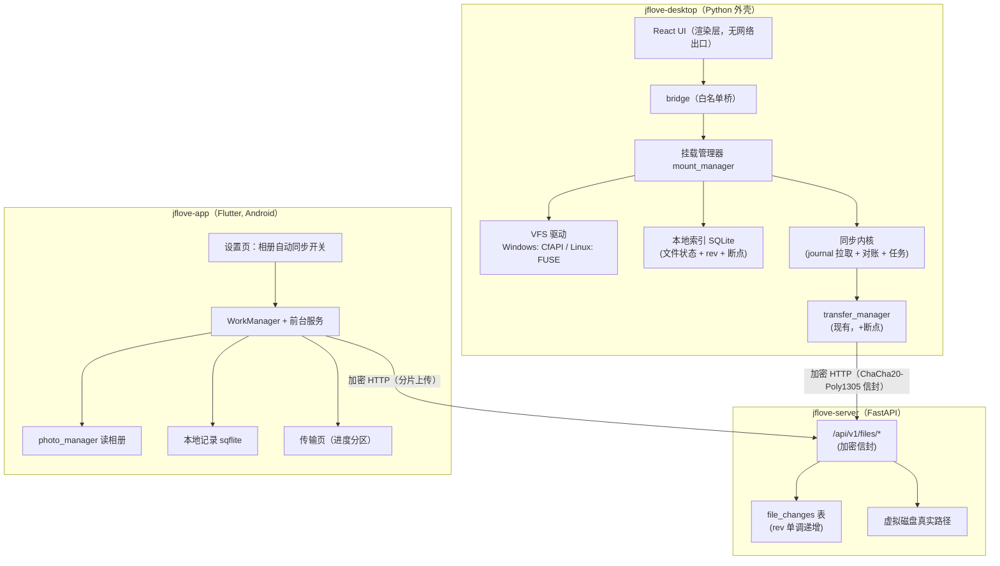

# JFLove v1.7.0 设计文档 —— 目录级挂载云盘与移动端相册备份

> **依据**：`文档记录/需求文档/v1.7.0.md`（AC-100 ~ AC-135）。
> **范围**：`jflove-server`（journal + 增量 + 分片清理）、`jflove-desktop`（挂载内核 + 状态 UI）、`jflove-app`（相册备份 + 删除同步管理）、`jflove-web`（删除同步面板）。
> **版本号**：`1.7.0`（`version.json` 唯一真相）。
> 编写角色：designer（Phase 2，`AGENTS.md §7.3`）。

---

## 0. 前言

### 0.1 术语

| 术语 | 含义 |
|---|---|
| **挂载点（Mount）** | `(disk_id, remote_path, local_path, enabled)` 四元组；一个挂载点只暴露一个远端子目录 |
| **占位（Placeholder）** | 本地存在元数据（名/大小/mtime）、但不含实体内容的文件表示 |
| **水合（Hydration）** | 用户打开占位文件时，按需拉取实体内容的过程 |
| **固定（Pinned）** | 用户显式要求保留离线可用；远端变更时自动更新本地副本 |
| **journal / 变更日志** | 服务端按 `rev` 单调递增记录的文件变更序列 |
| **对账（Reconcile）** | 用一次全量 stat 扫描校正 journal 可能遗漏的"API 外变更" |
| **VFS** | 虚拟文件系统层（Windows CfAPI / Linux FUSE） |

### 0.2 技术选型与理由

| 位置 | 选型 | 理由 | 置信度 |
|---|---|---|---|
| Windows 挂载 | **CfAPI（`cldapi.dll`）**，纯 ctypes 优先 | 零驱动安装；资源管理器原生云状态列；与 OneDrive 同款 | 待预研（见 §11.1） |
| Windows 降级 | WinFsp（用户态 FS + FUSE 兼容 API） | 不需 CfAPI 复杂回调查；但需装驱动、无系统云状态列 | 已实测（官方文档） |
| Linux 挂载 | **FUSE**（`fusepy` / `pyfuse3`） | 成熟、无系统状态列但可按需读 | 已实测（生态成熟） |
| 桌面端状态索引 | 本地 **SQLite** | 文件级状态 + rev + 断点记录；避免每次全量扫描 | 设计选择 |
| 移动端相册读取 | `photo_manager` | 跨平台、封装 MediaStore / PHPhotoLibrary | 待确认（需验证 Android 13/14 权限行为） |
| 移动端后台 | `workmanager` + `flutter_foreground_task` | 周期任务 + 前台服务保活 | 待确认（国产 ROM 行为需真机验证） |
| 移动端本地记录 | `sqflite` | 上万条备份记录，JSON 不适合 | 设计选择 |
| 服务端 journel 存储 | SQLite 同库新表 `file_changes` | 与现有库一致，无需新组件 | 设计选择 |

> **不引入**：WebDAV / SMB / SFTP 服务端、任何新加密算法、任何长期密钥（`AGENTS.md §9`）。

### 0.3 实测与待确认清单

| id | 结论 | 证据 / 判据 | 置信度 |
|---|---|---|---|
| S-1 | 服务端下载流已是 `StreamingResponse + encrypt_stream_chunk`（v1），预览流为 v2 | `file_controller.py:309-313`、`:648-655` | 已实测（静态） |
| S-2 | 服务端已有 Range 读能力，`get_stream_range` 规范化 start/end | `file_service.py:658-718` | 已实测（静态） |
| S-3 | 上传临时分片按 `upload_id` 目录存放，会话在内存 dict | `file_service.py:270-286` | 已实测（静态） |
| S-4 | `init_db()` 只做加表/加列/建索引，管不到删约束 | `database.py:309-371` | 已实测（静态） |
| S-5 | 桌面端同步配置为本地 JSON，按账号隔离 | `jflove-desktop/src/services/sync_service.py:1-45` | 已实测（静态） |
| S-6 | 移动端当前无 `photo_manager` / `workmanager` / `sqflite` 依赖 | `jflove-app/pubspec.yaml` | 已实测（静态） |
| S-7 | Web `SyncPage` 是 82 行静态页，`sync-service.ts` 未被引用 | `grep -rn "sync-service" jflove-web/src` = 0 | 已实测（命令） |
| S-8 | CfAPI 纯 ctypes 接入可行性 | `poc/cfapi_probe.py` 退出码 0；`tests/test_mount_vfs_v1_7_0.py` 2 passed | **已实测（Windows Server 2022 / build 20348）** |

---

## 1. 总体架构

### 1.1 架构图



### 1.2 关键数据流

**桌面端挂载读路径**：系统/用户打开文件 → VFS 回调 → 本地索引查状态 → 未缓存 ⇒ 发起加密 Range 请求 → 解密写入占位 → 状态变 `cached` → 返回给系统。

**桌面端增量**：挂载点启用/定时 → `POST /files/journal`（since_rev）→ 合并到本地索引 → 生成占位/删除占位 → 必要时对账。

**移动端相册**：系统媒体变更 → WorkManager/ContentObserver → 查未备份 → 分片上传（加密）→ 写本地记录 → 传输页更新。

### 1.3 模块划分

| 模块 | 新增 | 改造 | 删除 |
|---|---|---|---|
| server | `file_changes` 表、`/files/journal`、`/files/scan`、分片清理任务 | `file_service` 写入点埋 journal | — |
| desktop | `mount_manager`、VFS 驱动、本地索引、挂载管理 UI | `transfer_manager`（断点）、`sync_service`（配置迁移）、`sync_engine`（替换） | 旧全量 diff 引擎 |
| app | 相册备份服务、设置分区、传输页分区、本地记录 | 设置页 | 同步页 / 路由 / 服务 / 模型 / Provider |
| web | — | — | `SyncPage`、`/sync` 路由、两处菜单、`sync-service` |

---

## 2. 服务端设计

### 2.1 数据库变更

#### 2.1.1 新增表 `file_changes`

```sql
CREATE TABLE IF NOT EXISTS file_changes (
    id           INTEGER PRIMARY KEY AUTOINCREMENT,
    disk_id      INTEGER NOT NULL,
    rel_path     TEXT    NOT NULL,              -- 相对磁盘根，使用 / 分隔
    op           TEXT    NOT NULL,              -- upsert / delete
    is_dir       INTEGER NOT NULL DEFAULT 0,
    size         INTEGER NOT NULL DEFAULT 0,
    mtime        REAL    NOT NULL DEFAULT 0,
    content_hash TEXT    NOT NULL DEFAULT '',   -- 可选，上传完成时写入
    created_at   TEXT    NOT NULL,
    updated_at   TEXT    NOT NULL,
    deleted_at   TEXT
);
```

索引：

```sql
CREATE INDEX IF NOT EXISTS file_changes_disk_id_idx ON file_changes(disk_id);
CREATE INDEX IF NOT EXISTS file_changes_rel_path_idx ON file_changes(rel_path);
```

**要点**：

1. **`rev` = `id`**：`AUTOINCREMENT` 全局单调，删除记录也占 id，不会回退；客户端只记 `last_rev`。
2. **软删除与唯一性**：本表**不建唯一索引**——同一路径允许多条历史记录（append-only 日志），`deleted_at` 仅用于清理。
3. **不建外键约束**（`AGENTS.md §5.2`）。
4. 清理：保留最近 N 条（默认 100000）或 30 天，避免无限增长；清理动作不得影响 `last_rev` 语义（客户端拿到 `since_rev` 太旧时返回 `reset_required=true`，走全量对账）。

#### 2.1.2 写入点（必须全部埋）

| 操作 | 写入 | 说明 |
|---|---|---|
| `complete_upload` | `upsert`（文件） | 上传成功、原子替换后写 |
| `delete_file` | `delete`（文件或其整棵子树） | 目录递归删除要为每个子孙写一条 |
| `rename_file` | 旧路径 `delete` + 新路径 `upsert` | |
| `move_file` | 旧路径 `delete` + 新路径 `upsert` | |
| `make_dir` | `upsert`（`is_dir=1`） | |
| 媒体修复产物 | `upsert` | 产物落到磁盘后写 |

> **API 外变更**（用户直接往磁盘目录拷文件）不会进 journal —— 由客户端 `scan` 对账兜底（§2.3.2、§3.3）。

### 2.2 新增接口

#### 2.2.1 `POST /api/v1/files/journal`

**用途**：拉取某磁盘、某子目录范围内的增量变更。

- 明文白名单：**否**
- 加密：`decrypt_request_body` + `encrypt_response`
- 路径参数：**无**（`disk_id` / `prefix` 均在加密 body）
- 鉴权：JWT（body `token`）+ `check_disk_permission(read)`

请求字段：

| 字段 | 类型 | 必填 | 说明 |
|---|---|---|---|
| `token` | string | 是 | JWT |
| `disk_id` | int | 是 | 虚拟磁盘 ID |
| `prefix` | string | 否 | 子目录前缀（空 = 根）；**服务端强制限定在此前缀内** |
| `since_rev` | int | 是 | 上次拿到的最大 rev（首次传 0） |
| `limit` | int | 否 | 默认 500，最大 2000 |

响应字段：

| 字段 | 类型 | 说明 |
|---|---|---|
| `changes` | array | 每项见下表 |
| `latest_rev` | int | 本次返回的最大 rev（无变更时 = `since_rev`） |
| `has_more` | bool | 是否还有更多（客户端用 `latest_rev` 继续拉） |
| `reset_required` | bool | `true` 表示 `since_rev` 已过旧（被清理），客户端应走全量对账 |

`changes[]` 字段：

| 字段 | 类型 | 说明 |
|---|---|---|
| `rev` | int | 变更序号 |
| `path` | string | 相对磁盘根的路径（`/` 分隔） |
| `op` | string | `upsert` / `delete` |
| `is_dir` | bool | 是否目录 |
| `size` | int | 字节数（目录为 0） |
| `mtime` | float | Unix 时间戳（秒） |
| `hash` | string | 内容哈希（可空） |

错误码：`401` 令牌无效 / `403` 无读权限 / `400` 参数错误。

**范围隔离实现**：`WHERE disk_id=? AND id>? AND (rel_path=? OR rel_path LIKE ? ESCAPE '\')`，`LIKE` 参数为 `prefix + '/%'`（对 `%` / `_` 做转义）。返回前再对每条路径做一次前缀断言（防御深度）。

#### 2.2.2 `POST /api/v1/files/scan`

**用途**：全量对账（只 stat，不读内容），用于发现 journal 遗漏的外部变更。

- 明文白名单：**否**；加密：同上；路径参数：无
- 鉴权：JWT + `check_disk_permission(read)`

请求字段：`token` / `disk_id` / `prefix` / `cursor`（上一页最后路径，空 = 首页）/ `limit`（默认 2000，最大 5000）。

响应字段：`entries[]`（`path` / `is_dir` / `size` / `mtime`）、`next_cursor`、`has_more`、`latest_rev`（当前最大 rev，供客户端对齐）。

> 排序：按 `path` 升序；`cursor` 为上一页最后一个 `path`，下一页 `WHERE path > cursor`（同一事务内保证稳定性）。

#### 2.2.3 旧接口处置

- `POST /api/v1/sync/snapshot` **保留**（过渡期桌面端旧逻辑使用），下个版本评估移除。
- 移动端删除同步管理后不再调用它。

### 2.3 分片清理

- 位置：`UPLOAD_TEMP_DIR/<upload_id>/`（`file_service.py:270-272`）。
- 策略：服务启动时 + 每 1 小时扫描一次；删除 **mtime 超过 24 小时**且不在内存 `_upload_sessions` 中的目录。
- 判据：`AC` 见需求文档 §4；设计上保证"清理失败不影响主流程"（只记 warning）。

### 2.4 安全标注（§9.7 清单）

| 接口 | 明文白名单 | 加密信封 | 文件流 | 路径参数 | 归属/权限校验 |
|---|---|---|---|---|---|
| `/files/journal` | 否 | 是 | 否 | 无 | JWT + `check_disk_permission(read)` + 前缀断言 |
| `/files/scan` | 否 | 是 | 否 | 无 | JWT + `check_disk_permission(read)` + 前缀断言 |

- 响应头不含文件名/路径；日志只记 `disk_id` / `size` / `rev`，不记路径全文。
- 不新增明文路径，不新增加密算法。

---

## 3. 桌面端设计

### 3.1 挂载架构

```
mount_manager（单例）
 ├─ 配置层：mounts_{username}.json（本地，按账号隔离）
 ├─ 驱动层：VfsDriver 接口
 │    ├─ WindowsCfapiDriver（主）/ WindowsWinFspDriver（降级）
 │    └─ LinuxFuseDriver
 ├─ 索引层：mount_index.db（SQLite）
 └─ 同步层：journal_sync（拉增量 + 对账 + 提交传输）
```

**VfsDriver 接口**（Python 抽象）：

| 方法 | 说明 |
|---|---|
| `start(mount) -> None` | 注册挂载点（CfAPI sync root / FUSE mount） |
| `stop(mount) -> None` | 停止并卸载 |
| `update_placeholder(path, state)` | 更新状态（已缓存/仅在线/同步中） |
| `is_available() -> bool` | 驱动是否可用（用于降级判定） |

### 3.2 本地索引（`mount_index.db`）

```sql
CREATE TABLE IF NOT EXISTS mount_files (
    mount_id     TEXT NOT NULL,
    rel_path     TEXT NOT NULL,          -- 相对挂载点根
    remote_path  TEXT NOT NULL,          -- 相对磁盘根（= mount.remote_path + '/' + rel_path）
    rev          INTEGER NOT NULL DEFAULT 0,
    size         INTEGER NOT NULL DEFAULT 0,
    mtime        REAL NOT NULL DEFAULT 0,
    hash         TEXT NOT NULL DEFAULT '',
    state        TEXT NOT NULL,          -- online / cached / pinned / error / conflict
    local_path   TEXT NOT NULL,
    updated_at   TEXT NOT NULL,
    PRIMARY KEY (mount_id, rel_path)
);
```

- 状态机：`online → hydrating → cached`；`cached → pinned`；任意 → `error` / `conflict`。
- `hydrating` 是**运行时**状态，不持久化（进程重启视为未缓存）。
- 启动时若本地实体存在但索引为 `online` ⇒ 以实体为准修正为 `cached`（自愈）。

### 3.3 同步内核

1. **启用挂载点**：`journal(since_rev=0)` 拉全量 → 建占位（CfAPI `CfCreatePlaceholders` / FUSE 生成虚拟条目）。
2. **增量**：定时（默认 60s）拉 `/files/journal`（since_rev）→ 更新索引 → 增/删占位。
3. **对账**：每 10 分钟或用户点「刷新」→ `/files/scan` 分页 → 与索引比对（只查 size/mtime 差异）→ 补 journal 遗漏。
4. **水合**：VFS 读回调 → 索引查 `cached`？直接读本地：走加密 Range 流 → 写临时文件 → `os.replace` 原子落位 → 更新状态。
5. **上传**：用户在挂载目录新建/修改文件 → CfAPI/FUSE 写回调 → 提交上传任务 → 完成后更新 `rev`（从上传响应或下一次 journal 拿）。
6. **任务结果回写**：`transfer_manager` 的 `task_updated` → 更新索引状态（解决 E-1）。

### 3.4 断点续传

- **下载**：记录 `downloaded_bytes`；重试时用 `range_start=downloaded_bytes` 续传；校验总大小一致后 `os.replace`。
- **上传**：记录 `upload_id` + 已传分片集合；重试时先尝试续传；若服务端会话失效（404）→ 重新 `init` 并重传（相册/小文件影响小）。
- 断点记录存 `mount_index.db` 的 `transfer_resume` 表（`mount_id, rel_path, kind, bytes, upload_id, chunks`）。

### 3.5 冲突处理

触发条件：本地有未上传修改 **且** 远端 `rev` 已变化。

处理：
1. 远端版本下载为 `<原名>.conflict-<yyyyMMddHHmmss>-<设备名>`；
2. 本地版本保留原名并上传（若上传成功，远端 = 本地版本，冲突副本留在远端）；
3. 索引状态标 `conflict`，UI 提供「保留本地 / 保留远端 / 两个都留」三个动作。

**绝不静默覆盖**（需求 F22.2）。

### 3.6 配置与迁移

`mounts_{username}.json`：

```json
[{
  "id": "a1b2c3d4",
  "name": "照片库",
  "disk_id": 1,
  "remote_path": "photos",
  "local_path": "D:\\JFLove\\照片库",
  "enabled": false,
  "mode": "ondemand"
}]
```

迁移：读取旧 `sync_configs_{username}.json`，逐条转成挂载点（`enabled = auto_sync`），迁移后写 `mounts_*.json` 并保留旧文件（不删，防回滚丢配置）。迁移失败 ⇒ 中文提示 + 不删除旧文件。

### 3.7 渲染层边界（§9.6）

- 挂载管理 UI 只通过桥调用：`mount.list` / `mount.add` / `mount.update` / `mount.remove` / `mount.setEnabled` / `mount.sync` / `mount.status`。
- **文件字节不进渲染层**；预览仍走现有 `StreamProxy`。
- 桥的 `api.request` 白名单**不新增**任何文件读写出口。

### 3.8 降级方案

| 情形 | 行为 |
|---|---|
| CfAPI 不可用（spike 失败 / 系统版本低） | 切 WinFsp；UI 明示"兼容模式（无系统云状态列）"（AC-106） |
| WinFsp 也不可用（未装驱动） | 应用内挂载视图：显示远端全量 + 状态 + 按需下载，但**不映射系统路径** |
| Linux FUSE 不可用 | 同上（应用内视图） |

---

## 4. 移动端设计

### 4.1 依赖引入

```yaml
photo_manager: ^3.x        # 相册读取（MediaStore）
workmanager: ^0.9.x        # 后台周期任务（含网络/充电约束）
flutter_foreground_task: ^9.x  # 前台服务保活 + 通知
sqflite: ^2.x              # 本地备份记录
android_intent_plus: ^5.x  # 跳转系统设置（厂商保活引导）
```

> 版本号以 `flutter pub add` 实际解析为准；引入理由见 §0.2。

### 4.2 架构

```
SettingsPage（开关 + 配置）
   └─ AlbumBackupService（单例）
        ├─ PermissionGate（MediaStore 权限）
        ├─ BackupScheduler（WorkManager 周期 + 即时触发）
        ├─ ForegroundTask（通知 + 保活）
        ├─ AssetScanner（photo_manager 查未备份）
        ├─ Uploader（复用 TransferService 分片上传）
        └─ BackupStore（sqflite：asset_id → remote_path/hash）
```

### 4.3 本地记录

```sql
CREATE TABLE album_backup (
    asset_id     TEXT PRIMARY KEY,   -- MediaStore id
    remote_disk  INTEGER NOT NULL,
    remote_path  TEXT NOT NULL,
    content_hash TEXT NOT NULL,
    size         INTEGER NOT NULL,
    backed_at    TEXT NOT NULL
);
CREATE TABLE album_backup_fail (
    asset_id TEXT PRIMARY KEY,
    reason   TEXT NOT NULL,
    tried_at TEXT NOT NULL
);
```

### 4.4 备份流程

1. 开关打开 → 请求权限（Android 13+ 分媒体类型）→ 选远端目录（`files/list`）/ 选范围。
2. 启动前台服务（通知「相册备份进行中」）→ 扫描未备份资源（`album_backup` 中不存在或 hash 变化）。
3. 逐条上传：`init → chunk → complete`（复用 `TransferService`），失败写入 `album_backup_fail` 并可重试。
4. 成功 → 写 `album_backup`；传输页更新计数。
5. 关闭开关 → 停止调度、停前台服务；进行中任务取消（用户可选"完成后停止"）。

### 4.5 厂商适配

- 检测 `Build.MANUFACTURER`（MethodChannel）→ 命中小米/华为/OPPO/vivo/荣耀 → 显示对应中文引导（跳转自启动设置页 / 电池优化页，`android_intent_plus`）。
- 权限拒绝 → 中文说明 + 「去设置」按钮。

### 4.6 删除同步管理

删除清单（`AC-124`）：
- `lib/pages/sync/sync_page.dart`
- `lib/providers/sync_provider.dart`
- `lib/services/sync_engine_service.dart`
- `lib/services/sync_service.dart`
- `lib/models/sync_config.dart`
- `lib/app.dart:58` 的 `/sync` 路由
- 导航菜单入口（随 `app.dart` / 布局文件核对）
- 相关测试文件

---

## 5. Web 端设计

### 5.1 删除清单

| 文件 | 动作 |
|---|---|
| `jflove-web/src/pages/SyncPage.tsx` | 删除 |
| `jflove-web/src/services/sync-service.ts` | 删除（未被引用） |
| `jflove-web/src/config/routes.tsx:11,68` | 删 import + 路由 |
| `jflove-web/src/layouts/DesktopLayout.tsx:31` | 删菜单项 |
| `jflove-web/src/layouts/MobileLayout.tsx:27` | 删菜单项 |

### 5.2 路由处置

`/sync` 不再注册 ⇒ 落入现有 404 / 兜底路由即可，不新增重定向。

---

## 6. 数据库迁移

### 6.1 `jflove-db/migrate-1.7.0.sql`

```sql
-- v1.7.0：新增文件变更日志（幂等）
CREATE TABLE IF NOT EXISTS file_changes (
    id           INTEGER PRIMARY KEY AUTOINCREMENT,
    disk_id      INTEGER NOT NULL,
    rel_path     TEXT    NOT NULL,
    op           TEXT    NOT NULL,
    is_dir       INTEGER NOT NULL DEFAULT 0,
    size         INTEGER NOT NULL DEFAULT 0,
    mtime        REAL    NOT NULL DEFAULT 0,
    content_hash TEXT    NOT NULL DEFAULT '',
    created_at   TEXT    NOT NULL,
    updated_at   TEXT    NOT NULL,
    deleted_at   TEXT
);
CREATE INDEX IF NOT EXISTS file_changes_disk_id_idx ON file_changes(disk_id);
CREATE INDEX IF NOT EXISTS file_changes_rel_path_idx ON file_changes(rel_path);
```

### 6.2 `jflove-db/rollback-1.7.0.sql`

```sql
-- 回滚前冲突检查（有数据时告警，不阻断）
-- SELECT COUNT(*) FROM file_changes;
DROP INDEX IF EXISTS file_changes_rel_path_idx;
DROP INDEX IF EXISTS file_changes_disk_id_idx;
DROP TABLE IF EXISTS file_changes;
```

### 6.3 迁移与校验

- `init_db()` 同步新增 `_CREATE_FILE_CHANGES` + `_INDEXES` 两条，并加入 `expected_schema()` / `expected_indexes()`。
- 发布前：`python scripts/check_db_schema.py` 退出码必须为 `0`（`AGENTS.md §5.1.1`）。
- 本版**无**"去掉/修改约束"类变更，不需要重建表。

---

## 7. API 定义汇总

| # | 方法 | 路径 | 加密 | 鉴权 | 状态 |
|---|---|---|---|---|---|
| 1 | POST | `/api/v1/files/journal` | 信封 | JWT + read 权限 | 新增 |
| 2 | POST | `/api/v1/files/scan` | 信封 | JWT + read 权限 | 新增 |
| 3 | POST | `/api/v1/sync/snapshot` | 信封 | JWT + read 权限 | **保留**（过渡） |
| — | 现有 `/files/upload/*`、`/files/download`、`/files/stream` | 不变 | — | — | 复用 |

**错误码约定**：`400` 参数非法 / `401` 令牌失效 / `403` 权限不足 / `404` 路径不存在 / `409` 冲突。

---

## 8. 关键决策与最终裁决

| id | 决策点 | 最终方案 | 原因 | 影响文件 |
|---|---|---|---|---|
| **DS-1** | `rev` 语义 | 用 `file_changes.id`（全局单调）作为 rev | 简单、无回退、客户端只记一个整数 | `database.py`、`file_changes` |
| **DS-2** | API 外变更 | **journal + 定期 `scan` 对账**双保险 | 用户可直接改磁盘目录，纯 journal 会漏 | `mount_manager`、`/files/scan` |
| **DS-3** | Windows 驱动 | CfAPI 优先（纯 ctypes），失败降级 WinFsp，再失败降级应用内视图 | 零驱动是最大优势；有明确降级链 | `WindowsCfapiDriver` 等 |
| **DS-4** | 状态存储 | 本地 SQLite `mount_index.db` | 文件级状态 + 断点，避免全量扫描 | `mount_index` |
| **DS-5** | 冲突 | 保留双版本 + 冲突副本命名 | 不静默覆盖 | `sync_kernel` |
| **DS-6** | 旧配置迁移 | 同步配置 → 挂载点，保留旧文件 | 不丢用户配置、可回滚 | `sync_service` |
| **DS-7** | 移动端后台 | WorkManager + 前台服务 | 同时满足周期与保活 | `album_backup` |
| **DS-8** | 相册本地记录 | sqflite（非 JSON） | 上万条记录 | `backup_store` |
| **DS-9** | Web 删除 | 页面 + service + 路由 + 两处菜单 | 死代码清理 | `jflove-web/src` |
| **DS-10** | 分片清理 | 24h 超时 + 启动/每小时扫描 | 防磁盘泄漏 | `file_service` |

---

## 9. 安全设计

### 9.1 §9.7 新接口自查

- [x] 路径可枚举 ID？无路径参数；`disk_id` 在加密 body，且做 read 权限校验。
- [x] 请求 body 走 `decrypt_request_body`。
- [x] 成功响应走 `encrypt_response`。
- [x] 错误通过 `HTTPException` 抛出（全局 handler 加密）。
- [x] 是否返文件流？`journal` / `scan` 不返文件流；下载复用现有加密流。
- [x] 响应头无敏感元数据。
- [x] 日志不记明文路径（只记 `disk_id` / `size` / `rev`）。
- [x] 无新增长期密钥 / 静态盐 / 写死对称密钥。

### 9.2 桌面端

- 渲染层无网络出口；挂载与传输全在 Python 侧。
- 本地缓存明文（需求 D2），不进入渲染层；桥不暴露文件字节。

### 9.3 移动端

- 上传复用 `TransferService`（`encryptedPost`）。
- session_key / JWT 不进日志；备份记录只存 hash 与远端路径。

---

## 10. 设计差异与影响文件

### 10.1 与 v1.6.2 的差异

| 维度 | v1.6.2 | v1.7.0 |
|---|---|---|
| 服务端 | 无 journal | 新增 `file_changes` + 2 接口 + 清理任务 |
| 桌面端 | 全量 diff 引擎 | 挂载内核 + 本地索引 + VFS |
| 移动端 | 同步管理 | 相册备份 |
| Web | 同步面板 | 删除 |
| 数据库 | 无变更 | 新增表（迁移脚本） |

### 10.2 影响文件清单

**server**：`src/models/database.py`、`src/services/file_service.py`、`src/controllers/file_controller.py`、`src/services/sync_service.py`（保留）、`scripts/check_db_schema.py`（期望结构）、`jflove-db/migrate-1.7.0.sql`、`rollback-1.7.0.sql`。

**desktop**：`src/utils/mount_manager.py`（新）、`src/utils/vfs/`（新）、`src/services/mount_service.py`（新）、`src/bridge/mount.py`（新）、`src/utils/transfer_manager.py`、`src/services/sync_service.py`、`ui/src/pages/SyncPage.tsx`（改造为挂载页）、`ui/src/config/routes.tsx`。

**app**：`lib/services/album_backup/`（新）、`lib/pages/settings/settings_page.dart`、`lib/pages/transfer/transfer_page.dart`、`lib/app.dart`（删路由）、`pubspec.yaml`。

**web**：`src/pages/SyncPage.tsx`（删）、`src/services/sync-service.ts`（删）、`src/config/routes.tsx`、`src/layouts/DesktopLayout.tsx`、`src/layouts/MobileLayout.tsx`。

---

## 11. 风险与未决项

| id | 风险 | 影响 | 应对 |
|---|---|---|---|
| **R-1** | ~~CfAPI 纯 ctypes 接入失败~~ | ~~Windows 无云状态列~~ | **已关闭**：注册 → 连接 → 占位 → `FETCH_DATA` + `CfExecute` 全链路实测通过（`poc/cfapi_probe.py` exit 0、`tests/test_mount_vfs_v1_7_0.py` 2 passed）；Linux FUSE 待换设备 |
| **R-2** | 国产 ROM 杀后台导致相册备份不持续 | 移动端体验 | 前台服务 + 厂商引导 + WorkManager 兜底；真机验证 |
| **R-3** | 大目录 `scan` 全量对账耗时 | 挂载点刷新慢 | 分页（5000/页）+ 只在启用/定时执行；后续可加增量 stat |
| **R-4** | `_upload_sessions` 在内存，服务重启丢失 | 断点续传失效 | 客户端检测 404 后重新 init；大文件影响可接受 |
| **R-5** | journal 表无限增长 | 磁盘占用 | 保留 30 天 / 10 万条 + `reset_required` 兜底 |
| **R-6** | 移动端新增 4 个依赖的兼容性 | 构建失败 | 先 `flutter pub add` 验证 + 锁版本 |

### 11.1 Phase 4a 必须先做的预研（判据）

1. 用 ctypes 定义 `CF_CALLBACK_REGISTRATION` / `CF_CALLBACK_INFO` / `CF_OPERATION_INFO`；
2. 注册一个 sync root，创建 1 个占位文件，资源管理器能看到云状态；
3. 双击占位触发 `FETCH_DATA` 回调并成功 `CfExecute(TRANSFER_DATA)` 写回内容；
4. **判据**：上述 3 步在 Windows 10/11 真机跑通 = CfAPI 路线成立；任一步失败且 24 小时内无法解决 = 切降级方案。

> 该预研结果必须回写本文件 §0.3 S-8 与 §11 R-1，并作为 Phase 4a 开发记录的取证。
>
> **2026-10-18 预研结论（已回写）**：三步判据在 Windows Server 2022（build 20348）全部跑通。
> 关键坑位：① `CfConnectSyncRoot` 之前必须 `CfRegisterSyncRoot`；② `CF_CALLBACK_PARAMETERS`
> 首字段是 `ParamSize`（ULONG），`FetchData` 是 union 成员（不是 `StructSize + Type`）；
> ③ `CfExecute` 的 `CF_OPERATION_PARAMETERS` 也**必须以 `StructSize` 开头**；
> ④ `CfCreatePlaceholders` 的 `FileIdentity` 对文件是**强制**字段；本机仍返回
> `ERROR_CLOUD_FILE_INVALID_REQUEST`，故实现改用 `CfConvertToPlaceholder(DEHYDRATE)` 路线。
