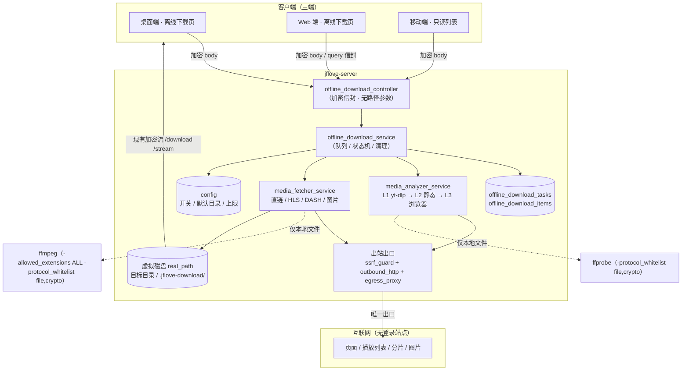
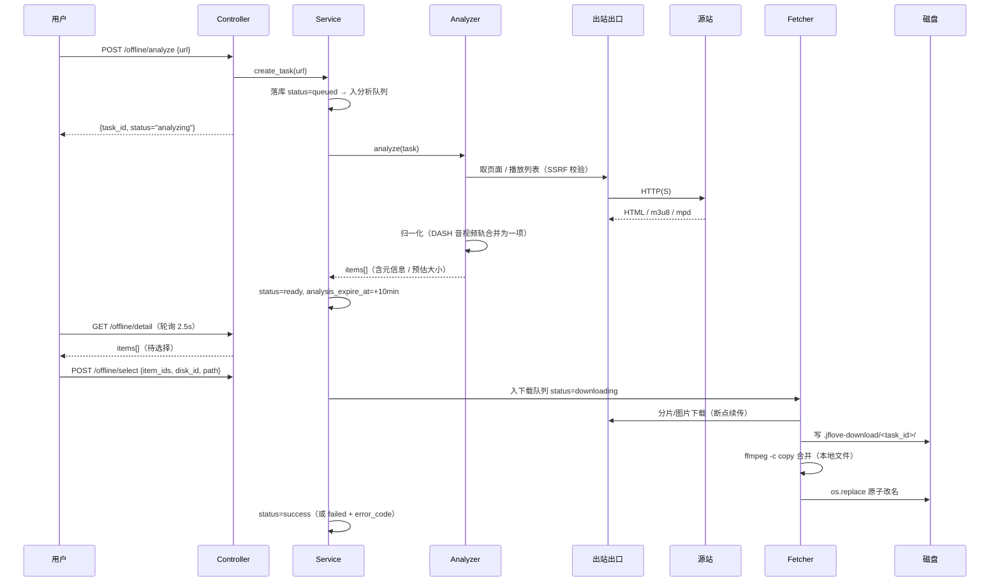
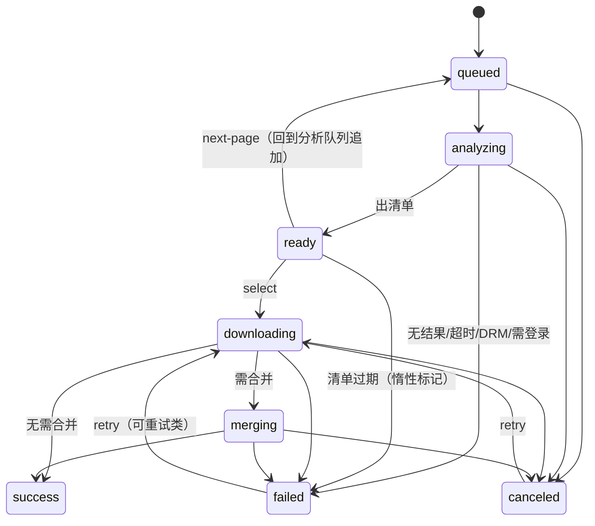

# JFLove v1.8.0 设计文档 —— 服务端离线下载（网址分析 + 媒体抓取）

> **依据**：`文档记录/需求文档/v1.8.0.md`（AC-200 ~ AC-239）。
> **范围**：`jflove-server`（核心：出站出口 / 分析器 / 下载器 / 任务 / 配置）、`jflove-desktop`（完整页）、
> `jflove-web`（完整页）、`jflove-app`（只读页）。
> **版本号**：`1.8.0`（`version.json` 唯一真相）。
> 编写角色：designer（Phase 2，`AGENTS.md §7.3`）。

---

## 0. 前言

### 0.1 术语

| 术语 | 含义 |
|---|---|
| **离线下载任务** | 一次「网址 → 分析 → 选择 → 下载」的全过程，落库为 `offline_download_tasks` 一行 |
| **可下载项（item）** | 清单里的一条：一个视频变体 / 一条音轨 / 一张图 / 一条字幕，落库为 `offline_download_items` 一行 |
| **L1 / L2 / L3** | 三级分析：① 站点解析（yt-dlp）② 静态抓取（HTML/JSON/播放列表）③ 深度分析（无头浏览器嗅探） |
| **本地化（localize）** | 把远端播放列表/密钥改写为**本机文件路径**，使 ffmpeg 只读本地、不再出网 |
| **出站出口（egress）** | 服务端访问外网的**唯一**通道：`ssrf_guard` + `outbound_http` + `egress_proxy` |
| **策略代理** | 绑定 `127.0.0.1` 的临时 HTTP/CONNECT 代理，强制第三方分析器（yt-dlp）的请求也走同一套 SSRF 策略 |
| **变体（variant）** | HLS 主列表里的一个清晰度，或 DASH 里的一个 Representation |

### 0.2 技术选型与理由

| 位置 | 选型 | 理由 | 置信度 |
|---|---|---|---|
| 站点解析（L1） | **`yt-dlp==2026.8.19`** | 覆盖广、纯 Python（`py3-none-any`）、原生返回 HLS/DASH 的 formats 清单（含分辨率/码率/编码）；**只用于分析，不用于下载** | **已实测**（S-1/S-2/S-3/S-4） |
| 静态抓取（L2） | **自研**：`html.parser`（stdlib）+ 内嵌 JSON 启发式 | yt-dlp 对纯图片页**不返回图片**（S-5），图片必须自己抓；引入 `gallery-dl` 属重量级且与本版范围不符 | **已实测**（S-5） |
| 深度分析（L3） | **`playwright==1.64.0` + Chromium headless** | 需要真实浏览器执行 JS 并拦截响应；greenlet 有 cp314 wheel（S-12） | **待确认**（S-13，镜像内启动验证在 Phase 3） |
| 出站 HTTP | **`httpx==0.28.1`**（环境中已存在，未显式声明） | 异步、流式、超时/连接池成熟；**全仓唯一出站入口** | **已实测**（S-11） |
| 策略代理 | **自研**（asyncio 流式 TCP + CONNECT） | 把 yt-dlp 的出网也纳入同一策略，**不依赖其内部 API**（其内部注册接口不稳定） | 设计选择（Phase 3 实测） |
| 媒体合并/重封装 | **系统 `ffmpeg`**（镜像已装并构建期校验） | `-c copy` 无损；对 AES-128 HLS 可解密；不需编码器 | **已实测**（S-6/S-7/S-8） |
| 媒体元信息 | **`ffprobe`**（`-protocol_whitelist file,crypto` 限定本地） | 只读本地化后的播放列表/分片即可拿到分辨率/编码/时长 | **已实测**（S-9/S-10） |
| 图片宽高 | **自研 `image_probe`**（JPEG/PNG/GIF/WebP 头解析） | 只为过滤统计像素与展示分辨率，免引入 Pillow | 设计选择 |
| 浏览器运行时分发 | 镜像 `ARG WITH_BROWSER=1`（默认 1） | 体积可控；设为 0 时能力降级并向管理员**响亮报警** | 设计选择 |

> **不引入**：任何新加密算法 / 新 KDF / 长期密钥（`§9`）；不引入 `gallery-dl`、`Pillow`、`lxml`、`bs4`；
> **不引入** 任何"在线拉取解析器代码"的自更新机制（需求 I-6）。

### 0.3 实测与待确认清单

> 纪律（`designer/SKILL.md`）：每条附**命令 + 原始输出片段 + 置信度**；下游使用前必须自己复现一次。

| id | 结论 | 证据（命令 / 输出片段） | 置信度 |
|---|---|---|---|
| **S-1** | `yt-dlp 2026.8.19` 提供纯 wheel，Python 3.14 可安装可导入 | `pip download --no-deps yt-dlp` → `yt_dlp-2026.8.19-py3-none-any.whl`；`import yt_dlp` → `2026.08.19` | **已实测**（venv-linux / Python 3.14.8） |
| **S-2** | yt-dlp 对**直链 mp4 / m3u8 / mpd / HTML5 `<video>`** 均能 `extract_info(download=False)` 出 formats，耗时 0.03~0.33s | 本地夹具 `http://127.0.0.1:18999/...`：`直链mp4 OK 0.32s formats=1`、`HLS 0.03s formats=1`、`DASH 0.03s formats=2`、`HTML页面 0.20s extractor=HTML5MediaEmbed formats=1` | **已实测** |
| **S-3** | 对 **HLS 主列表**，yt-dlp 每个变体给一条 format，且带 `height/width/tbr` | `master.m3u8` → `formats=2`；`{'format_id':'400','height':240,'width':426,'tbr':400.0}`、`{'format_id':'900','height':480,'width':854,'tbr':900.0}` | **已实测** |
| **S-4** | 对 **音视频分离的 DASH**，yt-dlp 返回**两条** format（video-only + audio-only） | `{'format_id':'1','ext':'m4a','acodec':'mp4a.40.2','vcodec':'none'}`、`{'format_id':'0','ext':'mp4','vcodec':'avc1.42c00c','acodec':'none','height':240}` | **已实测** |
| **S-5** | yt-dlp **不返回图片**：对含 5 张图的 HTML 页只给出 1 条视频 format | `HTML页面 ... formats=1`（`srcset`/`data-src`/`background` 全部未出现） | **已实测** |
| **S-6** | `ffmpeg -c copy` 可把**本地 m3u8** 合并为 mp4，音视频齐全 | `ffmpeg -i out.m3u8 -c copy merged.mp4` → `h264 320x240` + `aac`，`duration=3.041814`，`size=64150` | **已实测**（ffmpeg 8.1.3） |
| **S-7** | **AES-128 HLS** 用本地 key 文件合并时，ffmpeg 默认**拒绝**非媒体扩展名；必须 `-allowed_extensions ALL` | 无该参数 → `Filename extension of '.../key.bin' is not a common multimedia extension, blocked for security reasons`（exit 183）；加参数后 → `aac duration=3.041814`，成功 | **已实测** |
| **S-8** | **不要**让 ffmpeg 直接读远端/本地 MPD demuxer；正确做法是**手工拼接 init+分片**再 mux | `ffmpeg -i manifest.mpd -c copy` → stderr `Error when loading first fragment of playlist`（产物可疑）；改为 `cat init-stream0.m4s chunk-stream0-*.m4s > v.mp4`、`cat init-stream1... > a.mp4` + `ffmpeg -i v.mp4 -i a.mp4 -map 0:v -map 1:a -c copy` → `h264 duration=3.000000` + `aac duration=3.000000` | **已实测** |
| **S-9** | `ffprobe` **能自行出网**读远端 m3u8/MPD（0.09s）⇒ 必须用协议白名单禁止 | 不加限制读远端：正常返回 `duration 3.000000`；`-protocol_whitelist file,crypto` → `exit=1`，`Protocol 'http' not on whitelist 'file,crypto'!` | **已实测** |
| **S-10** | 同一套白名单参数下读**本地** m3u8 正常 | `ffprobe -protocol_whitelist file,crypto ... /tmp/.../out.m3u8` → `exit=0`，`3.000000` | **已实测** |
| **S-11** | 环境里 `httpx 0.28.1` 已可用，但 `requirements.txt` **未声明** | `python -c "import httpx"` → `httpx 0.28.1`；`grep httpx requirements.txt` → 0 命中 | **已实测** |
| **S-12** | Python 3.14 有 `greenlet` / `playwright` 的可用 wheel | `pip download greenlet` → `greenlet-3.5.6-cp314-cp314-manylinux...whl`；`playwright-1.64.0-py3-none-manylinux1_x86_64.whl` | **已实测** |
| **S-13** | Chromium 在本机 headless 可启动 | `python -m playwright install chromium` + `chromium.launch(headless=True)` → 见 §0.3.1 | **待确认**（Phase 3 在镜像内复验） |
| **S-14** | 系统 ffmpeg 可能**不含 libx264**（Fedora `ffmpeg-free`），只做 `-c copy` 不受影响，但**测试夹具**必须用可用编码器 | `ffmpeg -encoders` → `libx264: NO`、`h264: libopenh264 YES`、`mpeg4 YES`；用 `libopenh264` 生成的 HLS 合并成功（S-6） | **已实测**（Fedora 8.1.3） |
| **S-15** | 现有隐藏目录机制可直接扩展：列表过滤 + `_safe_join` 拒绝 | `file_service.py:215`（`forbidden_parts=(REPAIR_DIR_NAME,)`）、`:322`（列表跳过 `REPAIR_DIR_NAME`）、`file_controller.py:24` | **已实测**（静态） |
| **S-16** | GET 只读接口支持 **query 加密信封**（Web 端浏览器 GET 无 body） | `middleware.py:34-45`（body 为空时读 `nonce`/`ciphertext` 两个 query 参数） | **已实测**（静态） |

#### 0.3.1 S-13 的复现记录（Phase 2 执行，结果回填）

```bash
cd jflove-server
venv-linux/bin/pip install -q playwright
venv-linux/bin/python -m playwright install chromium
venv-linux/bin/python -c "from playwright.sync_api import sync_playwright; ...launch(headless=True)..."
```

**实际结果**：见本文件末尾 §12「复现日志」。

---

## 1. 总体架构

### 1.1 架构图



### 1.2 关键数据流



### 1.3 模块划分（服务端新增文件）

| 文件 | 职责 | 关键约束 |
|---|---|---|
| `src/utils/ssrf_guard.py` | URL/域名/端口策略：scheme、userinfo、私网/环回/链路本地/保留地址、逐跳复检 | **纯函数、无 IO 副作用**（除 DNS 解析），便于单测 |
| `src/utils/outbound_http.py` | **唯一**出站客户端：UA/Referer、超时、大小上限、重定向逐跳复检、流式落盘 | 其他模块**禁止**直接 `import httpx` |
| `src/utils/egress_proxy.py` | 本地策略代理（HTTP + CONNECT），供 yt-dlp 使用 | 仅 `127.0.0.1`、随机端口、`Proxy-Authorization` 随机令牌、任务结束即关 |
| `src/utils/image_probe.py` | JPEG/PNG/GIF/WebP/BMP 宽高与类型探测 | 只读文件头 ≤ 64 KB |
| `src/services/media_analyzer_service.py` | L1/L2/L3、归一化、去重、上限、清晰度标签、大小估算 | 分析阶段**不落盘媒体** |
| `src/services/media_fetcher_service.py` | 直链 / HLS / DASH / 图片下载、播放列表本地化、ffmpeg 合并、原子落盘 | ffmpeg 只读本地；**禁止** `FileResponse` |
| `src/services/offline_download_service.py` | 队列、状态机、并发、取消、重试、过期、重启兜底、清理 | 与修复任务**独立**队列与并发额度 |
| `src/repositories/offline_download_repository.py` | **三张表**的 CRUD / 状态流转 / 分页 / 账号配置 UPSERT | SQL 参数化，无字符串拼接 |
| `src/controllers/offline_download_controller.py` | **10 个**接口（§2.2） | JWT 从加密 body 取；**无路径参数**；`settings` 的归属只来自 token |

### 1.4 出站网络收敛原则（本版最重要的架构约束）

> **只有 `outbound_http` 可以直接创建对外连接；`ffmpeg` / `ffprobe` 只能处理本地文件；`yt-dlp` 只能经策略代理出网。**

| 出网主体 | 强制手段 | 判据 |
|---|---|---|
| 自研抓取（页面/图片/分片/密钥/播放列表） | 必须经 `outbound_http` | `grep -rn "import httpx" src/` 只允许出现在 `outbound_http.py` |
| `ffmpeg` / `ffprobe` | 必须带 `-protocol_whitelist file,crypto`（S-9/S-10）+ 输入只能是本地路径 | 单测断言命令行参数含该白名单；传入 `http://` 必须失败 |
| `yt-dlp` | 必须传 `proxy=http://127.0.0.1:<port>` + 代理令牌；**分析期专用** | 单测：代理拒绝内网目标时 yt-dlp 请求失败 |

---

## 2. 服务端设计

### 2.1 数据库变更

#### 2.1.1 表 `offline_download_tasks`

```sql
CREATE TABLE IF NOT EXISTS offline_download_tasks (
    id                 INTEGER PRIMARY KEY AUTOINCREMENT,
    user_id            INTEGER NOT NULL,              -- 创建者（仅展示用，任务全平台共享）
    username           TEXT    NOT NULL DEFAULT '',
    source_url         TEXT    NOT NULL,              -- 完整来源 URL（重试/重新分析用；展示时脱敏）
    source_domain      TEXT    NOT NULL DEFAULT '',   -- 展示用域名
    page_title         TEXT    NOT NULL DEFAULT '',   -- 页面标题（产物命名基础）
    status             TEXT    NOT NULL DEFAULT 'queued', -- queued/analyzing/ready/downloading/merging/success/failed/canceled
    analysis_level     TEXT    NOT NULL DEFAULT '',   -- l1/l2/l3（出清单时用的是哪一级）
    analysis_expire_at TEXT,                          -- ready 状态的清单有效期（+10 分钟）
    image_page_index   INTEGER NOT NULL DEFAULT 1,    -- 图片已追加到第几页
    target_disk_id     INTEGER NOT NULL DEFAULT 0,
    target_rel_path    TEXT    NOT NULL DEFAULT '',   -- 相对路径（绝不含绝对路径 / ..）
    pack_zip           INTEGER NOT NULL DEFAULT 0,    -- 图片是否打包 zip
    item_total         INTEGER NOT NULL DEFAULT 0,
    item_done          INTEGER NOT NULL DEFAULT 0,
    bytes_total        INTEGER NOT NULL DEFAULT 0,
    bytes_done         INTEGER NOT NULL DEFAULT 0,
    speed_bps          INTEGER NOT NULL DEFAULT 0,    -- 最近一次采样的速度
    error_code         TEXT    NOT NULL DEFAULT '',   -- §2.2.3 业务错误码
    error_message      TEXT    NOT NULL DEFAULT '',   -- 中文原因
    started_at         TEXT,
    finished_at        TEXT,
    created_at         TEXT    NOT NULL,
    updated_at         TEXT    NOT NULL,
    deleted_at         TEXT
)
```

#### 2.1.2 表 `offline_download_items`

```sql
CREATE TABLE IF NOT EXISTS offline_download_items (
    id            INTEGER PRIMARY KEY AUTOINCREMENT,
    task_id       INTEGER NOT NULL,
    kind          TEXT    NOT NULL,                   -- video/audio/image/subtitle
    display_name  TEXT    NOT NULL,                   -- 「1080P · H264 · 5.2 Mbps」
    ext           TEXT    NOT NULL DEFAULT 'mp4',
    source_url    TEXT    NOT NULL,                   -- 主轨地址
    aux_url       TEXT    NOT NULL DEFAULT '',        -- 分离音频轨地址（DASH），合并时用
    protocol      TEXT    NOT NULL DEFAULT 'http',    -- http/m3u8/mpd_segments
    variant_id    TEXT    NOT NULL DEFAULT '',
    vcodec        TEXT    NOT NULL DEFAULT '',
    acodec        TEXT    NOT NULL DEFAULT '',
    width         INTEGER NOT NULL DEFAULT 0,
    height        INTEGER NOT NULL DEFAULT 0,
    duration_ms   INTEGER NOT NULL DEFAULT 0,
    est_size      INTEGER NOT NULL DEFAULT 0,         -- 预估字节数（展示带「约」）
    is_estimated  INTEGER NOT NULL DEFAULT 1,
    is_selected   INTEGER NOT NULL DEFAULT 0,
    status        TEXT    NOT NULL DEFAULT 'pending', -- pending/downloading/success/failed/skipped
    bytes_done    INTEGER NOT NULL DEFAULT 0,
    output_name   TEXT    NOT NULL DEFAULT '',        -- 最终落盘文件名（原子改名后回填）
    error_code    TEXT    NOT NULL DEFAULT '',
    error_message TEXT    NOT NULL DEFAULT '',
    sort_order    INTEGER NOT NULL DEFAULT 0,
    created_at    TEXT    NOT NULL,
    updated_at    TEXT    NOT NULL,
    deleted_at    TEXT
)
```

#### 2.1.3 表 `offline_download_settings`（**账号级默认目录**）

> 依据需求 D9：默认目录**按账号隔离**、存服务端（各端一致）、必须是该账号有 write 权限的磁盘。

```sql
CREATE TABLE IF NOT EXISTS offline_download_settings (
    id               INTEGER PRIMARY KEY AUTOINCREMENT,
    user_id          INTEGER NOT NULL,                -- 归属账号（唯一真相在服务端）
    default_disk_id  INTEGER NOT NULL,                -- 默认目标虚拟磁盘
    default_rel_path TEXT    NOT NULL DEFAULT '',     -- 默认相对路径（磁盘内，无 .. / 非隐藏目录）
    created_at       TEXT    NOT NULL,
    updated_at       TEXT    NOT NULL,
    deleted_at       TEXT                             -- 取消配置 = 软删除（保留历史便于审计）
)
```

**唯一性口径（`AGENTS.md §5.2` + `backend` 硬约束第 1 条）**：一个账号**只允许一行活跃配置**，用**部分唯一索引**表达
（不能用列级 `UNIQUE`，否则软删除后账号再也配不上）：

```sql
CREATE UNIQUE INDEX IF NOT EXISTS offline_download_settings_user_active_uidx
    ON offline_download_settings(user_id) WHERE deleted_at IS NULL;
```

#### 2.1.4 索引

```sql
CREATE INDEX IF NOT EXISTS offline_download_tasks_status_idx     ON offline_download_tasks(status);
CREATE INDEX IF NOT EXISTS offline_download_tasks_created_at_idx ON offline_download_tasks(created_at);
CREATE INDEX IF NOT EXISTS offline_download_items_task_id_idx    ON offline_download_items(task_id);
CREATE UNIQUE INDEX IF NOT EXISTS offline_download_settings_user_active_uidx
    ON offline_download_settings(user_id) WHERE deleted_at IS NULL;
```

> **唯一性说明**：`tasks` / `items` 两表**没有**需要唯一约束的业务字段（同一 URL 允许多次任务）；
> `settings` 表的「一个账号一行」由上述**部分唯一索引**保证（只对 `deleted_at IS NULL` 生效）。

#### 2.1.5 `database.py` 登记

- `expected_schema()` 增加三张表；`expected_indexes()` 增加四条索引（含 `settings` 的部分唯一索引）。
- **不**加入 `LEGACY_TABLES`（新建表）。
- `init_db()` 建表走既有 `CREATE TABLE IF NOT EXISTS` 路径即可（纯加表，无需 `ALTER`）。
- `check_db_schema.py` 无需改动（以 `expected_schema()` 为准），但发布前必须跑一次（§6.3）。

### 2.2 新增接口

> 统一前缀 `/api/v1/offline`。全部**不在明文白名单**；全部走加密信封；**无路径参数**（ID 全在加密 body 内）。

#### 2.2.0 通用约定

| 项 | 约定 |
|---|---|
| 鉴权 | 加密 body 的 `token` 字段（`§9.3`）；缺失/无效 → 401 |
| 加密 | POST：body 信封；GET：query 信封（`?nonce=&ciphertext=`，S-16） |
| 响应头 | 不出现文件名/路径（`§9.4`） |
| 业务错误 | `HTTPException(status, detail="中文原因")` + 任务级 `error_code` |
| 时间 | ISO8601 字符串（与既有接口一致） |

#### 2.2.1 `POST /analyze` —— 创建分析任务

| 项 | 内容 |
|---|---|
| 请求 | `{ "token": str, "url": str }` |
| 校验（**顺序**） | ① 总开关开启（400 `开关已关闭`）② **当前账号有效默认目录存在且仍可写**（否则 400 `no_writable_disk` / `target_not_configured` / `target_not_writable`）③ URL 通过 `ssrf_guard` ④ 分析队列未满（20） |
| 响应 | `{ "task_id": int, "status": "analyzing", "source_domain": str, "page_title": str }` |
| 错误 | 400 `开关已关闭` / `网址不合法` / `该地址不允许访问`（SSRF）/ `分析队列已满` / `没有可写入的磁盘` / `请先设置离线下载目录`；401 令牌 |

> **为什么分析前就校验目录**（D9 + AC-214b）：账号若无处可放，分析出来也不能下载；
> 提前拦住可以避免"白分析 + 白出网"，也让"没有可写磁盘 ⇒ 不能用"成为**接口层事实**而不只是界面文案。

#### 2.2.2 `GET /tasks` —— 任务列表（**按账号隔离**，D10）

| 项 | 内容 |
|---|---|
| 请求（query 信封） | `{ "token": str, "page": int=1, "page_size": int=20 }`（`page_size` 上限 100） |
| SQL 约束 | **必须** `WHERE user_id = 当前账号 AND deleted_at IS NULL`；`total` 同条件 |
| 响应 | `{ "total": int, "tasks": [TaskRow] }` |
| `TaskRow` | `id:int, username:str, source_domain:str, page_title:str, status:str, status_text:str, item_total:int, item_done:int, bytes_total:int, bytes_done:int, speed_bps:int, target_disk_name:str, target_rel_path:str, error_code:str, error_message:str, created_at:str, started_at:str\|null, finished_at:str\|null, can_operate:bool` |

> `can_operate` = 「是他自己的任务」**且**「他对目标磁盘仍有 write 权限」。
> **管理员在此接口没有特权**（D10）：管理员看到的也只是自己建的任务；全局运维视角属后续版本。

#### 2.2.3 `GET /detail` —— 任务详情（含清单）

| 项 | 内容 |
|---|---|
| 请求 | `{ "token": str, "task_id": int }` |
| 响应 | `{ "task": TaskRow, "items": [ItemRow], "has_more_images": bool }` |
| `ItemRow` | `id:int, kind:str, display_name:str, ext:str, width:int, height:int, duration_ms:int, est_size:int, is_estimated:bool, is_selected:bool, status:str, error_message:str` |
| 错误 | **404 任务不存在（含"是别人的任务"——按不存在处理，不泄露存在性）**；410 分析结果已过期（`analysis_expire_at` 已过） |

#### 2.2.4 `POST /select` —— 提交勾选并开始下载

| 项 | 内容 |
|---|---|
| 请求 | `{ "token": str, "task_id": int, "item_ids": [int], "disk_id": int, "target_path": str, "pack_zip": bool=false }` |
| 校验顺序 | ① 任务 status 必须为 `ready`（否则 409）② `item_ids` 非空、≤ 上限、属于该任务 ③ 本次未传 `disk_id`/`target_path` 时回退到**自己的**账号配置：无配置 → 400 `target_not_configured`，配置失效 → 400 `config_invalid` ④ `disk_id`/`target_path` 合法（`_safe_join`，无 `..`、非隐藏目录、非 `.jflove-*`）⑤ 当前用户对该磁盘 `write` 权限（否则 403）⑥ 目录存在 ⑦ 磁盘余量 ≥ 预估 × 1.2（否则 400 `磁盘剩余空间不足`）⑧ 单文件预估 ≤ 体积上限 |
| 响应 | `{ "task_id": int, "status": "downloading", "selected": int, "bytes_total": int }` |
| 错误 | 400 `目标目录不可写` / `磁盘剩余空间不足` / `超出单文件体积上限` / `未选择任何项目`；403 无写权限；404 任务不存在；409 状态不允许；410 已过期 |

> **幂等**：重复 `select` 在 `downloading` 状态下返回 409（不重复入队）。

#### 2.2.5 `POST /next-page` —— 图片追加下一页

| 项 | 内容 |
|---|---|
| 请求 | `{ "token": str, "task_id": int }`（服务端按 `image_page_index` 自增） |
| 响应 | `{ "added": int, "item_total": int, "has_more": bool, "page_index": int }` |
| 错误 | 400 `已达抓取页数上限`；404；409 任务状态不是 `ready`；410 已过期 |

#### 2.2.6 `POST /cancel` / `POST /retry` / `POST /delete-record`

| 接口 | 请求 | 响应 | 错误 |
|---|---|---|---|
| `/cancel` | `{token, task_id}` | `{task_id, status:"canceled"}` | 404；409 已终态；403 无操作权限 |
| `/retry` | `{token, task_id}` | `{task_id, status:"downloading"}` | 404；409 不可重试（`需要登录` / `受版权保护` 类） |
| `/delete-record` | `{token, task_id}` | `{task_id, deleted:true}` | 404；**不删文件**（只置 `deleted_at`） |

#### 2.2.7 `GET /meta` —— 客户端初始化元信息（所有登录用户可读）

| 项 | 内容 |
|---|---|
| 请求（query 信封） | `{ "token": str }` |
| 响应 | `{ "enabled": bool, "deep_analyze_enabled": bool, "deep_analyze_available": bool, "can_use": bool, "configured": bool, "unusable_reason": str, "config": {"disk_id": int, "rel_path": str, "valid": bool}, "writable_disks": [{"disk_id": int, "name": str}], "max_items": int, "max_file_size": int, "max_images": int, "poll_interval_ms": int }` |
| 字段语义 | `can_use` = 总开关开 **且** 账号至少有一个可写磁盘；`configured` = 存在一行有效配置且磁盘仍可写；`config.valid=false` = 配置存在但已失效（磁盘删除/权限收回）；`unusable_reason` ∈ `{disabled, no_writable_disk, not_configured, config_invalid}`；`writable_disks` **只含该账号有 write 权限**的磁盘 |
| 说明 | `deep_analyze_available` = 镜像内浏览器可用（`false` 时前端提示"当前部署未启用深度分析"）；**不暴露**任何服务端绝对路径 / 其他账号信息 |

#### 2.2.8 `POST /settings` —— 保存/清除「我的」默认目录

| 项 | 内容 |
|---|---|
| 请求 | `{ "token": str, "disk_id": int, "rel_path": str }`；`disk_id=0` 表示**清除配置** |
| 校验 | ① `disk_id>0`：磁盘存在且未软删 ② 当前用户对该磁盘有 **write**（`check_disk_permission`，否则 403）③ `rel_path` 经 `_safe_join` 规范化：无 `..`、非绝对路径、不以 `.jflove-` 开头 ④ 目录存在，或按请求中的 `create=true` 在**该磁盘内**创建 |
| 写入 | `UPSERT`：已有活跃行 → `UPDATE`；无 → `INSERT`。**清除** = 置 `deleted_at`（软删除），保证部分唯一索引可再插入 |
| 响应 | `{ "configured": bool, "disk_id": int, "rel_path": str }` |
| 错误 | 400 `目录不合法`；403 `没有该磁盘的写入权限` / `no_writable_disk`；404 磁盘不存在 |
| 归属 | **只能操作自己那一行**：`user_id` 只从 `token` 解析，**不接受**客户端传入 `user_id`（否则即越权） |

#### 2.2.9 业务错误码（`error_code` 枚举，与需求 F29 一一对应）

| `error_code` | 中文 `error_message` | 可重试 |
|---|---|---|
| `unsupported_site` | 暂不支持这个网站的解析 | 否 |
| `no_media` | 没有在这个页面里找到可下载的内容 | 是（换 L3） |
| `deep_analyze_disabled` | 当前站点可能需要深度分析，请联系管理员开启 | 否 |
| `login_required` | 该内容需要登录才能访问，本功能不支持登录态站点 | 否 |
| `drm_protected` | 该内容受版权保护（加密流），无法下载 | 否 |
| `url_expired` | 媒体地址已过期，请重新分析 | 是（重新分析） |
| `referer_denied` | 源站拒绝了请求（防盗链） | 是 |
| `net_timeout` | 访问源站超时 | 是 |
| `ssrf_blocked` | 该地址不允许访问 | 否 |
| `disk_full` | 磁盘剩余空间不足 | 是 |
| `too_large` | 超出单文件体积上限 | 否 |
| `target_not_writable` | 目标目录不可写 | 否 |
| `target_not_configured` | 请先设置离线下载目录 | 否 |
| `config_invalid` | 离线下载目录已失效，请重新配置 | 否 |
| `no_writable_disk` | 你没有可写入的磁盘，无法使用离线下载 | 否 |
| `parser_outdated` | 解析组件可能已过时，等待服务端升级 | 否 |
| `restart_interrupted` | 服务重启导致任务中断 | 是 |
| `cancelled` | 已取消 | 是 |

### 2.3 分析器设计（`media_analyzer_service`）

#### 2.3.1 三级流程与合并策略

```text
analyze_task(task):
  1) url 预检：ssrf_guard.validate(url) → 失败 → ssrf_blocked
  2) 并行执行 L1 与 L2：
     L1 = yt_dlp.extract（proxy=策略代理；skip_download；socket_timeout=20；noplaylist=True）
          → video/audio 候选（protocol ∈ {http, m3u8_native, http_dash_segments}）
     L2 = 若 Content-Type 是 HTML：
            outbound_http.get_html(url, max=5MB) → static_parse：
              · <video>/<source>/<audio> src、og:video、JSON-LD contentUrl
              · 、CSS background-image
              · 内嵌 JSON 中的 .m3u8/.mp4/.mpd/.jpg 字符串（正则 + 去转义）
              · 图集分页链接（rel=next / 页码参数 / "下一页"按钮的 href）
          → image 候选（+ video/audio 兜底）
  3) 若 L1 与 L2 都没有 video/audio，且需要图片之外的内容 / 或用户期望视频：
        且 deep_analyze 开启且 available → L3
     L3 = Playwright：new_context(UA 与 L2 一致)、监听 response（Content-Type 或 URL 后缀命中
          m3u8|mpd|mp4|m4s|mp3|m4a|jpg|png|webp）→ 记录 URL；
          页面加载 domcontentloaded + 3s 静默期；总预算 ≤ 30s；截图不留存
  4) 归一化（normalize）：
     · 过滤：is_live=True 的流拒绝（drm_protected / unsupported_site）；<50×50 图片；重复 URL
     · DASH 配对：按 (height,width,codec) 把 video-only 与 audio-only 配对 → 一条 item
       （`source_url`=视频轨，`aux_url`=音频轨）；无匹配音频轨 → 该项标记 acodec='' 并在
       error_message 说明「无音轨」，但**不**默认勾选
     · HLS 变体：每个变体一条；`protocol='m3u8'`
     · 元信息补全：duration = ΣEXTINF 或 MPD@mediaPresentationDuration 或 format.duration；
       codec/宽高缺失时用 ffprobe 读**本地化后的**播放列表（S-9/S-10）
     · 预估大小：filesize/filesize_approx 优先；否则 tbr×1000/8×duration；仍无 → 0 + is_estimated=1
     · 显示名：`{height}P · {vcodec} · {tbr} Mbps` / 图片 `{width}×{height}` / 音频 `音频 · {acodec}`
     · 上限：items ≤ max_items（按「视频分辨率降序 + 图片张数」截断）；图片 ≤ max_images；截断写日志（不含 URL）
  5) 落库 items（is_selected 默认：视频只选最高清一条？→ **否**，默认全不选，由用户勾选）
     task.analysis_level = l1/l2/l3；task.page_title = 清洗后的页面标题（≤80 字符）
```

> **与需求 F23.3「出结果即停」的关系**：L1 与 L2 **并行**但不互相阻塞——它们覆盖面不同（L1 强在视频、L2 强在图片，S-5），
> 合并结果比"谁先出结果"更完整；L3 只在「前两级完全没有视频/音频」时才启动，这才是"降级"的真实语义。

#### 2.3.2 HLS / DASH 解析规则

| 形态 | 解析要点 |
|---|---|
| HLS 主列表 | `#EXT-X-STREAM-INF` 的 `BANDWIDTH`/`RESOLUTION` → 变体；变体 URI 可能是相对路径（按 playlist 基址解析） |
| HLS 媒体列表 | `#EXTINF` 求和得时长；`#EXT-X-KEY:METHOD=AES-128,URI=...` 记下密钥地址（本地化时替换） |
| HLS 加密 | 仅支持 `METHOD=AES-128`（有 key 即可解）；`METHOD=SAMPLE-AES`/`SAMPLE-AES-CTR`/DRM `KEYFORMAT` 一律判 `drm_protected` |
| DASH MPD | `AdaptationSet@contentType` 分 video/audio；`Representation@width/height/bandwidth/codecs`；`SegmentTemplate@media` 支持 `$Number%0Nd$`、`$Time$`、`$RepresentationID$`；也支持 `SegmentList`；`SegmentBase`（单文件 + indexRange）按整文件下载 |
| DASH 加密 | `ContentProtection` 出现 `urn:uuid:edef8ba9-79d6-4ace-a3c8-27dcd51d21ed`（Widevine）等 → `drm_protected` |

#### 2.3.3 L3（Playwright）细节

| 项 | 设计 |
|---|---|
| 浏览器生命周期 | 全局单实例 + 每任务一个 `context`；闲置 60s 关闭；进程崩溃自动重启一次 |
| 拦截方式 | `page.on("response")` 记录命中媒体后缀/Content-Type 的 URL；**不**消费响应体（省内存），必要时对 m3u8 单独用 `outbound_http` 取 |
| 等待策略 | `domcontentloaded` → 3s 网络静默 → 若仍无媒体，触发一次滚动到底（懒加载图）→ 再 2s |
| 预算 | 总 ≤ 30s；超时返回已捕获的部分结果（不丢已抓到的） |
| 安全 | 浏览器经 `--proxy-server` 指向**策略代理**（同一套 SSRF 策略）；禁用下载、禁用 PDF 预览、禁用权限提示 |
| 资源 | 单任务最多 1 个 context；并发任务共用实例但串行化 context 创建（防内存峰值） |

#### 2.3.4 分析结果复用（AC-208）

- 判定键：`source_url`（规范化后）+ `created_at > now - 600s` + `status='ready'` + `deleted_at IS NULL`。
- 命中 ⇒ **新建任务**但直接复制上一任务的 `items`（含 `est_size/width/height/duration_ms`），
  任务直接进入 `ready`，`analysis_level` 沿用并按 `analysis_expire_at = 上次 + 600s` 计算；响应耗时 < 1s。
- 未命中 ⇒ 走完整三级分析。
- 复用**不**复用 `source_url` 内部的签名（items 里存的是上次解析出的媒体地址，可能已过期）；
  因此 `select` 时若下载遇到 `url_expired`，仍走 §2.5.5 的自动重分析（最终兜底）。

### 2.4 下载器设计（`media_fetcher_service`）

#### 2.4.1 统一落盘流程

```text
download_item(task, item):
  tmp_root = <target_abs>/.jflove-download/<task_id>/
  1) 按 protocol 分派：http / m3u8 / mpd_segments / image
  2) 全部产物先写 tmp_root，成功后：
     os.replace(tmp, <target_abs>/<final_name>)     # 原子替换
  3) 失败/取消：递归删除 tmp_root 下本任务目录；正式文件不出现
```

#### 2.4.2 各协议实现

| 协议 | 步骤 | 断点续传 |
|---|---|---|
| **http**（直链 mp4/mp3/图片） | `Range: bytes=N-` 续传；`.part` 文件记录已下字节；`Content-Length` 校验 | 按 `.part` 大小续 |
| **m3u8** | ① `outbound_http` 取主/媒体列表 ② 取 `EXT-X-KEY` 密钥（AES-128）写本地 `key.bin` ③ **重写** playlist：分片 URI → 本地文件名、key URI → 本地路径、去掉 `#EXT-X-BYTERANGE` 以外的远端依赖 ④ 分片并发 4 下载到本地（已存在且大小一致则跳过）⑤ `ffmpeg -allowed_extensions ALL -protocol_whitelist file,crypto -i local.m3u8 -c copy out.mp4` | 分片级（已下分片跳过） |
| **mpd_segments** | ① 解析 MPD 得 video rep + audio rep ② 各自下 `initialization` + 分片（并发 4）③ `cat init + chunks > v.mp4 / a.mp4` ④ `ffmpeg -protocol_whitelist file,crypto -i v.mp4 -i a.mp4 -map 0:v:0 -map 1:a:0 -c copy out.mp4`（无音轨时只 `-map 0:v:0`） | 分片级 |
| **图片** | `outbound_http` 流式下载到 tmp → `image_probe` 取宽高 → 过滤 <50×50 → 原子改名 | 单文件 `.part` |

> **为什么不给 ffmpeg 传 URL**：S-9 已证明 ffprobe/ffmpeg 能自行出网，这会绕过 `outbound_http` 的 SSRF 策略与日志。
> 本地化后 ffmpeg 只读本地文件，出站收敛为单一模块（§1.4）。

#### 2.4.3 产物命名

| 场景 | 命名 |
|---|---|
| 视频/音频单项 | `{safe_title}_{清晰度或音频}.{ext}`；`safe_title` 清洗 `\/:*?"<>|` 与控制字符，≤80 字符 |
| 图片单张 | `{safe_title}_img_{序号:03d}.{ext}`（不建子目录，避免"单图也套目录"） |
| 图片一批（>1） | 子目录 `{safe_title}/` 下 `{序号:03d}.{ext}`；子目录**已存在则复用**（不追加哈希，便于同一图集续抓），文件级冲突按下一行处理 |
| 打包 zip | `{safe_title}.zip`（内含上述图片，`zipfile.ZIP_DEFLATED`；单张不打包） |
| 同名冲突 | `{name}_{8位sha1前8}.{ext}`（内容相同则复用已有文件并记 `error_message='已存在'`、`status='skipped'`） |

#### 2.4.4 进度与速度

- `bytes_total` = 已选项 `est_size` 之和（真实总字节在 DASH/HLS 只有下载完才知道，故进度按**字节**与**项数**双口径）。
- 每 1s 落库一次 `bytes_done/speed_bps`（节流，沿用 `REPAIR_PROGRESS_THROTTLE` 的思路，新常量 `OFFLINE_PROGRESS_THROTTLE`）。
- 速度：EMA（α=0.3），避免数字乱跳。

### 2.5 任务编排与状态机

#### 2.5.1 状态机



#### 2.5.2 队列与并发

| 队列 | 默认并发 | 硬上限 | 说明 |
|---|---|---|---|
| 分析队列 | 2 | 4 | 每条可能占用浏览器，故限 2 |
| 下载队列 | `offline_download_max_concurrent`（默认 2） | 4 | 网络 IO 为主 |

- **与修复任务完全独立**（不同 `asyncio.Queue`、不同 worker 列表、不同并发额度），因为资源特征不同（网络 vs CPU）。
- 队列满时 `analyze` 返回 400 `分析队列已满`（阈值 20 条排队）。

#### 2.5.3 重启与清理

| 情况 | 处理 |
|---|---|
| 启动时 `status ∈ {queued, analyzing, downloading, merging}` | 置 `failed` + `error_code='restart_interrupted'` + 清空临时目录 |
| 启动时 `status = 'ready'` 且 `analysis_expire_at > now` | **保留**（用户可继续勾选下载） |
| 启动时 `status = 'ready'` 且已过期 | 置 `failed` + `url_expired` |
| 临时目录 `*.jflove-download/*` 中不属于任何活跃任务的目录 | 启动时清理（按 `created_at` 早于 24h 判定） |
| 后台巡检循环 | 每 5 分钟：标记过期 `ready`；清理孤儿临时目录；僵尸浏览器回收 |

#### 2.5.4 惰性过期标记

在 `list_tasks` / `detail` / `select` / `next-page` 入口统一调用 `_expire_stale(db, task)`：
`status='ready' and analysis_expire_at < now → failed(url_expired)`。避免额外的定时器依赖。

### 2.5.5 重试与自愈策略（AC-225）

| 失败类型 | 自动动作 | 上限 | 用户可见结果 |
|---|---|---|---|
| 网络类（`net_timeout` / 连接重置 / 5xx） | 同项重试 | 1 次（退避 2s） | 仍失败 → `failed` + `net_timeout` |
| 媒体地址过期（401/403 且 `error_code` 判定为 `url_expired`） | **自动重新分析一次**（重新解析页面 → 刷新 items 地址）后**从断点继续** | 1 次 | 成功则无感；仍失败 → `url_expired` + 「重新分析」按钮 |
| 防盗链（403 且带 `Referer` 仍失败） | 重试 1 次（换 `Referer` 为最终落地页 URL） | 1 次 | `referer_denied` |
| `drm_protected` / `login_required` | **不重试** | — | 只显示说明，隐藏「重试」按钮 |
| `disk_full` / `too_large` / `target_not_writable` | **不重试**（需用户/管理员动作） | — | 显示原因 + 动作建议 |

> 自动重分析消耗一次分析队列额度；若队列满则**不**自动重分析，直接落 `url_expired`（避免雪崩）。

### 2.6 配置项

> **两类配置，存放位置不同，不要混**：
> - **全局策略**（本节，`config` 表，**仅管理员**）：开关 / 深度分析 / 并发 / 上限。
> - **账号默认目录**（§2.1.3 `offline_download_settings` 表，**每个账号自己**）：磁盘 + 相对路径。

#### 2.6.1 全局策略（`config` 表，管理员）

| 键 | 默认 | 校验 | 说明 |
|---|---|---|---|
| `offline_download_enabled` | `1` | ∈ {0,1} | 总开关（**默认开**，2026-10-21 UAT 裁决；管理员可应急关闭） |
| `offline_download_deep_analyze` | `1` | ∈ {0,1} | L3 开关 |
| `offline_download_max_concurrent` | `2` | 1~4 | 下载并发 |
| `offline_download_max_file_size_mb` | `4096` | 1~102400 | 单文件体积上限 |
| `offline_download_max_items` | `50` | 1~200 | 单次清单项数 |
| `offline_download_max_images` | `200` | 1~1000 | 单页图片张数 |

- 写入走**现有** `PUT /api/v1/config`（`_require_admin`），写后 `config_service.invalidate_cache()` 立即生效（E-2）。
- 服务端在 `PUT` 前对上述键做**白名单 + 范围校验**；非法值 400 中文原因（不得只在客户端校验）。
- **本节不得出现任何目录/磁盘字段**（目录属账号级；管理员不能替他人配，见 D9）。

#### 2.6.2 账号默认目录（`offline_download_settings` 表）

| 键 | 说明 |
|---|---|
| `user_id` | 归属账号，**只来自 token**，不接受客户端传入 |
| `default_disk_id` | 必须是该账号有 write 权限的磁盘 |
| `default_rel_path` | 磁盘内相对路径；`_safe_join` 规范化，禁 `..` / 绝对路径 / `.jflove-*` |

校验时机（**每次都要**，不能只信保存那一刻）：

| 时机 | 校验 |
|---|---|
| `POST /settings` 保存时 | 磁盘存在 + write 权限 + 路径合法（§2.2.8） |
| `GET /meta` 读取时 | 重新判定 `config.valid`（磁盘删除/权限收回 ⇒ false） |
| `POST /analyze` 前 | `can_use` + `configured` + `valid`，否则拒绝（§2.2.1） |
| `POST /select` 前 | 目标磁盘 `check_disk_permission(write)`（本次可能临时改目录，逐次校验） |
| 下载开始时 | 再校验一次目标绝对路径仍是磁盘内合法路径（防 TOCTOU） |

**固定常量（不开放给管理员，写进 `settings.py`）**：

| 常量 | 值 | 用途 |
|---|---|---|
| `OFFLINE_DIR_NAME` | `.jflove-download` | 目标目录内的隐藏临时目录 |
| `OFFLINE_ANALYZE_TOTAL_TIMEOUT` | 30 s | 单次分析总预算（含浏览器） |
| `OFFLINE_ANALYSIS_TTL` | 600 s | `ready` 清单有效期 |
| `OFFLINE_QUEUE_MAX` | 20 | 分析队列排队上限 |
| `OFFLINE_MAX_IMAGE_PAGES` | 20 | 图片分页追加上限 |
| `OFFLINE_SEGMENT_CONCURRENCY` | 4 | 单任务分片并发 |
| `OFFLINE_MAX_REDIRECTS` | 5 | 出站重定向跳数上限 |
| `OFFLINE_HTML_MAX_BYTES` | 5 MB | HTML 响应上限 |
| `OFFLINE_IMAGE_MAX_BYTES` | 20 MB | 单张图片上限 |
| `OFFLINE_SEGMENT_MAX_BYTES` | 8 MB | 单个分片上限 |
| `OFFLINE_PLAYLIST_MAX_BYTES` | 2 MB | 播放列表上限 |
| `OFFLINE_PROGRESS_THROTTLE` | 1.0 s | 进度落库节流 |
| `OFFLINE_BROWSER_IDLE_SECONDS` | 60 s | 浏览器闲置回收 |

### 2.7 安全标注（`§9.7` 清单逐项）

| 接口 | 明文白名单 | 加密信封 | 路径参数 | 归属/权限校验 | 文件流 |
|---|---|---|---|---|---|
| `POST /offline/analyze` | 否 | body | 无 | JWT + 总开关 + 队列上限 | 否 |
| `GET /offline/tasks` | 否 | query 信封 | 无 | JWT（列表共享，字段 `can_operate` 按磁盘权限算） | 否 |
| `GET /offline/detail` | 否 | query 信封 | 无 | JWT（任务共享；只读） | 否 |
| `POST /offline/select` | 否 | body | 无 | JWT + `check_disk_permission(write)` + 路径 `_safe_join` | 否 |
| `POST /offline/next-page` | 否 | body | 无 | JWT + 任务 `ready` | 否 |
| `POST /offline/cancel` | 否 | body | 无 | JWT + 磁盘 write（`can_operate`） | 否 |
| `POST /offline/retry` | 否 | body | 无 | JWT + 磁盘 write | 否 |
| `POST /offline/delete-record` | 否 | body | 无 | JWT + 磁盘 write 或管理员 | 否 |
| `GET /offline/meta` | 否 | query 信封 | 无 | JWT（只返回**自己**的配置与可写磁盘） | 否 |
| `POST /offline/settings` | 否 | body | 无 | JWT + `check_disk_permission(write)` + **`user_id` 只来自 token** | 否 |
| `PUT /config`（扩键） | 否 | body | 无 | `_require_admin` | 否 |

> **产物下载不新增接口**：用户下载产物走**现有** `/api/v1/files/download` 与 `/stream`（`§9.1` 加密流），
> 因此本版**不新增任何文件流接口**，也不存在 `FileResponse` 风险面。

---

### 2.8 存量缺陷修复：修复任务按账号隔离（D10 / F31）

> **这是已上线代码的隐私缺陷**：`GET /api/v1/files/repair/tasks` 当前返回**全平台所有账号**的修复记录
> （含 `username` / `rel_path` / `filename` / `error_message`），任何登录用户都能看到别人在修哪些文件。
> 证据：`src/repositories/repair_task_repository.py:82-100`（`WHERE deleted_at IS NULL`，**无 `user_id`**）、
> `src/controllers/repair_controller.py:100-108`（列表接口注释明确写「全平台共享」）。

| 项 | 变更前 | 变更后 |
|---|---|---|
| `repair_task_repository.list_tasks` | 无过滤 | 增加 `user_id` 参数，`WHERE user_id = ? AND deleted_at IS NULL`（计数同条件） |
| `repair_controller.list_tasks` | 只鉴权，不取 `user_id` 过滤 | 用 `_get_user` 拿到的 `user["id"]` 过滤 |
| `repair_controller.cancel/override/delete-artifact/delete-record` | 按 `task_id` 直接操作 | 先按 `(task_id, user_id)` 取任务；取不到 → **404**（不泄露存在性） |
| **同一文件的全局互斥** | 同文件只允许一个未完成任务 | **保留不变**（资源保护），但冲突提示改为**无身份信息**的「该文件正在处理中」 |
| `task_row_to_dict` | 返回 `username` | **保留字段**（历史兼容，值恒为自己）；前端不展示"创建人"列 |
| 三端界面 | 修复中心显示所有人任务 | 只显示自己的；无「创建人」列 |

**错误码**：他人的 `task_id` 一律 `404`（不是 403 —— 403 会泄露"这个 ID 存在"）。

**兼容性影响**：这是**行为变更**（原来能看到别人的任务，现在看不到），需在开发记录与发布记录里显式写明；
数据无需迁移（表已有 `user_id`），无 DDL 变更。

---

## 3. 桌面端设计

### 3.1 页面结构

| 文件 | 说明 |
|---|---|
| `ui/src/pages/offline-download/OfflineDownloadPage.tsx` | 容器：`Tabs`（「任务中心」/「新建任务」），与修复中心同款交互 |
| `ui/src/pages/offline-download/TaskList.tsx` | 任务表：状态徽章 / 进度条 / 来源（脱敏）/ 产物 / 目标 / 失败原因 / 操作 |
| `ui/src/pages/offline-download/NewTaskDialog.tsx` | 粘贴 URL → 分析 → 清单勾选（快捷选择）→ 目录（预填）→ 开始下载 |
| `ui/src/pages/offline-download/ItemPicker.tsx` | 清单项：类型图标 / 显示名 / 时长 / 约大小 / 勾选框 / 「继续抓下一页」 |
| `ui/src/services/offline-download-service.ts` | 走 `ui/src/utils/http-client.ts`（`api.request` 前缀白名单已含 `/api/v1/`，**无需改桥**，E-9） |
| `ui/src/hooks/use-polling.ts`（若已存在则复用） | 2.5s 轮询 + 页面可见性守卫 |
| `ui/src/config/routes.tsx` + 侧边栏 | 新增「离线下载」入口 |

### 3.2 状态与刷新

- 轮询：`poll_interval_ms`（来自 `/offline/meta`，默认 2500）。
- 停止条件：页面不在前台（`document.visibilityState !== 'visible'`）或所有任务终态 → 停止（AC-232）。
- 分析中显示骨架 + 「正在深度分析，最多 30 秒」提示（当 `status='analyzing'` 且已超 5 秒）。

### 3.3 渲染层边界（`§9.6`）

- 渲染层**无网络出口**：只用 `api.request`（路径前缀白名单）；不直接 `fetch` 外网。
- **不**在渲染层处理媒体字节：预览产物走既有 `StreamProxy` / 本地文件路径。
- URL 输入框内容只提交给服务端，**不**在渲染层发起任何对外请求。

### 3.4 目录选择器与账号设置

- 复用现有「磁盘/目录选择」组件（文件管理页已有目录浏览与新建子目录能力）。
- **磁盘列表来自 `/offline/meta` 的 `writable_disks`**（服务端已按 write 权限过滤），客户端**不自行判断**权限。
- 默认目录**不存本地**（D9：各端一致）：每次进入页面以 `meta.config` 预填；保存时调 `POST /offline/settings`。
- 任务内临时改目录：只影响本次请求的 `disk_id/target_path`，**不**调用 settings（不回写默认值）。
- 账号无 `writable_disks` ⇒ 整页进入「不可用」态（置灰 + `unusable_reason` 对应中文）。

### 3.5 设置页（「离线下载设置」）

| 元素 | 说明 |
|---|---|
| 入口 | 离线下载页右上「设置」（非管理员也能进，只管自己的目录） |
| 内容 | 磁盘下拉（仅可写磁盘）+ 目录浏览/新建 + 保存 / 清除 |
| 只读态 | 无可写磁盘：全部控件禁用 + 中文说明 |
| 错误 | 403 → 「没有该磁盘的写入权限」；路径非法 → 「目录不合法」 |

### 3.6 管理员「系统设置」：离线下载全局策略（三端齐备）

> 2026-10-21 UAT 裁决（需求 D11）：总开关默认开；Web / 桌面 / 移动三端**都必须**有管理端开关，
> 不允许只留后端接口，也不允许只改其中一端。

| 端 | 文件 | 内容 |
|---|---|---|
| Web | `src/pages/admin/AdminSystemPage.tsx` | 新增「离线下载」卡片：总开关 / 深度分析（Switch）；下载并发 1~4、单文件上限 1~102400 MB、单次项数 1~200、单页图片 1~1000（数字输入 + 保存） |
| 桌面 | `ui/src/pages/admin/AdminSystemPage.tsx` | 同上（复用 `Card` / `Switch` / `Input` / `Button`，Toast 提示） |
| 移动 | `lib/pages/admin/admin_system_page.dart` | 同上（`SwitchListTile` + `TextField`，SnackBar 提示） |
| Web / 桌面常量 | `src/services/config-service.ts`（两端各一份） | 新增 `OFFLINE_DOWNLOAD_KEYS`，与后端 `settings.py` 的键名一一对应 |
| 移动 | `lib/services/config_service.dart` | 直接复用既有 `getConfig` / `updateConfig` |

- **读取**：`GET /api/v1/config`（管理员 + 加密信封）；未落库的键由后端 `OFFLINE_CONFIG_DEFAULTS` 补默认值
  （总开关当前默认 `"1"`）。
- **保存**：`PUT /api/v1/config`（管理员 + 加密信封），写后 `invalidate_cache()` 立即生效，**无需重启**。
- **UI 只做前置提示**：范围最终以后端 `validate_config_value()` 的 400 中文错误为准。
- **语义保留**：管理员关闭总开关后，三端离线页仍显示「管理员关闭了离线下载功能」，入口保持可见（AC-200）。

---

## 4. Web 端设计

| 文件 | 说明 |
|---|---|
| `src/pages/OfflineDownloadPage.tsx` | 单页双布局（PC 侧栏 / 移动浏览器底部菜单），与 `DiskBrowserPage` 同款响应式策略 |
| `src/services/offline-download-service.ts` | `httpClient.get(path, body)`（GET 走 query 信封）+ `httpClient.post` |
| `src/config/routes.tsx` | 新增 `/offline` 路由（懒加载，与现有页面一致） |
| `src/layouts/*`（PC + Mobile） | 各加一个菜单项 |
| `src/types/models.ts` | 新增 `OfflineTask` / `OfflineItem` 类型（字段与 §2.2 严格一致） |

- 移动浏览器布局：任务列表卡片式；「新建任务」为全屏 sheet；**设置面板同样可用**（普通账号可配自己的目录）。
- 与桌面端一致：2.5s 轮询 + 可见性守卫；`visibilitychange` 时暂停。
- **不**引入新加解密代码：复用 `http-client.ts` 的信封逻辑。
- 默认目录来自 `GET /offline/meta`（服务端账号级），**不写 localStorage**（保证与桌面端一致）。

## 5. 移动端设计（只读）

| 文件 | 说明 |
|---|---|
| `lib/pages/offline/offline_download_page.dart` | 只读列表（状态/进度/来源域名/产物名）+ 下拉刷新 + 2.5s 轮询（页面可见时） |
| `lib/services/offline_download_service.dart` | 走 `http_service.dart`（加密信封），仅 `tasks` / `detail` / `meta` 三个只读接口 |
| `lib/pages/files/disk_browser_page.dart` 或「我的」 | 新增入口「离线下载中心」 |
| `lib/models/offline_task.dart` | 数据模型（`fromJson` 容错：字段缺失不崩） |

- **不提供**创建/勾选/取消/重试（AC-231）。
- 轮询在 `dispose` 时取消；后台不轮询（避免耗电）。

---

## 6. 数据库迁移

### 6.1 `jflove-db/migrate-1.8.0.sql`

```sql
-- v1.8.0 离线下载：纯新增表 + 索引，幂等可重复执行，不触碰业务数据
CREATE TABLE IF NOT EXISTS offline_download_tasks ( ...同 §2.1.1... );
CREATE TABLE IF NOT EXISTS offline_download_items ( ...同 §2.1.2... );
CREATE TABLE IF NOT EXISTS offline_download_settings ( ...同 §2.1.3... );
CREATE INDEX IF NOT EXISTS offline_download_tasks_status_idx     ON offline_download_tasks(status);
CREATE INDEX IF NOT EXISTS offline_download_tasks_created_at_idx ON offline_download_tasks(created_at);
CREATE INDEX IF NOT EXISTS offline_download_items_task_id_idx    ON offline_download_items(task_id);
CREATE UNIQUE INDEX IF NOT EXISTS offline_download_settings_user_active_uidx
    ON offline_download_settings(user_id) WHERE deleted_at IS NULL;
```

### 6.2 `jflove-db/rollback-1.8.0.sql`

```sql
-- 回滚前冲突检查：若存在未完成任务，回滚会丢任务记录（磁盘上的文件不受影响）
-- SELECT COUNT(*) FROM offline_download_tasks WHERE deleted_at IS NULL AND status NOT IN ('success','failed','canceled');
-- 回滚后账号级目录配置丢失，用户需重新配置（文件不受影响）
-- SELECT COUNT(*) FROM offline_download_settings WHERE deleted_at IS NULL;
DROP INDEX IF EXISTS offline_download_settings_user_active_uidx;
DROP INDEX IF EXISTS offline_download_items_task_id_idx;
DROP INDEX IF EXISTS offline_download_tasks_created_at_idx;
DROP INDEX IF EXISTS offline_download_tasks_status_idx;
DROP TABLE IF EXISTS offline_download_settings;
DROP TABLE IF EXISTS offline_download_items;
DROP TABLE IF EXISTS offline_download_tasks;
```

> 回滚**只删任务记录，不删磁盘上的已下载文件**；回滚脚本头部必须写明上述检查 SQL（`AGENTS.md §5.1.2`）。

### 6.3 校验判据（发布前必须）

| 关卡 | 命令 | 判据 |
|---|---|---|
| 代码 → dev | `scripts/check_db_schema.py` 内置前置检查 | dev == 当前代码 `expected_schema()` |
| dev → prod | `python scripts/check_db_schema.py` | **退出码 0** |

---

## 7. API 定义汇总

| # | 方法 | 路径 | 加密 | 权限 | 用途 |
|---|---|---|---|---|---|
| 1 | POST | `/api/v1/offline/analyze` | body | JWT | 创建分析任务 |
| 2 | GET | `/api/v1/offline/tasks` | query | JWT | 任务列表 |
| 3 | GET | `/api/v1/offline/detail` | query | JWT | 任务详情 + 清单 |
| 4 | POST | `/api/v1/offline/select` | body | JWT + 磁盘 write | 勾选并开始下载 |
| 5 | POST | `/api/v1/offline/next-page` | body | JWT | 图片追加下一页 |
| 6 | POST | `/api/v1/offline/cancel` | body | JWT + 磁盘 write | 取消 |
| 7 | POST | `/api/v1/offline/retry` | body | JWT + 磁盘 write | 重试 |
| 8 | POST | `/api/v1/offline/delete-record` | body | JWT + 磁盘 write / 管理员 | 删除记录（不删文件） |
| 9 | GET | `/api/v1/offline/meta` | query | JWT | 初始化元信息（含**自己的**默认目录与可写磁盘） |
| 10 | POST | `/api/v1/offline/settings` | body | JWT + 磁盘 write | 保存/清除**自己的**默认目录 |
| — | PUT | `/api/v1/config`（扩键） | body | 管理员 | 全局策略项 |

---

## 8. 关键决策与最终裁决

### 8.1 决策表

| id | 决策点 | 最终方案 | 备选与推翻过程 | 依据 |
|---|---|---|---|---|
| **G-1** | 下载执行器 | **自研分片下载器** | 曾考虑直接用 `yt-dlp` 下载（成熟、自动合并）；**已推翻**：其网络栈不经过 `outbound_http`，SSRF 策略与日志将出现第二出口（S-9 同类问题） | §1.4 |
| **G-2** | DASH 合并方式 | **手工拼 init+分片 → ffmpeg mux** | 曾计划 `ffmpeg -i manifest.mpd -c copy`；**已推翻**：实测 stderr `Error when loading first fragment of playlist`（S-8），不可靠 | S-8 |
| **G-3** | HLS 解密位置 | **本地化 key 文件 + `-allowed_extensions ALL`** | 曾计划让 ffmpeg 自己按 URI 取 key → 绕过出站策略；且默认被扩展名安全检查拒绝（S-7） | S-7 / §1.4 |
| **G-4** | 图片抓取方案 | **自研静态解析** | 曾考虑 `gallery-dl`：增加重量级依赖且策略不可控；yt-dlp 实测不返回图片（S-5） | S-5 |
| **G-5** | 深度分析定位 | **仅在 L1/L2 无视频/音频时启动** | 曾考虑"每次都跑一次浏览器以拿到完整资源"：30s 预算 × 每任务代价过高 | 需求 F23.3 |
| **G-6** | 目录归属 | **账号级默认目录**：每个账号一行（`offline_download_settings`），存服务端、各端一致；必须是**该账号有 write 权限**的磁盘；任务内可临时改但**不回写默认** | **已推翻原方案**（原方案：管理员配一份全局共享目录 + 客户端记上次选择）。原因：不同账号磁盘权限不同，全局一份必然出现"配给 A 的目录 B 不可写"；而"各端看到一样"要求存服务端而非客户端本地 | 需求 D9 |
| **G-13** | 无可写磁盘的账号 | **功能对该账号不可用**：接口层拒绝（`no_writable_disk`）+ 界面置灰；**不**降级到任何"公共目录" | 若无写权限却允许下载，产物必然写不进去或越权；宁可明确不可用 | 需求 I-11 / AC-214 |
| **G-7** | 记录可见性 | **按账号隔离**（含离线下载任务、修复记录）；管理员不越权；互斥保留但提示脱敏 | **已推翻原方案**（原方案：与修复中心一致的「全平台共享」）；用户 D10 指出记录必带内容元数据，共享即泄露 | 需求 D10 / F31 |
| **G-8** | 分析结果存放 | **落库（items 表）**，而非内存 | 重启后 `ready` 任务仍可下载；支持三端共享 | 需求 F27.4 |
| **G-9** | 队列与修复任务 | **完全独立** | 共用会互相抢额度，且一个是 CPU、一个是网络 | 需求 §4 |
| **G-10** | 浏览器分发 | 镜像 `ARG WITH_BROWSER`（默认 1） | 设为 0 时 `/offline/meta` 报 `deep_analyze_available=false`，前端明确提示 | 需求 AC-239 |
| **G-11** | ffmpeg/ffprobe 出网 | **一律 `-protocol_whitelist file,crypto` + 仅本地输入** | 实测可出网（S-9），不限制则策略形同虚设 | S-9 |
| **G-12** | 图片默认形态 | **单张直接落盘；>1 张落同名子目录；zip 可选** | zip 不可逐张预览（用户口径 D6） | 需求 D6 |
| **G-14** | 离线下载总开关默认值与管理端 UI | **默认开**（`OFFLINE_CONFIG_DEFAULTS` / `get_policy` 的缺省值均为 `"1"`）；Web / 桌面 / 移动三端「系统设置」各加一张全局策略卡片；已显式写 `0` 的库保持关闭 | **已推翻原方案**（原方案：默认关、仅后端 `PUT /config`、无 UI）；UAT 首轮用户无法自行开启 | 需求 D11 / AC-247 |

### 8.2 被推翻方案索引（防止下游照废弃方案实现）

| 废弃方案 | 取代者 | 位置 |
|---|---|---|
| 用 `yt-dlp` 执行下载 | G-1 自研下载器 | §2.4 |
| `ffmpeg -i manifest.mpd` 直接合并 DASH | G-2 手工拼接 | §2.4.2 |
| 让 ffmpeg 按远端 URI 取 AES key | G-3 本地化 key | §2.4.2 |
| `gallery-dl` 抓图 | G-4 自研静态解析 | §2.3.1 |
| **管理员配一份「全局共享默认目录」** | G-6 账号级目录（`offline_download_settings`） | §2.1.3 / §2.6.2 |
| **任务/记录「全平台共享」** | G-7 按账号隔离 + §2.8 存量修复 | §2.2.2 / §2.8 |
| **客户端 `localStorage` 记上次目录** | G-6 服务端账号级配置 | §3.4 |
| 仅 L1 单级分析 | L1+L2 并行 + L3 兜底 | §2.3.1 |
| 分析结果只存内存 | G-8 落库 | §2.1 |

---

## 9. 安全设计

### 9.1 SSRF 策略（**不可关闭**，`ssrf_guard.py`）

| # | 规则 | 判据（单测断言） |
|---|---|---|
| 1 | scheme ∈ {`http`, `https`} | `file://` `data:` `ftp://` `gopher://` 全部拒绝 |
| 2 | URL 不得含 userinfo（`user:pass@`） | 拒绝 |
| 3 | 主机名解析**全部** A/AAAA 必须为公网地址 | `127.0.0.1`、`::1`、`10.0.0.0/8`、`172.16/12`、`192.168/16`、`169.254.0.0/16`、`100.64/10`、`0.0.0.0`、组播、`fec0::/10` 全部拒绝 |
| 4 | 域名指向的 IP 每次请求**重新校验** | 模拟 DNS 变化 → 第二次请求被拒 |
| 5 | 重定向手动跟随 ≤ 5 跳，**每跳复检** | 302 → `http://127.0.0.1` 被拒，且**0 次**实际连接 |
| 6 | 响应体上限 | HTML 5 MB、图片 20 MB、分片 8 MB、播放列表 2 MB；超限中断 |
| 7 | 超时 | connect 10s / read 30s / 分析总预算 30s |
| 8 | 策略代理仅 `127.0.0.1` | 绑定地址断言；`Proxy-Authorization` 随机令牌校验 |

**已知残余风险（如实记录）**：DNS rebinding（校验时解析为公网、连接时解析为内网）。当前缓解：逐跳复检 + HTTPS 证书校验（HTTPS 目标 rebinding 会因证书不匹配失败）。后续可加「解析结果固定 IP 直连 + SNI 校验」，本版不做。

### 9.2 日志与展示

| 项 | 规则 |
|---|---|
| 日志中的 URL | 只记 `source_domain` + `sha256(url)[:8]`；**不记** query（可能含签名） |
| 任务列表展示 | 只显示 `source_domain`（如 `v.example.com`），不显示完整 URL |
| 错误消息 | 不 echo 完整路径/URL；如「目录不存在」而非「目录不存在: a/b/c」 |
| 临时目录 | `.jflove-download/` 纳入 `_safe_join` 禁止段 + 列表过滤（S-15） |

### 9.3 需同步修改的既有文件（隐藏目录扩展）

| 文件 | 改动 |
|---|---|
| `src/config/settings.py` | 新增 `OFFLINE_DIR_NAME = ".jflove-download"` 等常量 |
| `src/services/file_service.py:213-215` | `forbidden_parts=(REPAIR_DIR_NAME, OFFLINE_DIR_NAME)` |
| `src/services/file_service.py:299-322` | 列表过滤同时跳过 `OFFLINE_DIR_NAME` |
| `src/controllers/file_controller.py:24` | 视需要导入新常量（若流式接口需访问产物） |

> **注意**：产物文件本身在**正式目录**（原子改名后），因此**不需要**通过隐藏目录访问；隐藏目录只存下载中的临时文件。

### 9.5 账号级目录配置的越权防护（D9 专项）

| 风险 | 防护 | 判据 |
|---|---|---|
| A 读 B 的默认目录 | 无「按 user_id 查」的入参；`meta`/`settings` 一律用 token 解析出的 `user_id` | AC-240 |
| A 把目录设到无权限磁盘 | 保存时 `check_disk_permission(write)`，不通过即 403，**不写库** | AC-214a |
| A 把目录设到 B 私有的 `real_path` | 只接受 `disk_id + 相对路径`，绝对路径一律拒；`_safe_join` 限定在磁盘根内 | AC-235 |
| 权限在任务中途被收回 | 每次 `select` / 下载启动前复检；失败即 `target_not_writable`，不写任何文件 | AC-214c |
| 配置行重复（多端同改） | 部分唯一索引（`WHERE deleted_at IS NULL`）+ `UPSERT` | AC-241 |
| 磁盘被删除 | 配置**保留**（不级联删），读时判定 `valid=false`，提示重新配置；历史任务可看不可重试 | AC-242 |
| **记录跨账号可见** | 所有记录表列表/详情/操作 SQL 带 `user_id`；他人 ID 一律 404 | AC-243 / AC-244 |
| **互斥提示泄露身份** | 冲突提示只给「该文件正在处理中」，不含用户名/任务 ID | AC-245 |

> **为什么配置不随磁盘删除而级联清理**：删磁盘是管理员动作，用户配置是用户资产；
> 级联删会让"管理员误删磁盘 → 用户配置全消失"。保留 + 判失效更友好，且回滚磁盘后配置自动可用。

### 9.6 `§9.7` 自查结论

| 自查项 | 结论 |
|---|---|
| 路径上是否有可枚举 ID | 否（全在加密 body；query 信封不含路径参数） |
| 请求 body 是否 `decrypt_request_body` | 是（**10 个**接口全部） |
| 成功响应是否 `encrypt_response` | 是 |
| 错误是否 `HTTPException` | 是（全局 handler 加密） |
| 是否需要返回文件流 | 否（复用既有 `/download`、`/stream`） |
| 响应头是否含敏感元数据 | 否 |
| 日志是否明文记录用户内容 | 否（§9.2） |
| 是否新增长期密钥/静态盐 | 否 |
| 是否存在「按 ID 访问他人资源」的新路径 | 否（`settings` 的 `user_id` 只来自 token；`meta` 只返回自己） |

---

## 10. 设计差异（vs v1.7.0）

| 维度 | v1.7.0 | v1.8.0 |
|---|---|---|
| 服务端网络角色 | 纯被动 | **新增出站**（唯一出口 + SSRF 策略 + 策略代理） |
| 新依赖 | 无 | `yt-dlp`、`httpx`（显式）、`playwright`（+ 可选 Chromium） |
| 新表 | `file_changes` | `offline_download_tasks`、`offline_download_items`、`offline_download_settings` |
| 新接口 | 增量 / 对账 | **10 个**离线下载接口 + `config` 扩键 |
| 个人级配置 | 无（配置都在客户端本地） | **新增服务端账号级配置**（默认目录），并在 `meta`/`settings` 两处做归属校验 |
| 三端页面 | 挂载 / 相册备份 | 离线下载（桌面 + Web 完整，移动只读） |
| 安全新增面 | 无 | **SSRF**（首个出站面）+ **账号级配置越权**（§9.5）+ **记录跨账号泄露修复**（§2.8） |

---

## 11. 待确认与风险

| id | 项 | 影响 | 处理 |
|---|---|---|---|
| **T-1** | Chromium 在 `python:3.14-slim` 镜像内的系统依赖（libnss3/libatk/libgbm/字体） | 深度分析是否可用 | Phase 3 在镜像内实测 `playwright install --with-deps`；失败则 `WITH_BROWSER=0` 降级并**响亮报警**（AC-239） |
| **T-2** | 策略代理对 `yt-dlp` 的 HTTPS CONNECT 兼容性 | 分析能否走统一策略 | Phase 3 用本地 HTTPS 夹具验证 CONNECT 隧道 + 拒绝内网 |
| **T-3** | 各站点 m3u8 的 `EXT-X-KEY` 是否总可取到 | 部分站下载失败 | 失败归 `referer_denied` / `url_expired`；不做绕过 |
| **T-4** | 单任务内存峰值（并发 4 分片 + 浏览器） | OOM | 分片写盘流式、不整块读入；浏览器单实例串行 context |
| **T-5** | 图片页分页启发式的准确率 | 追加页可能抓错 | 仅对「明确有下一页链接/页码参数」的页面启用，否则按钮不出现 |
| **T-6** | DNS rebinding 残余风险 | 内网探测 | §9.1 已记录；后续版本评估 IP 固定直连 |
| **T-7** | Chromium 下载慢（本机 100s 仅 50%） | 镜像构建时长 / CI 超时 | Phase 3 在 Dockerfile 里用 `PLAYWRIGHT_DOWNLOAD_HOST`（可切镜像源）+ 构建缓存层；CI 设更长 timeout |
| **T-8** | 账号「无可写磁盘 / 未配置 / 配置失效」三态在 UI 上易混淆 | 用户不知道该怎么办 | `meta.unusable_reason` 枚举 + 三套不同文案（§2.2.7），前端按下表渲染 |

---

## 12. 复现日志

### 12.1 S-13（Playwright / Chromium headless）—— **未完成，保持「待确认」**

见 §0.3.1 命令。**Phase 2 执行结果（如实记录）**：

| 步骤 | 结果 |
|---|---|
| `pip install playwright` | ✅ 成功（`playwright-1.64.0`） |
| `python -m playwright install chromium` | ⚠️ **未完成**：下载 191.1 MiB 的 Chromium，实测 100 秒推进到 **50%** 后被超时终止；`~/.cache/ms-playwright` 为空 |
| `chromium.launch(headless=True)` | ❌ **未执行到**（上一步未完成） |

> **结论：S-13 仍为「待确认」**，本文件**不**把它记为已实测。
> 已知信息：Chromium 包 + 依赖 wheel 均存在（S-12），下载在开发机上**可推进**（100s→50%，约需 4~6 分钟），
> 说明网络可达但较慢。**镜像内**（`python:3.14-slim`，需额外系统库 + 可能需 `PLAYWRIGHT_DOWNLOAD_HOST` 镜像源）
> 必须在 Phase 3 按 T-1 复验；未通过前不得在开发记录里写"深度分析已验证"。

### 12.2 夹具与命令清单（供 Phase 3/6 复用）

| 用途 | 命令 |
|---|---|
| HLS 夹具 | `ffmpeg -f lavfi -i testsrc=size=320x240:rate=10 -f lavfi -i sine=frequency=440 -t 3 -c:v libopenh264 -b:v 300k -c:a aac -f hls -hls_time 1 -hls_list_size 0 -hls_segment_filename "seg%03d.ts" out.m3u8` |
| DASH 夹具 | 同上替换输出 `-f dash -seg_duration 1 -use_template 1 -use_timeline 0 manifest.mpd` |
| AES-128 HLS 夹具 | 追加 `-hls_key_info_file keyinfo.txt`（`URL\nkeyfile\nIV`） |
| 合并（HLS） | `ffmpeg -allowed_extensions ALL -protocol_whitelist file,crypto -i local.m3u8 -c copy out.mp4` |
| 合并（DASH） | `cat init + chunks > v.mp4/a.mp4` → `ffmpeg -protocol_whitelist file,crypto -i v.mp4 -i a.mp4 -map 0:v:0 -map 1:a:0 -c copy out.mp4` |

> 夹具编码器：**必须用 `libopenh264`**（S-14：本机系统 ffmpeg 无 `libx264`）；镜像内 Debian ffmpeg 有 `libx264`，
> 但**不要**依赖编码器存在——测试夹具优先用 `libopenh264`，并在缺失时 `pytest.skip` 并打印明确原因。

---

## 13. AC 覆盖对照（Phase 5/6 用）

> 每条 AC 在**本设计**里的落点；测试角色据此设计用例，审查角色据此逐条核查。

| AC | 设计落点 | 关键手段 |
|---|---|---|
| AC-200 入口存在 | §3.1 / §4 / §5；§2.2.7 | `meta.enabled=false` → 前端置灰；普通用户不显示配置项 |
| AC-201 直链页 | §2.3.1 L1（S-2）；§2.4.2 `http` | `Content-Length` → `is_estimated=0` |
| AC-202 HLS 两清晰度 | §2.3.2 HLS 主列表；S-3 | 每个 `EXT-X-STREAM-INF` 一条 item |
| AC-203 DASH 合并一条 | §2.3.1 归一化·DASH 配对（S-4）；§2.4.2 `mpd_segments` | `source_url`+`aux_url` 配对，`-map 1:a:0` 合并 |
| AC-204 图片页 | §2.3.1 L2；§2.4.2 图片 | `srcset` 取最大、懒加载属性、`image_probe` 过滤 <50×50、URL 去重 |
| AC-205 分页追加 | §2.2.5；`OFFLINE_MAX_IMAGE_PAGES=20` | `image_page_index` 自增 + `has_more` |
| AC-206 JS 注入页 | §2.3.1 L3；错误码 `deep_analyze_disabled` | 关闭开关时必须返回明确中文，不得空清单 |
| AC-207 超时 | `OFFLINE_ANALYZE_TOTAL_TIMEOUT=30s`；`net_timeout` | 分析 worker 内 `asyncio.timeout` |
| AC-208 结果复用 | §2.3.4 | 同址 600s 内复制 items，直接 `ready` |
| AC-209 上限截断 | §2.6 `max_items`/`max_images` | 截断 + 前端提示 |
| AC-210 快捷选择 | §3.1 `ItemPicker`；§2.2.4 校验 | 客户端计算，服务端只校验 `item_ids` |
| AC-211 账号默认目录生效 | §2.2.7 `meta`；§2.2.8 `settings`；§2.2.4 ④ | 预填来自**账号自己的**配置，无需任何操作 |
| AC-212 按账号隔离 | §2.1.3 表 + §9.5 | `user_id` 只来自 token；A/B 各一行互不可见 |
| AC-213 跨端一致 | §2.1.3（存服务端）；§3.4 / §4 | 桌面端**取消** localStorage 方案 |
| AC-214 无可写磁盘即不可用 | §2.2.7 `can_use=false`；§2.2.1 ②；`no_writable_disk` | 接口层拒绝 + 0 出站 |
| AC-214a 不能配无权限磁盘 | §2.2.8 ② 403 | 写库前校验，失败不落库 |
| AC-214b 未配置前不能分析 | §2.2.1 ② `target_not_configured` | 分析入口即拦 |
| AC-214c 权限收回后失效 | §2.6.2 校验时机表；§9.5 | `config.valid=false` + 禁止新任务；文件保留 |
| AC-215 成片可用 | §2.4.2；§2.4.3 | `-c copy` 合并后 `ffprobe` 断言含音频流、时长一致 |
| AC-216 断点续传 | §2.4.2 分片级/`.part` | 已存在分片跳过，字节数不倒退 |
| AC-217 原子落盘 | §2.4.1 | `.jflove-download/<task_id>/` + `os.replace` |
| AC-218 同名冲突 | §2.4.3 | `{name}_{sha1[:8]}.{ext}`；同内容复用 |
| AC-219 三端一致 | §2.2.2 共享列表；§3.2 / §5 | 同一 `task_id` 三方可见 |
| AC-220 取消生效 | §2.5.1；§2.5.3 清理 | 取消事件 + 立即断开请求 |
| AC-221 磁盘预检 | §2.2.4 ⑦ | `shutil.disk_usage` ≥ 预估 × 1.2 |
| AC-222 体积上限 | §2.2.4 ⑧；`too_large` | 入队前 + 下载中双检 |
| AC-223 并发上限 | §2.5.2 | 下载 worker 数 = `max_concurrent` |
| AC-224 重启兜底 | §2.5.3 | 未终态 → `restart_interrupted` + 清临时目录 |
| AC-225 签名过期自愈 | §2.5.5 | 自动重分析 1 次 + 断点续传 |
| AC-226 音频产物 | §2.4.2（audio-only 走 `http`/`m3u8`） | 保留原扩展名，不转码 |
| AC-227 图片产物 + zip | §2.4.3 | 一批落子目录；`pack_zip` 出 `<title>.zip` |
| AC-228 配置立即生效 | §2.6.1 / §2.6.2 | 全局走 `invalidate_cache()`；账号目录 `UPSERT` 后下一次 `meta` 即新值 |
| AC-229 只读用户 | §2.2.2 `can_operate` | 无 write → 前端隐藏操作按钮 |
| AC-230 本地夹具端到端 | §12.2；本文件 S-2/S-6/S-7/S-8 | 直链/HLS/DASH/防盗链+图片页四类夹具，无外网 |
| AC-231 移动只读 | §5 | 仅 `tasks`/`detail`/`meta` 三个只读接口 |
| AC-232 轮询纪律 | §3.2；§5 | `visibilitychange` 停轮询；终态停轮询 |
| AC-233 加密不破 | §2.7；§9.4 | 全接口信封；白名单仍 3 条 |
| AC-234 SSRF 防护 | §9.1 | 8 条规则 + 逐跳复检 + 代理 |
| AC-235 路径与日志 | §9.2；§9.3 | `_safe_join` 禁止段 + 日志只留域名/哈希 |
| AC-236 回归 | 各模块既有测试 | flake8/pytest/lint 全绿 |
| AC-237 迁移脚本 | §6 | `check_db_schema.py` 退出码 0 |
| AC-238 实机启动 | `scripts/verify/server.sh smoke` | `/health` 200 + 登录 200 |
| AC-239 镜像可构建 | §0.2 G-10；§11 T-1 | `WITH_BROWSER` + 构建期校验 + 缺失即报警 |
| AC-240 越权读取配置 | §2.2.7 / §2.2.8（无 `user_id` 入参）；§9.5 | 只按 token 解析归属；响应只含自己 |
| AC-241 多端同改配置 | §2.1.3 部分唯一索引 + §2.2.8 `UPSERT` | 后写者生效，`COUNT(*)=1` |
| AC-242 删除磁盘后的处置 | §9.5「磁盘被删除」行；§2.6.2 | 配置保留但判失效；历史任务可看不可重试 |
| AC-243 修复记录隔离 | §2.8 | SQL 加 `user_id`；他人 `task_id` → 404 |
| AC-244 离线下载记录隔离 | §2.2.2 / §2.2.3；§2.2.8 | 列表与详情均按 `user_id`；`meta/config` 只含自己 |
| AC-245 互斥不泄露身份 | §2.8「全局互斥」行 | 提示只给「该文件正在处理中」 |
| AC-246 规则固化 | `.agents/skills/product/SKILL.md` 纪律 4；`.agents/skills/designer/SKILL.md` 纪律 8 | `scripts/check_skills.py` 退出码 0 |
| AC-247 默认开启 + 三端管理开关 | §2.6.1；§3.6 | `get_policy` / `OFFLINE_CONFIG_DEFAULTS` 缺省 `1`；三端 AdminSystemPage 卡片；后端 / Web / 移动测试 |

---

## 14. 变更记录（本文件内部）

| 日期 | 变更 | 原因 |
|---|---|---|
| 2026-10-20 | **目录口径改写**：`config` 全局默认目录 → `offline_download_settings` 账号级目录；新增 `POST /offline/settings`；`meta` 扩展 `can_use/configured/unusable_reason/writable_disks`；`analyze` 前置校验目录；新增 §9.5 越权防护、G-13、AC-211~214c/240~242 | 用户第 4 轮裁决 D9（普通账号 + 按账号隔离 + 无可写磁盘即不可用） |
| 2026-10-20 | **记录隔离改写**：任务列表由「全平台共享」改为按账号隔离；新增 §2.8 存量修复（`media_repair_tasks` 列表泄露）；新增 G-7、AC-243~246 | 用户第 5 轮裁决 D10（记录必带内容元数据，共享即泄露） |
| 2026-10-20 | **S-13 置信度回退**：Chromium 下载未完成，S-13 由"已实测"改回"待确认"，并如实记录 100s→50% 的现象 | 证据纪律：未复现成功不得记为已实测 |
| 2026-10-21 | **总开关默认值 UAT 改写**：`offline_download_enabled` 默认 `0 → 1`；新增 §3.6「管理员系统设置 · 三端齐备」；新增 G-14、AC-247 | UAT 首轮用户反馈「三端都没有管理员开关、无法自行开启」，用户裁决默认开 + 三端开关 |
