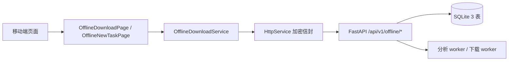
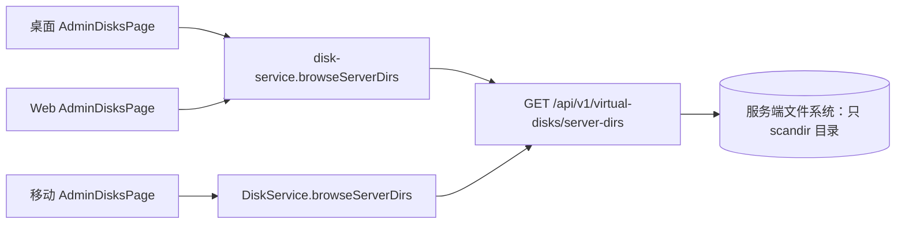

# JFLove v1.8.1 设计文档 —— 移动端离线下载补全 + 目录选择器 + 进度条口径

> 基线：`文档记录/需求文档/v1.8.1.md`（AC-248 ~ AC-270）。
> 本版**无数据库结构变更**；服务端仅新增 1 个管理员只读接口。
> 编写角色：designer（Phase 2，`AGENTS.md §7.3`）。

---

## 0. 设计摘要

| 项 | 结论 |
|---|---|
| 移动端离线下载 | 从只读改为完整功能；复用 v1.8.0 的 10 个 `/api/v1/offline/*` 接口，不改契约 |
| 新增服务端接口 | `GET /api/v1/virtual-disks/server-dirs`（管理员、只读、只列目录） |
| 目录选择器 | 桌面 / Web 新增 `ServerDirPickerModal`；移动新增 `ServerDirPickerDialog` + 复用 `VirtualDiskDirPicker` |
| 进度条 | 桌面 / Web 的百分比函数改为 `success` 优先 100 |
| 数据库 | 无变更；不需要迁移脚本 |
| 加密 | 沿用现有信封；不新增算法 / 密钥 / KDF |

---

## 1. 架构与数据流

### 1.1 移动端离线下载



- 页面只调用 `OfflineDownloadService`，不直接使用 dio；
- `task_id` / `url` / `item_ids` 等业务字段全部在加密 body / query 信封内；
- 轮询只读详情 / 列表，不新增 WebSocket / SSE（沿用 v1.8.0 E-7）。

### 1.2 服务器目录选择



- 接口只做 `os.scandir` + 目录过滤，不打开文件、不返回文件项；
- 客户端选择器只负责导航与回填，不做路径拼接以外的权限判断。

---

## 2. 服务端设计

### 2.1 新增接口 `GET /api/v1/virtual-disks/server-dirs`

| 项 | 内容 |
|---|---|
| 方法 / 路径 | `GET /api/v1/virtual-disks/server-dirs` |
| 鉴权 | 管理员（`auth_service.get_current_user` + `role == "admin"`） |
| 加密 | GET query 信封（`decrypt_request_body` 的 query 通道）；响应 `encrypt_response` |
| 明文白名单 | **不在** `_PLAIN_PATHS` |
| 路径参数 | **无** |
| 请求字段 | `token: str`、`path: str = ""`（绝对路径；空 = 取 roots 第一项） |
| 响应字段 | `path: str`、`parent: str \| null`、`dirs: [{name: str, path: str}]`、`roots: [{name: str, path: str}]`、`truncated: bool` |
| 错误 | 401 缺少/无效令牌；403 非管理员 / 无权限访问目录；400 路径不是绝对路径；404 目录不存在 |

**字段语义**：

- `path`：规范化后的当前绝对路径；
- `parent`：上一级绝对路径；根 / 盘符根为 `null`；
- `dirs`：当前目录下的子目录（过滤 `.` 开头），按名称排序，最多 2000 条；
- `roots`：本机可用起点：POSIX `/`、`/storage`、`/data`、`~`（存在且去重）；Windows 各盘符根 + `~`；
- `truncated`：目录数超过上限时为 `true`，客户端提示「目录过多，请进入更具体的路径」。

**实现要点**：

- `os.path.isabs` 校验；`os.path.normpath` 规范化；
- `os.path.isdir` 校验；`PermissionError` → 403；
- `entry.is_dir()` 过滤；隐藏目录跳过；
- 不跟随文件；不读取文件内容；不返回文件大小；
- 错误 detail **不回显完整路径**（「目录不存在」/「无权限访问该目录」）；
- 日志不记录完整路径（`§9.4`）。

**安全对照（`AGENTS.md §9.7`）**：

| 检查项 | 结论 |
|---|---|
| 路径上是否可枚举 ID | 无路径参数 |
| 请求 body 是否解密 | 是（query 信封） |
| 成功响应是否加密 | 是 |
| 错误是否 HTTPException | 是（全局 handler 加密） |
| 是否返回文件流 | 否 |
| 响应头敏感元数据 | 无 |
| 日志是否记录用户内容 | 否（仅记录成功/失败，不记录路径） |
| 是否新增长期密钥 | 否 |

### 2.2 离线下载接口（沿用，不改契约）

移动端新增调用的接口与 v1.8.0 设计 §2.2 完全一致：

| 用途 | 接口 | 请求字段 |
|---|---|---|
| 分析 | `POST /offline/analyze` | `url` |
| 勾选开始 | `POST /offline/select` | `task_id`、`item_ids`、`disk_id`、`target_path`、`pack_zip` |
| 追加图片页 | `POST /offline/next-page` | `task_id` |
| 取消 | `POST /offline/cancel` | `task_id` |
| 重试 | `POST /offline/retry` | `task_id` |
| 删除记录 | `POST /offline/delete-record` | `task_id` |
| 默认目录 | `POST /offline/settings` | `disk_id`、`rel_path`、`create` |
| 列表 / 详情 / 元信息 | `GET /offline/tasks`、`/detail`、`/meta` | 见 v1.8.0 §2.2 |

> `settings` 的 `create` 字段在 v1.8.0 设计 §2.2.8 已定义（目录不存在时按请求创建）；
> 移动端设置面板必须显式传 `create`，默认 `false`。

### 2.3 无数据库变更

- 不新增表 / 列 / 索引；
- `check_db_schema.py` 预期退出码 0；
- 不生成 `migrate-1.8.1.sql` / `rollback-1.8.1.sql`。

---

## 3. 桌面端设计

### 3.1 进度条

**文件**：`jflove-desktop/ui/src/pages/offline-download/offline-utils.ts`

```ts
export function taskPercent(task: {
  status: string;
  bytes_done: number;
  bytes_total: number;
  item_done: number;
  item_total: number;
}): number {
  if (task.status === 'success') return 100; // 产品口径：已完成一律满格
  // 其余保持字节优先、项数次之
}
```

- 调用方 `TaskList.tsx` 已传入完整 `OfflineTask`，只改类型签名；
- 单测：`success + bytes_done=99/bytes_total=100 → 100`；`downloading` 仍按字节；`success + total=0 → 100`。

### 3.2 服务器目录选择器

| 文件 | 变更 |
|---|---|
| `ui/src/services/disk-service.ts` | 新增 `browseServerDirs(path?: string): Promise<ServerDirListing>` |
| `ui/src/components/ServerDirPickerModal.tsx` | **新增**：绝对路径导航 + roots + 上级/根 + 选择 |
| `ui/src/pages/admin/AdminDisksPage.tsx` | 表单加「浏览…」；创建默认 `/`，编辑从 `real_path` 打开；保留手输兜底 |
| `ui/src/types/models.ts` | 新增 `ServerDirListing` / `ServerDirEntry` |

**交互**：

1. 点「浏览…」→ 打开 Modal，首次加载 `path || ''`；
2. 顶部显示当前绝对路径；「上级」「根目录」；roots 快捷按钮；
3. 目录列表点击进入；底部「选择当前目录」回填；
4. 加载 / 空 / 错误态中文；错误不关闭弹窗。

### 3.3 其他目录字段

- 云盘挂载远端 / 本地、笔记目录、离线默认目录：已有选择器，复核后登记，不在本版重写；
- 桌面端本地目录继续使用原生 `QFileDialog`（`dialogs.select_directory` 白名单桥），不新增网络出口。

---

## 4. Web 端设计

### 4.1 进度条

`jflove-web/src/utils/offline-download.ts` 的 `taskProgress()` 改为 `success` 优先：

```ts
if (task.status === 'success') return 100;
if (task.bytes_total > 0) return clamp(...);
if (task.item_total > 0) return clamp(...);
return 0;
```

补单测；页面 `OfflineDownloadPage.tsx` 统一渲染进度条（成功任务同样显示满格 100%，见 v1.8.2 回写）。

> 口径回写（2026-10-24，v1.8.2 / C3）：原表述「页面无需改渲染逻辑」与实现不符——实现为**所有状态都渲染进度条**，
> 成功任务固定 100%。以本段为准；代码 `jflove-web/src/pages/OfflineDownloadPage.tsx` 的「进度条对所有状态可见」注释为现行实现。

### 4.2 服务器目录选择器

| 文件 | 变更 |
|---|---|
| `src/services/disk-service.ts` | 新增 `browseServerDirs(path?: string)` |
| `src/components/ServerDirPickerModal.tsx` | **新增**（与桌面端同构，独立实现） |
| `src/pages/admin/AdminDisksPage.tsx` | 表单加「浏览…」；保留手输兜底 |
| `src/types/models.ts` | 新增 `ServerDirListing` / `ServerDirEntry` |

**注意**：

- Web 端只选**服务端远端目录**，不涉及浏览器本地目录；
- 所有请求走 `httpClient.get`（query 信封），不出现明文路径参数；
- 错误必须 `toast.error` 展示，不关闭弹窗。

---

## 5. 移动端设计（完整功能）

### 5.1 路由与页面

| 路由 | 页面 | 说明 |
|---|---|---|
| `/offline` | `offline_download_page.dart` | 任务中心：列表 + 操作 + 设置 + 「新建任务」 |
| `/offline/new` | `offline_new_task_page.dart`（新增） | 新建：URL → 分析 → 勾选 → 目标目录 → 开始 |
| — | `offline_settings_sheet.dart`（新增） | 默认目录配置（底部弹层） |

`AppRoutes` 新增 `offlineNew = '/offline/new'`；`app.dart` 注册在 `/offline` 之前或之后均可（路径不重叠）。

### 5.2 服务层

`OfflineDownloadService` 新增：

| 方法 | 接口 | 返回模型 |
|---|---|---|
| `analyze(url)` | `POST /offline/analyze` | `OfflineAnalyzeResult` |
| `select(...)` | `POST /offline/select` | `OfflineSelectResult` |
| `nextPage(taskId)` | `POST /offline/next-page` | `OfflineNextPageResult` |
| `cancel(taskId)` | `POST /offline/cancel` | `OfflineTaskAction` |
| `retry(taskId)` | `POST /offline/retry` | `OfflineTaskAction` |
| `deleteRecord(taskId)` | `POST /offline/delete-record` | `OfflineTaskAction` |
| `saveSettings(diskId, relPath, create)` | `POST /offline/settings` | `OfflineSettingsResult` |

- 全部走 `HttpService.encryptedPost` / `encryptedGet`；
- 字段名与 controller 严格一致；
- 不打印 token / session_key；异常由 `userFacingError` 转中文。

### 5.3 模型

`lib/models/offline_task.dart` 新增：

- `OfflineAnalyzeResult {taskId, status, sourceDomain, pageTitle}`；
- `OfflineSelectResult {taskId, status, selected, bytesTotal}`；
- `OfflineNextPageResult {added, itemTotal, hasMore, pageIndex}`；
- `OfflineSettingsResult {configured, diskId, relPath}`；
- `OfflineTaskAction {taskId, status?, deleted?}`。

全部 `fromJson` 容错（缺字段 / 类型不符 / null 不抛异常），沿用现有 `_asInt` / `_asString` 风格。

### 5.4 任务中心

- 顶部 AppBar：标题「离线下载中心」、刷新、设置（齿轮）、新建（加号）；
- 顶部提示：`meta.enabled=false` / `can_use=false` / `configured=false` / `config.valid=false` 分别给中文说明；
- 列表卡片：状态、进度、来源域名、产物、目标、失败原因、速度；
- 点击卡片 → 详情底部弹层：
  - 展示任务字段 + 清单项；
  - 操作按钮：取消（active）、重试（failed/canceled 且可重试）、删除记录（终态/ready）、去选择（ready）、追加下一页（ready 且 has_more_images）；
  - 操作后刷新列表；失败 toast 中文原因。
- 轮询保持「页面可见 + 2.5s」，与 v1.8.0 现有策略一致。

### 5.5 新建任务页

状态机：

```text
idle → analyzing → ready → submitting → done
                  ↘ failed / canceled
```

1. **idle**：URL 输入框 + 说明 + 「分析」按钮；
   - 未配置默认目录 / 无可写磁盘 / 总开关关闭 → 顶部提示 + 「去设置」，禁用分析；
2. **analyzing**：显示进度、来源域名、已用时；「取消」调用 `/cancel`；
3. **ready**：清单 + 快捷选择 chips（全选 / 音频 / 图片 / 最高清）+ 已选汇总 +
   目标目录行（磁盘 + 路径 + 「选择」）+ 打包 zip + 「开始下载」；
4. **submitting**：按钮 loading，防重复；
5. 成功后 `Navigator.pop(true)`，任务中心刷新；
6. 失败：中文错误 + 建议，保留已选状态。

目标目录：

- 默认取 `meta.config`（disk_id + rel_path）；
- 点「选择」打开 `VirtualDiskDirPicker`（磁盘下拉 + 目录浏览）；
- 任务内临时选择**不回写**默认目录（v1.8.0 G-6）。

### 5.6 默认目录设置弹层

- 磁盘下拉：仅 `meta.writable_disks`；
- 当前目录：显示 `磁盘名 / 相对路径`；
- 「选择目录」→ `VirtualDiskDirPicker`；
- 「目录不存在时自动创建」开关；
- 保存 / 清除；
- 保存后刷新 meta 与列表。
- 无可写磁盘：整块禁用 + 中文说明。

### 5.7 目录选择器组件

**`VirtualDiskDirPicker`（新增，`lib/widgets/virtual_disk_dir_picker.dart`）**

- 输入：`disks`（`VirtualDisk` 或 `OfflineWritableDisk` 适配）、`initialDiskId`、`initialPath`；
- 输出：`(diskId, path)`；
- 内部：磁盘下拉 + `browseDirs` 目录列表 + 上级 / 根 / 当前目录选择；
- 复用：相册备份、离线新建、离线默认目录。

**`ServerDirPickerDialog`（新增）**

- 输入：`initialPath`；
- 输出：`path`；
- 内部：`DiskService.browseServerDirs` + roots + 上级/根 + 目录列表 + 选择；
- 用于移动端添加 / 编辑磁盘。

### 5.8 错误文案

新增 `lib/pages/offline/offline_error_text.dart`（或模型工具）：

- 映射 v1.8.0 §2.2.9 的 `error_code` → 中文原因 + 建议；
- `ApiException` / `userFacingError` 兜底；
- 不显示原始 `DioException` / 堆栈。

---

## 6. 目录 / 文件输入审计落点

| # | 字段 | 端 | 选择器 |
|---|---|---|---|
| 1 | 磁盘真实路径 | 桌面 | `ServerDirPickerModal` + 手输兜底 |
| 2 | 磁盘真实路径 | Web | `ServerDirPickerModal` + 手输兜底 |
| 3 | 磁盘真实路径 | 移动 | `ServerDirPickerDialog` + 手输兜底 |
| 4 | 云盘远端子目录 | 桌面 | 现有 `DirTreeModal` |
| 5 | 云盘本地缓存目录 | 桌面 | 现有原生目录对话框 |
| 6 | 笔记目录 | 桌面 / Web | 现有 `DirTreeModal` |
| 7 | 笔记目录 | 移动 | 现有磁盘 + 目录浏览 |
| 8 | 离线默认 / 任务目录 | 桌面 / Web | 现有 `DirTreeModal` |
| 9 | 相册备份远端目录 | 移动 | `VirtualDiskDirPicker` |
| 10 | 离线任务 / 默认目录 | 移动 | `VirtualDiskDirPicker` |
| 11 | 上传 / 打开 / 保存文件 | 三端 | 系统原生选择器 |
| 12 | 笔记文件名 | 三端 | 文本框（非路径，保持） |

---

## 7. 进度条与状态口径

| 状态 | 百分比 |
|---|---|
| `success` | **100**（无条件） |
| `downloading` / `merging` | 字节优先：`bytes_done / bytes_total`；无字节则项数 |
| `ready` | 按项数（若为 0 则 0） |
| `queued` / `analyzing` | 0 或按项数（现有行为） |
| `failed` / `canceled` | 保持现有百分比（不清零，便于看进度） |

---

## 8. 测试设计

### 8.1 服务端

| 用例 | 断言 |
|---|---|
| 管理员浏览 `/` | 200；`dirs` 均目录；`path` 规范 |
| 普通用户 | 403 |
| 无 token | 401 |
| 相对路径 | 400 |
| 不存在 | 404 |
| 无权限（monkeypatch scandir） | 403 |
| 隐藏目录过滤 | `.hidden` 不出现 |
| `roots` 去重 / 存在性 | 不含不存在路径 |
| 超限截断 | `truncated=true` |
| 错误 detail 不含完整路径 | 断言 |
| 加密信封 | 请求 / 响应可解密 |

### 8.2 桌面端

- `taskPercent` success 优先 / 字节 / 项数 / clamp；
- `ServerDirPickerModal`：roots、进入、上级、选择回填、错误态；
- `AdminDisksPage`：点浏览打开、选中回填、创建 / 编辑；
- `npm run lint` / `npm run test` / `npm run build`。

### 8.3 Web 端

- `taskProgress` success 优先；
- `ServerDirPickerModal` 同桌面；
- `AdminDisksPage` 集成；
- `npm run lint` / `npm run test` / `npm run build`。

### 8.4 移动端

- 服务层：7 个新方法的路径 / method / 字段；
- 模型：4 个新响应解析容错；
- 页面：新建流程、未配置目录拦截、快捷选择、开始下载、取消 / 重试 / 删除、设置保存；
- 目录选择器：磁盘切换、进入 / 上级 / 根、选择回填；
- `dart analyze lib/` 0；`flutter test` 全通过。

---

## 9. AC 对照

| AC | 设计落点 |
|---|---|
| AC-248 | §5.5 新建任务页 |
| AC-249 | §5.6 默认目录设置 + 服务端 `/settings` |
| AC-250 | §5.4 任务操作 |
| AC-251 | §5.4 追加下一页 |
| AC-252 | 现有三端轮询 + 服务端按账号共享 |
| AC-253 | §5.5 前置拦截 + §5.2 服务层 |
| AC-254 | 文档 / 文案 / 测试改写 |
| AC-255 / 256 | §3.1 / §4.1 |
| AC-257 | §2.1 / §3.2 / §4.2 / §5.7 |
| AC-258 | §2.1 + §8.1 |
| AC-259 | §5.7 + 相册备份改造 |
| AC-260 | §6 |
| AC-261 | §2.1（只列目录） |
| AC-262 / 263 | §2.1 安全对照 |
| AC-264 ~ 267 | §8 |
| AC-268 | 版本号由 `sync_version.py` 同步 |
| AC-269 | §2.3 |
| AC-270 | Phase 6 验证报告 |

---

## 10. 风险与取舍

| 风险 | 取舍 |
|---|---|
| 服务器目录接口暴露目录结构 | 仅管理员；管理员本就能注册任意路径；只列目录、不读文件；写进审查 |
| 移动端页面复杂度 | 分页 / 分步：任务中心与新建页分离；目录选择器独立组件 |
| 旧只读测试 | 逐条改写为完整功能断言，保留轮询 / 账号隔离等有效覆盖 |
| Web / 桌面选择器重复实现 | 两端独立演进（不共享组件），但接口与交互保持一致 |
| 路径跨平台 | roots 按平台生成；Windows 盘符根单独处理 |
