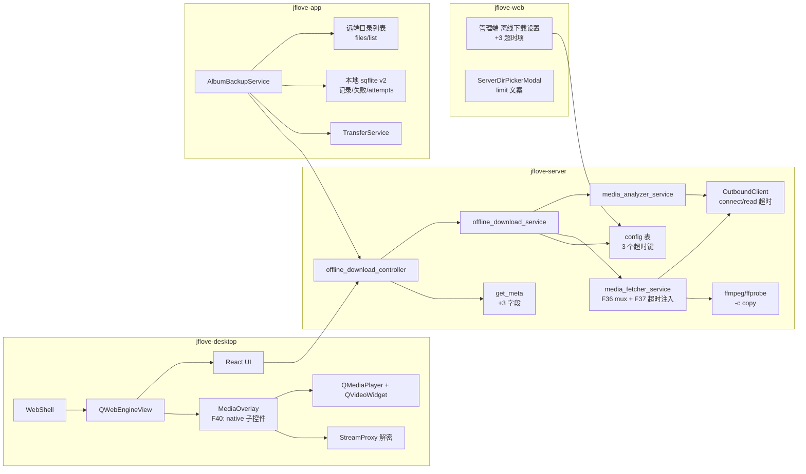
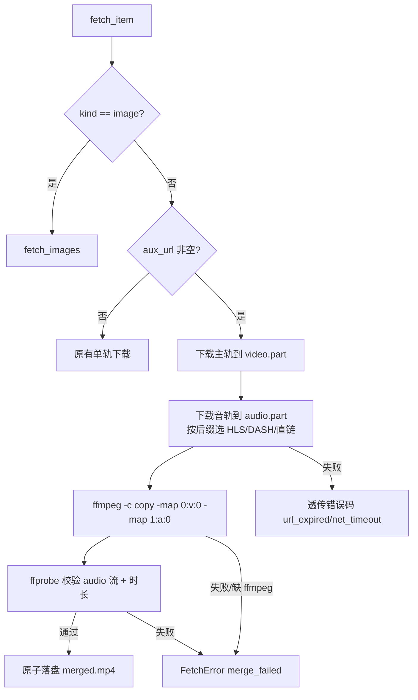

# JFLove v1.8.2 设计文档 —— 离线下载可用性 + 相册备份可靠性 + Linux 播放窗口跟随

> 阶段：Phase 2（设计）｜ 基线：`文档记录/需求文档/v1.8.2.md`（D16–D20）
> 编写角色：designer ｜ 上一版设计：`文档记录/设计文档/v1.8.1.md`
> **数据库**：服务端**无 DDL**；仅 `config` 表新增 3 个 KV 键；移动端本地 sqflite 升级 v1 → v2（非服务端库）。
> **安全协议不变**：X25519 ECDH + HKDF-SHA256（盐 `jflove-v1`）+ ChaCha20-Poly1305；文件流 `X-Encrypted-Stream: v1`；明文白名单不扩大。

---

## 0. 设计摘要与与上一版的差异

| 需求 | 设计落点 | 关键决策 |
|---|---|---|
| F36 音视频合并（#9） | `MediaFetcherService` 新增「主轨 + `aux_url` 双下载 → ffmpeg `-c copy` mux → ffprobe 校验」分支 | 不改库、不加列；aux 协议按 URL 后缀推断 |
| F37 超时可配（#11） | `config` 表 3 个 KV 键 + `get_policy` 读取 + 分析/出站注入；解析重试 1 次；超时保留部分结果 | 单一阈值来源；非法值夹边界 |
| F38 远端去重（#8） | 移动端扫描前按 `YYYY/MM` 拉 `POST /api/v1/files/list`，同名同大小跳过；轮内缓存 | 不改服务端接口；列表失败 fail-open |
| F39 扫描健壮（#12） | 单资源异常隔离、失败原因可见、有限自动重试、跨轮游标、计数自洽；本地库 v2 | 本地库迁移，不动服务端 |
| F40 浮层子窗口（#10） | 浮层从顶层窗口改为 **QWebEngineView 的 native 子控件**，坐标相对父控件 | 已用最小原型在 X11 + Wayland 实测 |
| C1/C2/C3 | `server-dirs` 返回 `limit`；移动轮询退避；设计文档回写 | 小改动 |

**被本设计取代的旧口径（必须按本文件实现）**：

| 旧口径 | 位置 | 现状 |
|---|---|---|
| 分析总超时固定 30s、不可配 | `设计文档/v1.8.0.md:896`（§9.1 第 7 条）、`:1027`（AC-207） | **被 F37 取代**：默认 90s，管理员可配 30–180s |
| 桌面媒体浮层 = 独立顶层窗口 + 全局坐标反算 | `jflove-desktop/src/ui/media_overlay.py:16`（模块注释） | **被 F40 取代**：改为 QWebEngineView 子控件 + 相对坐标 |
| 成功任务进度条口径 | `设计文档/v1.8.1.md:186`（§4.1） | 实现已正确；C3 本次把 §4.1 回写为「成功一律 100%」 |

---

## 1. 总体架构



---

## 2. 服务端设计

### 2.1 F36 音视频合并（`media_fetcher_service.py`）

**现状**：`fetch_item` 只按 `protocol` 分流（`m3u8` / `mpd_segments` / 其余直链），直链分支只读 `item["source_url"]`；`aux_url` 在库里有值但被忽略（`media_fetcher_service.py:420-472`）。

**目标流程**：



**实现要点**

| 项 | 设计 |
|---|---|
| 入口 | `fetch_item` 增加分支：`if item.get("aux_url") and kind in ("video",): produced = await self._fetch_av(...)` |
| 音轨协议推断 | 新函数 `_aux_protocol(aux_url)`：路径以 `.m3u8` 结尾 ⇒ `m3u8`；`.mpd` 结尾 ⇒ 用 `.mpd` 的父地址走 `_fetch_dash`；其余 ⇒ `direct`。**不新增数据库列** |
| 主轨协议 | 仍按 `item["protocol"]` 分流（与现有一致） |
| ffmpeg 调用 | 复用 `_run_ffmpeg`；参数 `["-protocol_whitelist","file,crypto","-i",video,"-i",audio,"-map","0:v:0","-map","1:a:0","-c","copy","-y",out]` |
| 校验 | 复用 `_probe_output`：必须含 `audio` 流；时长与主轨差 >1s ⇒ `merge_failed` |
| 失败口径 | 音轨 4xx → `url_expired`（触发既有自动重分析一次）；音轨超时 → `net_timeout`；合并失败 → `merge_failed`（文案「音视频合并失败，可重试」） |
| 进度 | 先报主轨字节，再报 `主轨 + 音轨` 累计；合并阶段不重复计字节 |
| 临时文件 | 保留在 `<target>/.jflove-offline/<task_id>/`，成功后由既有 `cleanup_task_temp` 清理 |
| 无音轨来源 | `aux_url` 为空且 `acodec` 为空 ⇒ 清单项 `note="无音轨"`；落库到 `offline_download_items.error_message`（修 `replace_items` 的 INSERT 字段，非 schema 变更） |

**不做**：不重编码（`-c copy`）；不引入新依赖（ffmpeg 已在镜像内）；不改变 `source_url` 语义。

### 2.2 F37 解析/下载超时可配 + 重试 + 部分结果

#### 2.2.1 配置键（`config` 表 KV，无 DDL）

| 键 | 默认 | 范围 | 落点 |
|---|---|---|---|
| `offline_download_analyze_timeout_s` | 90 | 30–180 | 分析总预算（`asyncio.timeout`） |
| `offline_download_connect_timeout_s` | 15 | 5–30 | `OutboundClient(connect_timeout=...)` |
| `offline_download_read_timeout_s` | 60 | 15–120 | `OutboundClient(read_timeout=...)` |

- 常量：`settings.py` 增加 `OFFLINE_ANALYZE_TIMEOUT_KEY` 等与默认/边界常量（保留 `OFFLINE_ANALYZE_TOTAL_TIMEOUT` 作为默认值，改为 90）。
- `offline_download_service.OFFLINE_CONFIG_DEFAULTS` 增加三条默认值（管理端 `GET /api/v1/config` 未落库时展示默认）。
- `validate_config_value` 增加三条白名单与整数范围校验（越界夹边界，非法回落默认）。
- `get_policy` 返回 `analyze_timeout_s` / `connect_timeout_s` / `read_timeout_s`。

#### 2.2.2 生效链路

```
get_policy(db)
  ├─ analyze_timeout_s → MediaAnalyzerService.analyze(total_timeout=…)
  │                      └─ 总预算仍由 asyncio.timeout 包住
  └─ connect/read      → MediaAnalyzerService(connect_timeout=…, read_timeout=…)
                         └─ 其内部 OutboundClient(connect_timeout=…, read_timeout=…)
                         └─ 下载侧 OutboundClient 同参数
```

> 已知边界：`egress_proxy`（yt-dlp / 浏览器出网中继）的读取超时仍用默认 60s，**本版不随配置变化**；
> yt-dlp 自身 `socket_timeout=20s` 先于它生效，影响面有限，后续版本再统一。
> （本段为最终口径；`egress_proxy.py:424` 的常量即现状实现，不存在「跟随 policy」的第二套说明。）

- `_run_analysis`：从 `policy` 取超时并传入 `analyze`；不再使用常量默认。
- `_run_download`：`OutboundClient(connect_timeout=policy[...], read_timeout=policy[...])`；`MediaFetcherService` 不变（它复用传入的 outbound）。
- `egress_proxy`：**本版不改动**，仍用默认 60s（见上方「已知边界」；后续版本再跟随 `policy`）。

#### 2.2.3 解析重试（1 次）

```python
for attempt in range(2):
    try:
        result = await service.analyze(url, ..., total_timeout=policy["analyze_timeout_s"])
        break
    except AnalysisError as exc:
        if attempt == 0 and exc.code in ("net_timeout", "network_error") and elapsed < timeout * 0.5:
            await asyncio.sleep(2); continue
        raise
```

约束：只有在**第一次快速失败**（耗时 < 预算 50%）时才重试，避免「90s + 90s」把用户等待翻倍；重试仍失败才写 `failed`。

#### 2.2.4 超时保留部分结果（修复设计 §2.3.3 未落地）

- `_analyze_inner` 在 L1/L2 合并完成后**立即**把结果写入 `collected`（`collected["items"]` / `title`）；L3 合并后再刷新一次。
- `analyze` 捕获 `TimeoutError`：若 `collected.items` 非空 ⇒ `_finalize(collected.items)` 返回 `AnalysisResult(level="partial", warnings=[...])`；为空才抛 `net_timeout`。
- 边界（如实写入）：若超时发生在 **L1/L2 的并发等待期间**（两者都还没返回），此时没有可保留的结果，仍按失败处理；要覆盖这一段需要把 L1/L2 改成逐任务 `asyncio.wait` 收集，列入后续增强（不影响 AC-279 的「已有抓取项」判据）。
- `AnalysisResult.level` 新增取值 `"partial"`；`offline_download_service._store_analysis` 原样落 `analysis_level`（客户端只读展示，不参与状态机）。
- 错误文案：`net_timeout` 改为「解析超时（{N}s），可稍后重试或让管理员调大解析超时」。

#### 2.2.5 接口变更

**`GET /api/v1/offline-download/meta`（既有接口，增量字段）**

| 字段 | 类型 | 说明 |
|---|---|---|
| `analyze_timeout_s` | int | 当前解析总预算（秒） |
| `connect_timeout_s` | int | 当前连接超时（秒） |
| `read_timeout_s` | int | 当前读取超时（秒） |

向后兼容：旧客户端忽略新字段；响应仍走加密信封。

**`GET /api/v1/config` / `PUT /api/v1/config`**：不新增路由；`GET` 返回中自动补三条默认值，`PUT` 接受三键并校验。

> `PUT /api/v1/config` 属管理员接口（既有 `_require_admin`），**非管理员 403**；`GET /api/v1/config` 同为管理员接口。

### 2.3 C1 `server-dirs` 返回 `limit`

- `virtual_disk_service.list_server_dirs` 返回值增加 `"limit": SERVER_DIR_LIMIT`。
- 控制器描述同步（`virtual_disk_controller.py` 的 `server-dirs` docstring）。
- 三端选择器用响应里的 `limit` 渲染文案；缺省回落 2000（旧服务端兼容）。

### 2.4 数据库（服务端）

**无表结构变更**，不产出 `migrate-1.8.2.sql` / `rollback-1.8.2.sql`。
新配置为 `config` 表 KV 行，`init_db()` 无需改动；发布前 `check_db_schema.py` 仍以 dev 为基准校验（预期 exit 0）。
遗留表 `notes_permissions` 仍不参与比对（同 v1.8.1）。

### 2.5 接口安全标注（新增/变更）

| 接口 | 方法 | 明文白名单 | 加密 | 路径参数 | 归属/鉴权 | 备注 |
|---|---|---|---|---|---|---|
| `/api/v1/offline-download/meta` | GET | 否 | query 信封 | 无 | 登录用户（只看自己） | 增 3 字段 |
| `/api/v1/config` | GET/PUT | 否 | body 信封 | 无 | **admin-only**（`_require_admin`） | 新增 3 键校验 |
| `/api/v1/virtual-disks/server-dirs` | GET | 否 | query 信封 | 无 | **admin-only** | 响应增 `limit`（只读） |

安全清单（§9.7）：无路径参数新增；请求/响应均加密；错误经 `HTTPException` 全局加密；不返回文件名/路径给非管理员；日志只记 `task_id`/错误码。

---

## 3. 移动端设计

### 3.1 F38 远端目录比对

**数据流**

```
scanAndUpload()
  ├─ 计算本轮候选资源（分页游标）
  ├─ 对资源所属远端目录 <root>/YYYY/MM：若本轮未缓存 → POST /files/list
  │     └─ 建立 {filename: size} 索引（失败 ⇒ 该目录标记 unavailable，fail-open）
  ├─ 本地记录命中（backed）→ skip
  ├─ 远端索引命中（同名同大小）→ markBackedUp（本地补记录）+ skippedExisting++
  └─ 其余 → 提交上传
```

**实现要点**

| 项 | 设计 |
|---|---|
| 目录列表 | 复用 `FileService.listFiles(diskId, path)`（`jflove-app/lib/services/file_service.dart:26`）；返回 `FileItem{name,size,isDir}` |
| 缓存 | `Map<String, Map<String,int>?> _remoteIndex`，键 `diskId:relDir`；同一轮扫描有效（扫描结束清空）；每次扫描最多 `min(候选目录数, 30)` 次请求 |
| 判定 | `is_dir == false && name == asset.title && size == asset.size` |
| 记录归属 | 本地记录以 `(asset_id)` 主键 + `disk_id` / `remote_root` 列限定；查询时 `WHERE disk_id=? AND remote_root=?` |
| 目标变更 | `remote_root` 变化后旧记录不命中 ⇒ 历史资源进入待传队列（符合需求 F38.2） |
| 失败开放 | 列表请求异常 ⇒ 本轮该目录按「本地记录」判断，并计数 `remoteCheckFailed`，设置页提示「远端校验暂不可用」 |
| 计数 | `skippedExisting` 进入 `AlbumBackupProgress`，UI 显示「远端已存在跳过 N 项」 |
| 手动入口 | 设置页新增「重新核对远端」：清空本轮缓存 + 触发一次 `scanAndUpload()` |

**安全**：只对当前配置的 `diskId` 调列表；请求走 `http_service` 加密；文件名不写日志。

### 3.2 F39 扫描健壮性

**状态机（单个资源）**

```
候选 → 取文件(asset.file) ──异常/空────→ failed(reason="文件不可用")
   │                                      └─ attempts++
   ├─ 大小>0 → 提交上传 → 完成 → backed
   │                    ├─ 失败 → failed(reason=服务端错误) attempts++
   └─ 类型不在范围 → outOfScope（视频开关关闭/非图非视频）
```

**关键改造**

| 项 | 设计 |
|---|---|
| 异常隔离 | `_submit` 整体包 `try/catch`（含 `asset.file` / `length()`）；每个资源独立，不冒泡 |
| 失败原因 | `markFailed(assetId, reason, attempts)`；reason 为中文枚举（文件不可用/读取失败/上传失败/超大文件），不含路径 |
| 自动重试 | `attempts < 3` 时下一轮仍尝试；`>=3` 暂停自动重试，直到「重试失败项」或「立即检查」手动解锁（清零 attempts） |
| 游标 | `_cursorOffset` 内存游标 + `_pageSize=200`；每轮从游标继续，扫到尾部回绕到 0；单轮最多访问 `maxScan=2000`，但**跨轮推进**，不会永久饿死 |
| 计数 | 新增 `_albumCounts()`：分别用 `RequestType.image` / `RequestType.video` 取 `assetCountAsync`；`outOfScope = 关闭类型的数量`；`pending = total - done - failed - outOfScope`（≥0） |
| UI | 设置页/传输页显示：总数、已备份、上传中、失败、不在范围、远端已存在跳过；失败可展开查看原因 |
| 单测 | 新增 `jflove-app/test/album_backup_test.dart`：坏资源隔离、视频关闭计数、游标回绕、远端跳过（注入 fake `AssetSource` / `FileService`） |

**抽象**：把 `photo_manager` 与 `FileService` 抽成 `AlbumAssetSource` / `RemoteFileIndex` 接口，`AlbumBackupService` 依赖接口，便于单测注入（当前 0 用例）。

### 3.3 移动端本地库迁移 v1 → v2（sqflite）

```sql
-- onUpgrade(1 → 2)
ALTER TABLE album_backup ADD COLUMN remote_root TEXT NOT NULL DEFAULT '';
ALTER TABLE album_backup_fail ADD COLUMN attempts INTEGER NOT NULL DEFAULT 0;
```

- 不改变主键；`remote_root` 在 `init()` 时按当前配置回填：
  `UPDATE album_backup SET remote_root=? WHERE disk_id=? AND remote_root=''`
  （老用户升级后记录继续有效，不触发全量重传）。
- 查询按 `disk_id=? AND remote_root=?` 过滤；上传成功后 `INSERT OR REPLACE`（同一资源只保留当前目标记录）。
- 失败表新增 `attempts`；`clearFailed` 清零；`markFailed` 自增。
- 回滚：本地库不需回滚脚本；版本号 `version: 2`，降级不兼容（App 降级会重建本地记录，不影响远端文件，可接受——写入开发记录）。

### 3.4 移动端 UI

- 设置页相册备份卡片：新增「远端已存在跳过 N 项」「不在范围 N 项」「失败 N 项（查看原因）」；新增「重新核对远端」。
- 传输页相册分区：同步展示上述计数。
- 离线下载新建页：轮询退避（C2）+「重试分析」。

---

## 4. 桌面端设计

### 4.1 F40 媒体浮层子窗口化（含 P2 原型实测）

#### 4.1.1 原型实测（已执行，2026-10-24）

**目的**：验证「QWebEngineView 的 native 子控件能否显示在其上方并随主窗移动」。

**环境与命令**

- X11：`Xvnc :99` + `kwin_x11`，`QT_QPA_PLATFORM=xcb`，`QTWEBENGINE_CHROMIUM_FLAGS="--disable-gpu --no-sandbox"`。
- Qt 版本：**PySide6 6.11.0 / Qt 6.11.0**（`jflove-desktop/venv-linux`）。
- Wayland：`dbus-run-session -- kwin_wayland --virtual --socket jfwl2 --width 1280 --height 800`，`QT_QPA_PLATFORM=wayland`。
- 原型脚本：主窗 + `QWebEngineView`（`setHtml`）+ 红色 `QWidget(view)`（`WA_NativeWindow`、`raise_()`）；1.5s 时 `main.move(420,320)`；3s 时输出 JSON 并截图（X11 用 `ffmpeg x11grab`，Wayland 用 `spectacle`）。

**原始输出（节选）**

```
# X11 / child
RESULT {"mode":"child","platform":"xcb","main_pos":[420,254],
 "overlay_geo":[60,80,320,180],"overlay_global":[480,380],
 "overlay_is_window":true,"overlay_handle_type":0}

# Wayland / child
RESULT {"mode":"child","platform":"wayland","main_pos":[420,320],
 "overlay_geo":[60,80,320,180],"overlay_global":[60,80],
 "overlay_is_window":true,"overlay_handle_type":0}

# X11 / top（现状对照，move 后按全局坐标 setGeometry）
RESULT {"mode":"top","platform":"xcb","main_pos":[420,254],
 "overlay_geo":[480,440,320,180],"overlay_global":[480,440]}
# 期望 overlay 在 420+60=480, 254+120=374；实际 440 ⇒ 偏差 66px（WM 调整主窗 y 后按旧坐标算）
```

**截图判定**：X11 与 Wayland 截图中红色浮层均完整显示在网页内容之上；X11 上点击网页区域后再截图，浮层仍在最上层。

**结论（置信度）**：
- 「QWebEngineView 的子控件会被盖住」在**当前 Qt/QtWebEngine 版本 + 上述两平台**下不成立——native 子控件 + `raise_()` 可见且不随主窗移动错位。**已实测**。
- `QWindow.setParent()` 重挂顶层窗口在 X11 返回 `false`，**不可用**。**已实测**。
- 视频表面（`QVideoWidget`）、全屏、多显示器/分数缩放、托盘恢复：**未验证**，P4a 实机补。

#### 4.1.2 目标结构

```
QMainWindow
└── QWebEngineView（页面）
    └── MediaOverlay.window = QWidget(view)   ← native child, WA_NativeWindow
        ├── QVideoWidget
        └── QLabel（图片）
```

- 坐标：直接使用渲染层上报的 `rect`（相对视口），`self.window.setGeometry(x, y, w, h)`；**删除 `mapToGlobal` 与 `_shell_hidden` 的显式恢复逻辑**（子控件随父窗隐藏/恢复）。
- 全屏：`self.window.setGeometry(view.rect())`（不再 `showFullScreen()`）。
- 层级：`open()` / `setVisible()` / 全屏切换后 `raise_()`。
- 回退：`JFLOVE_MEDIA_OVERLAY=window` 环境变量可强制旧顶层窗口实现（仅排障用，默认 `child`）；子控件创建失败时自动回退并记 warning。
- `web_shell`：`moveEvent/resizeEvent → _schedule_overlay_refresh` 可删除；新增对 view 的 `resizeEvent` 转发（页面尺寸变化时重设 geometry）。

**风险与判据**：见 §8 R1；实机判据见需求 AC-289～293。

### 4.2 管理端超时设置（桌面）

- 页面：现有「系统设置 → 离线下载」卡片（Web UI `ui/src`）新增三个数字输入（解析/连接/读取），范围校验同服务端；保存走既有 `config-service`。
- 复用现有 `offline_download_max_items` 等字段的读写逻辑（`jflove-desktop/ui/src/services/config-service.ts:21-26` 增加三个键）。

### 4.3 C1 目录选择器 `limit`

- `ServerDirPickerModal.tsx` 用响应 `limit` 渲染「最多显示 N 项」；缺省 2000。

---

## 5. Web 端设计

- 管理端「离线下载」设置新增三项（复用 `config-service.ts:21-26`）。
- `ServerDirPickerModal.tsx` 使用 `limit`（同桌面）。
- C3：**已在 Phase 2 回写** `文档记录/设计文档/v1.8.1.md` §4.1：进度条对所有状态可见、成功任务 100%；只改文档，不改代码。

---

## 6. 关键决策与最终裁决

| 决策点 | 最终方案 | 原因 | 影响文件 |
|---|---|---|---|
| #9 合并在哪一层做 | 下载器内 mux | 分析端已配对；下载器是唯一执行点 | `media_fetcher_service.py` |
| aux 协议 | 按 URL 后缀推断 | 避免加列与迁移 | 同上 |
| #11 超时来源 | `config` KV + `get_policy` | 管理员可配（D18） | `settings.py` / `offline_download_service.py` / 三端管理页 |
| 解析重试条件 | 仅快速失败（<50% 预算）重试 1 次 | 防止 90s×2 放大等待 | `offline_download_service.py` |
| 超时部分结果 | 分阶段预算 + collected | 对齐设计 §2.3.3 | `media_analyzer_service.py` |
| #8 去重 | 远端列表比对（fail-open） | 用户裁决 D17 | `album_backup_service.dart` |
| #8 记录归属 | `asset_id` 主键 + `disk_id/remote_root` 过滤 | 换目标不误判 | 本地库 v2 |
| #12 重试 | 3 次自动 + 手动解锁 | 区分永久/暂时 | 同上 |
| #10 结构 | QWebEngineView 子控件 | 双平台原型通过 | `media_overlay.py` / `web_shell.py` / `main.py` |

---

## 7. 测试与验证策略

| 需求 | 自动化 | 实机/端到端 |
|---|---|---|
| F36 | `test_offline_media_fetcher_v1_8_2.py`：aux 直链合并、aux 失败、ffmpeg 缺失、ffprobe 缺音轨 | 真实 B 站链接（360P）下载后 `ffprobe` 含 audio（对照修复前） |
| F37 | 配置范围/越界/权限；重试计数；部分结果返回 | 首字节 20s 的桩服务；管理端改值后 `get_meta` 生效 |
| F38 | Dart 单测：远端命中/大小不同/换目标/列表失败 | Android 模拟器：清数据重扫，`upload/init` 计数为 0/仅缺失项 |
| F39 | Dart 单测：坏资源隔离、视频关闭计数、游标、重试上限 | 模拟器注入坏资源；2500 张数据集 |
| F40 | 几何/全屏/托盘单测（假窗口） | **Wayland + X11 双会话**：拖动 200px、录屏抽帧、中文输入法 |
| C1/C2 | 三端 lint/test；接口字段断言 | 目录选择器文案；移动轮询间隔日志 |

**#10 实机命令（P6 执行）**

```bash
source scripts/verify/env.sh
# X11
DISP=$(jf_start_xvnc :99); jf_start_wm "$DISP"
DISPLAY=$DISP QT_QPA_PLATFORM=xcb jflove-desktop/venv-linux/bin/python jflove-desktop/src/main.py
# Wayland
dbus-run-session -- bash -c 'kwin_wayland --virtual --socket jfwl2 --width 1440 --height 900 & sleep 2; WAYLAND_DISPLAY=jfwl2 QT_QPA_PLATFORM=wayland jflove-desktop/venv-linux/bin/python jflove-desktop/src/main.py'
```

判据：拖动 200px 偏差 ≤1px、80 帧 0 黑帧、浮层不被盖住、中文输入可用。

---

## 8. 风险

| # | 风险 | 应对 |
|---|---|---|
| R1 | 子控件内 `QVideoWidget` 在部分平台不出画面 | P4a 第一步就用真实视频验证；失败回退顶层窗口 + 记录平台限制 |
| R2 | 全屏/托盘/多显示器几何未覆盖 | 单测 + 双会话实机；全屏用 `view.rect()` |
| R3 | 远端列表请求过多 | 轮内缓存 + 每轮目录上限 30；失败 fail-open |
| R4 | 本地库迁移丢记录 | `ALTER TABLE` 保留数据；升级后按当前配置回填 `remote_root` |
| R5 | 超时调大导致失败反馈慢 | 前端显示「解析中（最长 N 秒）」；快速失败才重试 |
| R6 | 三端管理页字段不一致 | 三键常量集中在各端 `config-service`；UI 复用同一卡片 |

---

## 9. 交付物与差异

- 本文件；
- 后续：后端 / 桌面 / Web / 移动开发记录 v1.8.2；审查 / 测试 / UAT / PMO / 发布记录 v1.8.2。
- 差异：服务端新增 3 个 config KV 键与 1 个响应字段；移动端本地库 v2；桌面浮层结构重写；无服务端 DDL。


---

## 10. 附录：F40 原型脚本（可复现）

> 设计阶段原型（非交付代码）；P4a 将整理为 `scripts/verify/media_overlay_probe.py`。
> 复现：`PROTO_MODE=child QT_QPA_PLATFORM=wayland WAYLAND_DISPLAY=<sock> <desktop-venv>/python proto.py`

```python
import json, os, sys
from PySide6.QtCore import QPoint, Qt, QTimer
from PySide6.QtWebEngineWidgets import QWebEngineView
from PySide6.QtWidgets import QApplication, QMainWindow, QWidget

MODE = os.environ.get("PROTO_MODE", "top")
app = QApplication(sys.argv)
main = QMainWindow(); main.resize(900, 600)
view = QWebEngineView(main)
view.setHtml("<body style='background:#123;color:#fff'>WEB VIEW</body>")
main.setCentralWidget(view)

if MODE == "child":
    overlay = QWidget(view)                 # native 子控件
    overlay.setAttribute(Qt.WidgetAttribute.WA_NativeWindow, True)
    overlay.setStyleSheet("background:#e53935")
    overlay.setGeometry(60, 80, 320, 180)
    overlay.show(); overlay.raise_()
else:
    overlay = QWidget(None, Qt.WindowType.Tool | Qt.WindowType.FramelessWindowHint)
    overlay.setStyleSheet("background:#e53935"); overlay.resize(320, 180)

main.show()
overlay.setGeometry(main.x() + 60, main.y() + 120, 320, 180)

def move():
    main.move(420, 320)
    if MODE == "top":
        overlay.setGeometry(main.x() + 60, main.y() + 120, 320, 180)

def report():
    h = overlay.windowHandle()
    print("RESULT " + json.dumps({
        "mode": MODE, "platform": app.platformName(),
        "main_pos": [main.x(), main.y()],
        "overlay_geo": [overlay.x(), overlay.y(), overlay.width(), overlay.height()],
        "overlay_global": [overlay.mapToGlobal(QPoint(0, 0)).x(),
                            overlay.mapToGlobal(QPoint(0, 0)).y()],
        "is_window": bool(h),
    }, ensure_ascii=False), flush=True)
    QTimer.singleShot(200, app.quit)

QTimer.singleShot(1500, move)
QTimer.singleShot(3000, report)
app.exec()
```
