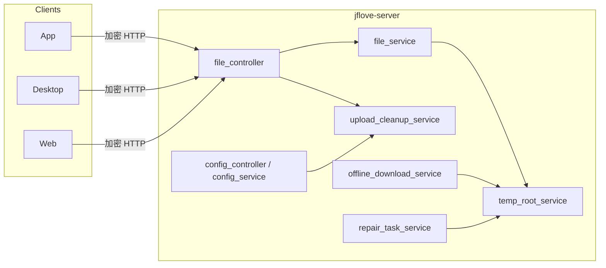

# JFLove v1.9.0 设计文档 —— 大文件断点续传、合并异步化、临时文件统一治理

> 版本：**1.9.0**｜阶段：Phase 2｜角色：designer
> 基线：`文档记录/需求文档/v1.9.0.md`（AC-321~AC-365，D24~D35）
> 影响模块：server / app / desktop / web
> 数据库：**无表结构变更**（`config` 既有键值表新增键，无需 DDL；不新建表）
> 发布约束：服务端 `complete` 强制异步，三端与服务端**同版本**升级（D27）

---

## 0. 设计摘要

1. 上传会话从「内存 dict」改为「临时目录内 `session.json` 持久化 + 启动恢复」，并以磁盘分片实际存在性重建已收分片。
2. `init` 增加内容指纹幂等复用；新增 `upload/status`；`complete` 改为「立即受理 + 后台线程合并 + progress 轮询」。
3. 合并走独立工作线程，配全局合并信号量（默认 1）、全局分片上传信号量（默认 2）、单分片 ≤1MB；客户端分片默认 512KB。
4. 下载接口支持 `range_start`，回归 v1 纯数据帧；响应头给出偏移/总大小/文件版本标识；三端客户端用本地 part 续传。
5. 临时文件统一：进程级 `build/tmp/`（上传分片）+ 磁盘级 `<磁盘根>/.jflove-tmp/`（offline / repair）；旧 `.jflove-download` / `.jflove-repair` 迁移。
6. `list` / `scan` / `journal` 过滤 `.` 开头条目；程序保留目录路径段禁止接口访问。
7. 清理策略全部走 `config` 键值；**TTL 单一来源**；按客户端类型过滤；只删「固定命名 + 允许根内」的文件。
8. 客户端：App/桌面/Web 统一「失败不删会话 + 分片级重试 + init 返回已收分片 + 异步轮询 + 下载 part/meta」。

---

## 1. 架构与模块划分



**单一真相**
- 上传会话元数据：`session.json`（服务端）为唯一真相；客户端本地记录只是**提示/兜底**，续传以服务端 `status/init` 返回为准。
- 临时目录命名：服务端 `src/config/settings.py` 常量唯一；离线下载/修复服务统一从该常量派生。
- 分片默认大小：三端各端常量，但必须一致为 **512KB**；服务端以 `max_chunk_size=1MB` 校验。
- 续传 TTL：`config` 键 `upload_resume_ttl_hours` 唯一；清理、`init/status/progress`、三端提示均读它。

---

## 2. 服务端设计

### 2.1 统一临时目录与常量

`jflove-server/src/config/settings.py` 新增/调整：

| 常量 | 值 | 说明 |
|---|---|---|
| `TEMP_ROOT` | `<BASE_DIR>/build/tmp` | 进程级统一临时根 |
| `UPLOAD_TEMP_DIR` | `<TEMP_ROOT>/upload` | 上传分片会话目录（从旧 `build/upload_tmp` 迁移） |
| `LEGACY_UPLOAD_TEMP_DIR` | `<BASE_DIR>/build/upload_tmp` | 旧路径，仅迁移/兼容用 |
| `TEMP_DIR_NAME` | `.jflove-tmp` | 磁盘级统一隐藏临时根 |
| `TEMP_OFFLINE_SUBDIR` | `offline` | 离线下载临时 |
| `TEMP_REPAIR_SUBDIR` | `repair` | 修复产物 |
| `OFFLINE_DIR_NAME` | `.jflove-download` | **保留常量名，语义 = 旧目录**（迁移/禁止访问） |
| `REPAIR_DIR_NAME` | `.jflove-repair` | 同上 |

**磁盘级布局**：

```text
<disk_root>/                  # 虚拟磁盘根
  ├── .jflove-tmp/            # 统一隐藏临时根（每磁盘根唯一）
  │   ├── offline/<task_id>/  # 离线下载临时（原 .jflove-download/<task_id>）
  │   └── repair/<task_id>/   # 修复产物（原 .jflove-repair 内产物）
  ├── 用户正常文件...
  └── 目标目录内 .<name>.jflove-upload-<upload_id>.part  # 合并临时（必须同目录，例外）
```

**迁移规则（`temp_root_service.migrate_legacy_dirs(db)`，lifespan 启动时执行一次）**：
1. 旧上传目录 `build/upload_tmp/*` → `build/tmp/upload/*`（逐 UUID 目录 `os.replace`；跨设备失败则逐文件复制后删除；失败保留旧目录并记 warning）。
2. 每磁盘根 `.jflove-download/<task_id>` → `.jflove-tmp/offline/<task_id>`；空父目录删除。
3. `.jflove-repair/*` → `.jflove-tmp/repair/<task_id>/`（任务记录 `id` 作为子目录；旧路径找不到新目录时，读取仍回退旧路径）。
4. 迁移幂等：目标已存在则跳过；只移动程序自产命名内容，不触碰其它文件。

**离线下载改造点**：
- `media_fetcher_service`：临时根由「`target_dir/.jflove-download/<task_id>`」改为「`disk_root/.jflove-tmp/offline/<task_id>`」；
  `cleanup_task_temp(target_dir, task_id)` 改为接收磁盘根；最终产物仍 `os.replace` 到目标目录（同一磁盘，跨目录 rename 原子）。
- `offline_download_service._cleanup_orphan_temps`：扫描 `disk_root/.jflove-tmp/offline`，按孤儿保留期清理。

**修复服务改造点**：
- 新任务产物写 `disk_root/.jflove-tmp/repair/<task_id>/`；
- `file_controller._resolve_repair_artifact` 先查新路径，找不到再回退旧路径（兼容迁移/旧任务）；
- 删除修复记录时清理对应 task_id 目录（新旧路径都尝试）。

### 2.2 上传会话持久化

`session.json`（位于 `UPLOAD_TEMP_DIR/<upload_id>/session.json`）：

| 字段 | 类型 | 说明 |
|---|---|---|
| `upload_id` | str | UUID |
| `owner_user_id` | int | 归属，权限校验 |
| `client_type` | str | `app` / `desktop` / `web` / `unknown` |
| `disk_id` | int | 目标磁盘 |
| `rel_path` | str | 目标目录（规范化，无前后 `/`） |
| `filename` | str | 纯文件名（`validate_filename` 校验过） |
| `file_size` | int | 字节 |
| `total_chunks` | int | 总分片数 |
| `file_hash` | str | 源文件 SHA256 |
| `mtime` | float \| null | 源 mtime |
| `created_at` | float | 创建时间 |
| `updated_at` | float | 最近活动（每 N 片 / 每 30s 回写） |
| `state` | str | `active` / `failed` / `merging`（重启后 `merging` 视为 `active`，由客户端重新 complete） |

- `received` **不落 JSON**：启动/恢复时扫描目录内 `^[0-9]{6}\.chunk$`、校验 `index < total_chunks` 与文件大小，重建集合。
- 恢复：`restore_upload_sessions()` 扫描 `UPLOAD_TEMP_DIR/*/session.json`，校验 UUID 目录名与字段完整性；`updated_at + ttl` 过期的不加载（留给清理）。
- 更新时机：`init` 写；每 `_SESSION_FLUSH_EVERY = 8` 片或距上次 30s 回写 `updated_at`；`complete` 成功/`cancel` 删除目录。
- 所有读写带锁（模块级 `_session_lock` 或按 upload_id），避免并发写坏 JSON。

### 2.3 内容指纹与 init 幂等

- 指纹 = `sha256(f"{owner_user_id}|{disk_id}|{rel_path}|{filename}|{file_size}|{file_hash}|{total_chunks}")`。
  实现补充：`total_chunks` 必须参与指纹 —— 不同客户端版本分片大小不同（1MB vs 512KB），
  复用旧会话会导致 `chunk_index` 越界（Web/桌面联调发现，已落实现）。
- `init` 流程：
  1. 权限/文件名/路径校验（沿用）；
  2. 计算指纹；内存索引中查未过期会话（启动恢复时重建索引）；
  3. 命中：校验分片目录存在；返回原 `upload_id`、`received_chunks`、`resumed=True`、`expires_at`、`max_chunk_size`、`recommended_concurrency`；
  4. 命中但 `state=failed`：返回**新会话**（旧失败分片不复用），`restart_required=True`；
  5. 未命中/已过期：新建 `upload_id` + 目录 + `session.json`；若旧过期目录仍在，先删除旧目录；
  6. `already_exists` 字段保留但恒为 false（**服务端不自动判定**）：同大小不代表同内容，
     是否跳过由客户端用远端索引/列表核验（桌面/Web/App 均已实现）。
- 同指纹并发 init：用进程内锁串行化，保证只创建一个会话。
- 会话上限：`upload_max_sessions_per_user`；同用户未完成会话数（`active`，不含已 `done`）达到上限 → 返回 409「未完成上传过多，请先完成或取消」。

### 2.4 状态查询

`POST /api/v1/files/upload/status`（加密 body）：

- 请求：`token`、`upload_id`；
- 归属：会话存在 → `owner_user_id` 必须匹配；会话不存在 → `exists=false`（不区分“不存在/别人的”，避免枚举探测）。
- 响应字段（完整）：

```json
{
  "exists": true,
  "state": "active",
  "upload_id": "uuid",
  "received_chunks": [0, 1, 2],
  "missing_chunks": [3, 4],
  "total_chunks": 6,
  "file_size": 1048576,
  "expires_at": 1760000000.0,
  "expired": false,
  "client_type": "app"
}
```

- 分片缺失（文件被清理/损坏）→ `received_chunks` 按磁盘实际存在过滤，缺失进 `missing_chunks`。

### 2.5 complete 异步化与合并

**请求**：`token`、`upload_id`、`async_mode: bool`（新客户端必传 `true`）。

- 旧客户端识别：`init` 时若缺 `client_type` → 返回 409「服务端已升级，请升级客户端」。
- `complete`：新客户端必须传 `async_mode=true`。**过渡兼容（仅 1.9.0 内保留，下一版移除）**：
  已通过 init 新协议校验、但 `complete` 未传 `async_mode` 的客户端仍走同步合并；
  原因是仓库内 v1.8.x 回归用例与部分旧调用仍依赖同步返回。旧客户端在 init 阶段即被 409 拒绝。
- 处理顺序：
  1. 会话存在且归属正确：
     - 若已有合并任务 → 返回当前状态（幂等）；
     - 否则登记 `queued`、创建后台任务，返回 `state=merging|queued`、`poll_interval_s=2.5`、`queue_position`；
  2. 会话不存在：查进度记录：
     - `done` → 返回 `state=done` + `path`；
     - `merging/queued` → 返回当前状态；
     - `failed` → 返回 `state=failed` + `error`（客户端决定全量重传）；
     - 无记录 → 400「上传会话不存在或已过期」。
- **合并后台任务**：
  - 全局信号量 `_merge_semaphore`（`upload_merge_concurrency`，默认 1；0 = 排队不执行，由清理循环定期唤醒）；
  - 获取许可前状态 `queued`；获取后 `merging`；
  - 合并体在 `asyncio.to_thread(_merge_worker, ...)`：
    ```
    逐片 open/read chunk -> write tmp_file -> sha256.update
    每 16 片更新进度（线程内 threading.Lock 保护 progress）
    结束后回主线程：os.utime(tmp_file) / _replace_with_retry(tmp_file, dest_file)
    ```
  - 失败：`state=failed`，`error` ∈ `missing_chunks` / `hash_mismatch` / `io_error`；`missing_chunks` 写入进度记录；会话保留（供补片），`state` 标记 `failed`（再次 init 不复用）。
  - 成功：删除会话目录；进度记录保留 `UPLOAD_PROGRESS_TTL_SECONDS`（默认 24h，与续传 TTL 同源）供迟到查询。
- **并发安全**：同一 upload_id 仍用 `_complete_locks`；重复 complete 不重复启动；合并任务字典 `_merge_tasks` 记录 task 引用。
- **进度**：`_merge_progress[upload_id]` 增加 `owner_user_id`、`queue_position`、`missing_chunks`、`path`、`error`。

### 2.6 progress

`POST /upload/progress`：
- 归属：会话存在 → 会话 owner；会话不存在但进度记录存在 → 进度记录 owner；都无 → 200 `{"state":"unknown"}`。
- 响应字段：

```json
{
  "state": "queued|merging|done|failed|unknown",
  "upload_id": "uuid",
  "processed": 0,
  "total": 0,
  "percent": 0,
  "file_size": 0,
  "elapsed_seconds": 0.0,
  "queue_position": 0,
  "path": "",
  "error": "",
  "missing_chunks": []
}
```

- 进度记录清理：`prune_merge_progress` 使用 TTL（默认 24h），不再 1h。

### 2.7 分片上传并发与大小限制

- 全局 `_chunk_semaphore`（`upload_chunk_concurrency`，默认 2；弱服务端）。
- 请求进入 `async with _chunk_semaphore`，等待超时 60s → 429「上传繁忙，请稍后重试」。
- 校验：`0 <= chunk_index < total_chunks`；`len(chunk_data) <= max_chunk_size`（1MB）且非空；超过 → 400。
- 客户端 `init` 响应带 `max_chunk_size`、`recommended_concurrency`。

### 2.8 下载 Range

`GET /api/v1/files/download`（加密 query/body，沿用现有 GET 信封）：

- 请求新增 `range_start: int = 0`（明文在加密体）。
- 校验：`0 <= range_start <= file_size`；越界 416。
- 响应：`StreamingResponse`，`X-Encrypted-Stream: v1`；新增头：
  - `X-Stream-Offset`：实际起始偏移（整数）
  - `X-Stream-Total`：文件总字节
  - `X-File-Version`：`f"{size}:{int(mtime)}"`（仅元数据，不含文件名/路径）
- 帧格式不变：`[4B len][12B nonce][密文+16B tag]`，每帧 ≤64KB 明文；新增 `_build_encrypted_range_stream(file_path, session_key, start, end)`（**纯数据帧，不带 v2 meta 帧**）。
- 服务端不保存任何下载临时文件（续传在客户端）。

### 2.9 隐藏项过滤与访问隔离

- `list_files`：过滤 `entry.name.startswith(".")`（所有隐藏项，不只旧目录）。
- `scan_tree` / `_collect_tree`：遍历时跳过 `.` 开头目录/文件；`journal` 不产生临时目录变更（无需额外过滤，但写入日志时跳过隐藏路径）。
- `_safe_join(base, rel, forbidden_parts=(REPAIR_DIR_NAME, OFFLINE_DIR_NAME, TEMP_DIR_NAME))`：
  所有文件管理接口（下载/预览/删除/移动/重命名/上传目标）统一禁止上述路径段。
- 用户自己的 `.` 文件：仍允许精确路径访问（`_safe_join` 不禁止任意 `.`），只是列表不展示。
- 新建/上传 `.` 开头文件名：服务端**允许**但控制器返回提示？产品 F50.3 要求界面提示。设计：服务端不拒绝；三端在用户提交 `.` 开头的名称时展示提示「隐藏文件，列表不显示」。客户端实现。

### 2.10 清理（`upload_cleanup_service`）

**配置键**（`src/config/settings.py` 常量 + 默认/边界）：

| key | 默认 | 边界 | 校验 |
|---|---|---|---|
| `upload_resume_ttl_hours` | `"24"` | 1~168 | int |
| `upload_cleanup_enabled` | `"1"` | 0/1 | enum |
| `upload_cleanup_interval_minutes` | `"60"` | 5~1440 | int |
| `upload_cleanup_client_types` | `""` | `app,desktop,web,unknown` 子集 | 逗号集 |
| `upload_orphan_ttl_hours` | `"24"` | 1~168 | int |
| `upload_max_sessions_per_user` | `"8"` | 1~64 | int |
| `upload_merge_concurrency` | `"1"` | 0~4 | int |
| `upload_chunk_concurrency` | `"2"` | 1~8 | int |

`upload_cleanup_service` 提供：
- `get_options(db)`：读取全部键（带默认值），返回 dataclass；
- `validate_config_value(key, value)`：供 `config_controller.update` 调用；
- `run_cleanup(db)`：执行一次清理，返回 `{removed_sessions, removed_dirs, removed_parts, skipped, executed_at}`；
- `refresh_limits(options)`：重建合并/分片信号量（配置变更后调用；`config_controller` 写入后触发）。

**清理算法**：
1. 读 options；`enabled=0` → 直接返回。
2. `ttl = upload_resume_ttl_hours * 3600`。
3. 内存会话：`now - updated_at >= ttl` 且 `client_type` 在允许清理集合（空集合 = 全部）→ 删除会话 + 目录。
4. 扫描 `UPLOAD_TEMP_DIR`：
   - 目录名必须匹配 UUID 正则；
   - 读取 `session.json`；无文件 → 按目录 `mtime` 判定（>= ttl）；
   - 有文件 → 按 `updated_at` 判定；类型过滤同上；目录内文件名必须全部为 `^\d{6}\.chunk$` 或 `session\.json`，否则跳过并 `skipped++`；
   - 真实路径必须在 `UPLOAD_TEMP_DIR` 内（`realpath` 校验），不跟随符号链接。
5. 磁盘级：枚举虚拟磁盘根：
   - `.jflove-download` / `.jflove-repair` 旧残留：仅按固定命名/任务子目录判定，`mtime >= orphan_ttl` 才删；否则跳过；
   - `.jflove-tmp/offline`：任务子目录 `mtime >= orphan_ttl` 且无活跃任务（由 offline service 提供活跃 task 集合；若拿不到则只按 orphan_ttl 保守判定）；
   - `.jflove-tmp/repair`：**默认不自动删除**（修复产物），仅在对应修复记录删除时清理；
   - `.jflove-tmp` 本身不删除（保留空根）。
6. `.part` 清理：遍历磁盘根，文件名严格匹配 `^\.<任意>\.jflove-upload-<UUID>\.part$`，`mtime >= orphan_ttl` 才删；否则保留。不删除其它 `.part`/普通文件。
7. 日志：只记数量/类型/跳过数，不记文件名/路径明文。

**启动首轮**：`main.py` lifespan 启动清理循环；首次立即执行 `run_cleanup`（**同一 TTL**，不再 1h）；间隔从 options 读取；每次循环重新读配置。

**旧上传目录迁移**：`temp_root_service` 在 lifespan 最先执行，迁移完成后再 `restore_upload_sessions`。

**立即清理接口**：`POST /api/v1/config/cleanup`（admin）→ 调 `run_cleanup`，返回统计；同时 `refresh_limits`。

### 2.11 配置接口

- `GET /api/v1/config`：返回现有配置 + `upload_cleanup_service.DEFAULTS` 缺省注入（参考 offline 做法）。
- `PUT /api/v1/config`：`key` 命中 upload 配置键时调 `upload_cleanup_service.validate_config_value`，保存后 `refresh_limits`。
- `POST /api/v1/config/cleanup`：新增，管理员 only，触发一次清理。

### 2.12 旧客户端识别

- `init` 请求缺 `client_type`（或值非法）→ 409「服务端已升级，请升级客户端后重试」。
- `complete` 请求 `async_mode` 不为 true → 409 同上。
- 三端 1.9.0 必须传 `client_type` 与 `async_mode=true`。

---

## 3. 客户端设计

### 3.1 共享协议常量

| 项 | 值 |
|---|---|
| 分片大小 | 512KB（可读 `init.max_chunk_size` 限制） |
| 上传并发 | 读 `init.recommended_concurrency`（App/桌面默认取 2；Web 1） |
| complete 轮询 | 2.5 秒 |
| 续传 TTL | 服务端 `expires_at` 展示；本地 part 7 天 |
| 下载 part 命名 | App：目标文件旁 `<name>.jflove-part` + `.jflove-part.json`；桌面：`<save>.part` + `<save>.jflove-part.json`；Web OPFS/IndexedDB（命名差异由各端本地实现，服务端不受影响） |

### 3.2 App

- 新增 `lib/services/transfer_resume_store.dart`：JSON（`getApplicationSupportDirectory`），
  `upload_<hash>.json` 记录 `upload_id/sent_chunks/file_hash/file_size/remote_dir/filename/expires_at`；
  `download_<hash>.json` 记录 `remote_size/version/offset`。
- `TransferService._doUpload`：
  - init 携带 `client_type:"app"`；读 `received_chunks` 跳过已传；`resumed` 提示；
  - 分片 512KB；单片失败指数退避 5 次；网络失败不删会话；用户取消才 `DELETE`；
  - complete `async_mode=true` 后轮询 progress（2.5s），`done` 收尾；`failed` 展示 error；
  - 失败/超时后用远端列表核验（`size == file_size`）判定完成，避免重传。
- `TransferService._doDownload`：
  - 目标文件旁 `.jflove-part` + meta；重试读 offset 并带 `range_start`；
  - 首次响应读取 `X-Stream-Total` / `X-File-Version`；meta 版本不一致 → 删除 part 从头；
  - 完成后校验大小、`rename`；失败保留 part；「放弃」删除。
- `http_service.dart`：
  - `encryptedDownloadStream` 增加 `rangeStart`；返回 `({Stream<Uint8List> stream, Map<String,String> headers, int statusCode})`（Dart record）；
  - 解析响应头需在 `ResponseType.stream` 返回后读取。
- 设置页（管理员）：新增「存储与临时文件」卡片：总开关、TTL、间隔、客户端类型多选、孤儿保留期、会话上限、合并并发、上传并发、立即清理。
- 传输页：显示「续传中 / 服务端合并中 / 已从 X% 继续」。

### 3.3 桌面端

- `file_service.upload_file`：
  - init 携带 `client_type:"desktop"`；以 `received_chunks` 为准（本地 resume 记录仅兜底）；
  - 分片 512KB；失败不 `_cancel_session`（仅用户取消）；complete `async_mode=true` + progress 轮询；
  - 合并失败/超时仍保留现有「远端大小核验」兜底。
- `utils/http_client.py`：
  - `download_to_file` 新增 `range_start` 参数与返回响应头；写 `.part` 时追加；meta JSON 记录 `version/size`；
  - 断点：启动读取 `.part` + meta，版本一致则续传；不一致删除重下；完成 `os.replace`；
  - 失败保留 `.part`（用户取消时按参数决定）。
- `file_service.download_file` 透传 `range_start` 与 meta 路径。
- 设置页（`ui/src/pages/settings`）：新增「存储与临时文件」卡片（管理员），调 config 与 cleanup。
- 分片常量 `CHUNK_SIZE` 改为 512KB（`jflove-desktop/src/config/settings.py`）。

### 3.4 Web

- `file-service.ts`：
  - 上传：init `client_type:"web"`；读 `received_chunks` 跳过；分片 512KB；失败不删会话；complete `async_mode=true` + 轮询 `upload/progress`（2.5s）。
  - 下载：`downloadRaw` 改为支持「分块存储 + 续传」：
    - 优先 `navigator.storage.getDirectory()`（OPFS）：保存 `chunks`（1MB 明文块）+ `meta.json`（version/size/offset）；
    - 不支持 OPFS → IndexedDB 同构存储；两者都不可用 → 回退整文件下载并提示「当前浏览器不支持断点续传」。
    - 刷新后读 meta/offset，请求 `range_start` 续传；完成后拼 Blob 导出并清理临时数据。
  - `http-client.ts`：`downloadStream` 支持 `range_start`（POST? 现有 GET query 信封，见实现）；暴露响应头。
- 系统设置页（管理员）：新增「存储与临时文件」卡片（字段同上）。
- 上传并发：默认 1（浏览器带宽/内存）。

### 3.5 三端设置页字段映射

| 字段 | config key | 类型 |
|---|---|---|
| 自动清理总开关 | `upload_cleanup_enabled` | bool（"1"/"0"） |
| 断点续传保障时长 | `upload_resume_ttl_hours` | int 1~168 |
| 自动清理间隔 | `upload_cleanup_interval_minutes` | int 5~1440 |
| 允许清理的客户端类型 | `upload_cleanup_client_types` | 多选 → "app,desktop" |
| 孤儿临时文件保留期 | `upload_orphan_ttl_hours` | int 1~168 |
| 每用户未完成会话上限 | `upload_max_sessions_per_user` | int 1~64 |
| 合并并发 | `upload_merge_concurrency` | int 0~4 |
| 上传分片并发 | `upload_chunk_concurrency` | int 1~8 |
| 弱服务端模式 | 一键写以上建议值 | — |
| 立即清理 | `POST /config/cleanup` | 返回统计 |

---

## 4. API 契约汇总

所有接口：明文白名单**否**；请求/响应走加密信封；GET 下载走 query 信封（Web 兼容）。
鉴权：token 在加密 body；JWT 只从 body 读取（§9.3）。

| 接口 | 方法 | 新增/变更 | 关键字段 | 错误 |
|---|---|---|---|---|
| `/api/v1/files/upload/init` | POST | 新增 `client_type`；响应扩展 | `upload_id, received_chunks, resumed, expires_at, max_chunk_size, recommended_concurrency, already_exists, restart_required` | 400/403/409/429 |
| `/api/v1/files/upload/status` | POST | 新增 | `exists, state, upload_id, received_chunks, missing_chunks, total_chunks, file_size, expires_at, expired, client_type` | 403 |
| `/api/v1/files/upload/complete` | POST | 异步化 | `state, upload_id, poll_interval_s, queue_position` | 400/403/409 |
| `/api/v1/files/upload/progress` | POST | 扩展 | `state, upload_id, processed, total, percent, file_size, elapsed_seconds, queue_position, path, error, missing_chunks` | 403 |
| `/api/v1/files/upload/{upload_id}` | DELETE | 不变 | — | 403 |
| `/api/v1/files/download` | GET | `range_start`；响应头 | `X-Encrypted-Stream:v1, X-Stream-Offset, X-Stream-Total, X-File-Version` | 403/404/416 |
| `/api/v1/files/list` | GET | 隐藏过滤 | `files` | 400/403 |
| `/api/v1/files/scan` | POST | 隐藏过滤 | `entries` | 400/403 |
| `/api/v1/config` | GET | 默认值注入 | `config` | 401/403 |
| `/api/v1/config` | PUT | 校验 + 刷新限流 | `message` | 400/401/403 |
| `/api/v1/config/cleanup` | POST | 新增 | `removed_sessions, removed_dirs, removed_parts, skipped, executed_at` | 401/403 |

**响应字段类型**：见 §2.2~§2.8；客户端不得依赖未列出的字段。

---

## 5. 数据库

- **无 DDL**：不新建表、不加列；仅 `config` 表新增键值（`config_service.update` upsert）。
- 发布前 `scripts/check_db_schema.py` 仍须退出码 0；无 `migrate-1.9.0.sql`。
- 记录类数据不变（离线下载/修复记录仍按账号隔离）。

---

## 6. 安全方案与逐接口标注

| 接口 | 归属校验 | 备注 |
|---|---|---|
| init | 登录用户 + 磁盘写权限（沿用） | 指纹含 owner，防跨用户复用 |
| status | 会话 owner；不存在统一 `exists=false` | 防枚举 |
| complete | 会话 owner；进度记录 owner 兜底 | 防换 ID |
| progress | 会话/进度记录 owner | 迟到查询不 403 |
| upload chunk/cancel | 沿用 `is_upload_owned_by` | — |
| download | 磁盘读权限（沿用） | 响应头不含文件名/路径 |
| list/scan | 磁盘读权限 | 隐藏过滤在服务端 |
| config GET/PUT/cleanup | admin only | JWT 从加密 body |

- 路径安全：`_safe_join` 增加程序保留目录段；清理使用 `realpath` 前缀 + 命名正则。
- 日志：不记录文件名 / 完整路径 / token / session_key。
- 加密原语：不新增；文件流仍用 `encrypt_stream_chunk` + `StreamingResponse`。
- Web 下载续传参数来自本地 OPFS/IndexedDB，不进入 URL 明文。

---

## 7. 关键决策与最终裁决

| 决策点 | 最终设计 | 原因 | 影响文件 |
|---|---|---|---|
| 会话存储 | **文件 `session.json`**，不建表 | 临时数据与分片共存亡、清理简单、无 DDL | `file_service.py`、`temp_root_service.py` |
| 已收分片 | **以磁盘文件为准**，不落 JSON | 防 JSON 与磁盘不一致导致「说有片其实没有」 | `file_service.py` |
| complete | **立即受理 + 后台线程 + progress** | 解决 120s 超时与事件循环阻塞 | `file_service.py`、`file_controller.py` |
| 合并并发 | **全局信号量默认 1**（0=暂停排队） | N2840/8GB 弱服务端防 CPU/IO 打满 | `file_service.py` |
| 分片并发 | 全局信号量默认 2 | 控制瞬时内存/线程池峰值 | `file_service.py` |
| 分片大小 | 客户端默认 512KB，服务端 ≤1MB | 降低单请求副本与弱 CPU 压力 | 三端 + settings |
| 统一临时根 | `.jflove-tmp`（磁盘级）+ `build/tmp`（进程级） | 用户目录整洁、清理单一入口 | `settings.py`、offline/repair 服务 |
| 合并 `.part` | 保留目标目录（原子替换例外） | 跨目录/跨卷 rename 破坏原子性 | `file_service.py` |
| 旧目录迁移 | 启动迁移 + 旧路径读取回退 | 兼容旧任务，失败不阻塞 | `temp_root_service.py`、`file_controller.py` |
| 隐藏过滤 | 服务端过滤所有 `.` 开头；程序目录禁止访问 | 三端一致、少改动 | `file_service.py`、`path_safety` |
| 清理 TTL | 单一 config 键（24h 默认） | 与续传期限一致 | `upload_cleanup_service.py` |
| 客户端续传 | 服务端状态为准 + 本地记录兜底 | 跨设备/重装仍可续 | 三端 |
| 旧同步 complete | **不保留** | D27/F54 | 全端 |
| Web 续传 | OPFS 优先，IndexedDB 兜底，否则提示 | 浏览器兼容 | `web-frontend` |

---

## 8. 测试设计（AC 映射）

| AC | 测试层 | 用例/证据 |
|---|---|---|
| AC-321/322/323/324/325/326 | server pytest | `test_upload_resume_v1_9_0.py`：指纹复用、恢复、缺片、过期、分片重试（mock） |
| AC-327~AC-331 | server pytest + 实机 | `test_upload_async_complete_v1_9_0.py`：异步受理、progress 状态、缺片、旧客户端 409 |
| AC-332~AC-337 | server + 三端单测 | `test_download_range_v1_9_0.py`；App/桌面/Web 续传用例 |
| AC-338~AC-343 | server pytest | `test_temp_layout_v1_9_0.py`：统一根、迁移、隐藏过滤、路径拒绝 |
| AC-344~AC-350 | server pytest | `test_upload_cleanup_v1_9_0.py`：TTL/类型/启动/安全/统计 |
| AC-351~AC-353 | 三端 UI 单测 + 实机 | 设置页渲染、保存、立即清理 |
| AC-354~AC-358 | 门禁 | `sync_version` / `check_db_schema` / `check_verification_report` |
| AC-359~AC-365 | 实机 + server pytest | 合并期间播放录像、并发合并、RSS 采样、分片大小、弱服务端模式 |

**安全用例（必须）**：换 upload_id 403；status 枚举不存在返回 false；路径段 `.jflove-tmp` 下载/删除 403；清理放正常文件不删；清理放非 UUID 目录不删；`init` 跨用户指纹不命中。

---

## 9. 与 v1.8.4 的设计差异

| 维度 | v1.8.4 | v1.9.0 |
|---|---|---|
| 上传会话 | 内存 dict；重启丢失 | `session.json` + 启动恢复 |
| init | 每次新会话 | 指纹幂等复用 + 已收分片 |
| complete | 同步请求内合并 | 异步受理 + 后台线程 + 排队 |
| 合并并发 | 无限制 | 全局信号量（默认 1） |
| 分片 | 1MB、无大小校验 | 512KB 客户端 + ≤1MB 服务端校验 + 并发信号量 |
| 下载 | 无 Range | `range_start` + 版本标识 + 三端 part 续传 |
| 临时目录 | 分散 | 统一根 + 迁移 |
| 隐藏项 | 只过滤 `.jflove-repair` | 所有 `.` 开头过滤 + 程序目录禁访问 |
| 清理 | 硬编码 24h / 启动 1h | config 配置 + TTL 单一来源 + 类型过滤 |
| 兼容 | 同步 complete | 强制异步；旧客户端 409 提示升级 |

---

## 10. 风险与遗留

- 迁移 `.jflove-repair` 产物涉及修复任务的产物读取；旧任务用旧路径回退，新增测试覆盖。
- 合并并发 0（暂停）需要清理循环唤醒排队任务，避免永久排队。
- Web OPFS 在部分浏览器/隐私模式不可用；必须回退并提示。
- 三端同版本发布；发布/UAT 记录必须写明。
- 实机性能判据（AC-359）需要弱服务端或人为限流环境；若本机性能过强，用 `stress`/并发限制模拟弱服务端。
</content>
